# vitis-pangenome

[中文](README.zh.md)

This repository provides *Vitis* pangenome graphs, presence/absence variation, and mixed-variant / dosage methods.

It contains no unpublished genotypes or private sample matrices.

## Out of scope

- TE library curation: [vitis-te](https://github.com/Xuzhen-Li/vitis-te)
- Plastid-only: [grapevine-plastid](https://github.com/Xuzhen-Li/grapevine-plastid)
- Gene models (coordinates, GFF3, proteins): [gene-structure-annotation](https://github.com/Xuzhen-Li/gene-structure-annotation)
- GO / KEGG / readable names / domains: [gene-function-annotation](https://github.com/Xuzhen-Li/gene-function-annotation)

This repository covers pangenome graphs, presence/absence variation, and genotyping of sites already in the graph. Giraffe + `vg call` and PanGenie genotype variant sites already in the graph; they do not add new alleles.

## Methods catalog

This page lists, by task, the 371 methods, tools, and analyses from the 2026-11 survey and the 2026-11-14 update (tool 260, analysis 74, idea 24, resource 12, format 1); 87 were added on 2026-11-13 and 39 on 2026-11-14, and none of these has a details row in `docs/` yet. On 2026-11-14, 7 entries were merged into another entry: six older versions into the latest version, and cactus-pangenome into Minigraph-Cactus. The default analysis pipeline is still the pipeline scripts at the foot of the page; the catalog does not change that pipeline. The full tables and errata are in the detailed files under `docs/`.

**2026-11-14 update.** Each section now opens with a **Clusters:** list. It groups the entries as alternatives (pick one), complementary (use together) or in order (run in sequence), with a note on when to pick which. Inside a list, “A or B” means pick one of the two and “A → B” is one fixed route. Different versions of one program are now one entry named for the latest version; older versions are only mentioned in that entry's note. A workflow chart with tool choices and decision points is in [`docs/CATALOG.md`](docs/CATALOG.md#workflow-2026-11-14).

## Contents

1. [Upstream inputs: phased assemblies](#section-1) (18)
2. [Graph construction](#section-2) (23)
3. [Assembly and graph QC before genotyping](#section-3) (25)
4. [Variant discovery: sequence PAV, structural variants and TE insertions](#section-4) (35)
5. [Cohort genotyping and read-to-graph mapping](#section-5) (32)
6. [Synteny, alignment and comparative maps](#section-6) (15)
7. [Graph-aware gene presence and family copy-number](#section-7) (26)
8. [Graph analysis, indexing and formats](#section-8) (22)
9. [Visualization](#section-9) (26)
10. [Expression, QTL and pangenome-GWAS](#section-10) (39)
11. [Evolution, ancestry and introgression](#section-11) (27)
12. [Vitis pangenome studies and public resources](#section-12) (30)
13. [Workflows and pipelines](#section-13) (8)
14. [Ideas still untested on Vitis](#section-14) (21)
15. [Peer plant pangenome studies and reviews](#section-15) (24)

- [Data needed alongside the pangenome](#data-needs)
- [Figure credits](#figure-credits)

How the sections line up with the scripts in this repo: build the graph (01–05, 12–13) → QC the graph (16) → genotype the cohort (08 sketch, 14, 15) → classify and post-process variants (07, 09) → check synteny (10). Script numbers are file names, not the order of steps.

<a id="section-1"></a>
## 1. Upstream inputs: phased assemblies

Tools for de novo haplotype-resolved assembly, purging duplicates, and scaffolding prior to graph building, such as hifiasm, Verkko, and purge_dups.

**Needs:** long reads for haplotype assemblies (HiFi and/or ONT); add Hi-C or genetic/optical maps only if contigs must be ordered into chromosomes. [Data needs by scenario](#data-needs)

**Clusters:**
- *Haplotype assembly* (alternatives): hifiasm, Verkko, Flye, NextDenovo. Use hifiasm for HiFi (default, trio or Hi-C phasing); Verkko with ultra-long ONT for T2T; Flye or NextDenovo only for ONT-only data.
- *Phasing aids* (alternatives): Hi-C phasing with GreenHill, PhaseGrass, NOHIC. Use only when trio data are missing; check switch errors afterwards.
- *Haplotig purging* (alternatives): purge_dups, Purge Haplotigs. For collapsed primary assemblies only; never run on already phased haplotypes.
- *Scaffolding* (in order): YaHS or HapHiC or ALLHiC or 3D-DNA or ALLMAPS or RagTag, Juicebox Assembly Tools (JBAT). Automatic scaffolding first: YaHS or HapHiC (allele-aware) with Hi-C, ALLMAPS with genetic maps, RagTag only against a close reference; then review by hand in JBAT.
- *Gaps and telomeres* (complementary): quarTeT, GCI. Confirm gap count and telomere ends before PanSN renaming.

- **hifiasm** (tool) — Assembles HiFi reads into phased haplotype contigs, with trio or Hi-C phasing modes. Grapevine cultivars are highly heterozygous clones, so two phased haplotypes per accession are the natural input for a graph. [doi:10.1038/s41592-020-01056-5](https://doi.org/10.1038/s41592-020-01056-5) · [link](https://github.com/chhylp123/hifiasm) · [details](docs/PANGENOME_CATALOG.md#L40)
- **Verkko** (tool) — Combines HiFi and ultra-long ONT reads into telomere-to-telomere haplotype assemblies. Fills centromeres and long repeats so graph paths are not broken at gaps, as in T2T grape assemblies. [doi:10.1038/s41587-023-01662-6](https://doi.org/10.1038/s41587-023-01662-6) · [link](https://github.com/marbl/verkko) · [details](docs/PANGENOME_CATALOG.md#L41)
- **quarTeT** (tool) — Toolkit for gap filling, telomere and centromere-repeat identification in T2T assembly. Developed in a horticulture setting; quick check of telomere/centromere completeness before graph input. [doi:10.1093/hr/uhad127](https://doi.org/10.1093/hr/uhad127) · [link](https://github.com/aaranyue/quarTeT) · [details](docs/PANGENOME_CATALOG.md#L42)
- **purge_dups** (tool) — Removes haplotigs and overlaps from primary assemblies using read depth. Avoids false duplications that later look like copy-number or PAV signals in the graph. [doi:10.1093/bioinformatics/btaa025](https://doi.org/10.1093/bioinformatics/btaa025) · [link](https://github.com/dfguan/purge_dups) · [details](docs/PANGENOME_CATALOG.md#L43)
- **NOHIC** (tool) — Scaffolds plant contigs against personalized references sampled from a pangenome graph instead of Hi-C. [preprint] Could scaffold new Vitis accessions cheaply once a grape graph exists. [待确认: code URL not checked] [doi:10.64898/2026.03.17.712436](https://doi.org/10.64898/2026.03.17.712436) · [details](docs/PANGENOME_CATALOG.md#L44)
- **GCI** (tool) — Genome Continuity Inspector scoring T2T assemblies from read alignments. Distinguish true T2T grape haplotypes from gap-filled ones before graph building. [doi:10.1093/bioinformatics/btae633](https://doi.org/10.1093/bioinformatics/btae633) · [link](https://github.com/yeeus/GCI) · [details](docs/PANGENOME_CATALOG_SUPPLEMENT_1.md#vs001)
- **RagTag** (tool) — Reference-guided scaffolding, patching and correction. Bring older contig-level Vitis assemblies to chromosome scale for PanSN per-chromosome graphs. [doi:10.1186/s13059-022-02823-7](https://doi.org/10.1186/s13059-022-02823-7) · [link](https://github.com/malonge/RagTag) · [details](docs/PANGENOME_CATALOG_SUPPLEMENT_1.md#vs002)
- **Hi-C phasing with GreenHill** (tool) — Hi-C based scaffolding and phasing of haplotypes. Option for phasing grapes without parental data. [doi:10.1186/s13059-023-03006-8](https://doi.org/10.1186/s13059-023-03006-8) · [link](https://github.com/ShunOuchi/GreenHill) · [details](docs/PANGENOME_CATALOG_SUPPLEMENT_1.md#vs003)
- **PhaseGrass** (tool) — Reference-based phasing workflow producing chromosome-level haplotype-resolved diploid assemblies. Phasing strategy for highly heterozygous outcrossing genomes like grape cultivars. [doi:10.1038/s41467-025-66377-5](https://doi.org/10.1038/s41467-025-66377-5) · [link](https://github.com/Yutang-ETH/PhaseGrass) · [details](docs/PANGENOME_CATALOG_SUPPLEMENT_1.md#vs004)
- **Flye** (tool) — Long-read assembler built on repeat graphs; works with ONT and PacBio reads. A common ONT-only assembler for grape accessions without HiFi data. [doi:10.1038/s41587-019-0072-8](https://doi.org/10.1038/s41587-019-0072-8) · [link](https://github.com/mikolmogorov/Flye)
- **NextDenovo** (tool) — Corrects and assembles noisy long reads (ONT/CLR) with low memory. Used in several Chinese grape and Vitis wild-species assemblies built from ONT reads. [doi:10.1186/s13059-024-03252-4](https://doi.org/10.1186/s13059-024-03252-4) · [link](https://github.com/Nextomics/NextDenovo)

  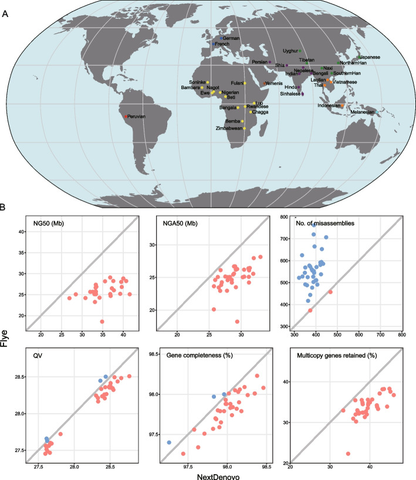

  <sub>**NextDenovo**: Assembly statistics for 35 human genomes assembled with NextDenovo vs Flye (Fig. 2). Data: human (non-grape data). Source: Hu et al. 2024, Genome Biology, Fig. 2 ([doi:10.1186/s13059-024-03252-4](https://doi.org/10.1186/s13059-024-03252-4)), CC BY.</sub>
- **YaHS** (tool) — Hi-C scaffolder that orders and orients contigs into chromosomes. Fast chromosome scaffolding for each grape haplotype before graph building. [doi:10.1093/bioinformatics/btac808](https://doi.org/10.1093/bioinformatics/btac808) · [link](https://github.com/c-zhou/yahs)
- **HapHiC** (tool) — Hi-C scaffolding of haplotype-resolved assemblies without a reference genome. Fits heterozygous grape and hybrid rootstocks where two haplotypes must be scaffolded separately. [doi:10.1038/s41477-024-01755-3](https://doi.org/10.1038/s41477-024-01755-3) · [link](https://github.com/zengxiaofei/HapHiC)
- **ALLHiC** (tool) — Allele-aware Hi-C scaffolding for polyploid and highly heterozygous genomes. Option for polyploid Vitis or Muscadinia material and older grape assemblies. [doi:10.1038/s41477-019-0487-8](https://doi.org/10.1038/s41477-019-0487-8) · [link](https://github.com/tangerzhang/ALLHiC)
- **3D-DNA** (tool) — Hi-C based scaffolding and misjoin correction, reviewed in Juicebox. Widely used for manual curation of grape chromosome assemblies. [doi:10.1126/science.aal3327](https://doi.org/10.1126/science.aal3327) · [link](https://github.com/aidenlab/3d-dna)
- **ALLMAPS** (tool) — Orders scaffolds using genetic, optical or synteny maps together. Grape has dense genetic maps; ALLMAPS can check or fix chromosome order. [doi:10.1186/s13059-014-0573-1](https://doi.org/10.1186/s13059-014-0573-1) · [link](https://github.com/tanghaibao/jcvi)
- **Purge Haplotigs** (tool) — Reassigns allelic contigs from a primary assembly using read depth and synteny. An alternative to purge_dups; its paper used a grape (Cabernet Sauvignon) assembly as a test case [待确认: wording]. [doi:10.1186/s12859-018-2485-7](https://doi.org/10.1186/s12859-018-2485-7) · [link](https://bitbucket.org/mroachawri/purge_haplotigs)
- **Juicebox Assembly Tools (JBAT)** (tool) — Interactive Hi-C contact-map editor for fixing misjoins and orientation after automated scaffolding. Used for manual review of grape chromosomes before PanSN naming. [preprint] [doi:10.1101/254797](https://doi.org/10.1101/254797) · [link](https://github.com/aidenlab/Juicebox)

<a id="section-2"></a>
## 2. Graph construction

Methods and naming specifications for building and partitioning pangenome variation graphs and compacted de Bruijn graphs, including PGGB, Minigraph-Cactus, and PanSN-spec.

**Needs:** chromosome-named haplotype FASTAs (PanSN). Population reads are not required to build the graph. For already-phased haplotypes, check false duplication (BUSCO Duplicated, Merqury) and run purge_dups only if haplotigs remain. [Data needs by scenario](#data-needs)

**Clusters:**
- *Graph builders (pick by goal)* (alternatives): PGGB, Minigraph-Cactus, minigraph. PGGB for an unbiased all-to-all graph (discovery); Minigraph-Cactus for a reference-anchored, Giraffe-ready graph; minigraph for a lightweight SV backbone. This repo retains both PGGB and MC (dual graph).
- *PGGB main chain* (in order): wfmash, seqwish, smoothxg, GFAffix. The steps PGGB runs in order.
- *POA engines inside smoothxg* (alternatives): abPOA, SPOA. smoothxg uses one of them internally.
- *Alignment and implicit-graph helpers* (complementary): SweepGA, impg. Not steps of the PGGB chain: SweepGA filters whole-genome alignments; impg queries the implicit graph built from alignments.
- *Whole-genome aligners* (alternatives): Progressive Cactus, SibeliaZ, pgr-tk, AlfaPang. Alternatives for multi-genome alignment outside the default path.
- *k-mer and de Bruijn graphs* (alternatives): Bifrost, GGCAT, Cuttlefish 2, TwoPaCo, rust-mdbg. Fast colored k-mer graphs for sequence PAV, not for SV genotyping.
- *Conventions* (complementary): PanSN-spec, Chromosome-level graph partitioning, Pangenome graph construction review (Plant). PanSN names and per-chromosome builds are required inputs.

- **PGGB** (tool) — Builds an unbiased variation graph from all-to-all alignments (wfmash → seqwish → smoothxg → GFAffix). Already the discovery graph in this repo (scripts 04–05); Grapepan v1.0 also used PGGB. [doi:10.1038/s41592-024-02430-3](https://doi.org/10.1038/s41592-024-02430-3) · [link](https://github.com/pangenome/pggb) · [details](docs/PANGENOME_CATALOG.md#L54)

  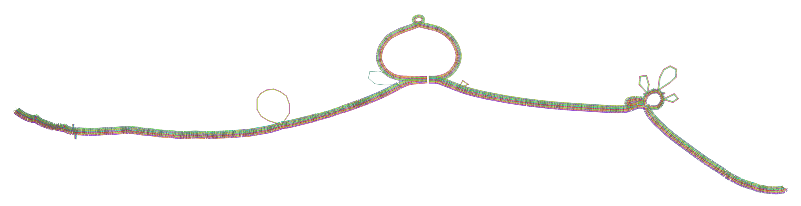

  <sub>**PGGB**: odgi draw 2D layout of a PGGB graph built from the DRB1-3123 test set (12 human HLA-DRB1 haplotype sequences). Data: human (non-grape data). Source: repository [pangenome/pggb](https://github.com/pangenome/pggb/blob/4225c6ce010553ef353c5ea13805e38c2016b503/docs/img/DRB1-3123.fa.gz.pggb-E-s5000-l15000-p80-n10-a0-K16-k8-w50000-j5000-e5000-I0-R0-N.smooth.chop.og.lay.draw_mqc.png), MIT.</sub>
- **Minigraph-Cactus** (tool) — Reference-anchored base-level pangenome graph built from a minigraph SV backbone and Cactus alignments, with vg/Giraffe indexes. Produces Giraffe-ready graphs; used by Grapepan v1.0 and the cultivated grapevine G3 2026 graph. It runs as one command with the cactus-pangenome workflow (GBZ, VCF and indexes; the target of script 12). [doi:10.1038/s41587-023-01793-w](https://doi.org/10.1038/s41587-023-01793-w) · [link](https://github.com/ComparativeGenomicsToolkit/cactus) · [details](docs/PANGENOME_CATALOG.md#L55)

  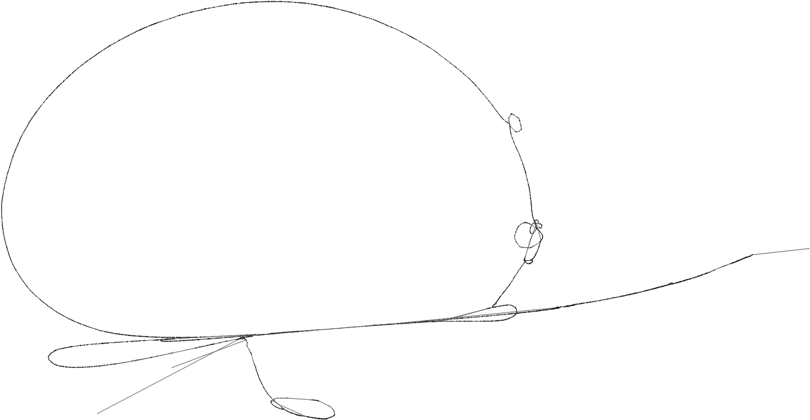

  <sub>**Minigraph-Cactus**: odgi draw layout of chromosome I from the Minigraph-Cactus yeast pangenome tutorial graph (real S. cerevisiae assemblies). Data: yeast, S. cerevisiae (non-grape data). Source: repository [ComparativeGenomicsToolkit/cactus](https://github.com/ComparativeGenomicsToolkit/cactus/blob/1abe7c3e822d58d6c274c51738cbeb927614d747/doc/yeast-pg-chrI.full.draw.png), MIT.</sub>
- **minigraph** (tool) — Incrementally builds an SV-level rGFA graph from assemblies and maps sequences to it. Fast SV-only graph for large Vitis panels; script 13 already uses it per chromosome. [doi:10.1186/s13059-020-02168-z](https://doi.org/10.1186/s13059-020-02168-z) · [link](https://github.com/lh3/minigraph) · [details](docs/PANGENOME_CATALOG.md#L56)
- **wfmash** (tool) — Whole-genome all-to-all aligner based on mashmap segments and wavefront alignment; the alignment step of PGGB. Parameter -p (identity) controls how divergent wild Vitis species can be joined in one graph. [link](https://github.com/waveygang/wfmash) · [details](docs/PANGENOME_CATALOG.md#L57)
- **seqwish** (tool) — Induces a variation graph from pairwise alignments by transitive closure of matches. Core of PGGB; understanding it explains graph complexity at grape repeat loci. [link](https://github.com/pangenome/seqwish) · [details](docs/PANGENOME_CATALOG.md#L58)
- **smoothxg** (tool) — Locally re-aligns (POA) and normalizes the seqwish graph to remove alignment noise. Reduces spurious small bubbles before calling variants from Vitis graphs. [link](https://github.com/pangenome/smoothxg) · [details](docs/PANGENOME_CATALOG.md#L59)
- **GFAffix** (tool) — Collapses walk-preserving shared affixes in variation graphs. Final PGGB normalization step; makes graphs smaller and variant decomposition cleaner. [link](https://github.com/codialab/GFAffix) · [details](docs/PANGENOME_CATALOG.md#L60)
- **impg** (tool) — Treats all-vs-all alignments as an implicit pangenome graph to project and extract homologous loci without building a full graph. Lets one study a single grape locus (e.g. sex or berry-colour region) across many haplotypes cheaply. [link](https://github.com/pangenome/impg) · [details](docs/PANGENOME_CATALOG.md#L61)
- **AlfaPang** (tool) — Alignment-free construction of variation graphs as a faster replacement for the first PGGB steps. Possible cost saving when the Vitis panel grows to hundreds of haplotypes. [doi:10.1186/s13015-025-00277-7](https://doi.org/10.1186/s13015-025-00277-7) · [link](https://github.com/AdamCicherski/AlfaPang) · [details](docs/PANGENOME_CATALOG.md#L62)
- **Progressive Cactus** (tool) — Reference-free multiple genome aligner for many genomes. Genus-level alignments across Vitis / Muscadinia where pangenome graphs become too divergent. [doi:10.1038/s41586-020-2871-y](https://doi.org/10.1038/s41586-020-2871-y) · [link](https://github.com/ComparativeGenomicsToolkit/cactus) · [details](docs/PANGENOME_CATALOG.md#L63)
- **pgr-tk** (tool) — Builds minimizer-anchored sequence graphs (MAP graphs) and principal bundles for locus-level pangenome analysis. Good for repeat-rich resistance-gene clusters (e.g. NLR loci) across grape haplotypes. [doi:10.1038/s41592-023-01914-y](https://doi.org/10.1038/s41592-023-01914-y) · [link](https://github.com/cschin/pgr-tk) · [details](docs/PANGENOME_CATALOG.md#L64)
- **Bifrost** (tool) — Builds and queries colored compacted de Bruijn graphs for many genomes. Alignment-free, k-mer graph view of Vitis panels for k-mer GWAS or presence queries. [doi:10.1186/s13059-020-02135-8](https://doi.org/10.1186/s13059-020-02135-8) · [link](https://github.com/pmelsted/bifrost) · [details](docs/PANGENOME_CATALOG.md#L65)
- **GGCAT** (tool) — Fast construction of compacted and colored de Bruijn graphs. Scales k-mer graphs to large resequencing panels. [doi:10.1101/gr.277615.122](https://doi.org/10.1101/gr.277615.122) · [link](https://github.com/algbio/ggcat) · [details](docs/PANGENOME_CATALOG.md#L66)
- **Cuttlefish 2** (tool) — Constructs compacted de Bruijn graphs from many references with low memory. Cheap alternative graph representation for k-mer–based association. [doi:10.1186/s13059-022-02743-6](https://doi.org/10.1186/s13059-022-02743-6) · [link](https://github.com/COMBINE-lab/cuttlefish) · [details](docs/PANGENOME_CATALOG.md#L67)
- **Pangenome graph construction review (Plant)** (analysis) — Review of plant graph pangenome construction, mapping and genotyping tools and their limits. Up-to-date plant-specific map of the method landscape. [doi:10.1007/s42994-025-00206-7](https://doi.org/10.1007/s42994-025-00206-7) · [details](docs/PANGENOME_CATALOG.md#L68)
- **PanSN-spec** (idea) — Naming convention sample#haplotype#contig for sequences in pangenomes. Script 01 already applies it; keeps Vitis haplotypes traceable across all tools. [link](https://github.com/pangenome/PanSN-spec) · [details](docs/PANGENOME_CATALOG.md#L69)
- **Chromosome-level graph partitioning** (idea) — Build one graph per chromosome or per mash community to bound memory and runtime. Grape has 19 chromosomes with conserved collinearity, so per-chromosome graphs are natural. [doi:10.1093/bioinformatics/btae609](https://doi.org/10.1093/bioinformatics/btae609) · [link](https://github.com/nf-core/pangenome) · [details](docs/PANGENOME_CATALOG.md#L70)
- **SweepGA** (tool) — All-vs-all genome alignment with plane-sweep filtering and scaffold chaining (FastGA/wfmash). (year = repo created; no paper checked) Removes TE-driven spurious cross-chromosome alignments, a known grape problem. [link](https://github.com/pangenome/sweepga) · [details](docs/PANGENOME_CATALOG_SUPPLEMENT_1.md#vs005)
- **SibeliaZ** (tool) — Locally collinear blocks across many closely related genomes. Synteny-block view of grape haplotypes; SibeliaZ does not build a pangenome graph (a graph-free alternative, closer in spirit to section 6). [doi:10.1038/s41467-020-19777-8](https://doi.org/10.1038/s41467-020-19777-8) · [link](https://github.com/medvedevgroup/SibeliaZ) · [details](docs/PANGENOME_CATALOG_SUPPLEMENT_1.md#vs006)
- **abPOA** (tool) — Fast partial-order alignment library with adaptive banding. Used inside smoothxg to normalise PGGB graphs; useful to know when tuning PGGB on grape. [doi:10.1093/bioinformatics/btaa963](https://doi.org/10.1093/bioinformatics/btaa963) · [link](https://github.com/yangao07/abPOA)
- **SPOA** (tool) — SIMD partial-order alignment library; the other POA engine smoothxg can use. Same role as abPOA in PGGB smoothing of grape graphs. [doi:10.1101/gr.214270.116](https://doi.org/10.1101/gr.214270.116) · [link](https://github.com/rvaser/spoa)
- **TwoPaCo** (tool) — Builds a compacted de Bruijn graph from many complete genomes. Alignment-free graph of all grape haplotypes for k-mer level comparison. [doi:10.1093/bioinformatics/btw609](https://doi.org/10.1093/bioinformatics/btw609) · [link](https://github.com/medvedevgroup/TwoPaCo)
- **rust-mdbg** (tool) — Minimizer-space de Bruijn graph; very fast assembly and graph building. Quick exploratory graph of many grape assemblies on a laptop-scale machine. [doi:10.1016/j.cels.2021.08.009](https://doi.org/10.1016/j.cels.2021.08.009) · [link](https://github.com/ekimb/rust-mdbg)

<a id="section-3"></a>
## 3. Assembly and graph QC before genotyping

Evaluation tools and benchmarks for checking assembly completeness, base accuracy, and graph topology before downstream genotyping, such as Merqury, Inspector, and Truvari.

**Needs:** the assemblies or graph, plus the assembly reads when checking k-mers or base accuracy. [Data needs by scenario](#data-needs)

**Clusters:**
- *Assembly accuracy* (complementary): Merqury, Merfin, CRAQ, Inspector, Flagger, QUAST, gfastats. Merqury QV per haplotype; Merfin after polishing; Flagger or CRAQ to mask unreliable blocks before graph building.
- *Completeness* (complementary): BUSCO, compleasm, OMArk, LAI, tidk. compleasm as a fast BUSCO alternative; LAI for repeats; tidk for telomeres.
- *Reads and contamination* (complementary): GenomeScope 2.0, Smudgeplot, KAT, BlobToolKit, skani. Ploidy and heterozygosity from reads; skani to catch swapped or mislabelled assemblies.
- *Graph QC and benchmarks* (complementary): odgi stats / validate, gfatools, gretl, Truvari, vcfdist, Leave-one-out haplotype benchmark, Crop graph evaluation framework, Human graph method comparison. Script 16 runs odgi + panacus; Truvari or vcfdist compares graph VCFs; leave-one-out tests genotyping accuracy.

- **Merqury** (tool) — Reference-free k-mer QV, completeness and phasing assessment of assemblies. Run on every haplotype before it enters the graph. [doi:10.1186/s13059-020-02134-9](https://doi.org/10.1186/s13059-020-02134-9) · [link](https://github.com/marbl/merqury) · [details](docs/PANGENOME_CATALOG.md#L80)

  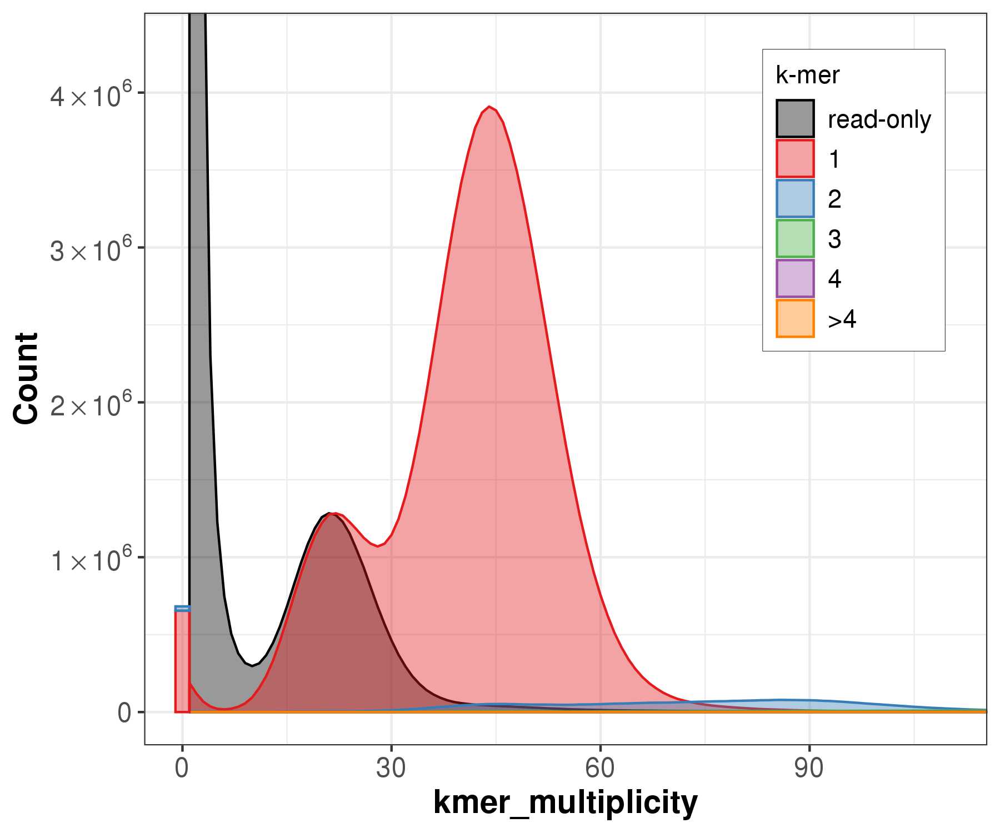

  <sub>**Merqury**: Merqury copy-number spectrum of the TrioCanu CLR Col-0 haplotype assembly of an Arabidopsis thaliana Col-0 x Cvi-0 F1. Data: Arabidopsis thaliana (non-grape data). Source: repository [marbl/merqury](https://github.com/marbl/merqury/blob/88f37c0f4dbb073001d194bcc5d5989a0b0527df/example/triocanu_clr.col.spectra-cn.fl.png), public domain (US Government work, NHGRI).</sub>
- **BUSCO** (tool) — Assesses gene-space completeness using single-copy orthologs. Standard QC gate for each Vitis haplotype (Grapepan reported ~98%). Lineage datasets now come from OrthoDB v12 (2024 update, doi:10.1093/nar/gkae987). [doi:10.1093/molbev/msab199](https://doi.org/10.1093/molbev/msab199) · [link](https://busco.ezlab.org/) · [details](docs/PANGENOME_CATALOG.md#L81)
- **compleasm** (tool) — Faster, miniprot-based BUSCO-style completeness estimate. Quick re-check for dozens of grape haplotypes. [doi:10.1093/bioinformatics/btad595](https://doi.org/10.1093/bioinformatics/btad595) · [link](https://github.com/huangnengCSU/compleasm) · [details](docs/PANGENOME_CATALOG.md#L82)
- **LAI** (tool) — LTR Assembly Index measures repeat-space contiguity. Grape genomes are ~55–59% TE; LAI flags weak repeat assembly before graph build. [doi:10.1093/nar/gky730](https://doi.org/10.1093/nar/gky730) · [link](https://github.com/oushujun/LTR_retriever) · [details](docs/PANGENOME_CATALOG.md#L83)
- **Inspector** (tool) — Read-based assembly error detection and correction. Finds structural misassemblies that would masquerade as graph SVs. [doi:10.1186/s13059-021-02527-4](https://doi.org/10.1186/s13059-021-02527-4) · [link](https://github.com/Maggi-Chen/Inspector) · [details](docs/PANGENOME_CATALOG.md#L84)
- **CRAQ** (tool) — Pinpoints regional and structural assembly errors from clipped read alignments. Separates real Vitis SVs from assembly errors at single-nucleotide resolution. [doi:10.1038/s41467-023-42336-w](https://doi.org/10.1038/s41467-023-42336-w) · [link](https://github.com/JiaoLaboratory/CRAQ) · [details](docs/PANGENOME_CATALOG.md#L85)
- **Flagger** (tool) — Read-coverage-based flagging of erroneous, duplicated or collapsed blocks in diploid assemblies (HPRC). Masks unreliable blocks in phased grape haplotypes before graph construction. [doi:10.1038/s41586-023-05896-x](https://doi.org/10.1038/s41586-023-05896-x) · [link](https://github.com/mobinasri/flagger) · [details](docs/PANGENOME_CATALOG.md#L86)
- **Crop graph evaluation framework** (analysis) — Compares minigraph, PGGB and Minigraph-Cactus on crop data with completeness, duplication and SV-fidelity metrics. Gives ready-made QC metrics to choose and justify the Vitis graph builder. [doi:10.1093/gigascience/giaf121](https://doi.org/10.1093/gigascience/giaf121) · [details](docs/PANGENOME_CATALOG.md#L87)

  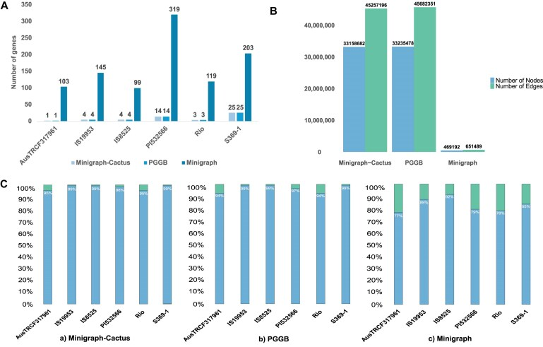

  <sub>**Crop graph evaluation framework**: Graph characteristics and missing genes for Minigraph-Cactus, PGGB and Minigraph graphs built from real sorghum assemblies (Figure 4). Data: sorghum (non-grape data). Source: Kopalli et al. 2025, GigaScience, Figure 4 ([doi:10.1093/gigascience/giaf121](https://doi.org/10.1093/gigascience/giaf121)), CC BY.</sub>
- **Human graph method comparison** (analysis) — Benchmarks how construction methods change graph structure and downstream use. Explains why PGGB and MC graphs differ in bubbles and size. [doi:10.1186/s13059-023-03098-2](https://doi.org/10.1186/s13059-023-03098-2) · [details](docs/PANGENOME_CATALOG.md#L88)
- **odgi stats / validate** (tool) — Graph statistics, path checks and layout-based QC on variation graphs. Script 16 QC basis; run before any cohort genotyping. [doi:10.1093/bioinformatics/btac308](https://doi.org/10.1093/bioinformatics/btac308) · [link](https://github.com/pangenome/odgi) · [details](docs/PANGENOME_CATALOG.md#L89)
- **gfatools** (tool) — Converts and summarizes GFA/rGFA graphs. Quick sanity checks on minigraph graphs. [link](https://github.com/lh3/gfatools) · [details](docs/PANGENOME_CATALOG.md#L90)
- **Truvari** (tool) — Compares, merges and benchmarks SV VCFs with sequence similarity. Benchmark graph-derived SVs against assembly SyRI calls. [doi:10.1186/s13059-022-02840-6](https://doi.org/10.1186/s13059-022-02840-6) · [link](https://github.com/ACEnglish/truvari) · [details](docs/PANGENOME_CATALOG.md#L91)
- **vcfdist** (tool) — Phasing-aware benchmarking of small and structural variant calls. Evaluate genotyping accuracy on held-out Vitis haplotypes. [doi:10.1038/s41467-023-43876-x](https://doi.org/10.1038/s41467-023-43876-x) · [link](https://github.com/TimD1/vcfdist) · [details](docs/PANGENOME_CATALOG.md#L92)
- **Leave-one-out haplotype benchmark** (idea) — Remove one assembled sample from the panel, genotype its reads, and compare with its assembly. The standard way to measure graph genotyping accuracy in Vitis without a truth set. [doi:10.1038/s41588-022-01043-w](https://doi.org/10.1038/s41588-022-01043-w) · [details](docs/PANGENOME_CATALOG.md#L93)
- **gretl** (tool) — Graph statistics (node/path similarity, bootstrap growth, windows). Window-level graph stats to compare PGGB vs MC grape graphs. [doi:10.1093/bioinformatics/btae755](https://doi.org/10.1093/bioinformatics/btae755) · [link](https://github.com/MoinSebi/gretl) · [details](docs/PANGENOME_CATALOG_SUPPLEMENT_1.md#vs007)
- **gfastats** (tool) — Assembly/graph statistics and manipulation. Uniform N50/gap stats across Vitis assemblies. [doi:10.1093/bioinformatics/btac460](https://doi.org/10.1093/bioinformatics/btac460) · [link](https://github.com/vgl-hub/gfastats) · [details](docs/PANGENOME_CATALOG_SUPPLEMENT_1.md#vs008)
- **skani** (tool) — Fast ANI estimation via sparse chaining. More accurate pairwise identity than Mash for wild-species graphs. [doi:10.1038/s41592-023-02018-3](https://doi.org/10.1038/s41592-023-02018-3) · [link](https://github.com/bluenote-1577/skani) · [details](docs/PANGENOME_CATALOG_SUPPLEMENT_1.md#vs009)
- **QUAST** (tool) — Reports contiguity and, with a reference, misassemblies for genome assemblies. Standard first-pass summary for each grape haplotype before it enters the graph. [doi:10.1093/bioinformatics/btt086](https://doi.org/10.1093/bioinformatics/btt086) · [link](https://github.com/ablab/quast)
- **GenomeScope 2.0** (tool) — Estimates genome size, heterozygosity and ploidy from a k-mer spectrum. Checks heterozygosity of a grape cultivar before deciding on phased assembly. [doi:10.1038/s41467-020-14998-3](https://doi.org/10.1038/s41467-020-14998-3) · [link](https://github.com/tbenavi1/genomescope2.0)

  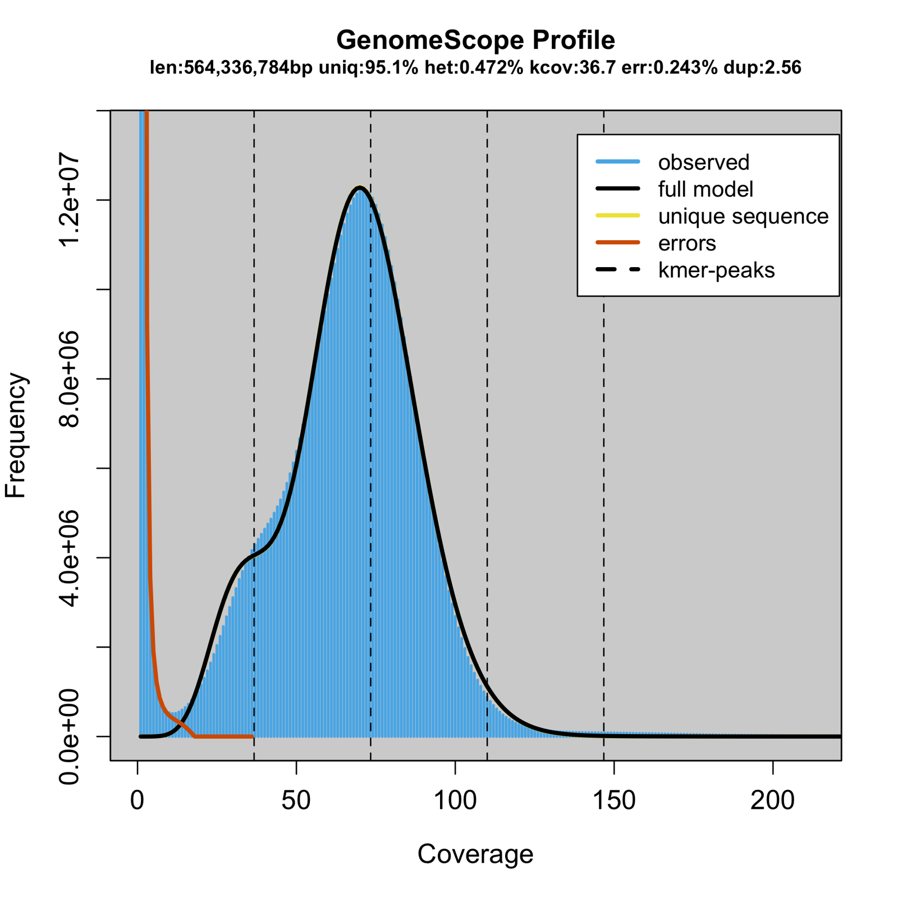

  <sub>**GenomeScope 2.0**: GenomeScope 2.0 k-mer (k=21) profile and model fit for European seabass short reads (repo example1, from analysis/real_data/seabass_21.hist). Data: European seabass (non-grape data). Source: repository [tbenavi1/genomescope2.0](https://github.com/tbenavi1/genomescope2.0/blob/8f25e3a25eaa691cdae474daf5cfe5416bfc60dc/user_data/example1/plot.png), Apache-2.0.</sub>
- **Smudgeplot** (tool) — Infers ploidy from heterozygous k-mer pairs. Confirms diploid vs polyploid status of Vitis and rootstock material. [doi:10.1038/s41467-020-14998-3](https://doi.org/10.1038/s41467-020-14998-3) · [link](https://github.com/KamilSJaron/smudgeplot)

  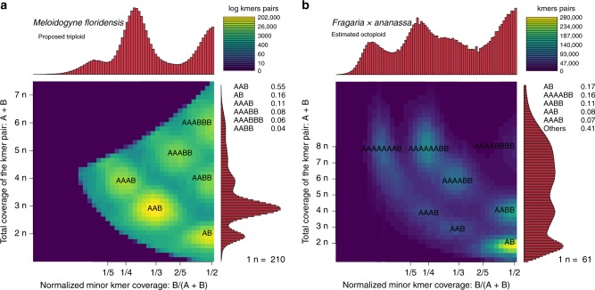

  <sub>**Smudgeplot**: Smudgeplots of real data: triploid root-knot nematode Meloidogyne floridensis and octoploid strawberry Fragaria x ananassa (Fig. 8). Data: root-knot nematode and strawberry (non-grape data). Source: Ranallo-Benavidez et al. 2020, Nature Communications, Fig. 8 ([doi:10.1038/s41467-020-14998-3](https://doi.org/10.1038/s41467-020-14998-3)), CC BY.</sub>
- **KAT** (tool) — k-mer toolkit that compares reads with an assembly to find missing or duplicated content. Shows whether a grape haplotype assembly kept both alleles or collapsed them. [doi:10.1093/bioinformatics/btw663](https://doi.org/10.1093/bioinformatics/btw663) · [link](https://github.com/EarlhamInst/KAT)
- **OMArk** (tool) — Checks gene-set completeness and contamination against known gene families. Complements BUSCO when comparing gene sets across grape assemblies (gene models themselves belong to gene-structure-annotation). [doi:10.1038/s41587-024-02147-w](https://doi.org/10.1038/s41587-024-02147-w) · [link](https://github.com/DessimozLab/OMArk)
- **tidk** (tool) — Finds and plots telomeric repeats along an assembly. Quick check that grape T2T haplotypes have telomeres at both chromosome ends. [doi:10.1093/bioinformatics/btaf049](https://doi.org/10.1093/bioinformatics/btaf049) · [link](https://github.com/tolkit/telomeric-identifier)
- **BlobToolKit** (tool) — Plots GC, coverage and taxonomy of contigs to spot contamination. Screens grape assemblies for fungal, bacterial or organelle contigs before graph building. [doi:10.1534/g3.119.400908](https://doi.org/10.1534/g3.119.400908) · [link](https://github.com/genomehubs/blobtoolkit)
- **Merfin** (tool) — Uses read k-mers to filter variant calls and polishing edits and to estimate QV. Verifies that polishing did not remove true heterozygous sites in grape haplotypes. [doi:10.1038/s41592-022-01445-y](https://doi.org/10.1038/s41592-022-01445-y) · [link](https://github.com/arangrhie/merfin)

<a id="section-4"></a>
## 4. Variant discovery: sequence PAV, structural variants and TE insertions

Callers and graph-decomposition methods for detecting presence-absence variation, structural variants, and TE insertion polymorphisms, such as panacus, vg deconstruct, and GraffiTE. TE library construction is not in this repository (it is in `vitis-te`).

**Needs:** the graph or assemblies for sequence PAV and SVs; a curated TE library from vitis-te for TE-insertion polymorphism. [Data needs by scenario](#data-needs)

**Clusters:**
- *Sequence PAV and growth* (complementary): panacus, odgi pav, pangrowth, panagram, GraTools, PanK-Pipeline, Heaps law openness. Section 4a covers sequence or window presence, not gene presence (section 7).
- *Graph decomposition* (in order): vg deconstruct, vcfbub, vcfwave (vcflib), collapse-bubble. Run vg deconstruct → vcfbub → vcfwave to produce normalised graph VCFs.
- *Assembly-based SV* (alternatives): SyRI, PAV (EichlerLab assembly variant caller), SVIM-asm, dipcall, Assemblytics. Per-haplotype calls against PN_T2T; SyRI also calls inversions and translocations.
- *Read-based SV* (in order): Sniffles2 or cuteSV or SVision-pro or DeBreak or SVDSS or Delly or Manta, Jasmine or SURVIVOR. Detect per sample (long reads: Sniffles2 population mode or cuteSV; short reads: Delly or Manta), then merge across samples with Jasmine or SURVIVOR.
- *TE insertions* (alternatives): GraffiTE, McClintock 2, TEMP2. GraffiTE for graph-based TE genotyping; McClintock 2 runs multiple short-read callers.

### (a) Sequence and window PAV, growth curves

Sequence or window presence/absence and growth curves. These are not gene-level PAV.

- **panacus** (tool) — Computes pangenome growth and core size curves from a graph (by bp, node or edge). Script 06 uses it; this is sequence-level (bp) growth, not gene PAV. [doi:10.1093/bioinformatics/btae720](https://doi.org/10.1093/bioinformatics/btae720) · [link](https://github.com/codialab/panacus) · [details](docs/PANGENOME_CATALOG.md#L105)

  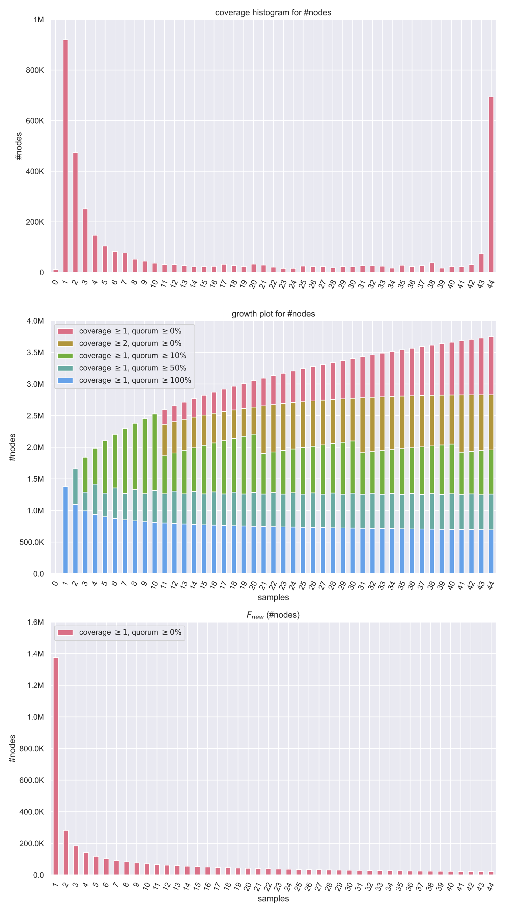

  <sub>**panacus**: panacus node coverage histogram and pangenome growth curve for chr22 of the HPRC v1.0 PGGB graph. Data: human, HPRC (non-grape data). Source: repository [marschall-lab/panacus](https://github.com/marschall-lab/panacus/blob/79ba82b01f7d44b22faada755f05464f045fbd20/docs/chr22.hprc-v1.0-pggb.histgrowth.node.png), MIT.</sub>
- **odgi pav** (tool) — Presence/absence of paths over BED windows in a graph. Window-level sequence PAV across grape haplotypes (separate from gene PAV). [doi:10.1093/bioinformatics/btac308](https://doi.org/10.1093/bioinformatics/btac308) · [link](https://github.com/pangenome/odgi) · [details](docs/PANGENOME_CATALOG.md#L106)
- **GraTools** (tool) — Indexes a GFA once and extracts subgraphs, core/dispensable ratios and group-specific segments. [preprint] Find segments specific to wild vs cultivated, or table vs wine, grape groups. [doi:10.64898/2025.12.01.691558](https://doi.org/10.64898/2025.12.01.691558) · [link](https://gratools.readthedocs.io/) · [details](docs/PANGENOME_CATALOG.md#L107)
- **Heaps law openness** (idea) — Fitting pangenome growth to judge whether a pangenome is open or closed. Interpret panacus curves for Vitis (open genus-level vs near-closed V. vinifera). [doi:10.1016/j.mib.2008.09.006](https://doi.org/10.1016/j.mib.2008.09.006) · [details](docs/PANGENOME_CATALOG.md#L108)
- **PanK-Pipeline** (tool) — k-mer presence/absence genotyping to VCF, PCA, structure and phylogeny (Brassica rapa demo). Sequence-level PAV, not gene PAV. (year = repo created; no paper checked) Reference-free sequence PAV across grape accessions. [link](https://github.com/caixu0518/PanK-Pipeline) · [details](docs/PANGENOME_CATALOG_SUPPLEMENT_1.md#vs010)
- **panagram** (tool) — Alignment-free pangenome browser/analysis using KMC k-mer indexes. Sequence-level presence, not gene PAV. (year = repo created; no paper checked) k-mer PAV browsing along grape chromosomes. [link](https://github.com/kjenike/panagram) · [details](docs/PANGENOME_CATALOG_SUPPLEMENT_1.md#vs011)
- **pangrowth** (tool) — Pangenome growth/openness from k-mers or from gene families. (year = repo created; no paper checked) Report k-mer (sequence) and gene-family growth separately for Vitis; they answer different questions. Gene-family growth results belong in section 7; do not mix them with the sequence/window PAV reports in section 4a. [link](https://github.com/gi-bielefeld/pangrowth) · [details](docs/PANGENOME_CATALOG_SUPPLEMENT_1.md#vs012)

### (b) Structural variants and TE insertions

Structural variants and TE insertions found from the graph, from assemblies, or as new alleles from long reads.

- **vg deconstruct** (tool) — Emits VCF of graph bubbles relative to a chosen reference path. Script 05 variant discovery from the graph itself. [doi:10.1038/nbt.4227](https://doi.org/10.1038/nbt.4227) · [link](https://github.com/vgteam/vg) · [details](docs/PANGENOME_CATALOG.md#L114)

  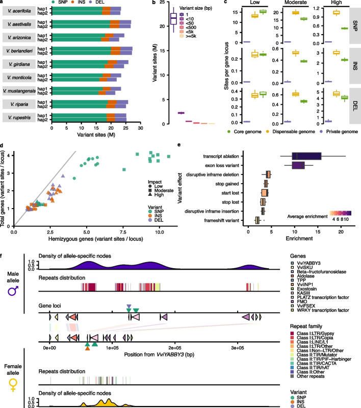

  <sub>**vg deconstruct**: Variants deconstructed from the PGGB super-pangenome graph of 9 North American Vitis species (18 haplotypes): counts, size distribution, impact (Fig. 5). Data: 9 North American Vitis species (grape data). Source: Cochetel et al. 2023, Genome Biology, Fig. 5 ([doi:10.1186/s13059-023-03133-2](https://doi.org/10.1186/s13059-023-03133-2)), CC BY.</sub>
- **vcfbub** (tool) — Filters nested/oversized bubbles from graph VCFs. Removes huge nested sites before population analysis. [link](https://github.com/pangenome/vcfbub) · [details](docs/PANGENOME_CATALOG.md#L115)
- **vcfwave (vcflib)** (tool) — Realigns complex graph alleles into primitive SNPs/indels/SVs. Makes graph VCFs usable by standard grape popgen tools. [doi:10.1371/journal.pcbi.1009123](https://doi.org/10.1371/journal.pcbi.1009123) · [link](https://github.com/vcflib/vcflib) · [details](docs/PANGENOME_CATALOG.md#L116)
- **SyRI** (tool) — Finds synteny, rearrangements and local variants between two chromosome-level assemblies. Script 10 uses it; independent SV truth from assemblies. [doi:10.1186/s13059-019-1911-0](https://doi.org/10.1186/s13059-019-1911-0) · [link](https://github.com/schneebergerlab/syri) · [details](docs/PANGENOME_CATALOG.md#L117)
- **PAV (EichlerLab assembly variant caller)** (tool) — Calls SNVs, indels, SVs and inversions from phased assemblies against a reference. Haplotype-resolved SV calls for each grape haplotype to compare with graph bubbles. [doi:10.1126/science.abf7117](https://doi.org/10.1126/science.abf7117) · [link](https://github.com/EichlerLab/pav) · [details](docs/PANGENOME_CATALOG.md#L118)
- **SVIM-asm** (tool) — Assembly-to-reference SV caller. Light alternative to PAV for many Vitis haplotypes. [doi:10.1093/bioinformatics/btaa1034](https://doi.org/10.1093/bioinformatics/btaa1034) · [link](https://github.com/eldariont/svim-asm) · [details](docs/PANGENOME_CATALOG.md#L119)
- **Sniffles2** (tool) — Long-read SV caller with population-scale merging (SNF files) and mosaic SV detection. For HiFi/ONT resequencing of grape clones and populations. [doi:10.1038/s41587-023-02024-y](https://doi.org/10.1038/s41587-023-02024-y) · [link](https://github.com/fritzsedlazeck/Sniffles) · [details](docs/PANGENOME_CATALOG.md#L120)
- **cuteSV** (tool) — Fast long-read SV detection by signature clustering. Multi-caller consensus with Sniffles2 on Vitis long reads. [doi:10.1186/s13059-020-02107-y](https://doi.org/10.1186/s13059-020-02107-y) · [link](https://github.com/tjiangHIT/cuteSV) · [details](docs/PANGENOME_CATALOG.md#L121)
- **SVision-pro** (tool) — Neural-network discovery of complex, de novo and somatic SVs from long reads. Detect somatic SVs among grape clones (e.g. Pinot clones). [doi:10.1038/s41587-024-02190-7](https://doi.org/10.1038/s41587-024-02190-7) · [link](https://github.com/songbowang125/SVision-pro) · [details](docs/PANGENOME_CATALOG.md#L122)
- **Jasmine** (tool) — Merges SV calls across samples with a minimum-spanning-forest approach. Builds a non-redundant SV catalog from many grape callsets. [doi:10.1038/s41592-022-01753-3](https://doi.org/10.1038/s41592-022-01753-3) · [link](https://github.com/mkirsche/Jasmine) · [details](docs/PANGENOME_CATALOG.md#L123)
- **SURVIVOR** (tool) — Simulation, merging and comparison of SV calls. Classic merge/consensus step; still widely used in plant SV papers. [doi:10.1038/ncomms14061](https://doi.org/10.1038/ncomms14061) · [link](https://github.com/fritzsedlazeck/SURVIVOR) · [details](docs/PANGENOME_CATALOG.md#L124)
- **SVarp** (tool) — Discovers new SV alleles (not in the graph) from long reads aligned to a pangenome graph. [preprint] True novel-SV discovery against a grape graph, unlike genotyping of known bubbles. [doi:10.1101/2024.02.18.580171](https://doi.org/10.1101/2024.02.18.580171) · [link](https://github.com/asylvz/SVarp) · [details](docs/PANGENOME_CATALOG.md#L125)
- **SVPG** (tool) — Uses a haplotype-resolved pangenome reference to detect SVs from long reads and quickly augment the graph with new samples. [preprint] Adds new Vitis accessions without rebuilding the whole graph. [doi:10.1101/2025.07.11.664486](https://doi.org/10.1101/2025.07.11.664486) · [link](https://github.com/coopsor/SVPG) · [details](docs/PANGENOME_CATALOG.md#L126)
- **Swave** (tool) — Deep-learning method that resolves simple and complex SVs with population features from assembly-derived pangenome graphs. Better SV classification out of PGGB/MC grape graphs than bubble decomposition alone. [doi:10.1038/s41588-026-02538-6](https://doi.org/10.1038/s41588-026-02538-6) · [link](https://github.com/songbowang125/Swave) · [details](docs/PANGENOME_CATALOG.md#L127)
- **GraffiTE** (tool) — Finds polymorphic TE insertions from assemblies/long reads, builds a graph and genotypes them (v1.1 adds methylation, 2026 preprint 10.64898/2026.11.06.764993). TE insertions drive grape traits (e.g. Gret1 at VvMybA1); polymorphic TE catalog per accession. This is not TE-library construction for vitis-te, and not the trusted-library soft-mask step of structural annotation. [doi:10.1101/2023.09.11.557209](https://doi.org/10.1101/2023.09.11.557209) · [link](https://github.com/cgroza/GraffiTE) · [details](docs/PANGENOME_CATALOG.md#L128)
- **TE insertion polymorphisms from pangenome (rice)** (analysis) — Pangenome-wide TE insertion polymorphisms linked to cold tolerance in rice. Template for linking grape TE-SVs to cold hardiness (e.g. V. amurensis). [doi:10.1038/s41467-025-62887-4](https://doi.org/10.1038/s41467-025-62887-4) · [details](docs/PANGENOME_CATALOG.md#L129)
- **SV size and class taxonomy** (idea) — Report SVs by class (INS/DEL/INV/DUP/complex), size bin and TE/tandem origin rather than one count. Avoids mixing sequence PAV, SVs and gene PAV in grape summaries. [doi:10.1126/science.abf7117](https://doi.org/10.1126/science.abf7117) · [details](docs/PANGENOME_CATALOG.md#L130)
- **Inversions in pangenome graphs** (analysis) — How inversions are represented and detected in graphs. Grape SV maps report many inversions near centromeres; graph VCFs can misrepresent them. [doi:10.1093/nargab/lqag125](https://doi.org/10.1093/nargab/lqag125) · [link](https://pmc.ncbi.nlm.nih.gov/articles/PMC13669635/) · [details](docs/PANGENOME_CATALOG_SUPPLEMENT_1.md#vs013)
- **collapse-bubble** (tool) — Merges redundant SV alleles within the same bubble in Minigraph-Cactus VCFs while keeping phased genotypes. (year = repo created; no paper checked) Cleans MC deconstruct VCF before grape GWAS marker sets. [link](https://github.com/Han-Cao/collapse-bubble) · [details](docs/PANGENOME_CATALOG_SUPPLEMENT_1.md#vs014)
- **Delly** (tool) — Short-read SV caller using paired-end and split reads. Baseline SV calls for large short-read grape panels without long reads. [doi:10.1093/bioinformatics/bts378](https://doi.org/10.1093/bioinformatics/bts378) · [link](https://github.com/dellytools/delly)
- **Manta** (tool) — Fast short-read caller for SVs and medium indels. Second short-read caller to intersect with Delly on grape resequencing data. [doi:10.1093/bioinformatics/btv710](https://doi.org/10.1093/bioinformatics/btv710) · [link](https://github.com/Illumina/manta)
- **DeBreak** (tool) — Long-read SV caller focused on exact breakpoints. Precise breakpoints help when merging grape SVs into graph bubbles. [doi:10.1038/s41467-023-35996-1](https://doi.org/10.1038/s41467-023-35996-1) · [link](https://github.com/ChongLab/DeBreak)
- **SVDSS** (tool) — Calls SVs in hard regions from HiFi reads using sample-specific strings. Targets repeat-rich grape regions where alignment-based callers miss SVs. [doi:10.1038/s41592-022-01674-1](https://doi.org/10.1038/s41592-022-01674-1) · [link](https://github.com/Parsoa/SVDSS)
- **Assemblytics** (tool) — Finds and summarises variants from whole-genome assembly alignments. Quick size/class summary of SVs between a grape haplotype and PN40024. [doi:10.1093/bioinformatics/btw369](https://doi.org/10.1093/bioinformatics/btw369) · [link](https://github.com/MariaNattestad/assemblytics)

  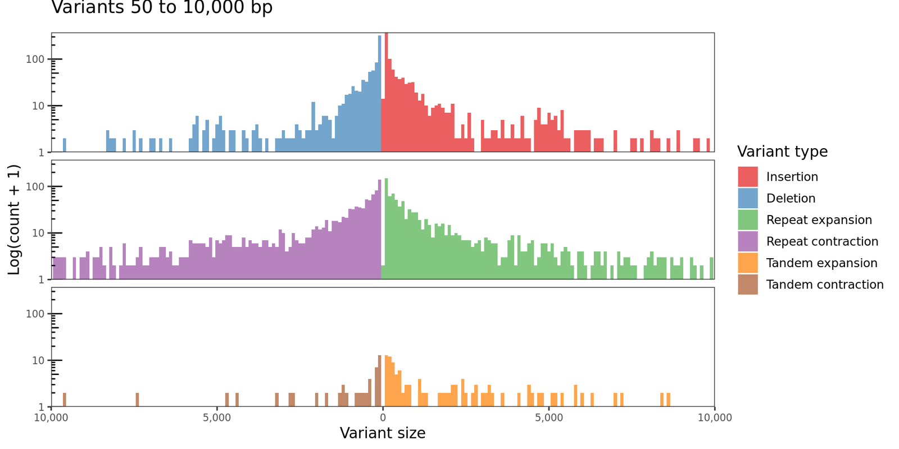

  <sub>**Assemblytics**: Assemblytics size distribution of insertions, deletions, repeat and tandem expansions/contractions for the Arabidopsis example assembly-to-reference alignment in the repo. Data: Arabidopsis thaliana (non-grape data). Source: repository [MariaNattestad/assemblytics](https://github.com/MariaNattestad/assemblytics/blob/7acd1acec5b4175ab71a7c885a6ddadec0e355ab/output_examples/arabidopsis/Arabidopsis_example.Assemblytics.size_distributions.all_variants.log_all_sizes.png), MIT.</sub>
- **dipcall** (tool) — Calls variants from a phased diploid assembly against a reference. Truth-set style calls for each phased grape accession, used to benchmark graph genotypes. [doi:10.1038/s41592-018-0054-7](https://doi.org/10.1038/s41592-018-0054-7) · [link](https://github.com/lh3/dipcall)
- **McClintock 2** (tool) — Runs and compares several TE insertion callers on short reads in one pipeline. TE insertion polymorphism calls in grape panels; the TE library itself comes from vitis-te. [doi:10.1186/s13100-023-00296-4](https://doi.org/10.1186/s13100-023-00296-4) · [link](https://github.com/bergmanlab/mcclintock)
- **TEMP2** (tool) — Detects germline and de novo TE insertions from short reads. Clone-level TE insertions in grape somatic variants; uses the vitis-te library. [doi:10.1093/nar/gkab010](https://doi.org/10.1093/nar/gkab010) · [link](https://github.com/weng-lab/TEMP2)
- **DeepSomatic** (tool) — Deep-learning somatic SNV and indel caller for short and long reads, built on DeepVariant. Candidate for calling clone-to-clone differences within a cultivar, though its tumour/normal logic requires adaptation [待确认: no plant benchmark]. [preprint] [doi:10.1101/2024.08.16.608331](https://doi.org/10.1101/2024.08.16.608331) · [link](https://github.com/google/deepsomatic)

<a id="section-5"></a>
## 5. Cohort genotyping and read-to-graph mapping

Short- and long-read graph aligners and cohort genotypers, including vg Giraffe, vg call, PanGenie, and GraphAligner. Note that Giraffe + vg call and PanGenie only genotype sites already in the graph; they do not add new alleles.

**Needs:** the graph plus cohort reads. Giraffe + vg call only genotype sites already in the graph (`vg augment` can discover new variants, but is not this repo's default). PanGenie uses short-read k-mers and needs a phased, bubble-decomposed VCF (e.g. Minigraph-Cactus + vcfbub), not a PGGB GFA; long reads go via GraphAligner or minigraph. [Data needs by scenario](#data-needs)

**Clusters:**
- *Graph genotyping of known sites* (alternatives): vg Giraffe → vg call, PanGenie, KAGE, BayesTyper, GraphTyper2, Paragraph, SVJedi-graph, Varigraph, Locityper, COSIGT, Plant graph genotyper benchmark + ensemble. Default: vg Giraffe → vg call (script 14) and PanGenie (script 15); they genotype sites already in the graph only.
- *Long-read graph aligners* (alternatives): GraphAligner, GraphChainer, Haplotype-aware long-read alignment, Panmap, Moni-align, RecAlign. Use when cohorts are sequenced with HiFi/ONT; Giraffe now also maps long reads.
- *Linear callers* (alternatives): DeepVariant, Clair3, BCFtools, GATK HaplotypeCaller. Baseline against PN_T2T and for SNPs not in the graph. SVTyper, which genotypes known SVs on the linear reference, is a separate step.
- *Phasing* (in order): WhatsHap, SHAPEIT5 or Beagle 5. Read-based phase sets from WhatsHap can feed statistical phasing of the cohort with SHAPEIT5 or Beagle 5.
- *Low-depth imputation* (alternatives): GLIMPSE2, STITCH, Practical Haplotype Graph (PHG v2). GLIMPSE2 and PHG v2 need a reference panel built from phased high-depth samples; STITCH works without a panel in low-depth families.
- *Identity QC before analysis* (alternatives): KING, NgsRelate v2. KING on called genotypes (higher depth); NgsRelate v2 on genotype likelihoods (low depth). Keep one sample per clone and remove synonyms before GWAS or selection scans.

- **vg Giraffe** (tool) — Fast haplotype-aware short-read mapper for GBZ pangenome graphs. Used in script 14 to map resequenced grape cohorts to the graph. The 2025 long-read extension (preprint, doi:10.1101/2025.09.29.678807) maps HiFi/ONT grape reads to the same graph used for short reads. [doi:10.1126/science.abg8871](https://doi.org/10.1126/science.abg8871) · [link](https://github.com/vgteam/vg) · [details](docs/PANGENOME_CATALOG.md#L140)
- **vg call** (tool) — Genotypes known graph bubbles (SVs and small variants) from read support after vg pack. Script 14 step: cohort genotyping of variants already in the graph, not discovery of new alleles. [doi:10.1186/s13059-020-1941-7](https://doi.org/10.1186/s13059-020-1941-7) · [link](https://github.com/vgteam/vg) · [details](docs/PANGENOME_CATALOG.md#L142)
- **Haplotype sampling (personalized graphs)** (tool) — Samples the most similar haplotypes per sample with k-mers to build a personalized graph before mapping. Improves mapping when the grape graph holds many divergent wild haplotypes. [doi:10.1038/s41592-024-02407-2](https://doi.org/10.1038/s41592-024-02407-2) · [link](https://github.com/vgteam/vg) · [details](docs/PANGENOME_CATALOG.md#L143)
- **PanGenie** (tool) — Alignment-free k-mer HMM genotyping of known pangenome variants from short reads. Script 15; fast cohort genotyping of graph SVs. Differs from Giraffe+vg call by k-mers vs read alignment. The 2026 release adds sample-specific haplotype sampling and rare-variant polishing for panels beyond the old 254-haplotype limit (preprint, doi:10.64898/2026.06.29.735275). [待确认: whether polishing adds alleles not in the graph] [doi:10.1038/s41588-022-01043-w](https://doi.org/10.1038/s41588-022-01043-w) · [link](https://github.com/eblerjana/pangenie) · [details](docs/PANGENOME_CATALOG.md#L144)

  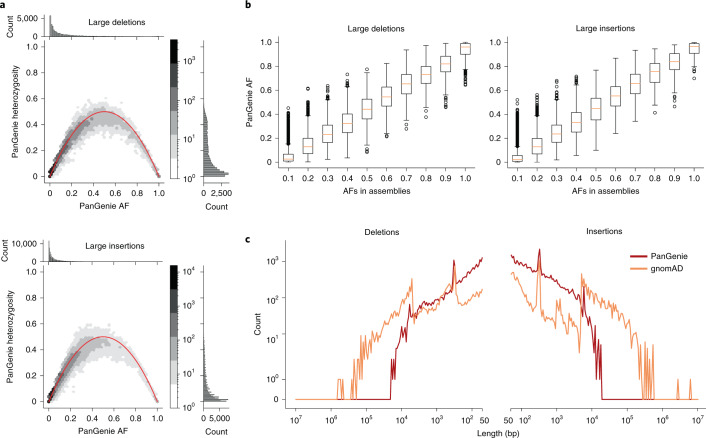

  <sub>**PanGenie**: PanGenie genotypes for 200 unrelated 1000 Genomes samples: allele frequency vs heterozygosity and related QC (Fig. 4). Data: human, 1000 Genomes (non-grape data). Source: Ebler et al. 2022, Nature Genetics, Fig. 4 ([doi:10.1038/s41588-022-01043-w](https://doi.org/10.1038/s41588-022-01043-w)), CC BY.</sub>
- **Varigraph** (tool) — k-mer genotyper for small and large variants on graphs, including polyploid allele dosage. Built and tested on plant genomes; useful for polyploid/hybrid rootstock material too. [doi:10.1016/j.molp.2025.08.001](https://doi.org/10.1016/j.molp.2025.08.001) · [link](https://github.com/JiaoLab2021/varigraph) · [details](docs/PANGENOME_CATALOG.md#L146)
- **GraphAligner** (tool) — Aligns long reads to sequence graphs. Long-read mapping to minigraph grape graphs. [doi:10.1186/s13059-020-02157-2](https://doi.org/10.1186/s13059-020-02157-2) · [link](https://github.com/maickrau/GraphAligner) · [details](docs/PANGENOME_CATALOG.md#L147)
- **Haplotype-aware long-read alignment** (tool) — Aligns sequences to pangenome graphs while respecting haplotype paths (Minichain/haplotype-aware co-linear chaining). Avoids chimeric paths across grape haplotypes. [doi:10.1101/gr.279143.124](https://doi.org/10.1101/gr.279143.124) · [details](docs/PANGENOME_CATALOG.md#L148)
- **BayesTyper** (tool) — k-mer based Bayesian genotyping of SNVs, indels and SVs. Early k-mer genotyper; reference point for comparisons. [doi:10.1038/s41588-018-0145-5](https://doi.org/10.1038/s41588-018-0145-5) · [link](https://github.com/bioinformatics-centre/BayesTyper) · [details](docs/PANGENOME_CATALOG.md#L149)
- **Paragraph** (tool) — Local graph-based SV genotyping from short reads. Targeted genotyping of a curated grape SV set. [doi:10.1186/s13059-019-1909-7](https://doi.org/10.1186/s13059-019-1909-7) · [link](https://github.com/Illumina/paragraph) · [details](docs/PANGENOME_CATALOG.md#L150)
- **GraphTyper2** (tool) — Population-scale SV genotyping with local pangenome graphs. Joint cohort genotyping of SVs in large grape resequencing panels. [doi:10.1038/s41467-019-13341-9](https://doi.org/10.1038/s41467-019-13341-9) · [link](https://github.com/DecodeGenetics/graphtyper) · [details](docs/PANGENOME_CATALOG.md#L151)
- **KAGE** (tool) — Fast alignment-free genotyping using k-mers and population priors. Low-cost genotyping for breeding-scale grape cohorts. [doi:10.1186/s13059-022-02771-2](https://doi.org/10.1186/s13059-022-02771-2) · [link](https://github.com/kage-genotyper/kage) · [details](docs/PANGENOME_CATALOG.md#L152)
- **SVJedi-graph** (tool) — Long-read SV genotyping on a variation graph of close/overlapping SVs. Genotype nested grape SVs with ONT data. [doi:10.1093/bioinformatics/btad237](https://doi.org/10.1093/bioinformatics/btad237) · [link](https://github.com/SandraLouise/SVJedi-graph) · [details](docs/PANGENOME_CATALOG.md#L153)
- **COSIGT** (tool) — Genotypes complex loci from 1–2x coverage by matching read-coverage vectors to graph haplotypes. Low-coverage or ancient grape seed DNA genotyping at complex loci. [doi:10.1186/s13059-026-04242-4](https://doi.org/10.1186/s13059-026-04242-4) · [link](https://github.com/davidebolo1993/cosigt) · [details](docs/PANGENOME_CATALOG.md#L154)
- **Panmap** (tool) — Phylogeny-compressed k-mer index for placement, alignment and genotyping on mutation-annotated pangenomes. [preprint] Idea for placing new grape samples on a haplotype phylogeny. [doi:10.64898/2026.03.29.711974](https://doi.org/10.64898/2026.03.29.711974) · [link](https://github.com/amkram/panmap) · [details](docs/PANGENOME_CATALOG.md#L155)
- **Locityper** (tool) — Genotypes complex polymorphic loci by choosing the best pair of known haplotypes from a panel (short or long reads). Cohort genotyping of NLR or other hypervariable grape loci against haplotypes already in the panel; it does not discover new alleles. [doi:10.1038/s41588-025-02362-4](https://doi.org/10.1038/s41588-025-02362-4) · [link](https://github.com/tprodanov/locityper) · [details](docs/PANGENOME_CATALOG_SUPPLEMENT_1.md#vs015)
- **GraphChainer** (tool) — Co-linear chaining for long-read graph alignment. More accurate long-read placement in repeats. [doi:10.1093/bioinformatics/btad460](https://doi.org/10.1093/bioinformatics/btad460) · [link](https://github.com/algbio/GraphChainer) · [details](docs/PANGENOME_CATALOG_SUPPLEMENT_1.md#vs016)
- **RecAlign** (tool) — Recombination-aware long-read alignment to variation graphs. Reads from recombinant grape progeny switch haplotypes. [doi:10.1186/s12859-026-06640-8](https://doi.org/10.1186/s12859-026-06640-8) · [link](https://github.com/AlgoLab/rec_align_exps) · [details](docs/PANGENOME_CATALOG_SUPPLEMENT_1.md#vs017)
- **Moni-align** (tool) — Short-read aligner on an r-index over a genome collection. Graph-free pangenome mapping alternative for local grape regions. [doi:10.1101/gr.279858.124](https://doi.org/10.1101/gr.279858.124) · [link](https://github.com/maxrossi91/moni-align) · [details](docs/PANGENOME_CATALOG_SUPPLEMENT_1.md#vs018)
- **Plant graph genotyper benchmark + ensemble** (analysis) — Benchmarks vg, GraphTyper2, BayesTyper, PanGenie etc. on plant genomes; ensemble pipeline. Choose a grape cohort genotyper from plant (not human) evidence. [doi:10.1186/s13059-024-03239-1](https://doi.org/10.1186/s13059-024-03239-1) · [link](https://pmc.ncbi.nlm.nih.gov/articles/PMC11003132/) · [details](docs/PANGENOME_CATALOG_SUPPLEMENT_1.md#vs019)

  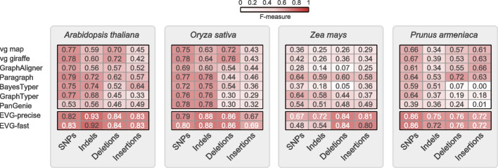

  <sub>**Plant graph genotyper benchmark + ensemble**: Genotyping performance of graph-based tools on real short reads from rice, maize and apricot (Fig. 6). Data: rice, maize and apricot (non-grape data). Source: Du et al. 2024, Genome Biology, Fig. 6 ([doi:10.1186/s13059-024-03239-1](https://doi.org/10.1186/s13059-024-03239-1)), CC BY.</sub>
- **GLIMPSE2** (tool) — Phasing and imputation of low-coverage sequencing from a reference panel. Impute known SNP and small-indel sites from a reference panel into skim-sequenced grape populations; known panel sites only, not graph structural variants. [doi:10.1038/s41588-023-01438-3](https://doi.org/10.1038/s41588-023-01438-3) · [link](https://github.com/odelaneau/GLIMPSE) · [details](docs/PANGENOME_CATALOG_SUPPLEMENT_1.md#vs020)
- **Practical Haplotype Graph (PHG v2)** (tool) — Stores panel haplotypes and imputes them into low-coverage or low-density samples. Low-cost imputation of known grape panel haplotypes into breeding populations; known sites only. [doi:10.1093/bioinformatics/btac410](https://doi.org/10.1093/bioinformatics/btac410) · [link](https://github.com/maize-genetics/phg_v2) · [details](docs/PANGENOME_CATALOG_SUPPLEMENT_1.md#vs021)
- **Beagle 5** (tool) — Genotype imputation and phasing for large reference panels. Imputes low-coverage grape samples from graph-genotyped reference panels (linear VCF). [doi:10.1016/j.ajhg.2018.07.015](https://doi.org/10.1016/j.ajhg.2018.07.015) · [link](https://faculty.washington.edu/browning/beagle/beagle.html)
- **SHAPEIT5** (tool) — Phases large cohorts, including rare variants. Phasing grape cohort VCFs after graph genotyping. [doi:10.1038/s41588-023-01415-w](https://doi.org/10.1038/s41588-023-01415-w) · [link](https://github.com/odelaneau/shapeit5)
- **BCFtools** (tool) — Calls, filters, merges and normalises variants in VCF/BCF. Everyday filtering and normalisation of vg call / PanGenie output for grape cohorts. [doi:10.1093/gigascience/giab008](https://doi.org/10.1093/gigascience/giab008) · [link](https://github.com/samtools/bcftools)
- **Clair3** (tool) — Deep-learning small-variant caller for long reads. SNP/indel calls from ONT/HiFi grape reads to compare with graph genotypes. [doi:10.1038/s43588-022-00387-x](https://doi.org/10.1038/s43588-022-00387-x) · [link](https://github.com/HKU-BAL/Clair3)
- **DeepVariant** (tool) — Deep-learning SNP and indel caller for short and long reads. Its pangenome-aware mode (preprint, doi:10.1101/2025.06.05.657102) adds graph haplotypes to the pileup and is more accurate in divergent regions (benchmarked in human; untested in grape); it discovers SNPs/indels not already in the graph and is not genotyping of known graph bubbles, unlike Giraffe + vg call or PanGenie. [doi:10.1038/nbt.4235](https://doi.org/10.1038/nbt.4235) · [link](https://github.com/google/deepvariant)
- **SVTyper** (tool) — Bayesian genotyper for known SVs from short reads. Short-read genotyping of known grape SVs, as a linear comparison to graph genotyping. [doi:10.1038/nmeth.3505](https://doi.org/10.1038/nmeth.3505) · [link](https://github.com/hall-lab/svtyper)
- **WhatsHap** (tool) — Read-based phasing and haplotagging of reads. Phases grape long-read data and tags reads by haplotype for allele-specific work. [doi:10.1101/085050](https://doi.org/10.1101/085050) · [link](https://github.com/whatshap/whatshap)
- **KING** (tool) — Robust kinship estimation and duplicate detection from genotypes. First step for identifying synonyms, mislabels and clones of the same cultivar before GWAS. [doi:10.1093/bioinformatics/btq559](https://doi.org/10.1093/bioinformatics/btq559) · [link](https://www.kingrelatedness.com/)
- **NgsRelate v2** (tool) — Estimates relatedness and inbreeding from genotype likelihoods, allowing checks on low-depth samples. Used for parent-offspring verification in grape pedigrees with shallow resequencing. [doi:10.1093/gigascience/giz034](https://doi.org/10.1093/gigascience/giz034) · [link](https://github.com/ANGSD/NgsRelate)
- **STITCH** (tool) — Imputes genotypes from low-coverage sequencing without a reference panel. Suited to breeding populations (F1 or half-sib families) sequenced at low depth. [doi:10.1038/ng.3594](https://doi.org/10.1038/ng.3594) · [link](https://github.com/rwdavies/STITCH)
- **GATK HaplotypeCaller** (tool) — Joint-genotyping SNP/indel caller widely used for grape resequencing panels. Serves as a linear baseline alongside graph genotyping; watch for batch effects when merging public grape panels. [preprint] [doi:10.1101/201178](https://doi.org/10.1101/201178) · [link](https://github.com/broadinstitute/gatk)

<a id="section-6"></a>
## 6. Synteny, alignment and comparative maps

Whole-genome aligners and synteny tools for comparing assemblies and collinear blocks across genomes, such as minimap2, AnchorWave, and GENESPACE.

**Needs:** two or more assemblies; gene models from gene-structure-annotation if using gene-based synteny (GENESPACE, JCVI). In cross-genus *Vitis*–*Muscadinia* synteny, map both *Muscadinia* chr7 and chr20 to *Vitis* chr7, not one-to-one by number. [Data needs by scenario](#data-needs)

**Clusters:**
- *Genome aligners* (alternatives): minimap2, AnchorWave, MUMmer4, FastGA, LAST. minimap2 for close haplotypes; AnchorWave for distant or rearranged genomes.
- *Synteny* (alternatives): GENESPACE, JCVI / MCscan, MCScanX, WGDI, ntSynt, halSynteny, msyd, Mumemto. GENESPACE for gene-based synteny across Vitis; WGDI for polyploidy events; ntSynt when annotations are unavailable.
- *Plots* (complementary): plotsr, D-GENIES. plotsr for SyRI output; D-GENIES for quick dot plots.

- **minimap2** (tool) — General long sequence and assembly aligner. Assembly-to-assembly alignment for SyRI and dotplots. [doi:10.1093/bioinformatics/bty191](https://doi.org/10.1093/bioinformatics/bty191) · [link](https://github.com/lh3/minimap2) · [details](docs/PANGENOME_CATALOG.md#L166)
- **AnchorWave** (tool) — Gene-anchored whole-genome alignment that handles WGD and SV. Better alignments across divergent Vitis species / Muscadinia. [doi:10.1073/pnas.2113075119](https://doi.org/10.1073/pnas.2113075119) · [link](https://github.com/baoxingsong/AnchorWave) · [details](docs/PANGENOME_CATALOG.md#L167)
- **plotsr** (tool) — Plots synteny and SVs across multiple chromosome-level assemblies. Karyotype-level figure of grape haplotypes from SyRI output. [doi:10.1093/bioinformatics/btac196](https://doi.org/10.1093/bioinformatics/btac196) · [link](https://github.com/schneebergerlab/plotsr) · [details](docs/PANGENOME_CATALOG.md#L168)

  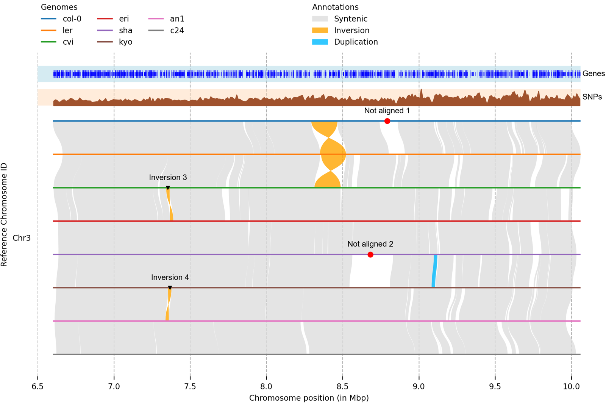

  <sub>**plotsr**: plotsr synteny and SV plot of chr3 6.6-10 Mb across Arabidopsis thaliana assemblies (AMPRIL accessions vs Col-0). Data: Arabidopsis thaliana (non-grape data). Source: repository [schneebergerlab/plotsr](https://github.com/schneebergerlab/plotsr/blob/d2da00875c96a34dd758487f3967fa223228843d/example/ampril_col0_chr3_6600000_10000000.png), MIT.</sub>
- **msyd** (tool) — Multi-genome synteny decomposition from pairwise SyRI results. Core vs variable syntenic regions across many grape haplotypes. [待确认: publication] [link](https://github.com/schneebergerlab/msyd) · [details](docs/PANGENOME_CATALOG.md#L169)
- **ntSynt** (tool) — Multi-genome synteny blocks from minimizer graph mappings, alignment-free. Fast synteny across a whole Vitis genus panel. [doi:10.1186/s12915-025-02455-w](https://doi.org/10.1186/s12915-025-02455-w) · [link](https://github.com/BirolLab/ntSynt) · [details](docs/PANGENOME_CATALOG.md#L170)
- **GENESPACE** (tool) — Synteny- and orthology-constrained comparison with riparian plots and pan-gene sets. Gene-order view across grape haplotypes and relatives. [doi:10.7554/eLife.78526](https://doi.org/10.7554/eLife.78526) · [link](https://github.com/jtlovell/GENESPACE) · [details](docs/PANGENOME_CATALOG.md#L171)

  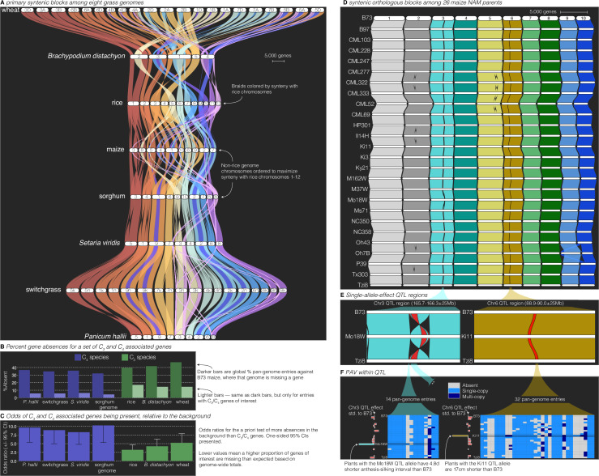

  <sub>**GENESPACE**: GENESPACE riparian plot of syntenic orthologous regions among eight grass genomes, coloured by rice chromosome (Figure 3). Data: eight grass genomes (non-grape data). Source: Lovell et al. 2022, eLife, Figure 3 ([doi:10.7554/eLife.78526](https://doi.org/10.7554/eLife.78526)), CC BY.</sub>
- **JCVI / MCscan** (tool) — Python toolkit for synteny, macro/micro-synteny plots and comparative genomics. Standard synteny dotplots and macro/micro-synteny plots for grape haplotypes and relatives. [doi:10.1002/imt2.211](https://doi.org/10.1002/imt2.211) · [link](https://github.com/tanghaibao/jcvi) · [details](docs/PANGENOME_CATALOG.md#L172)
- **Mumemto** (tool) — Finds multi-MUMs across pangenomes and visualizes conservation, synteny and assembly errors. Alignment-free collinearity check over all grape haplotypes at once. [doi:10.1186/s13059-025-03644-0](https://doi.org/10.1186/s13059-025-03644-0) · [link](https://github.com/vikshiv/mumemto) · [details](docs/PANGENOME_CATALOG.md#L173)

  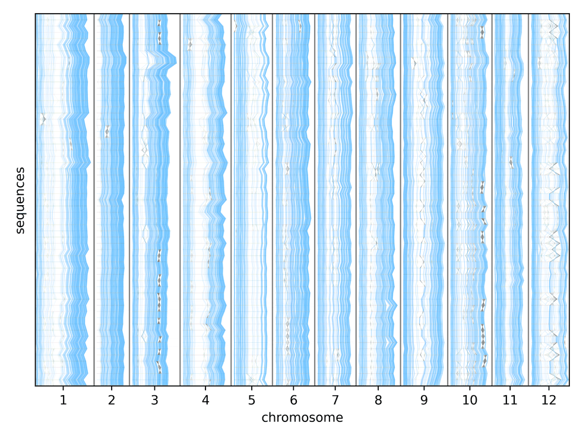

  <sub>**Mumemto**: Mumemto multi-MUM synteny view of potato pangenome assemblies (assemblies from Cheng et al. 2025, Nature). Data: potato (non-grape data). Source: repository [vikshiv/mumemto](https://github.com/vikshiv/mumemto/blob/ec48f10535f463ce709fe4181bec76ca0c4577db/img/potato_syn.png), GPL-3.0.</sub>
- **MUMmer4** (tool) — Whole-genome alignment (nucmer) and utilities. Input to SyRI; still standard for grape SV papers. [doi:10.1371/journal.pcbi.1005944](https://doi.org/10.1371/journal.pcbi.1005944) · [link](https://github.com/mummer4/mummer) · [details](docs/PANGENOME_CATALOG_SUPPLEMENT_1.md#vs022)
- **FastGA** (tool) — Fast genome-to-genome aligner producing .1aln (used by sweepga). Speeds up all-vs-all alignment of 50+ grape haplotypes. [doi:10.1093/bioadv/vbaf238](https://doi.org/10.1093/bioadv/vbaf238) · [link](https://github.com/thegenemyers/FASTGA) · [details](docs/PANGENOME_CATALOG_SUPPLEMENT_1.md#vs023)
- **WGDI** (tool) — WGD, collinearity and ancestral karyotype analyses. Grape gamma triplication; ancestral karyotype for Vitaceae comparisons. [doi:10.1016/j.molp.2022.10.018](https://doi.org/10.1016/j.molp.2022.10.018) · [link](https://github.com/SunPengChuan/wgdi) · [details](docs/PANGENOME_CATALOG_SUPPLEMENT_1.md#vs024)
- **MCScanX** (tool) — Detects syntenic blocks and collinear genes from gene positions and BLAST hits. Gene-level synteny between grape haplotypes and other Vitaceae. [doi:10.1093/nar/gkr1293](https://doi.org/10.1093/nar/gkr1293) · [link](https://github.com/wyp1125/MCScanX)
- **LAST** (tool) — Genome aligner with adaptive seeds, good for divergent sequences. Aligns grape to distant Vitaceae or Muscadinia where minimap2 loses sensitivity. [doi:10.1101/gr.113985.110](https://doi.org/10.1101/gr.113985.110) · [link](https://gitlab.com/mcfrith/last)
- **D-GENIES** (tool) — Interactive web dot plots for large genome alignments. Quick visual check of a new grape assembly against PN40024. [doi:10.7717/peerj.4958](https://doi.org/10.7717/peerj.4958) · [link](https://github.com/genotoul-bioinfo/dgenies)
- **halSynteny** (tool) — Builds conserved synteny blocks from a HAL multiple alignment. Synteny blocks straight from Progressive Cactus / Minigraph-Cactus output on grape. [doi:10.1093/gigascience/giaa047](https://doi.org/10.1093/gigascience/giaa047) · [link](https://github.com/ComparativeGenomicsToolkit/hal)

<a id="section-7"></a>
## 7. Graph-aware gene presence and family copy-number

Tools for orthology clustering, gene projection, and tracking gene presence and family copy-number across pangenomes, such as OrthoFinder, pangene, and Liftoff. This section covers graph-aware gene presence and family copy-number only, not gene-model annotation.

**Needs:** the graph or haplotypes plus gene models or proteins from gene-structure-annotation. This section does not build new gene models. [Data needs by scenario](#data-needs)

**Clusters:**
- *Pan-gene clustering* (alternatives): OrthoFinder 3, SonicParanoid2, Broccoli, GET_HOMOLOGUES-EST, Pandagma, pangene, PanTools (ploidy-aware), GET_PANGENES. OrthoFinder for gene families; pangene or Pandagma for pan-gene sets; requires gene models from the annotation repos.
- *Projection onto haplotypes* (alternatives): miniprot, Liftoff, LiftOn, GrAnnoT + GrAPEx. Projects one annotation onto all haplotypes so absent genes are tested rather than left unannotated.
- *Read-depth copy number* (alternatives): CNVnator, cn.MOPS, Control-FREEC, Hecaton. cn.MOPS across many samples; Control-FREEC per accession. mosdepth only computes the depth these callers start from.
- *NLR pan-repertoires* (complementary): Pan-NLRome, NLR-Annotator, Melon pan-NLRome graph, NLR neighborhoods by graph traversal (Arabidopsis). Counts NLR loci from the annotation repos per haplotype.
- *Family evolution* (complementary): CAFE 5, DupGen_finder. Analyses gene family expansion and duplication modes once families are defined.

- **OrthoFinder 3** (tool) — Infers orthogroups and gene trees across genomes; version 3 (2025 preprint) is the current release, while the 2019 paper (doi:10.1186/s13059-019-1832-y) describes v2. Builds gene-family copy-number tables across grape haplotypes using gene models from the annotation repos. [doi:10.1101/2025.07.15.664860](https://doi.org/10.1101/2025.07.15.664860) · [link](https://github.com/OrthoFinder/OrthoFinder) · [details](docs/PANGENOME_CATALOG.md#L183)
- **Pandagma** (tool) — Synteny-aware pan-gene and family sets, handling WGDs and chromosome constraints. Builds pan-gene sets for Vitis within-genus comparisons. [doi:10.1093/bioinformatics/btae526](https://doi.org/10.1093/bioinformatics/btae526) · [link](https://github.com/legumeinfo/pandagma) · [details](docs/PANGENOME_CATALOG.md#L184)
- **pangene** (tool) — Builds a pangene graph from protein-to-genome alignments (miniprot) to show gene order and copy changes. Graph-aware gene presence/copy-number without full re-annotation. [doi:10.1093/bioinformatics/btae456](https://doi.org/10.1093/bioinformatics/btae456) · [link](https://github.com/lh3/pangene) · [details](docs/PANGENOME_CATALOG.md#L185)

  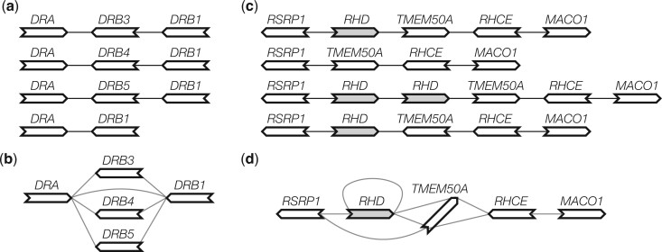

  <sub>**pangene**: pangene graphs of human haplotypes around HLA-DRB1 and RHD, showing gene copy-number changes (Figure 1). Data: human (non-grape data). Source: Li et al. 2024, Bioinformatics, Figure 1 ([doi:10.1093/bioinformatics/btae456](https://doi.org/10.1093/bioinformatics/btae456)), CC BY.</sub>
- **PanTools (ploidy-aware)** (tool) — Graph database pangenome with gene, synteny, repeat and Ka/Ks analyses within and between haplotypes. Tested on apple and potato phased genomes; fits grape haplotype pairs. [doi:10.1111/pbi.14545](https://doi.org/10.1111/pbi.14545) · [link](https://git.wur.nl/bioinformatics/pantools) · [details](docs/PANGENOME_CATALOG.md#L186)

  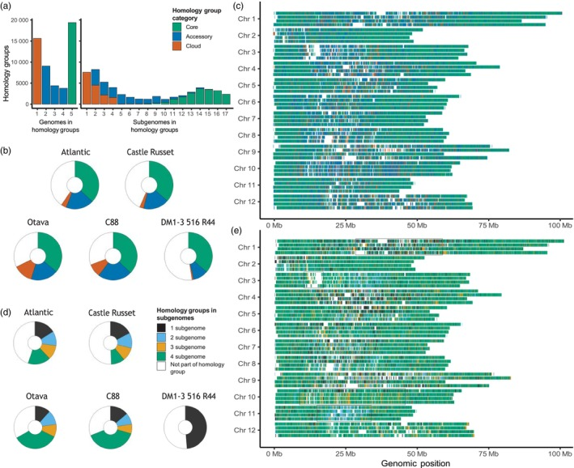

  <sub>**PanTools (ploidy-aware)**: Gene-content characterisation of the tetraploid potato (S. tuberosum) pangenome: homology groups by genome and subgenome (Figure 2). Data: tetraploid potato (non-grape data). Source: Jonkheer et al. 2025, Plant Biotechnology Journal, Figure 2 ([doi:10.1111/pbi.14545](https://doi.org/10.1111/pbi.14545)), CC BY.</sub>
- **GET_HOMOLOGUES-EST** (tool) — Plant-oriented core/soft-core/cloud gene clustering. Simple gene-level core/dispensable curves across grape annotations. [doi:10.3389/fpls.2017.00184](https://doi.org/10.3389/fpls.2017.00184) · [link](https://github.com/eead-csic-compbio/get_homologues) · [details](docs/PANGENOME_CATALOG.md#L187)

  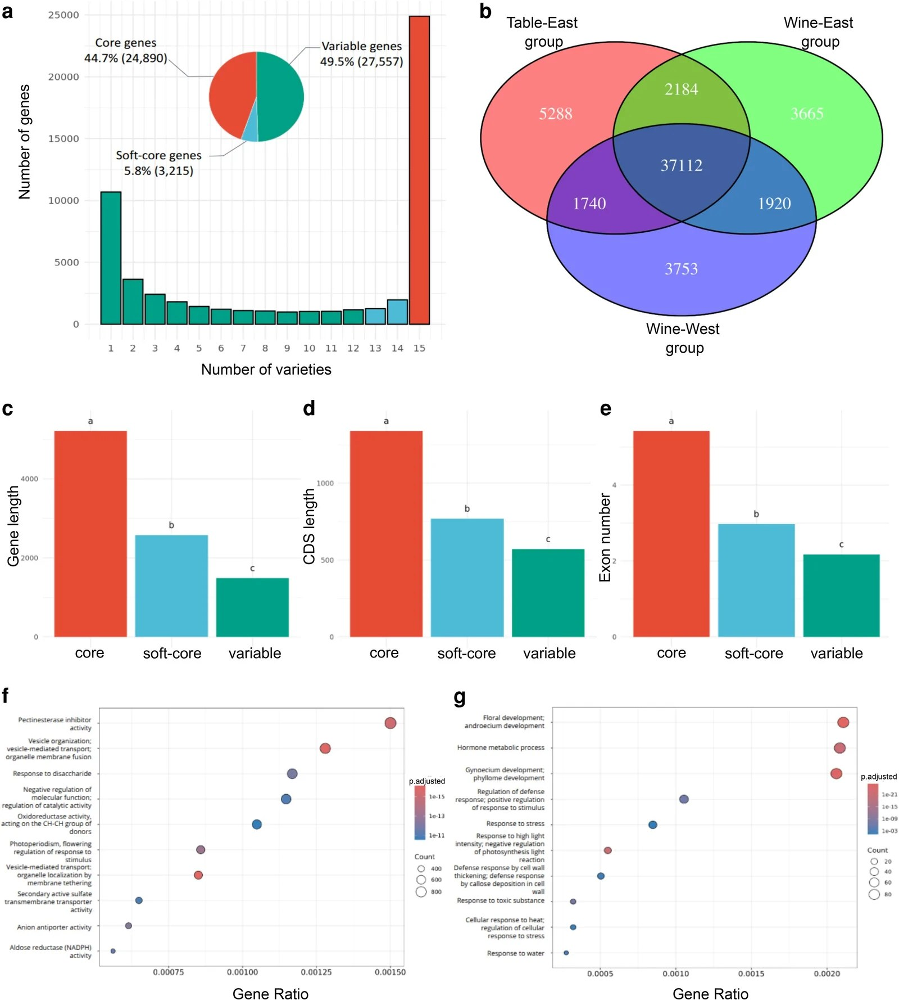

  <sub>**GET_HOMOLOGUES-EST**: Pangene (core/soft-core/shell/cloud) gene-content variation across 15 cultivated grapevine varieties, clustered with GET_HOMOLOGUES-EST (Fig. 2). Data: 15 cultivated grapevine varieties (grape data). Source: Pierre et al. 2026, G3: Genes, Genomes, Genetics, Fig. 2 ([doi:10.1093/g3journal/jkag168](https://doi.org/10.1093/g3journal/jkag168)), CC BY.</sub>
- **SonicParanoid2** (tool) — Fast ortholog inference with ML and domain-architecture graphs. Faster family tables when many grape haplotypes are added. [doi:10.1186/s13059-024-03298-4](https://doi.org/10.1186/s13059-024-03298-4) · [link](https://gitlab.com/salvo981/sonicparanoid2) · [details](docs/PANGENOME_CATALOG.md#L188)
- **miniprot** (tool) — Fast protein-to-genome spliced alignment. Projects reference proteins to each grape haplotype to check gene presence. [doi:10.1093/bioinformatics/btad014](https://doi.org/10.1093/bioinformatics/btad014) · [link](https://github.com/lh3/miniprot) · [details](docs/PANGENOME_CATALOG.md#L189)
- **Liftoff** (tool) — Lifts gene models between assemblies of the same species and reports copy gains. Checks whether existing gene models are present or duplicated in each haplotype; making new gene models stays in gene-structure-annotation. [doi:10.1093/bioinformatics/btaa1016](https://doi.org/10.1093/bioinformatics/btaa1016) · [link](https://github.com/agshumate/Liftoff) · [details](docs/PANGENOME_CATALOG.md#L190)
- **LiftOn** (tool) — Combines DNA and protein alignments to improve lift-over gene models. Better presence/copy calls at divergent grape loci; producing gene models stays in gene-structure-annotation. [doi:10.1101/gr.279620.124](https://doi.org/10.1101/gr.279620.124) · [link](https://github.com/Kuanhao-Chao/LiftOn) · [details](docs/PANGENOME_CATALOG.md#L191)
- **Pan-NLRome** (analysis) — Saturating NLR repertoire across 64 Arabidopsis accessions with resistance-gene enrichment. Model for a *Vitis* pan-NLRome. The *Vitis* super-pangenome (doi:10.1038/s41588-025-02111-7) reports that European cultivars have a smaller repertoire of NLR-family resistance genes encoding the TIR-NBARC-LRR domain (the TNL subclass), not a reduction of all NLRs. [待确认]: whether total NLR counts (all subclasses) also differ among groups in the main text or in Extended Data Fig. 6 was not checked here, because the published article is not open access and the scripted fetch of the submitted bioRxiv PDF returned HTTP 429. [doi:10.1016/j.cell.2019.07.038](https://doi.org/10.1016/j.cell.2019.07.038) · [details](docs/PANGENOME_CATALOG.md#L192)
- **NLR-Annotator** (tool) — Finds NLR loci from motifs, including partial and pseudogenes. NLR-Annotator is a structure-layer locus finder (motifs, including partial genes and pseudogenes); making gene models stays in gene-structure-annotation. This catalog only borrows its locus list to count presence and copy number of NLR loci across haplotypes. [doi:10.1104/pp.19.01273](https://doi.org/10.1104/pp.19.01273) · [link](https://github.com/steuernb/NLR-Annotator) · [details](docs/PANGENOME_CATALOG.md#L193)
- **Gene-level vs sequence-level PAV** (idea) — Report three separate layers: sequence/window PAV, SVs, and gene/family PAV or copy number. Avoids calling panacus bp growth curves "gene PAV" in grape results. [link](https://github.com/codialab/panacus) · [details](docs/PANGENOME_CATALOG.md#L194)
- **Wheat k-mer gene catalog (PanSK)** (analysis) — Uses unique k-mers to infer gene family presence directly from raw reads for association. Infer NLR or terpene-synthase family presence in grape accessions without assembly. [doi:10.1016/j.molp.2024.05.006](https://doi.org/10.1016/j.molp.2024.05.006) · [details](docs/PANGENOME_CATALOG.md#L195)
- **GET_PANGENES** (tool) — Clusters syntenic gene models across genomes from WGA into pangenes. Graph/alignment-aware gene PAV for grape haplotypes using existing gene models. [doi:10.1186/s13059-023-03071-z](https://doi.org/10.1186/s13059-023-03071-z) · [link](https://github.com/Ensembl/plant-scripts/tree/master/pangenes) · [details](docs/PANGENOME_CATALOG_SUPPLEMENT_1.md#vs025)
- **PanOryza pangene catalog** (analysis) — Stable pangene IDs across 16+ rice genomes. Model for a stable grape pangene ID catalog linked to Grapedia IDs. [doi:10.1101/gr.280790.125](https://doi.org/10.1101/gr.280790.125) · [details](docs/PANGENOME_CATALOG_SUPPLEMENT_1.md#vs026)
- **Melon pan-NLRome graph** (analysis) — Adaptive-sampling assemblies of NLR regions in 143 accessions, PGGB subgraphs, node- and k-mer GWAS. Template for Rpv/Run NLR clusters in grape: targeted long-read assembly, locus subgraphs, NLR allele counts. [doi:10.1093/hr/uhag399](https://doi.org/10.1093/hr/uhag399) · [details](docs/PANGENOME_CATALOG_SUPPLEMENT_1.md#vs027)
- **NLR neighborhoods by graph traversal (Arabidopsis)** (analysis) — Defines NLR neighborhoods by walking a pangenome graph to syntenic single-copy anchors (odgi). Graph-aware definition of NLR family copy-number regions in Vitis. [doi:10.1016/j.chom.2025.07.011](https://doi.org/10.1016/j.chom.2025.07.011) · [details](docs/PANGENOME_CATALOG_SUPPLEMENT_1.md#vs028)
- **CAFE 5** (tool) — Models gene family expansion and contraction on a species tree. Family size change (e.g. NLRs, terpene synthases) across Vitis species. [doi:10.1093/bioinformatics/btaa1022](https://doi.org/10.1093/bioinformatics/btaa1022) · [link](https://github.com/hahnlab/CAFE5)
- **Broccoli** (tool) — Orthology assignment combining phylogeny and network clustering. Alternative to OrthoFinder for grape gene families. [doi:10.1093/molbev/msaa159](https://doi.org/10.1093/molbev/msaa159) · [link](https://github.com/rderelle/Broccoli)
- **CNVnator** (tool) — Read-depth CNV caller for short reads. Copy-number of gene regions across a short-read grape panel. [doi:10.1101/gr.114876.110](https://doi.org/10.1101/gr.114876.110) · [link](https://github.com/abyzovlab/CNVnator)
- **mosdepth** (tool) — Fast per-base and per-region coverage from BAM/CRAM. Coverage-based gene presence/absence calls for resequenced grape accessions. [doi:10.1093/bioinformatics/btx699](https://doi.org/10.1093/bioinformatics/btx699) · [link](https://github.com/brentp/mosdepth)
- **DupGen_finder** (tool) — Classifies gene duplicates by mode (WGD, tandem, proximal, transposed, dispersed). Grape keeps the gamma triplication; separates it from tandem copy changes in families. [doi:10.1186/s13059-019-1650-2](https://doi.org/10.1186/s13059-019-1650-2) · [link](https://github.com/qiao-xin/DupGen_finder)
- **Hecaton** (tool) — CNV detection in plant genomes from short reads, tuned for plants. Plant-tested CNV calls for grape resequencing data. [待确认: code URL not found] [doi:10.1186/s12864-019-6153-8](https://doi.org/10.1186/s12864-019-6153-8)
- **cn.MOPS** (tool) — Calls population-level copy number from read depth across many samples simultaneously. Used for gene-family copy number across a grape resequencing panel. [doi:10.1093/nar/gks003](https://doi.org/10.1093/nar/gks003) · [link](https://bioconductor.org/packages/cn.mops/)
- **Control-FREEC** (tool) — Estimates copy number and allelic content from read depth and B-allele frequency. Checks dosage and hemizygous regions in individual grape accessions. [doi:10.1093/bioinformatics/btr670](https://doi.org/10.1093/bioinformatics/btr670) · [link](https://github.com/BoevaLab/FREEC)
- **GrAnnoT + GrAPEx** (tool) — GrAnnoT transfers a gene annotation onto every path of a pangenome graph; GrAPEx (2026 preprint, doi:10.64898/2026.09.28.754982) summarises gene presence across haplotypes. Calls gene PAV directly from the grape graph. [doi:10.24072/pcjournal.651](https://doi.org/10.24072/pcjournal.651) · [link](https://forge.ird.fr/diade/dynadiv/grannot)

<a id="section-8"></a>
## 8. Graph analysis, indexing and formats

Graph manipulation toolkits, compressed indexes, and format specifications for querying and decomposing pangenome graphs, including odgi, GBZ / GBWT, and the GFA specification.

**Needs:** the graph itself (GFA / GBZ / GBWT). No extra cohort data unless running IBD or similar analyses. [Data needs by scenario](#data-needs)

**Clusters:**
- *Graph toolkits and formats* (complementary): odgi, vg toolkit, GBZ / GBWT, GFA specification, GfaPy, libbdsg / libhandlegraph, AGC. odgi for PGGB graphs; vg/GBZ for MC graphs.
- *Bubbles and snarls* (complementary): BubbleGun, Snarl decomposition, Popping bubbles (arXiv), Cataloging variants in pangenome graphs (pantree). How graph sites are defined before genotyping.
- *k-mer indexes* (alternatives): KMC 3, Fulgor, Themisto, SPUMONI 2, ropebwt3. Membership and read classification without alignment. Mash gives sketch distances (script 03), not an index.
- *Coverage and applications on graphs* (complementary): gfainject, gafpack, Graph IBD with SVs (GIBD), GRAFIMO, Billi. Projects alignments or sequence motifs onto graph nodes.

- **odgi** (tool) — Toolkit to sort, layout, extract, untangle and summarize variation graphs. Core analysis toolkit for PGGB grape graphs. [doi:10.1093/bioinformatics/btac308](https://doi.org/10.1093/bioinformatics/btac308) · [link](https://github.com/pangenome/odgi) · [details](docs/PANGENOME_CATALOG.md#L205)
- **GBZ / GBWT** (tool) — Compressed haplotype-aware graph format used by vg Giraffe. Required format for Giraffe genotyping in script 14. [doi:10.1093/bioinformatics/btac656](https://doi.org/10.1093/bioinformatics/btac656) · [link](https://github.com/jltsiren/gbwtgraph) · [details](docs/PANGENOME_CATALOG.md#L206)
- **vg toolkit** (tool) — Variation graph toolkit for construction, indexing, mapping and calling. Backbone of scripts 08 and 14. [doi:10.1038/nbt.4227](https://doi.org/10.1038/nbt.4227) · [link](https://github.com/vgteam/vg) · [details](docs/PANGENOME_CATALOG.md#L207)
- **BubbleGun** (tool) — Detects bubbles and superbubbles and chains in graphs. Summarizes variation hotspots in grape graphs. [doi:10.1093/bioinformatics/btac448](https://doi.org/10.1093/bioinformatics/btac448) · [link](https://github.com/fawaz-dabbaghieh/bubble_gun) · [details](docs/PANGENOME_CATALOG.md#L208)
- **Snarl decomposition** (idea) — Theory of superbubbles, ultrabubbles and cacti that defines graph variant sites. Explains nested sites in vg deconstruct VCFs from grape graphs. [doi:10.1089/cmb.2017.0251](https://doi.org/10.1089/cmb.2017.0251) · [details](docs/PANGENOME_CATALOG.md#L209)
- **AGC** (tool) — Compresses collections of assembled genomes with random access. Ship and store many grape haplotypes efficiently. [doi:10.1093/bioinformatics/btad097](https://doi.org/10.1093/bioinformatics/btad097) · [link](https://github.com/refresh-bio/agc) · [details](docs/PANGENOME_CATALOG.md#L210)
- **Mash** (tool) — MinHash distance between genomes. Script 03; sets PGGB identity and groups communities. [doi:10.1186/s13059-016-0997-x](https://doi.org/10.1186/s13059-016-0997-x) · [link](https://github.com/marbl/Mash) · [details](docs/PANGENOME_CATALOG.md#L211)
- **gfainject** (tool) — Projects BAM alignments to linear paths into GAF on a graph. Reuse existing grape BAMs for graph coverage analyses. [link](https://github.com/AndreaGuarracino/gfainject) · [details](docs/PANGENOME_CATALOG.md#L212)
- **gafpack** (tool) — Converts GAF alignments to node coverage vectors. Node-level coverage matrix for association or CNV checks. [link](https://github.com/pangenome/gafpack) · [details](docs/PANGENOME_CATALOG.md#L213)
- **Graph IBD with SVs (GIBD)** (tool) — Detects identity-by-descent segments in a GBWT and annotates shared SVs. [preprint] Clonal and pedigree relationships among grape cultivars with SV context. [doi:10.64898/2026.11.05.764670](https://doi.org/10.64898/2026.11.05.764670) · [details](docs/PANGENOME_CATALOG.md#L214)
- **GRAFIMO** (tool) — Scans transcription-factor motifs on variation graphs, haplotype-aware. Finds promoter motif gains/losses caused by grape SVs. [preprint] [doi:10.1101/2021.02.04.429752](https://doi.org/10.1101/2021.02.04.429752) · [link](https://github.com/pinellolab/GRAFIMO) · [details](docs/PANGENOME_CATALOG.md#L215)
- **ropebwt3** (tool) — BWT construction and FM-index search for very large sequence collections. (year = repo created; no paper checked) Exact-match queries (e.g. marker k-mers) across all grape haplotypes. [link](https://github.com/lh3/ropebwt3) · [details](docs/PANGENOME_CATALOG_SUPPLEMENT_1.md#vs029)
- **Billi** (tool) — Bubble/snarl detection algorithm for large pangenome graphs (preprint). [preprint] Bubble decomposition defines the variant sites that are later genotyped. [doi:10.1101/2025.11.21.689636](https://doi.org/10.1101/2025.11.21.689636) · [details](docs/PANGENOME_CATALOG_SUPPLEMENT_1.md#vs030)
- **Popping bubbles (arXiv)** (analysis) — Theory/algorithms for bubble structures in pangenome graphs (arXiv preprint). [preprint, arXiv 2410.20932] Background for how variant sites are defined in grape graphs. [link](https://arxiv.org/abs/2410.20932) · [details](docs/PANGENOME_CATALOG_SUPPLEMENT_1.md#vs031)
- **Cataloging variants in pangenome graphs (pantree)** (analysis) — Defines graph variants via reference trees and outputs VCF catalogs. [preprint] [journal version in Cell Genomics; journal DOI 待确认, preprint DOI shown] Consistent variant IDs across grape graph versions. [doi:10.1101/2025.08.04.668502](https://doi.org/10.1101/2025.08.04.668502) · [details](docs/PANGENOME_CATALOG_SUPPLEMENT_1.md#vs032)
- **GFA specification** (format) — GFA 1/2 format specification incl. W-lines. (year = repo created; no paper checked) Shared format for all graph tools here. [link](https://github.com/GFA-spec/GFA-spec) · [details](docs/PANGENOME_CATALOG_SUPPLEMENT_1.md#vs033)
- **GfaPy** (tool) — Python library to read, edit and write GFA1/GFA2 graphs. Small scripts on grape graphs (renaming paths, extracting segments). [doi:10.1093/bioinformatics/btx398](https://doi.org/10.1093/bioinformatics/btx398) · [link](https://github.com/ggonnella/gfapy)
- **KMC 3** (tool) — Fast k-mer counting and set operations. k-mer counts of grape samples for k-mer PAV, GWAS and graph QC. [doi:10.1093/bioinformatics/btx304](https://doi.org/10.1093/bioinformatics/btx304) · [link](https://github.com/refresh-bio/KMC)
- **Fulgor** (tool) — Compact colored k-mer index for many genomes. Query which grape haplotypes contain a sequence without aligning. [doi:10.1186/s13015-024-00251-9](https://doi.org/10.1186/s13015-024-00251-9) · [link](https://github.com/jermp/fulgor)
- **libbdsg / libhandlegraph** (tool) — C++ libraries for dynamic variation graphs used by vg and odgi. Basis for custom tools on grape graphs that need vg-compatible formats. [doi:10.1093/bioinformatics/btaa640](https://doi.org/10.1093/bioinformatics/btaa640) · [link](https://github.com/vgteam/libbdsg)
- **Themisto** (tool) — Scalable colored k-mer index for pseudoalignment. Assign reads to grape haplotypes by k-mer colour. [doi:10.1093/bioinformatics/btad233](https://doi.org/10.1093/bioinformatics/btad233) · [link](https://github.com/algbio/themisto)
- **SPUMONI 2** (tool) — Compressed pangenome index of minimizer digests for rapid read classification. Screens reads for Vitis versus pathogen or Muscadinia origin before mapping. [doi:10.1186/s13059-023-02958-1](https://doi.org/10.1186/s13059-023-02958-1) · [link](https://github.com/oma219/spumoni)

<a id="section-9"></a>
## 9. Visualization

Browsers and plotting utilities for inspecting graph topology, haplotypes, synteny, and sequence repeats, such as BandageNG, SequenceTubeMap, and odgi viz / draw.

**Needs:** the graph and/or alignments; optional tracks such as genes, variants, or methylation. [Data needs by scenario](#data-needs)

**Clusters:**
- *Graph topology viewers* (alternatives): BandageNG, GfaViz, Gfaestus, strangepg, gfalook, odgi viz / draw, waragraph. BandageNG for individual loci; odgi viz for whole-chromosome overviews.
- *Path and haplotype browsers* (alternatives): SequenceTubeMap, VRPG, PangyPlot, PanGraphViewer, MoMI-G, Panache, PanVA, JBrowse 2, IGV. SequenceTubeMap for vg graphs; JBrowse 2 for sharing results with breeders.
- *Synteny and SV figures* (alternatives): NGenomeSyn, GenomeSyn, ntSynt-viz, SVbyEye. Generates publication figures across haplotypes.
- *Repeat dot plots* (alternatives): ModDotPlot, StainedGlass. Visualises centromeres and tandem arrays in T2T haplotypes.
- *Genome tracks* (complementary): pyGenomeTracks, karyoploteR, Circos, TBtools-II. Track-based figures generated without graph structures.

- **BandageNG** (tool) — Maintained fork of Bandage (doi:10.1093/bioinformatics/btv383) incorporating path and GFA improvements; use this instead of the original to inspect single grape locus subgraphs with modern GFA paths. [link](https://github.com/asl/BandageNG) · [details](docs/PANGENOME_CATALOG.md#L226)

  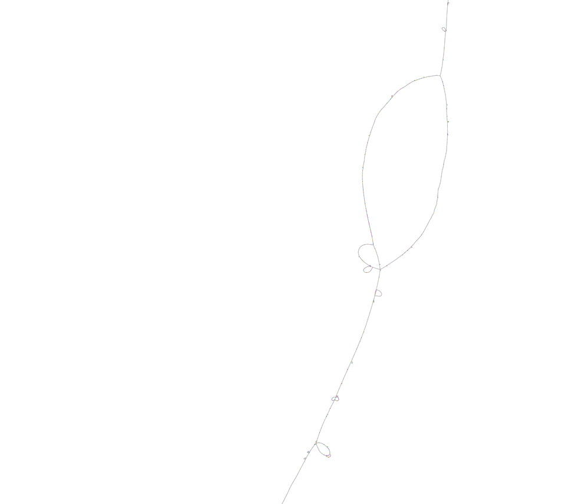

  <sub>**BandageNG**: Bandage-NG view of the MHC region (partial) of a Minigraph-Cactus graph built from GRCh38 plus its alt loci. Data: human, GRCh38 (non-grape data). Source: repository [ComparativeGenomicsToolkit/cactus](https://github.com/ComparativeGenomicsToolkit/cactus/blob/1abe7c3e822d58d6c274c51738cbeb927614d747/doc/grch38-alt-pg-mhc.png), MIT.</sub>
- **SequenceTubeMap** (tool) — Tube-map visualization of haplotype paths and reads in vg graphs. Show grape haplotypes and read support at a candidate SV. [doi:10.1093/bioinformatics/btz597](https://doi.org/10.1093/bioinformatics/btz597) · [link](https://github.com/vgteam/sequenceTubeMap) · [details](docs/PANGENOME_CATALOG.md#L227)
- **odgi viz / draw** (tool) — 1D and 2D renderings of graph paths and layouts. Whole-chromosome view of grape graph diversity. [doi:10.1093/bioinformatics/btac308](https://doi.org/10.1093/bioinformatics/btac308) · [link](https://github.com/pangenome/odgi) · [details](docs/PANGENOME_CATALOG.md#L228)

  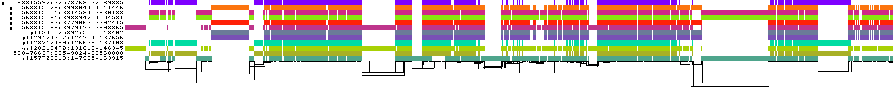

  <sub>**odgi viz / draw**: odgi viz 1D path-coverage plot of the sorted DRB1-3123 graph (human HLA-DRB1 haplotypes). Data: human (non-grape data). Source: repository [pangenome/odgi](https://github.com/pangenome/odgi/blob/fb43f0817d8f3b81ce854f111d6daed8c4c8cbf4/docs/img/DRB1-3123_sorted.png), MIT.</sub>
- **VRPG** (tool) — Web browser of pangenome graphs projected onto linear reference coordinates with annotation tracks. Browse grape graphs next to the gene tracks of PN40024. [doi:10.1101/gr.279461.124](https://doi.org/10.1101/gr.279461.124) · [link](https://github.com/codeatcg/VRPG) · [details](docs/PANGENOME_CATALOG.md#L229)
- **PangyPlot** (tool) — Genome browser for pangenome graphs with linear navigation and physics-based layouts. [preprint] Readable views of large SVs for grape breeders. [doi:10.1101/2025.10.31.684064](https://doi.org/10.1101/2025.10.31.684064) · [link](https://pangyplot.research.sickkids.ca/) · [details](docs/PANGENOME_CATALOG.md#L230)
- **PanGraphViewer** (tool) — Desktop/web viewer for rGFA or VCF-based graphs with gene annotation overlay. Easy local viewing of minigraph grape graphs. [preprint] [doi:10.1101/2023.03.30.534931](https://doi.org/10.1101/2023.03.30.534931) · [link](https://github.com/TF-Chan-Lab/panGraphViewer) · [details](docs/PANGENOME_CATALOG.md#L231)
- **MoMI-G** (tool) — Multi-scale genome graph browser focused on SVs. SV-centric views for grape. [doi:10.1186/s12859-019-3145-2](https://doi.org/10.1186/s12859-019-3145-2) · [link](https://github.com/MoMI-G/MoMI-G) · [details](docs/PANGENOME_CATALOG.md#L232)
- **Panache** (tool) — Linearized pangenome browser of presence/absence blocks (Wheat Panache; Brassica napus Panache 2026). PAV block browser for a grape pangenome database. [doi:10.1002/tpg2.20221](https://doi.org/10.1002/tpg2.20221) · [link](https://github.com/SouthGreenPlatform/panache) · [details](docs/PANGENOME_CATALOG.md#L233)

  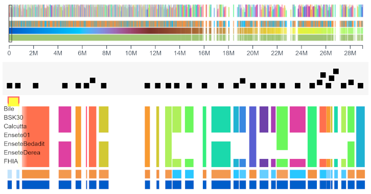

  <sub>**Panache**: Panache presence/absence view of the banana pangenome (Rijzaani et al. 2021 data). Data: banana (non-grape data). Source: repository [SouthGreenPlatform/panache](https://github.com/SouthGreenPlatform/panache/blob/d003a516a40bbfb512e4ff0fed6162a2e8d87b57/imagesReadMe/panacheBanana_clipped.png), MIT.</sub>
- **PanVA** (tool) — Visual analytics of variants in homology groups with phylogeny and metadata. [preprint] Explore resistance-gene alleles across grape accessions with phenotypes. [doi:10.1101/2025.06.23.661080](https://doi.org/10.1101/2025.06.23.661080) · [link](https://github.com/PanBrowse/PanVA) · [details](docs/PANGENOME_CATALOG.md#L234)
- **JBrowse 2** (tool) — Genome browser with synteny and multi-genome views. GrapeGenomics.com already hosts JBrowse 2 for Vitis genomes. [doi:10.1186/s13059-023-02914-z](https://doi.org/10.1186/s13059-023-02914-z) · [link](https://jbrowse.org/jb2/) · [details](docs/PANGENOME_CATALOG.md#L235)
- **ntSynt-viz** (tool) — Ribbon plots of ntSynt synteny across multiple genomes. [preprint] Fast genus-wide grape synteny figures. [doi:10.1101/2025.01.15.633221](https://doi.org/10.1101/2025.01.15.633221) · [link](https://github.com/BirolLab/ntSynt-viz) · [details](docs/PANGENOME_CATALOG.md#L236)

  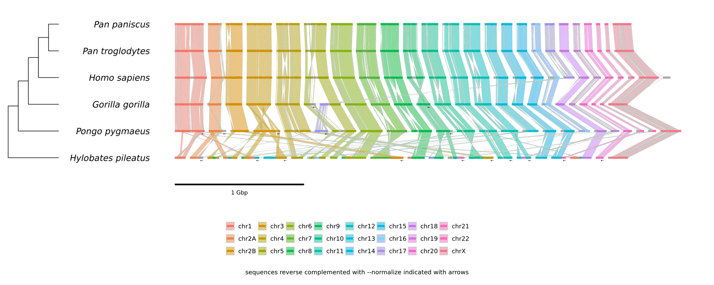

  <sub>**ntSynt-viz**: ntSynt-viz ribbon plot of ntSynt synteny blocks across great ape genome assemblies, with mitochondrial tree. Data: great apes (non-grape data). Source: repository [bcgsc/ntSynt-viz](https://github.com/bcgsc/ntSynt-viz/blob/9abc3078d42a695c7cbffed0d7d753e6817189d0/tests/great-apes_ribbon-plots.example1.png), GPL-3.0.</sub>
- **GfaViz** (tool) — GFA1/GFA2 visualization. Quick figures of small subgraphs. [doi:10.1093/bioinformatics/bty1046](https://doi.org/10.1093/bioinformatics/bty1046) · [link](https://github.com/ggonnella/gfaviz) · [details](docs/PANGENOME_CATALOG_SUPPLEMENT_1.md#vs034)
- **NGenomeSyn** (tool) — Multi-genome synteny figures. Publication-ready synteny across Vitis species. [doi:10.1093/bioinformatics/btad121](https://doi.org/10.1093/bioinformatics/btad121) · [link](https://github.com/hewm2008/NGenomeSyn) · [details](docs/PANGENOME_CATALOG_SUPPLEMENT_1.md#vs035)
- **SVbyEye** (tool) — R package for assembly-level SV visualization (miropeats-style). Visualize complex SVs at loci such as Rpv3 or Run1 across assemblies. [doi:10.1093/bioinformatics/btaf332](https://doi.org/10.1093/bioinformatics/btaf332) · [link](https://github.com/daewoooo/SVbyEye) · [details](docs/PANGENOME_CATALOG_SUPPLEMENT_1.md#vs036)
- **ModDotPlot** (tool) — Fast identity-heatmap dot plots for tandem repeats. Compare grape centromere arrays across haplotypes. [doi:10.1093/bioinformatics/btae493](https://doi.org/10.1093/bioinformatics/btae493) · [link](https://github.com/marbl/ModDotPlot) · [details](docs/PANGENOME_CATALOG_SUPPLEMENT_1.md#vs037)

  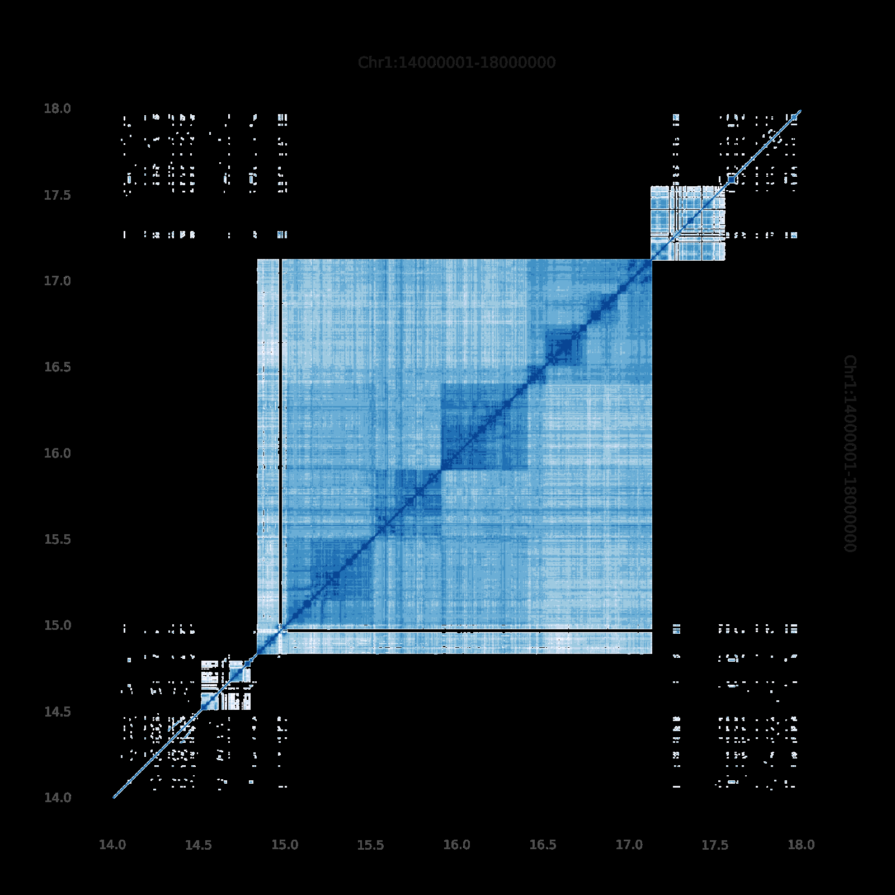

  <sub>**ModDotPlot**: ModDotPlot self-identity dot plot of Arabidopsis thaliana Chr1 14-18 Mb (centromere region). Data: Arabidopsis thaliana (non-grape data). Source: repository [marbl/ModDotPlot](https://github.com/marbl/ModDotPlot/blob/0be099ef3596473955dfb90b17a882dd95ee9dd9/images/Chr1_14000001-18000000_FULL.png), MIT.</sub>
- **StainedGlass** (tool) — Identity heatmaps of tandem repeat structures. Complementary centromere/rDNA view. [doi:10.1093/bioinformatics/btac018](https://doi.org/10.1093/bioinformatics/btac018) · [link](https://github.com/mrvollger/StainedGlass) · [details](docs/PANGENOME_CATALOG_SUPPLEMENT_1.md#vs038)

  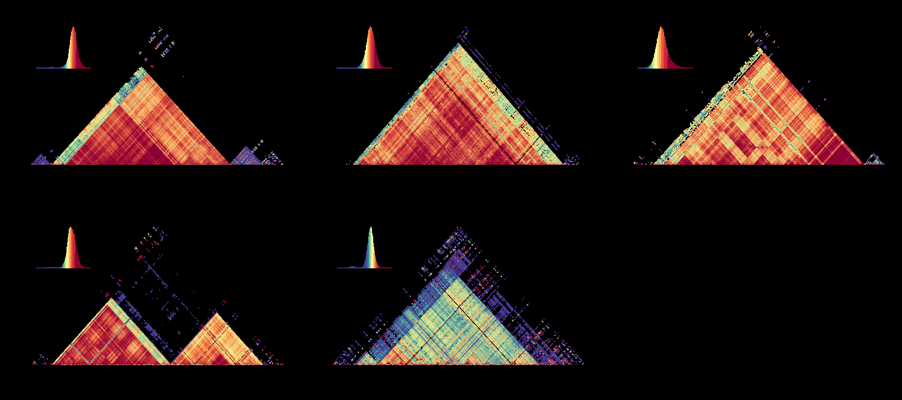

  <sub>**StainedGlass**: StainedGlass identity heatmaps of the five Arabidopsis thaliana centromeres (Col-CEN assembly, Naish et al. 2021). Data: Arabidopsis thaliana (non-grape data). Source: repository [vollgerlab/StainedGlass](https://github.com/vollgerlab/StainedGlass/blob/bcd23c73ad232caafc0262445b3141a165c4cb83/images/CENs_Arabidopsis.2000.10000.tri.TRUE__onecolorscale.TRUE__all.png), MIT.</sub>
- **waragraph** (tool) — GPU pangenome graph viewer (1D/2D). (year = repo created; no paper checked) Interactive whole-graph browsing. [link](https://github.com/chfi/waragraph) · [details](docs/PANGENOME_CATALOG_SUPPLEMENT_1.md#vs039)
- **strangepg** (tool) — Interactive viewer for very large GFA graphs with coarsening and live layout. (year = repo created; no paper checked) View whole-chromosome grape graphs. [link](https://github.com/qwx9/strangepg) · [details](docs/PANGENOME_CATALOG_SUPPLEMENT_1.md#vs040)
- **gfalook** (tool) — Pangenome graph rendering tool in the pangenome org (odgi-viz style). (year = repo created; no paper checked) Lightweight figures of PGGB grape graphs. [link](https://github.com/pangenome/gfalook) · [details](docs/PANGENOME_CATALOG_SUPPLEMENT_1.md#vs041)
- **IGV** (tool) — Desktop genome browser for alignments, variants and tracks. Inspect reads at grape SV and PAV calls after surjecting to linear coordinates. [doi:10.1038/nbt.1754](https://doi.org/10.1038/nbt.1754) · [link](https://github.com/igvteam/igv)
- **Circos** (tool) — Circular plots of genomic data and links. Genome-wide overview of grape SV density and synteny links. [待确认: circos.ca not reachable when checked] [doi:10.1101/gr.092759.109](https://doi.org/10.1101/gr.092759.109)
- **pyGenomeTracks** (tool) — Python tool for publication-style genome track plots. Stack coverage, genes and SVs for a grape locus in one figure. [doi:10.1093/bioinformatics/btaa692](https://doi.org/10.1093/bioinformatics/btaa692) · [link](https://github.com/deeptools/pyGenomeTracks)

  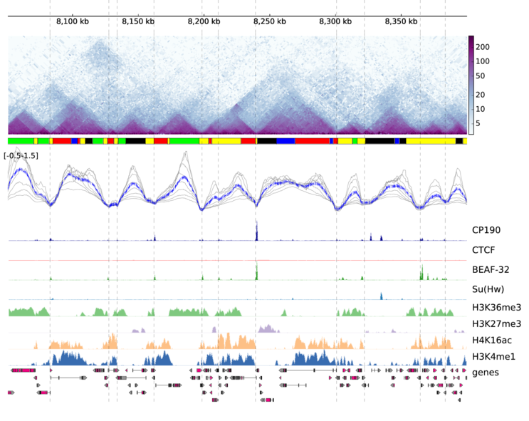

  <sub>**pyGenomeTracks**: pyGenomeTracks Hi-C plus track figure from Ramirez et al. 2018 Nat Commun (Drosophila melanogaster Hi-C; paper is CC-BY). Data: Drosophila melanogaster (non-grape data). Source: repository [deeptools/pyGenomeTracks](https://github.com/deeptools/pyGenomeTracks/blob/f25fcf1a48bb16a0afbd1cb95e9c5fed99d27fc7/docs/content/images/hic_example_nat_comm_small.png), GPL-3.0; figure originally from Ramírez et al. 2018, Nature Communications ([doi:10.1038/s41467-017-02525-w](https://doi.org/10.1038/s41467-017-02525-w), CC BY).</sub>
- **karyoploteR** (tool) — R/Bioconductor package to plot data along chromosomes. Chromosome-scale plots of grape PAV or SV density. [doi:10.1093/bioinformatics/btx346](https://doi.org/10.1093/bioinformatics/btx346) · [link](https://github.com/bernatgel/karyoploteR)
- **GenomeSyn** (tool) — Draws synteny and SVs among several genomes. Multi-haplotype synteny/SV figures for grape accessions. [doi:10.1016/j.jgg.2022.03.013](https://doi.org/10.1016/j.jgg.2022.03.013) · [link](https://github.com/jmsong2/GenomeSyn)
- **TBtools-II** (tool) — GUI toolkit providing diverse plotting functions (synteny, heatmaps, Circos-like views) for biologists; TBtools-II is the current release (first TBtools paper doi:10.1016/j.molp.2020.06.009). Widely used by grape laboratories for figure generation without scripting. [doi:10.1016/j.molp.2023.09.010](https://doi.org/10.1016/j.molp.2023.09.010) · [link](https://github.com/CJ-Chen/TBtools-II)
- **Gfaestus** (tool) — GPU-based interactive viewer for large GFA graphs using odgi layouts. Browse whole-chromosome grape PGGB graphs interactively. (no paper found) [link](https://github.com/chfi/gfaestus)

<a id="section-10"></a>
## 10. Expression, QTL and pangenome-GWAS

Methods and case studies linking pangenome structural variants, graph nodes, k-mers, transcriptomes, and methylomes to phenotypes, including Grapepan v1.0 SV-GWAS, NodeGWAS, and rpvg / spliced pangenome graphs.

**Needs:** identity-checked graph genotypes plus phenotypes for GWAS (one representative per clone); plus RNA-seq from the same genotype for eQTL; plus native 5mC (ONT: pod5/fast5 or MM/ML tags; HiFi: kinetics) or bisulfite reads for methylation layers. [Data needs by scenario](#data-needs)

**Clusters:**
- *Expression and epigenome on the graph (10a)* (complementary): tensorQTL, QTLtools, coloc, phASER, rpvg / spliced pangenome graphs, modkit, methylGrapher, methylation on graphs: panmethyl, Graph Peak Caller. eQTL mapping with tensorQTL or QTLtools on graph SV genotypes; phASER for allele-specific expression in heterozygous clones; coloc to link eQTLs with GWAS signals.
- *GWAS on graphs and k-mers (10b)* (alternatives): GEMMA, GCTA, PLINK 2, GAPIT 3, rMVP, NodeGWAS, kmersGWAS, kGWASflow, PanKmer, kmdiff, pyseer, panGWAS (PHAC). Mixed models (GEMMA, GAPIT) applied to graph genotypes first; k-mer GWAS captures variants missing from the graph.
- *Linkage maps and family QTL (10b)* (in order): Lep-MAP3, R/qtl2. Grape F1 crosses: Lep-MAP3 maps per parent, followed by R/qtl2 scans.
- *Genomic prediction (10b)* (alternatives): rrBLUP, BGLR, SV vs SNP genomic selection in rice, Pan-genome PAV in gene-bank genomic prediction. rrBLUP serves as a baseline, followed by BGLR using combined SNP and SV kernels.

- **Grapepan v1.0 SV-GWAS** (analysis) — Graph pangenome of 29 haplotypes; 466 accessions genotyped; SVs add heritability and QTLs for 29 traits. Direct Vitis precedent for SV-GWAS and genomic prediction. [doi:10.1038/s41588-024-01967-5](https://doi.org/10.1038/s41588-024-01967-5) · [details](docs/PANGENOME_CATALOG.md#L246)
- **Vitis super-pangenome SV-eQTL** (analysis) — 72 haplotype-resolved Vitis genomes; SV-eQTL and DM-infection transcriptomes identify VvLHT8 and other DM resistance loci. Model for SV-expression links in grape disease resistance. [doi:10.1038/s41588-025-02111-7](https://doi.org/10.1038/s41588-025-02111-7) · [details](docs/PANGENOME_CATALOG.md#L247)
- **NodeGWAS** (tool) — Turns graph alignments into node presence/count matrices for association and maps hits to linear coordinates. Association directly on graph nodes in diverse or polyploid grape material. [doi:10.1016/j.xplc.2026.101835](https://doi.org/10.1016/j.xplc.2026.101835) · [link](https://github.com/zhangyixing3/NodeGWAS) · [details](docs/PANGENOME_CATALOG.md#L248)
- **kmersGWAS** (tool) — Reference-free GWAS on k-mer presence/absence. Captures SV and PAV effects missed by SNP GWAS in grape. [doi:10.1038/s41588-020-0612-7](https://doi.org/10.1038/s41588-020-0612-7) · [link](https://github.com/voichek/kmersGWAS) · [details](docs/PANGENOME_CATALOG.md#L249)
- **Graph meta-GWAS (rice)** (analysis) — Meta-analysis of six GWAS panels with graph-derived PAVs increases detected QTLs. Combine several grape GWAS panels on one graph. [doi:10.1038/s41467-025-58081-1](https://doi.org/10.1038/s41467-025-58081-1) · [details](docs/PANGENOME_CATALOG.md#L250)
- **Potato PAV metabolite-GWAS** (analysis) — Graph-based SV PAVs associated with >1,000 tuber metabolites. Template for berry metabolite (aroma, anthocyanin) SV-mGWAS in grape. [doi:10.1016/j.molp.2025.01.017](https://doi.org/10.1016/j.molp.2025.01.017) · [details](docs/PANGENOME_CATALOG.md#L251)
- **Brassica napus SV-eQTL** (analysis) — Graph-genotyped SVs and expression reveal cis SV-eQTLs, many TE insertions. Same design for grape berry or leaf expression. [doi:10.1007/s00122-025-04867-2](https://doi.org/10.1007/s00122-025-04867-2) · [details](docs/PANGENOME_CATALOG.md#L252)
- **rpvg / spliced pangenome graphs** (tool) — Haplotype-aware transcript quantification on spliced pangenome graphs. Allele-aware expression across grape haplotypes; not the annotation RNA-evidence step. [doi:10.1038/s41592-022-01731-9](https://doi.org/10.1038/s41592-022-01731-9) · [link](https://github.com/jonassibbesen/rpvg) · [details](docs/PANGENOME_CATALOG.md#L253)
- **Tomato super-pangenome heritability** (analysis) — Graph pangenome of 32 genomes recovers missing heritability via SVs in 332 accessions. Shows why SVs belong in grape trait models. [doi:10.1038/s41586-022-04808-9](https://doi.org/10.1038/s41586-022-04808-9) · [details](docs/PANGENOME_CATALOG.md#L254)
- **Tomato SVs and expression** (analysis) — Long-read SVs in 100 tomatoes change gene dosage/expression and fruit traits. Classic SV–expression–trait design for fruit crops. [doi:10.1016/j.cell.2020.05.021](https://doi.org/10.1016/j.cell.2020.05.021) · [details](docs/PANGENOME_CATALOG.md#L255)
- **Oat pangenome + pantranscriptome** (analysis) — Combines a pangenome with multi-tissue transcriptomes to study expression variation. Template for a grape pantranscriptome across tissues. [doi:10.1038/s41586-025-09676-7](https://doi.org/10.1038/s41586-025-09676-7) · [details](docs/PANGENOME_CATALOG.md#L256)
- **methylGrapher** (tool) — Maps bisulfite methylation data to genome graphs. Methylation at grape SVs/TEs without reference bias. [doi:10.1093/nar/gkaf028](https://doi.org/10.1093/nar/gkaf028) · [link](https://github.com/twlab/methylGrapher) · [details](docs/PANGENOME_CATALOG.md#L257)

### (a) Expression and epigenome layers on the pangenome

Pangenome-level expression and epigenome analyses. This is not RNA evidence for gene-structure annotation and not functional annotation.

- **Graph Peak Caller** (tool) — ChIP-seq peak calling on graphs. Peak calling in SV regions for grape epigenomics. [doi:10.1371/journal.pcbi.1006731](https://doi.org/10.1371/journal.pcbi.1006731) · [link](https://github.com/uio-bmi/graph_peak_caller) · [details](docs/PANGENOME_CATALOG_SUPPLEMENT_1.md#vs042)

  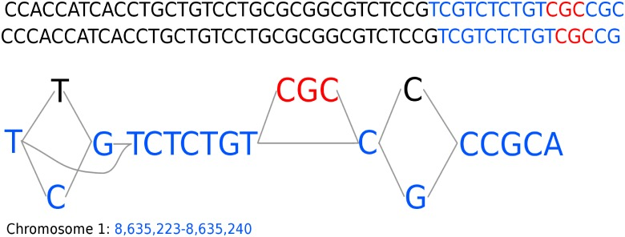

  <sub>**Graph Peak Caller**: A ChIP-seq peak called on the A. thaliana graph reference (chr1) over SNPs and an indel absent from the linear reference (Fig 4). Data: Arabidopsis thaliana (non-grape data). Source: Grytten et al. 2019, PLOS Computational Biology, Fig 4 ([doi:10.1371/journal.pcbi.1006731](https://doi.org/10.1371/journal.pcbi.1006731)), CC BY.</sub>
- **methylation on graphs: panmethyl** (tool) — Nextflow pipeline mapping long-read methylation to GFA pangenomes. (year = repo created; no paper checked) Methylation over non-reference grape sequence from ONT/HiFi. [link](https://github.com/cgroza/panmethyl) · [details](docs/PANGENOME_CATALOG_SUPPLEMENT_1.md#vs043)
- **modkit** (tool) — Extracts modified-base calls (5mC/6mA) from ONT BAMs. (year = repo created; no paper checked) Haplotype-resolved methylation from the same ONT data used for assemblies. [link](https://github.com/nanoporetech/modkit) · [details](docs/PANGENOME_CATALOG_SUPPLEMENT_1.md#vs044)
- **Phased epigenomics in a Vitis hybrid** (analysis) — Allele-specific methylation via phased graphs in a grape trio. Direct Vitis precedent for haplotype-resolved epigenomics. [doi:10.1186/s13059-025-03858-2](https://doi.org/10.1186/s13059-025-03858-2) · [link](https://github.com/noecochetel/Epigenomics_Trio) · [details](docs/PANGENOME_CATALOG_SUPPLEMENT_1.md#vs045)

  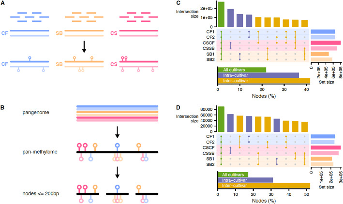

  <sub>**Phased epigenomics in a Vitis hybrid**: Pan-methylome of Cabernet Sauvignon and its parents: cultivar-specific bisulfite data projected onto a sequence graph (Fig 2). Data: Cabernet Sauvignon and its parents (grape data). Source: Cochetel et al. 2025, Genome Biology, Fig 2 ([doi:10.1186/s13059-025-03858-2](https://doi.org/10.1186/s13059-025-03858-2)), CC BY.</sub>
- **Clonal genome-methylome map in grapevine** (analysis) — Somatic SVs and methylation across grape clones. Clonal propagation means somatic SVs must be separated from inherited heterozygosity. [doi:10.1186/s13059-026-04184-x](https://doi.org/10.1186/s13059-026-04184-x) · [link](https://pmc.ncbi.nlm.nih.gov/articles/PMC13352677/) · [details](docs/PANGENOME_CATALOG_SUPPLEMENT_1.md#vs046)
- **Barley pan-transcriptome** (analysis) — Core/shell/cloud transcripts across 20 genotypes. Template for a grape pan-transcriptome classification (core/shell/cloud at the expression layer). This does not supply gene models to gene-structure-annotation. [doi:10.1038/s41588-024-02069-y](https://doi.org/10.1038/s41588-024-02069-y) · [link](https://doi.org/10.1038/s41588-024-02069-y) · [details](docs/PANGENOME_CATALOG_SUPPLEMENT_1.md#vs047)
- **tensorQTL** (tool) — GPU-accelerated cis/trans eQTL mapping. eQTL scans with graph SV genotypes on grape berry RNA-seq. [doi:10.1186/s13059-019-1836-7](https://doi.org/10.1186/s13059-019-1836-7) · [link](https://github.com/broadinstitute/tensorqtl)
- **coloc** (tool) — Bayesian test for whether two association signals share a causal variant. Checks if a grape GWAS hit and an eQTL point to the same SV. [doi:10.1371/journal.pgen.1004383](https://doi.org/10.1371/journal.pgen.1004383) · [link](https://github.com/chr1swallace/coloc)
- **phASER** (tool) — Phases genetic variants using RNA sequencing reads and quantifies haplotype-level expression. Measures allele-specific expression in heterozygous grape clones using graph haplotypes as a phasing guide. [doi:10.1038/ncomms12817](https://doi.org/10.1038/ncomms12817) · [link](https://github.com/secastel/phaser)
- **QTLtools** (tool) — Comprehensive toolkit for molecular QTL mapping incorporating permutation and conditional analysis passes. Performs eQTL analysis on graph-derived SV genotypes alongside tensorQTL. [doi:10.1038/ncomms15452](https://doi.org/10.1038/ncomms15452) · [link](https://github.com/qtltools/qtltools)

### (b) QTL, pangenome-GWAS and genomic prediction

Association and prediction using graph or k-mer variants.

- **kGWASflow** (tool) — Snakemake workflow for k-mer GWAS with post-GWAS mapping. Ready-to-run k-mer GWAS for grape panels. [doi:10.1093/g3journal/jkad246](https://doi.org/10.1093/g3journal/jkad246) · [link](https://github.com/akcorut/kGWASflow) · [details](docs/PANGENOME_CATALOG_SUPPLEMENT_1.md#vs048)
- **PanKmer** (tool) — k-mer pangenome indexing, presence/absence and association, reference-free. Reference-free k-mer association in grape cohorts. The presence/absence index itself is sequence-level PAV (section 4a), not gene-level PAV and not genotyping of known graph sites in section 5. [doi:10.1093/bioinformatics/btad621](https://doi.org/10.1093/bioinformatics/btad621) · [link](https://gitlab.com/salk-tm/pankmer) · [details](docs/PANGENOME_CATALOG_SUPPLEMENT_1.md#vs049)
- **kmdiff** (tool) — Differential k-mer analysis between groups with population-structure correction. Case/control k-mers (e.g. resistant vs susceptible grapes). [doi:10.1093/bioinformatics/btac689](https://doi.org/10.1093/bioinformatics/btac689) · [link](https://github.com/tlemane/kmdiff) · [details](docs/PANGENOME_CATALOG_SUPPLEMENT_1.md#vs050)
- **pyseer** (tool) — k-mer/unitig/PAV association with mixed models (microbial origin). Unitig-GWAS idea transferable to grape PAV. [doi:10.1093/bioinformatics/bty539](https://doi.org/10.1093/bioinformatics/bty539) · [link](https://github.com/mgalardini/pyseer) · [details](docs/PANGENOME_CATALOG_SUPPLEMENT_1.md#vs051)

  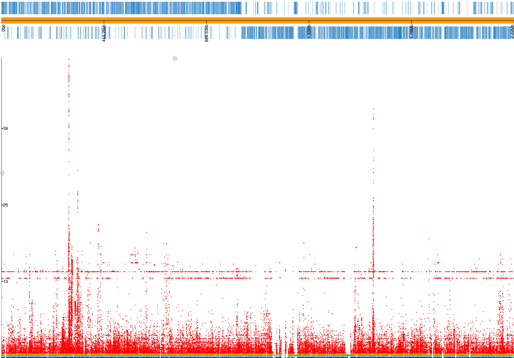

  <sub>**pyseer**: pyseer Manhattan plot of a penicillin-resistance GWAS in 616 Streptococcus pneumoniae genomes from Massachusetts (pyseer tutorial). Data: Streptococcus pneumoniae (non-grape data). Source: repository [mgalardini/pyseer](https://github.com/mgalardini/pyseer/blob/65e0fbe30c8fce653431d154678321c460cda8cf/docs/pbp_manhattan.png), Apache-2.0.</sub>
- **panGWAS (PHAC)** (tool) — Pangenome-wide association pipeline (SNP, PAV, SV) using pyseer (microbial). (year = repo created; no paper checked) Idea source for multi-variant-class association. [link](https://github.com/phac-nml/pangwas) · [details](docs/PANGENOME_CATALOG_SUPPLEMENT_1.md#vs052)
- **Cucumber graph pangenome in breeding** (analysis) — SV dynamics across breeding history; SV burden in genomic prediction (preprint). [preprint] SV burden as a predictor for grape breeding lines. [doi:10.1101/2025.07.17.665377](https://doi.org/10.1101/2025.07.17.665377) · [details](docs/PANGENOME_CATALOG_SUPPLEMENT_1.md#vs053)
- **SV vs SNP genomic selection in rice** (analysis) — Systematic SV vs SNP genomic prediction comparison. Expect SVs alone ~ SNPs; check before claiming gains in grape GS. [doi:10.1016/j.cj.2025.08.005](https://doi.org/10.1016/j.cj.2025.08.005) · [link](https://doi.org/10.1016/j.cj.2025.08.005) · [details](docs/PANGENOME_CATALOG_SUPPLEMENT_1.md#vs054)
- **Pan-genome PAV in gene-bank genomic prediction** (analysis) — PAV and low-call-rate SNPs as extra GP predictors. Grape germplasm collections are gene-bank-like. [doi:10.1007/s00122-025-05080-x](https://doi.org/10.1007/s00122-025-05080-x) · [link](https://pmc.ncbi.nlm.nih.gov/articles/PMC12594682/) · [details](docs/PANGENOME_CATALOG_SUPPLEMENT_1.md#vs055)
- **GEMMA** (tool) — Linear mixed-model association testing. Standard LMM for grape GWAS on graph-derived SNP/SV/PAV genotypes. [doi:10.1038/ng.2310](https://doi.org/10.1038/ng.2310) · [link](https://github.com/genetics-statistics/GEMMA)

  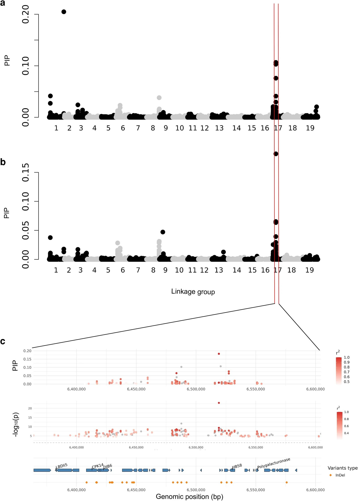

  <sub>**GEMMA**: GEMMA BSLMM GWAS of berry weight in 277 grapevine varieties, PN40024 linear reference vs pangenome-graph genotypes (Fig. 6). Data: 277 grapevine varieties (grape data). Source: Pierre et al. 2026, G3: Genes, Genomes, Genetics, Fig. 6 ([doi:10.1093/g3journal/jkag168](https://doi.org/10.1093/g3journal/jkag168)), CC BY.</sub>
- **GCTA** (tool) — Heritability, GREML and mixed-model association. Estimate how much trait variance grape SVs add beyond SNPs. [doi:10.1016/j.ajhg.2010.11.011](https://doi.org/10.1016/j.ajhg.2010.11.011) · [link](https://github.com/jianyangqt/gcta)
- **PLINK 2** (tool) — Fast genotype data handling, QC and association. QC, LD pruning and PCA of grape cohort genotypes before GWAS. [doi:10.1186/s13742-015-0047-8](https://doi.org/10.1186/s13742-015-0047-8) · [link](https://github.com/chrchang/plink-ng)
- **GAPIT 3** (tool) — R package for GWAS (MLM, FarmCPU, BLINK) and genomic prediction. Common in plant breeding; runs grape GWAS with several models. [doi:10.1016/j.gpb.2021.08.005](https://doi.org/10.1016/j.gpb.2021.08.005) · [link](https://github.com/jiabowang/GAPIT)
- **rMVP** (tool) — Memory-efficient GWAS in R with built-in Manhattan/QQ plots. Large grape panels with SV/PAV markers; plots ready for reports. [doi:10.1016/j.gpb.2020.10.007](https://doi.org/10.1016/j.gpb.2020.10.007) · [link](https://github.com/xiaolei-lab/rMVP)
- **Lep-MAP3** (tool) — Constructs linkage maps from high-density markers even with low-coverage data, supporting outcrossed F1 families. Grape mapping populations typically consist of heterozygous F1 crosses. [doi:10.1093/bioinformatics/btx494](https://doi.org/10.1093/bioinformatics/btx494) · [link](https://sourceforge.net/projects/lep-map3/)
- **R/qtl2** (tool) — QTL mapping for experimental crosses and multi-parent populations. For an outcrossed grape F1, map each parent separately as a pseudo-testcross or use a tool built for CP populations [待确认: R/qtl2 cross types for outbred F1]. [doi:10.1534/genetics.118.301595](https://doi.org/10.1534/genetics.118.301595) · [link](https://github.com/rqtl/qtl2)
- **BGLR** (tool) — Bayesian whole-genome regression framework supporting BayesA, BayesB, BayesC, and RKHS models. Enables comparison of SNP-only versus combined SNP and SV kernels for grape breeding values. [doi:10.1534/genetics.114.164442](https://doi.org/10.1534/genetics.114.164442) · [link](https://github.com/gdlc/BGLR-R)
- **rrBLUP** (tool) — Ridge-regression BLUP and kernel models designed for genomic selection. Acts as a simple baseline prior to applying Bayesian models in grape panels. [doi:10.3835/plantgenome2011.08.0024](https://doi.org/10.3835/plantgenome2011.08.0024) · [link](https://cran.r-project.org/package=rrBLUP)

<a id="section-11"></a>
## 11. Evolution, ancestry and introgression

Genealogy (ARG / tree-sequence) inference, such as SINGER and tsinfer; introgression tests, such as Dsuite; and studies on grapevine domestication and clonal diversification.

**Needs:** identity-checked population genotypes (one representative per clone), plus outgroups for introgression tests; phased haplotypes and ancestral alleles for genealogy (ARG / tree-sequence) inference. Dsuite only flags candidate introgressed regions and cannot separate introgression from selection. [Data needs by scenario](#data-needs)

**Clusters:**
- *Structure and admixture* (complementary): ADMIXTURE, PCAngsd, ADMIXTOOLS 2, TreeMix, Dsuite, Twisst. Applied after clone deduplication; PCAngsd is tailored for low-depth sequence data.
- *Genealogies and ARGs* (alternatives): tsinfer, SINGER, ARG-Needle, Relate. All need phased haplotypes; check whether each needs ancestral (polarised) alleles [待确认]. hap-ibd (IBD segments; phased, not polarised data) complements them for pedigree work.
- *Phylogeny* (complementary): IQ-TREE 2, ASTRAL, Mashtree. Used for reconstructing species and haplotype phylogenetic trees.
- *Diversity, LD and demography* (complementary): pixy, PopLDdecay, ANGSD, SMC++. pixy needs an all-sites VCF that includes invariant sites; a graph VCF from vg deconstruct holds variant sites only, so add invariant or callable sites first. PopLDdecay to choose GWAS windows.
- *Selection scans* (complementary): selscan, RAiSD, XP-CLR. Use them together to cross-check: XP-CLR does not need polarised alleles; selscan (iHS) does.
- *Grape precedents* (complementary): Grapevine SV domestication, Grapevine clone diversification, Dual domestication of grapevine, NA Vitis wild introgression, Clonal diversity in grapevine (review), Haplotype-aware phylogenomics. Published grape results to compare graph-based findings with.

- **Grapevine SV domestication** (analysis) — Population genetics of SVs and hemizygosity in grapevine domestication. Foundational Vitis SV study to compare graph results with. [doi:10.1038/s41477-019-0507-8](https://doi.org/10.1038/s41477-019-0507-8) · [details](docs/PANGENOME_CATALOG.md#L267)
- **Grapevine clone diversification** (analysis) — Somatic SVs and SNVs among grapevine clones. Motivates clone-level graphs for Pinot/Chardonnay clones. [doi:10.1186/s12864-019-6211-2](https://doi.org/10.1186/s12864-019-6211-2) · [details](docs/PANGENOME_CATALOG.md#L268)

  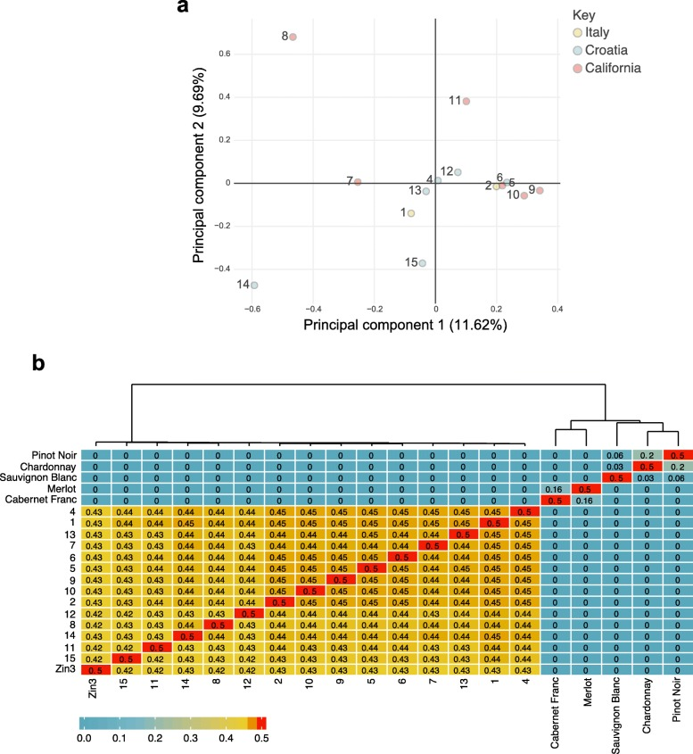

  <sub>**Grapevine clone diversification**: PCA and kinship of Zinfandel clonal selections from SNVs (Fig. 3). Data: Zinfandel clones (grape data). Source: Vondras et al. 2019, BMC Genomics, Fig. 3 ([doi:10.1186/s12864-019-6211-2](https://doi.org/10.1186/s12864-019-6211-2)), CC BY.</sub>
- **SINGER** (tool) — Bayesian ancestral recombination graph inference for hundreds of genomes. Genealogies for introgression and selection in grape haplotypes. [doi:10.1038/s41588-025-02317-9](https://doi.org/10.1038/s41588-025-02317-9) · [link](https://github.com/popgenmethods/SINGER) · [details](docs/PANGENOME_CATALOG.md#L269)

  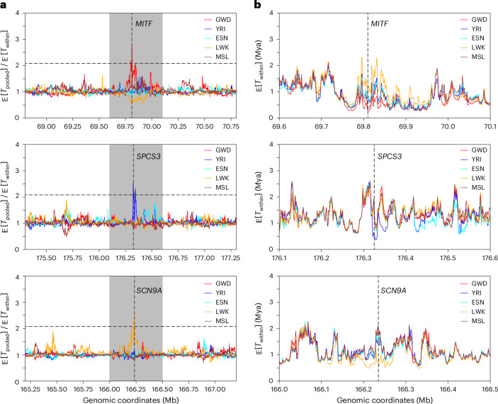

  <sub>**SINGER**: ARG-based coalescence-time differentiation across five African 1000 Genomes populations inferred with SINGER (Fig. 5). Data: human, 1000 Genomes (non-grape data). Source: Deng et al. 2025, Nature Genetics, Fig. 5 ([doi:10.1038/s41588-025-02317-9](https://doi.org/10.1038/s41588-025-02317-9)), CC BY.</sub>
- **tsinfer** (tool) — Scalable tree-sequence inference from phased data. Compact genealogy of large grape cohorts. [doi:10.1038/s41588-019-0483-y](https://doi.org/10.1038/s41588-019-0483-y) · [link](https://github.com/tskit-dev/tsinfer) · [details](docs/PANGENOME_CATALOG.md#L270)
- **Twisst** (tool) — Topology weighting of local trees along the genome. Introgression between V. vinifera and wild species across haplotypes. [doi:10.1534/genetics.116.194720](https://doi.org/10.1534/genetics.116.194720) · [link](https://github.com/simonhmartin/twisst) · [details](docs/PANGENOME_CATALOG.md#L271)

  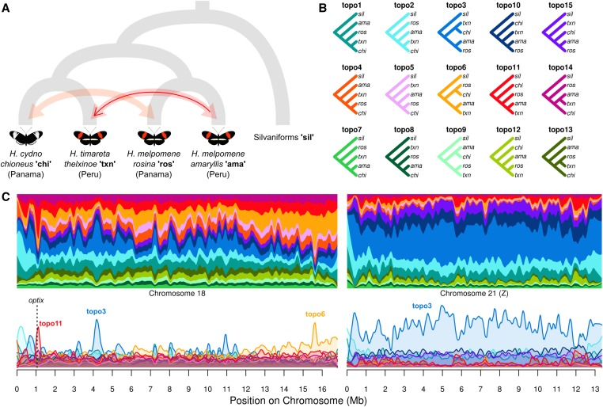

  <sub>**Twisst**: Twisst topology weightings along the genome of Heliconius butterflies, showing introgression at the wing-pattern locus (Figure 4). Data: Heliconius butterflies (non-grape data). Source: Martin et al. 2017, Genetics, Figure 4 ([doi:10.1534/genetics.116.194720](https://doi.org/10.1534/genetics.116.194720)), CC BY.</sub>
- **Haplotype-aware phylogenomics** (idea) — Use each phased haplotype as a tip to separate hybrid ancestry in clonal hybrids. The Vitis super-pangenome used it to resolve grape hybridization history. [doi:10.1038/s41588-025-02111-7](https://doi.org/10.1038/s41588-025-02111-7) · [details](docs/PANGENOME_CATALOG.md#L272)
- **NA Vitis wild introgression** (analysis) — North American wild grape super-pangenome with graph and gene-based analyses. Source of this repo's PGGB defaults; rootstock relatives. [doi:10.1186/s13059-023-03133-2](https://doi.org/10.1186/s13059-023-03133-2) · [details](docs/PANGENOME_CATALOG.md#L273)
- **ARG-Needle** (tool) — Large-scale ARG inference and ARG-based association. Genealogy-wide association for grape traits. [doi:10.1038/s41588-023-01379-x](https://doi.org/10.1038/s41588-023-01379-x) · [link](https://github.com/PalamaraLab/arg-needle) · [details](docs/PANGENOME_CATALOG_SUPPLEMENT_1.md#vs056)
- **Dsuite** (tool) — Fast ABBA-BABA statistics. Wild-to-cultivated introgression (sylvestris, V. amurensis). [doi:10.1111/1755-0998.13265](https://doi.org/10.1111/1755-0998.13265) · [link](https://github.com/millanek/Dsuite) · [details](docs/PANGENOME_CATALOG_SUPPLEMENT_1.md#vs057)
- **Mashtree** (tool) — Mash-distance neighbor-joining trees. Quick sanity tree of assemblies before graph construction. [doi:10.21105/joss.01762](https://doi.org/10.21105/joss.01762) · [link](https://github.com/lskatz/mashtree) · [details](docs/PANGENOME_CATALOG_SUPPLEMENT_1.md#vs058)
- **Dual domestication of grapevine** (analysis) — 3,525-accession population genomics of grapevine domestication. Population framework to place pangenome SVs in domestication history. [doi:10.1126/science.add8655](https://doi.org/10.1126/science.add8655) · [details](docs/PANGENOME_CATALOG_SUPPLEMENT_1.md#vs059)
- **Clonal diversity in grapevine (review)** (analysis) — Review of somatic variation in grape clones and breeding use. Clone-level variation is a grape-specific pangenome layer. [doi:10.1007/s00122-025-04986-w](https://doi.org/10.1007/s00122-025-04986-w) · [link](https://link.springer.com/article/10.1007/s00122-025-04986-w) · [details](docs/PANGENOME_CATALOG_SUPPLEMENT_1.md#vs060)
- **ADMIXTURE** (tool) — Model-based ancestry estimation from SNP genotypes. Ancestry of grape cultivars (wild vs cultivated, East vs West). [doi:10.1101/gr.094052.109](https://doi.org/10.1101/gr.094052.109) · [link](https://dalexander.github.io/admixture/)
- **IQ-TREE 2** (tool) — Maximum-likelihood phylogenetics with model selection. Phylogenies of Vitis species and of graph haplotypes at a locus. [doi:10.1093/molbev/msaa015](https://doi.org/10.1093/molbev/msaa015) · [link](https://github.com/iqtree/iqtree2)
- **SMC++** (tool) — Infers population size history from many unphased genomes. Demographic history of wild and cultivated grape populations. [doi:10.1038/ng.3748](https://doi.org/10.1038/ng.3748) · [link](https://github.com/popgenmethods/smcpp)
- **TreeMix** (tool) — Population tree with admixture edges from allele frequencies. Gene flow among grape groups alongside Dsuite tests. [待确认: code URL not found] [doi:10.1371/journal.pgen.1002967](https://doi.org/10.1371/journal.pgen.1002967)
- **selscan** (tool) — Haplotype-based selection scans (iHS, XP-EHH, nSL). Selection around SVs and PAVs linked to domestication traits in grape. [doi:10.1093/molbev/msu211](https://doi.org/10.1093/molbev/msu211) · [link](https://github.com/szpiech/selscan)
- **ASTRAL** (tool) — Species tree from many gene trees under incomplete lineage sorting. Vitis species tree from many loci with discordant histories. [doi:10.1186/s12859-018-2129-y](https://doi.org/10.1186/s12859-018-2129-y) · [link](https://github.com/smirarab/ASTRAL)
- **RAiSD** (tool) — Detects selective sweeps using several sweep signatures together. Sweep scan on grape SNP/SV genotypes. [doi:10.1038/s42003-018-0085-8](https://doi.org/10.1038/s42003-018-0085-8) · [link](https://github.com/alachins/raisd)
- **ADMIXTOOLS 2** (tool) — f-statistics and admixture graph fitting in R. Tests complex admixture models among wild and cultivated grape. [doi:10.7554/eLife.85492](https://doi.org/10.7554/eLife.85492) · [link](https://github.com/uqrmaie1/admixtools)
- **Relate** (tool) — Reconstructs genome-wide genealogies for thousands of samples and estimates allele ages. Requires polarised and phased data; grape clones must be deduplicated beforehand. [doi:10.1038/s41588-019-0484-x](https://doi.org/10.1038/s41588-019-0484-x) · [link](https://myersgroup.github.io/relate/)
- **hap-ibd** (tool) — Rapidly detects identity-by-descent segments within phased datasets, tracing shared haplotype blocks between grape cultivars and their parents. [doi:10.1016/j.ajhg.2020.02.010](https://doi.org/10.1016/j.ajhg.2020.02.010) · [link](https://github.com/browning-lab/hap-ibd)
- **PCAngsd** (tool) — Evaluates population structure and admixture directly from genotype likelihoods, making it suitable for shallow wild-Vitis resequencing data where hard genotype calls are unreliable. [doi:10.1534/genetics.118.301336](https://doi.org/10.1534/genetics.118.301336) · [link](https://github.com/Rosemeis/pcangsd)
- **ANGSD** (tool) — Population-genetic statistics from genotype likelihoods (SFS, theta, Fst). Low-depth or ancient grape samples. [doi:10.1186/s12859-014-0356-4](https://doi.org/10.1186/s12859-014-0356-4) · [link](https://github.com/ANGSD/angsd)
- **pixy** (tool) — Unbiased pi and dxy with missing data by using invariant sites, so it needs an all-sites VCF. A graph VCF from vg deconstruct has variant sites only; add invariant or callable sites before using it. [doi:10.1111/1755-0998.13326](https://doi.org/10.1111/1755-0998.13326) · [link](https://github.com/ksamuk/pixy)
- **PopLDdecay** (tool) — Calculates rapid linkage disequilibrium decay curves from VCF files, comparing LD decay between wild and cultivated grapes to establish GWAS window sizes. [doi:10.1093/bioinformatics/bty875](https://doi.org/10.1093/bioinformatics/bty875) · [link](https://github.com/BGI-shenzhen/PopLDdecay)
- **XP-CLR** (tool) — Performs cross-population composite-likelihood tests to detect selective sweeps. Used for wild versus cultivated grape domestication scans without requiring polarised alleles. [doi:10.1101/gr.100545.109](https://doi.org/10.1101/gr.100545.109) · [link](https://github.com/hardingnj/xpclr)

<a id="section-12"></a>
## 12. Vitis pangenome studies and public resources

Published *Vitis* and *Muscadinia* pangenome datasets, reference assemblies, reviews, and community databases, including Grapepan v1.0, Vitis super-pangenome, and PN_T2T reference.

**Needs:** no new data recipe — reuse the published *Vitis* / *Muscadinia* assemblies, graphs, and panels listed here. VIVC is for names and pedigrees only; confirm sample identity from genotypes. Map both *Muscadinia* chr7 and chr20 to *Vitis* chr7. [Data needs by scenario](#data-needs)

**Clusters:**
- *Vitis pangenomes and graphs* (complementary): Grapepan v1.0, Vitis super-pangenome, Cultivated grapevine pangenome (G3), Vitis amurensis graph (Vampan), NA Vitis super-pangenome, Muscadine Carlos assembly + pan-genome. Existing graphs available for reuse or extension.
- *Reference and cultivar assemblies* (complementary): PN_T2T reference, Cabernet Sauvignon FALCON-Unzip, Cabernet Sauvignon haplotype-resolved T2T, Muscadinia rotundifolia Trayshed diploid assembly, Munage haplotype-resolved assemblies, VitExpress + haplotype-resolved assembly, Börner rootstock (V. riparia × V. cinerea) assembly. Candidate haplotypes for incorporation into the graph, with PN_T2T serving as the coordinate backbone.
- *Population and ancient panels* (complementary): 472 Vitis accessions resequencing, 204 V. vinifera genomes (European wine grapes), Evolutionary genomics of grape domestication, Palaeogenomics of French grapevine, Cultivated grape diversity with 10K SNPs. Public sequencing reads to genotype against the graph after identity verification.
- *Clonal diversity in cultivars* (complementary): Chardonnay clonal population sequencing, Pinot blanc and gris as somatic mutants. Serves as templates for establishing clone-level panels (section 14).
- *Portals and catalogues* (complementary): Grapedia, GrapeGenomics JBrowse, VIVC (Vitis International Variety Catalogue), Pierre et al. data deposit. VIVC for names and pedigrees; Grapedia for reference genomes and annotations.

- **Grapepan v1.0** (analysis) — 18 T2T haplotypes plus 11 public assemblies; MC and PGGB graphs. Public Vitis graph to reuse. [doi:10.1038/s41588-024-01967-5](https://doi.org/10.1038/s41588-024-01967-5) · [details](docs/PANGENOME_CATALOG.md#L283)
- **Vitis super-pangenome** (analysis) — 72 accessions (25 wild, 47 cultivated); assemblies and annotations on Zenodo. Largest genus-level phased grape panel. [doi:10.1038/s41588-025-02111-7](https://doi.org/10.1038/s41588-025-02111-7) · [link](https://doi.org/10.5281/zenodo.13982444) · [details](docs/PANGENOME_CATALOG.md#L284)
- **Cultivated grapevine pangenome (G3)** (analysis) — 15 cultivar genomes; high collinearity and ~55% dispensable orthologous genes. Recent V. vinifera-only pangenome for cultivar-level comparisons. [doi:10.1093/g3journal/jkag168](https://doi.org/10.1093/g3journal/jkag168) · [details](docs/PANGENOME_CATALOG.md#L285)

  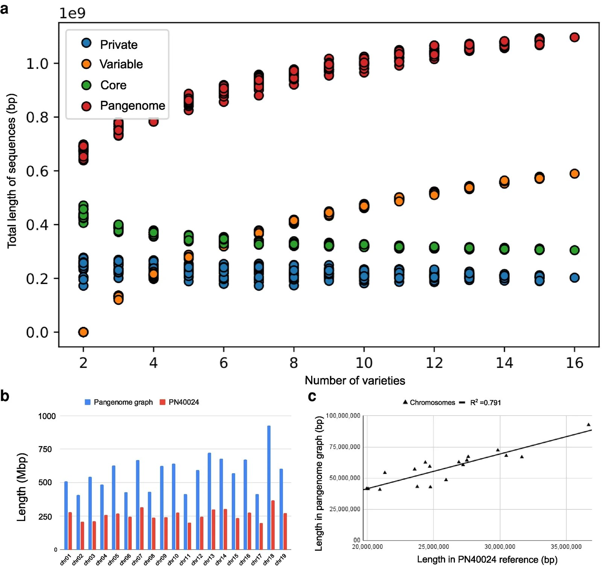

  <sub>**Cultivated grapevine pangenome (G3)**: Minigraph-Cactus graph growth curve (measured with gretl) for 15 cultivated grapevine varieties plus PN40024 (Fig. 4). Data: 15 cultivated grapevine varieties plus PN40024 (grape data). Source: Pierre et al. 2026, G3: Genes, Genomes, Genetics, Fig. 4 ([doi:10.1093/g3journal/jkag168](https://doi.org/10.1093/g3journal/jkag168)), CC BY.</sub>
- **Vitis amurensis graph (Vampan)** (analysis) — Graph pangenome of wild Amur grape linking TE variants to climatic adaptation. Cold-hardy wild Vitis; TE-SV adaptation template. [doi:10.1038/s41467-026-70026-w](https://doi.org/10.1038/s41467-026-70026-w) · [details](docs/PANGENOME_CATALOG.md#L286)
- **NA Vitis super-pangenome** (analysis) — Nine North American Vitis species pangenome and browser. Defaults used in this repo; browser for rootstock species. [doi:10.1186/s13059-023-03133-2](https://doi.org/10.1186/s13059-023-03133-2) · [link](https://grapegenomics.com/pages/NA_Vitis_pangenome/index.php) · [details](docs/PANGENOME_CATALOG.md#L287)

  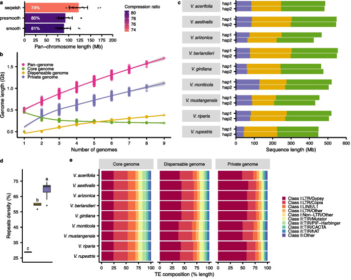

  <sub>**NA Vitis super-pangenome**: Properties of the PGGB nucleotide-level super-pangenome graph of 9 North American Vitis species: compression, core/dispensable/private shares (Fig. 2). Data: 9 North American Vitis species (grape data). Source: Cochetel et al. 2023, Genome Biology, Fig. 2 ([doi:10.1186/s13059-023-03133-2](https://doi.org/10.1186/s13059-023-03133-2)), CC BY.</sub>
- **Grapedia** (tool) — Community grapevine genome and tools portal (genomes, Grape-RNA, browsers). Single entry for public Vitis genomes and annotations. [link](https://grapedia.org/) · [details](docs/PANGENOME_CATALOG.md#L288)
- **GrapeGenomics JBrowse** (tool) — JBrowse 2 instances for many Vitis genomes. Browse grape assemblies used in a graph. [link](https://www.grapegenomics.com/pages/jbrowse2.php) · [details](docs/PANGENOME_CATALOG.md#L289)
- **Grapevine pangenome review (Horticulturae)** (analysis) — Review of V. vinifera diversity beyond the reference and pangenomic frameworks. Recent grape-specific overview of pangenome designs. [doi:10.3390/horticulturae12060756](https://doi.org/10.3390/horticulturae12060756) · [details](docs/PANGENOME_CATALOG.md#L290)
- **PN_T2T reference** (resource) — Telomere-to-telomere PN40024 reference (PN_T2T / v5). Coordinate backbone used by Grapepan and Grapedia. The first version of the same reference, the 12X genome (Jaillon 2007, doi:10.1038/nature06148), first showed the ancestral hexaploidy behind grape synteny triplets. PN40024.v4 stays a separate entry because it has its own coordinates and annotation. [doi:10.1093/hr/uhad061](https://doi.org/10.1093/hr/uhad061) · [details](docs/PANGENOME_CATALOG_SUPPLEMENT_1.md#vs061)

  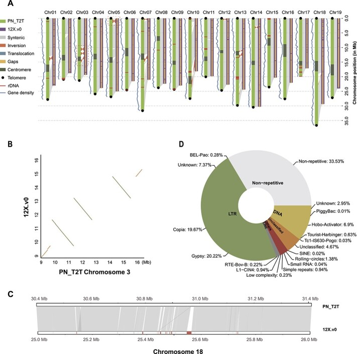

  <sub>**PN_T2T reference**: Overview of the gap-free PN_T2T assembly of PN40024 compared with 12X.v0 (Figure 1). Data: PN40024 (grape data). Source: Shi et al. 2023, Horticulture Research, Figure 1 ([doi:10.1093/hr/uhad061](https://doi.org/10.1093/hr/uhad061)), CC BY.</sub>
- **Pierre et al. data deposit** (resource) — Haplotyped assemblies, annotations, TE annotation and graph for 16 cultivars. This catalog uses the haplotyped assemblies and the graph. Gene annotations belong in the two annotation repositories; TE annotation or TE libraries belong in vitis-te. This entry is not a method for structural annotation or TE-library construction in this repository. [doi:10.57745/ckd4h5](https://doi.org/10.57745/ckd4h5) · [link](https://doi.org/10.57745/ckd4h5) · [details](docs/PANGENOME_CATALOG_SUPPLEMENT_1.md#vs062)
- **Muscadinia rotundifolia Trayshed diploid assembly** (resource) — Phased Trayshed assembly; chr7/chr20 fusion; R-gene expansion. Outgroup for a Vitaceae super-pangenome; karyotype difference must be handled. [doi:10.1093/g3journal/jkab033](https://doi.org/10.1093/g3journal/jkab033) · [details](docs/PANGENOME_CATALOG_SUPPLEMENT_1.md#vs063)
- **Muscadine Carlos assembly + pan-genome** (resource) — Carlos assembly and 4-genome synteny pan-genome. Pierce's disease resistance genes absent from vinifera. [doi:10.1186/s12864-023-09514-y](https://doi.org/10.1186/s12864-023-09514-y) · [link](https://pmc.ncbi.nlm.nih.gov/articles/PMC10357881/) · [details](docs/PANGENOME_CATALOG_SUPPLEMENT_1.md#vs064)

  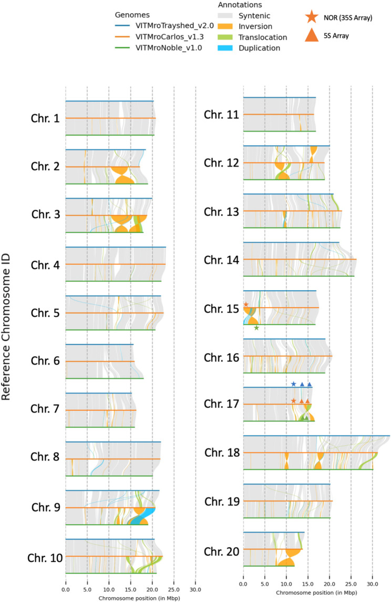

  <sub>**Muscadine Carlos assembly + pan-genome**: Collinearity among Vitis rotundifolia Carlos, Trayshed and Noble assemblies, with rDNA/NOR positions (Fig. 1). Data: muscadine, Vitis rotundifolia (grape data). Source: Huff et al. 2023, BMC Genomics, Fig. 1 ([doi:10.1186/s12864-023-09514-y](https://doi.org/10.1186/s12864-023-09514-y)), CC BY.</sub>
- **Wild side of grape genomics (review)** (analysis) — Review of 45 wild grape genomes and pangenomics. Map of available wild Vitis assemblies. [doi:10.1016/j.tig.2024.04.014](https://doi.org/10.1016/j.tig.2024.04.014) · [link](https://doi.org/10.1016/j.tig.2024.04.014) · [details](docs/PANGENOME_CATALOG_SUPPLEMENT_1.md#vs065)
- **Grape family phylogenomics** (analysis) — Chromosome-level genomes and phylogenomics across Vitaceae, including SV effects on A/B compartments. Family-scale outgroups for Vitis graphs and a 3D-genome angle on SVs. [doi:10.1038/s41477-026-02442-1](https://doi.org/10.1038/s41477-026-02442-1) · [link](https://www.nature.com/articles/s41477-026-02442-1) · [details](docs/PANGENOME_CATALOG_SUPPLEMENT_1.md#vs066)
- **Diploid phasing from draft (Minio et al.)** (tool) — Pipeline (HaploSync) to build diploid-phased chromosomes. Upgrade older grape assemblies to phased haplotypes. [doi:10.1093/g3journal/jkac143](https://doi.org/10.1093/g3journal/jkac143) · [details](docs/PANGENOME_CATALOG_SUPPLEMENT_1.md#vs067)
- **Grapevine sex determination** (analysis) — Haplotype-resolved sex locus of Vitis. Known SV-rich locus to validate graph representation. [doi:10.1038/s41467-020-16700-z](https://doi.org/10.1038/s41467-020-16700-z) · [link](https://www.nature.com/articles/s41467-020-16700-z) · [details](docs/PANGENOME_CATALOG_SUPPLEMENT_1.md#vs068)

  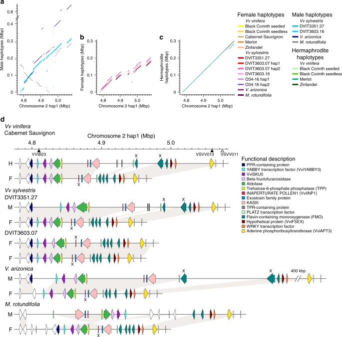

  <sub>**Grapevine sex determination**: Whole-sequence alignments of male, female and hermaphrodite haplotypes of the grape sex-determining region against Cabernet Sauvignon chr2 (Fig. 2). Data: grapevine (grape data). Source: Massonnet et al. 2020, Nature Communications, Fig. 2 ([doi:10.1038/s41467-020-16700-z](https://doi.org/10.1038/s41467-020-16700-z)), CC BY.</sub>
- **VitExpress + haplotype-resolved assembly** (resource) — Haplotype-resolved grape assembly with an open expression platform. Expression lookup for genes in graph SV regions. [doi:10.1073/pnas.2403750121](https://doi.org/10.1073/pnas.2403750121) · [link](https://pmc.ncbi.nlm.nih.gov/articles/PMC11161759/) · [details](docs/PANGENOME_CATALOG_SUPPLEMENT_1.md#vs069)
- **Munage haplotype-resolved assemblies** (resource) — Haplotype-resolved genome of an ancient Xinjiang cultivar. Adds Central Asian diversity to graph inputs. [doi:10.1093/hr/uhaf274](https://doi.org/10.1093/hr/uhaf274) · [details](docs/PANGENOME_CATALOG_SUPPLEMENT_1.md#vs070)

  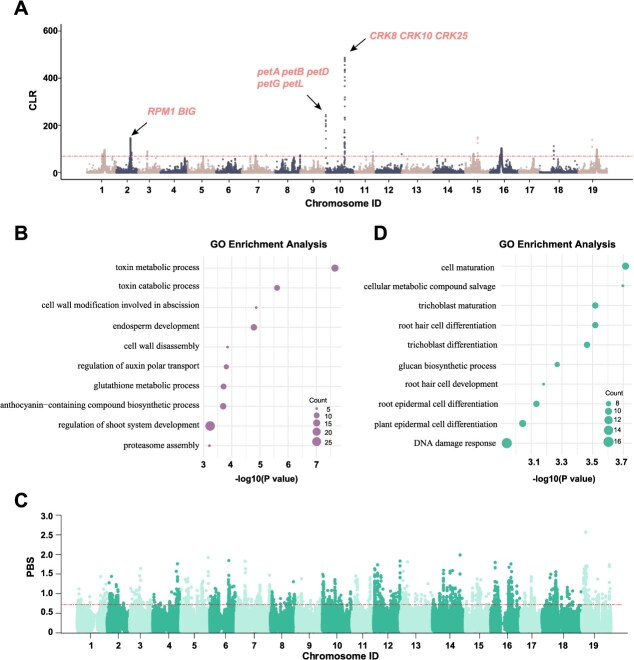

  <sub>**Munage haplotype-resolved assemblies**: SweeD selective-sweep scan and PBS in Munage grapes (Figure 4). Data: Munage grapes (grape data). Source: Zhong et al. 2025, Horticulture Research, Figure 4 ([doi:10.1093/hr/uhaf274](https://doi.org/10.1093/hr/uhaf274)), CC BY.</sub>
- **PN40024.v4 reference** (resource) — Improved PN40024 assembly and annotation (v4), before the T2T v5. Many public grape datasets still use v4 coordinates; needed for liftover to PN_T2T. [doi:10.1093/g3journal/jkad067](https://doi.org/10.1093/g3journal/jkad067)
- **Cabernet Sauvignon FALCON-Unzip** (resource) — Phased diploid assembly of Cabernet Sauvignon with FALCON-Unzip. Early phased grape cultivar; shows haplotype divergence in a clone. [doi:10.1038/nmeth.4035](https://doi.org/10.1038/nmeth.4035)
- **472 Vitis accessions resequencing** (analysis) — Resequencing of 472 Vitis accessions for diversity and demographic history. Large short-read panel that can be genotyped on a grape graph. [doi:10.1038/s41467-019-09135-8](https://doi.org/10.1038/s41467-019-09135-8)
- **VIVC (Vitis International Variety Catalogue)** (resource) — Database of grape varieties, synonyms, pedigrees and SSR profiles. Check accession identity and pedigree before adding a cultivar to the graph. [link](https://www.vivc.de/)
- **Chardonnay clonal population sequencing** (analysis) — Sequencing of multiple Chardonnay clones against a new assembly to investigate somatic variation and ancestral inbreeding. Serves as a template for clone-level resequencing panels. [doi:10.1371/journal.pgen.1007807](https://doi.org/10.1371/journal.pgen.1007807)
- **Pinot blanc and gris as somatic mutants** (analysis) — Demonstrates that Pinot blanc and Pinot gris originated via independent somatic mutations from Pinot noir, representing a classic case study for berry-colour somatic structural variants. [doi:10.1093/jxb/ers290](https://doi.org/10.1093/jxb/ers290)
- **Cabernet Sauvignon haplotype-resolved T2T** (analysis) — Haplotype-resolved, gap-free genome assemblies of Cabernet Sauvignon providing two additional T2T haplotypes for graph construction. [doi:10.1038/s41597-026-06910-3](https://doi.org/10.1038/s41597-026-06910-3)
- **Börner rootstock (V. riparia × V. cinerea) assembly** (analysis) — Partially phase-separated assembly of a disease-resistant rootstock providing rootstock haplotypes for interspecific graphs. [doi:10.3389/fpls.2020.00156](https://doi.org/10.3389/fpls.2020.00156)
- **204 V. vinifera genomes (European wine grapes)** (analysis) — Resequencing of 204 accessions tracing the evolutionary origin of European wine grapes, offering a public panel for graph genotyping. [doi:10.1038/s41467-021-27487-y](https://doi.org/10.1038/s41467-021-27487-y)
- **Evolutionary genomics of grape domestication** (analysis) — Characterises the domestication bottleneck, deleterious variant load, and selection patterns in cultivated versus wild grapes, providing a baseline for graph-based selection scans. [doi:10.1073/pnas.1709257114](https://doi.org/10.1073/pnas.1709257114)
- **Palaeogenomics of French grapevine** (analysis) — Genotyping of ancient grape seeds against modern cultivars, revealing that a single seed matched Savagnin Blanc and implying centuries of clonal propagation. Serves as a precedent for applying ancient DNA methods to grape pangenome graphs. [doi:10.1038/s41477-019-0437-5](https://doi.org/10.1038/s41477-019-0437-5)
- **Cultivated grape diversity with 10K SNPs** (analysis) — Genotyping a large cultivar collection to resolve synonyms, parentage relationships, and population structure, establishing an identity and pedigree reference prior to graph GWAS. [doi:10.1371/journal.pone.0192540](https://doi.org/10.1371/journal.pone.0192540)

<a id="section-13"></a>
## 13. Workflows and pipelines

End-to-end pangenome construction pipelines and multi-sample production workflows, such as nf-core/pangenome, Pan1c, and the cactus-pangenome workflow of Minigraph-Cactus.

**Needs:** the same inputs as graph construction and, if the workflow includes variant calling, cohort reads (see sections 2 and 5). [Data needs by scenario](#data-needs)

**Clusters:**
- *Graph pipelines* (alternatives): nf-core/pangenome, Pan1c, HPRC release 2 graph workflow. nf-core/pangenome runs PGGB; Minigraph-Cactus (section 2) runs as the one-command cactus-pangenome workflow; this repo's scripts 04 and 12 mirror them.
- *Workflow engines* (complementary): Snakemake, Nextflow, nf-core framework, Galaxy, Bioconda. Tool versions should be pinned using Bioconda containers.

- **nf-core/pangenome** (tool) — Nextflow pipeline running PGGB tools on clusters. Drop-in orchestration for scripts 04–06. [doi:10.1093/bioinformatics/btae609](https://doi.org/10.1093/bioinformatics/btae609) · [link](https://github.com/nf-core/pangenome) · [details](docs/PANGENOME_CATALOG.md#L301)
- **Pan1c** (tool) — Snakemake pipeline for chromosome-level PGGB/MC graphs with QC and reports. [preprint] Built by plant groups; matches the per-chromosome grape design. [doi:10.64898/2026.04.17.719212](https://doi.org/10.64898/2026.04.17.719212) · [link](https://forge.inrae.fr/genotoul-bioinfo/Pan1c/pan1c) · [details](docs/PANGENOME_CATALOG.md#L302)
- **HPRC release 2 graph workflow** (tool) — Public recipes for wfmash alignment, implicit graph and variants for HPRC release 2. Concrete large-scale template for a growing grape panel. Its release 1 draft pangenome (doi:10.1038/s41586-023-05896-x) set the graph and benchmark practice. [link](https://github.com/pangenome/HPRCv2) · [details](docs/PANGENOME_CATALOG.md#L304)
- **Snakemake** (tool) — Python-based workflow manager. Can wrap the numbered scripts in this repo into a reproducible workflow. [doi:10.12688/f1000research.29032.2](https://doi.org/10.12688/f1000research.29032.2) · [link](https://github.com/snakemake/snakemake)
- **Nextflow** (tool) — Dataflow workflow manager for clusters and cloud. Runs nf-core/pangenome and similar graph pipelines on HPC. [doi:10.1038/nbt.3820](https://doi.org/10.1038/nbt.3820) · [link](https://github.com/nextflow-io/nextflow)
- **nf-core framework** (resource) — Community standards and tooling for Nextflow pipelines. Template if the grape pipeline is ported to Nextflow. [doi:10.1038/s41587-020-0439-x](https://doi.org/10.1038/s41587-020-0439-x) · [link](https://github.com/nf-core/tools)
- **Bioconda** (resource) — Conda channel with thousands of bioinformatics packages. Pins versions of graph tools used in the grape pipeline. [doi:10.1038/s41592-018-0046-7](https://doi.org/10.1038/s41592-018-0046-7) · [link](https://github.com/bioconda/bioconda-recipes)
- **Galaxy** (resource) — Web platform for reproducible analyses, including vg/PGGB tools. Lets collaborators without command-line skills rerun grape graph steps. [doi:10.1093/nar/gkac247](https://doi.org/10.1093/nar/gkac247) · [link](https://github.com/galaxyproject/galaxy)

<a id="section-14"></a>
## 14. Ideas still untested on Vitis

Conceptual directions and DNA foundation models not yet tried on *Vitis*, such as COSIGT on ancient grape seeds, Berry-colour locus graph (VvMybA1), and PlantCaduceus.

**Needs:** depends on the idea — ancient or herbarium reads (COSIGT, 1–2× at complex loci, not yet tried on *Vitis*); both haplotypes of several clones; or known-locus phenotypes such as berry colour. [Data needs by scenario](#data-needs)

**Clusters:**
- *Known-locus graph checks* (complementary): Berry-colour locus graph (VvMybA1), Seedlessness locus graph (VviAGL11), Muscat flavour locus graph (VvDXS), Downy mildew Rpv3 haplotypes on the graph. Initial tests for any new grape graph to verify whether alleles with established phenotypes are correctly distinguished.
- *Clone-level questions* (complementary): Clone-level pangenome, Somatic variant calling across clones, Diploid genomes inferred on the graph. Addresses grape-specific challenges involving many clones per cultivar and scarce assemblies.
- *Ancient and degraded DNA* (complementary): COSIGT on ancient grape seeds, Graph mapping for degraded DNA. Needs the ancient panels in section 12.
- *DNA language models* (alternatives): Pangenome foundation models, DeepGene, PlantCaduceus, AgroNT, GPN, Evo 2. Evaluates variant-effect scoring on graph alleles; currently untested on Vitis data.
- *Other graph uses* (complementary): Graph-node GWAS + eQTL fusion, Implicit-graph locus atlas, Personalized-graph scaffolding, Pan-proteome with predicted structures (barley abstract), Variant-aware CRISPR off-target search (CRISPRme), Tandem-repeat genotyping (TRGT). Exploratory; pick one with a clear grape question.

- **COSIGT on ancient grape seeds** (idea) — Use low-coverage graph genotyping on archaeological grape seeds at complex loci. Domestication timing of SV alleles. [待确认: not tried on Vitis] [doi:10.1186/s13059-026-04242-4](https://doi.org/10.1186/s13059-026-04242-4) · [details](docs/PANGENOME_CATALOG.md#L316)
- **Berry-colour locus graph (VvMybA1)** (idea) — Build a locus graph (impg or PGGB) around a known SV locus such as the Gret1 retrotransposon at VvMybA1 (berry colour). Test graph genotyping on a known grape SV with a clear phenotype. [doi:10.1126/science.1095011](https://doi.org/10.1126/science.1095011) · [details](docs/PANGENOME_CATALOG.md#L317)
- **Pangenome foundation models** (idea) — Graph-conditioned DNA language models trained on tomato pangenome nodes (TomatoPGFM). [preprint] Could score grape SV effects; untested on Vitis. [doi:10.64898/2026.08.31.748176](https://doi.org/10.64898/2026.08.31.748176) · [details](docs/PANGENOME_CATALOG.md#L318)
- **DeepGene** (tool) — Transformer foundation model using pangenome graph representations. Idea for graph-aware sequence models in grape. [doi:10.1109/tcbbio.2025.3614354](https://doi.org/10.1109/tcbbio.2025.3614354) · [details](docs/PANGENOME_CATALOG.md#L319)
- **PlantCaduceus** (tool) — Cross-species plant DNA language model for variant effect prediction. Prioritize grape SV/SNP candidates from graph GWAS; not yet tested on Vitis. [doi:10.1073/pnas.2421738122](https://doi.org/10.1073/pnas.2421738122) · [link](https://github.com/plantcad/plantcad) · [details](docs/PANGENOME_CATALOG.md#L320)
- **AgroNT** (tool) — Foundation DNA language model trained on edible plant genomes. Plant-trained DNA language model; could score grape variant effects; not yet tested on Vitis. [doi:10.1038/s42003-024-06465-2](https://doi.org/10.1038/s42003-024-06465-2) · [link](https://github.com/instadeepai/nucleotide-transformer) · [details](docs/PANGENOME_CATALOG.md#L321)
- **Graph-node GWAS + eQTL fusion** (idea) — Run node-level GWAS and SV-eQTL on the same graph to link trait, SV and expression. Joins Grapepan GWAS and super-pangenome eQTL approaches. [doi:10.1016/j.xplc.2026.101835](https://doi.org/10.1016/j.xplc.2026.101835) · [details](docs/PANGENOME_CATALOG.md#L322)
- **Clone-level pangenome** (idea) — Add both haplotypes of several clones of one cultivar to detect somatic SVs in the graph. Grape is clonally propagated; somatic SVs shape clone traits. [doi:10.1186/s12864-019-6211-2](https://doi.org/10.1186/s12864-019-6211-2) · [details](docs/PANGENOME_CATALOG.md#L323)
- **Implicit-graph locus atlas** (idea) — Pre-compute impg projections for all NLR and terpene synthase clusters. Locus-centric browsing without whole-genome graph re-runs. [link](https://github.com/pangenome/impg) · [details](docs/PANGENOME_CATALOG.md#L324)
- **Personalized-graph scaffolding** (idea) — Scaffold new grape assemblies from haplotypes sampled from the graph. Saves Hi-C costs for breeding lines. [待确认] [doi:10.64898/2026.03.17.712436](https://doi.org/10.64898/2026.03.17.712436) · [details](docs/PANGENOME_CATALOG.md#L325)
- **GPN** (tool) — DNA language model for unsupervised variant-effect prediction (first trained on Arabidopsis/Brassicales). Could rank graph SNP/indel candidates in non-coding grape regions; not tested on Vitis. [doi:10.1073/pnas.2311219120](https://doi.org/10.1073/pnas.2311219120) · [link](https://github.com/songlab-cal/gpn) · [details](docs/PANGENOME_CATALOG_SUPPLEMENT_1.md#vs071)
- **Evo 2** (tool) — Genome-scale DNA language model across domains of life. (year = repo created; no paper checked) [待确认: paper DOI not checked] Exploratory variant-effect scoring; not tested on Vitis [待确认]. [link](https://github.com/ArcInstitute/evo2) · [details](docs/PANGENOME_CATALOG_SUPPLEMENT_1.md#vs072)
- **Pan-proteome with predicted structures (barley abstract)** (idea) — Conference abstract: 856,971 proteoforms from 76 barley genotypes with predicted-structure clustering. [conference abstract, not peer-reviewed] Idea for a grape pan-proteome layer. “Predicted-structure clustering” means clustering by predicted protein three-dimensional structures, not gene-structure annotation. Abstract only, not peer-reviewed. [link](https://ipk-bit.github.io/ib2026-abstract-book/abstracts/full-talks/144/) · [details](docs/PANGENOME_CATALOG_SUPPLEMENT_1.md#vs073)
- **Variant-aware CRISPR off-target search (CRISPRme)** (idea) — Searches CRISPR off-targets while accounting for population variants and haplotypes. Idea: use grape graph haplotypes so guides for gene editing are checked in all cultivars, not only PN40024. Tool was built for human data. [doi:10.1038/s41588-022-01257-y](https://doi.org/10.1038/s41588-022-01257-y) · [link](https://github.com/pinellolab/CRISPRme)
- **Graph mapping for degraded DNA** (idea) — Mapping ancient DNA to a variation graph reduces reference bias and improves indel calls. Idea: map archaeological or herbarium grape samples to the grape graph; complements COSIGT on ancient seeds. [doi:10.1186/s13059-020-02160-7](https://doi.org/10.1186/s13059-020-02160-7) · [link](https://github.com/vgteam/vg)
- **Tandem-repeat genotyping (TRGT)** (idea) — Genotypes and visualises tandem repeats from HiFi reads. Idea: compare tandem-repeat lengths between grape clones of one cultivar. [doi:10.1038/s41587-023-02057-3](https://doi.org/10.1038/s41587-023-02057-3) · [link](https://github.com/PacificBiosciences/trgt)
- **Seedlessness locus graph (VviAGL11)** (idea) — Evaluates whether the pangenome graph resolves the VviAGL11 seedless allele, whose missense mutation represents the primary genetic origin of seedlessness. [doi:10.1104/pp.18.00259](https://doi.org/10.1104/pp.18.00259)
- **Muscat flavour locus graph (VvDXS)** (idea) — Tests whether the graph genotypes the VvDXS K284N allele responsible for Muscat flavour across different cultivars. [doi:10.1093/jxb/err231](https://doi.org/10.1093/jxb/err231)
- **Downy mildew Rpv3 haplotypes on the graph** (idea) — Incorporates Rpv3 resistance haplotypes and associated KASP markers onto graph paths to test marker transferability across diverse genetic backgrounds. [doi:10.1007/s10681-021-02952-3](https://doi.org/10.1007/s10681-021-02952-3)
- **Diploid genomes inferred on the graph** (idea) — Reconstructs both haplotypes of a novel sample using short-read sequencing mapped to the graph, yielding near-assembly diploid sequences for clones that will never be assembled. [preprint] [doi:10.1101/2025.11.26.690754](https://doi.org/10.1101/2025.11.26.690754)
- **Somatic variant calling across clones** (idea) — Call clone-specific variants against a shared cultivar graph; DeepSomatic-style callers are a candidate, but grape benchmarks are missing. [preprint] [doi:10.1101/2024.08.16.608331](https://doi.org/10.1101/2024.08.16.608331) · [link](https://github.com/google/deepsomatic)

<a id="section-15"></a>
## 15. Peer plant pangenome studies and reviews

Pangenome studies and methodological reviews from other plant species, including Rice super pan-genome, Maize 26 genomes (NAM), and Pangenome graphs review.

**Needs:** not a *Vitis* data recipe. These are precedents from other species. [Data needs by scenario](#data-needs)

**Clusters:**
- *Reviews* (complementary): Pangenome graphs review, Plant T2T methods review, What are we learning from plant pangenomes?, From structural pangenomes to functional panomics, Pangenomes for large/complex plant genomes, Complexity welcome (review), Graph pangenomes in polyploid crops (review). Recommended foundational reading.
- *Clonal and perennial fruit crops* (complementary): Apple haplotype-resolved genomes (rootstock dwarfing), Potato wild/cultivated genomes, Citrus pangenome (citric acid gene). Represents crop designs closest to grape involving heterozygosity, clonal propagation, or fruit-related traits. The tomato heritability graph is listed in section 10.
- *Crop graph studies* (complementary): Rice super pan-genome, Rice pangenome reference (wild + cultivated), Barley pangenome, Maize 26 genomes (NAM), Soybean pan-genome, Wheat multiple genomes, Cucumber graph pan-genome, Eggplant graph pangenomes + pan-phenome, Sorghum pan-genome, Setaria graph pan-genome, Pea pan-genome, Pearl millet pangenome (heat tolerance), Sunflower haplotype blocks, Arabidopsis 69 accessions. Useful methodologies to adapt, with particular attention to how heterozygosity was managed.

- **Pangenome graphs review** (analysis) — Review of pangenome graph models and tools. Background for repo docs. [doi:10.1146/annurev-genom-120219-080406](https://doi.org/10.1146/annurev-genom-120219-080406) · [details](docs/PANGENOME_CATALOG_SUPPLEMENT_1.md#vs074)
- **Plant T2T methods review** (analysis) — Review of plant T2T assembly and pangenome use. Assembly standards for Vitis T2T graphs. [doi:10.1038/s41588-024-01830-7](https://doi.org/10.1038/s41588-024-01830-7) · [link](https://www.nature.com/articles/s41588-024-01830-7) · [details](docs/PANGENOME_CATALOG_SUPPLEMENT_1.md#vs075)
- **Potato wild/cultivated genomes** (analysis) — 44 diploid potato genomes; SVs and deleterious load in clonal crop. Clonal, heterozygous crop parallel to grapevine. [doi:10.1038/s41586-022-04822-x](https://doi.org/10.1038/s41586-022-04822-x) · [link](https://www.nature.com/articles/s41586-022-04822-x) · [details](docs/PANGENOME_CATALOG_SUPPLEMENT_1.md#vs076)
- **Rice super pan-genome** (analysis) — Rice super pan-genome with graph genome. Graph-based population SV design. [doi:10.1038/s41422-022-00685-z](https://doi.org/10.1038/s41422-022-00685-z) · [link](https://www.nature.com/articles/s41422-022-00685-z) · [details](docs/PANGENOME_CATALOG_SUPPLEMENT_1.md#vs077)
- **Barley pangenome** (analysis) — 76 barley genomes, SV in domestication. Large plant pangenome methods (minigraph per chr). [doi:10.1038/s41586-024-08187-1](https://doi.org/10.1038/s41586-024-08187-1) · [link](https://www.nature.com/articles/s41586-024-08187-1) · [details](docs/PANGENOME_CATALOG_SUPPLEMENT_1.md#vs078)
- **Arabidopsis 69 accessions** (analysis) — Species-wide pan-genome with genome structure conservation. Methods for core/dispensable classification in plants. [doi:10.1038/s41588-024-01715-9](https://doi.org/10.1038/s41588-024-01715-9) · [link](https://www.nature.com/articles/s41588-024-01715-9) · [details](docs/PANGENOME_CATALOG_SUPPLEMENT_1.md#vs079)
- **Cucumber graph pan-genome** (analysis) — Graph pan-genome with trait SVs. Graph SV-trait design in a fruit crop. [doi:10.1038/s41467-022-28362-0](https://doi.org/10.1038/s41467-022-28362-0) · [link](https://www.nature.com/articles/s41467-022-28362-0) · [details](docs/PANGENOME_CATALOG_SUPPLEMENT_1.md#vs080)
- **Maize 26 genomes (NAM)** (analysis) — NAM founder genomes and pan-gene analysis. Pan-gene classification and PAV reference design. [doi:10.1126/science.abg5289](https://doi.org/10.1126/science.abg5289) · [details](docs/PANGENOME_CATALOG_SUPPLEMENT_1.md#vs081)
- **Soybean pan-genome** (analysis) — Graph-based soybean pan-genome. Early graph genome for a crop. [doi:10.1016/j.cell.2020.05.023](https://doi.org/10.1016/j.cell.2020.05.023) · [link](https://doi.org/10.1016/j.cell.2020.05.023) · [details](docs/PANGENOME_CATALOG_SUPPLEMENT_1.md#vs082)
- **Wheat multiple genomes** (analysis) — 10+ wheat genomes and introgressions. Introgression mapping via multiple assemblies. [doi:10.1038/s41586-020-2961-x](https://doi.org/10.1038/s41586-020-2961-x) · [link](https://www.nature.com/articles/s41586-020-2961-x) · [details](docs/PANGENOME_CATALOG_SUPPLEMENT_1.md#vs083)
- **Pearl millet pangenome (heat tolerance)** (analysis) — Pangenome SVs associated with heat tolerance. SV-to-abiotic-stress design relevant to grape heat/drought work. [doi:10.1038/s41588-023-01302-4](https://doi.org/10.1038/s41588-023-01302-4) · [link](https://www.nature.com/articles/s41588-023-01302-4) · [details](docs/PANGENOME_CATALOG_SUPPLEMENT_1.md#vs084)
- **Apple haplotype-resolved genomes (rootstock dwarfing)** (analysis) — Near-gapless haplotype-resolved apple genomes used to map rootstock-induced dwarfing. Woody grafted perennial like grape; template for a Vitis rootstock pangenome. [doi:10.1038/s41588-024-01657-2](https://doi.org/10.1038/s41588-024-01657-2) · [link](https://www.nature.com/articles/s41588-024-01657-2) · [details](docs/PANGENOME_CATALOG_SUPPLEMENT_1.md#vs085)
- **Eggplant graph pangenomes + pan-phenome** (analysis) — Two graph pangenomes from 40 assemblies plus a 368-accession pan-phenome. Shows sequence growth curves stay open while protein-family curves close; same split needed for Vitis. [doi:10.1038/s41467-025-64866-1](https://doi.org/10.1038/s41467-025-64866-1) · [link](https://www.nature.com/articles/s41467-025-64866-1) · [details](docs/PANGENOME_CATALOG_SUPPLEMENT_1.md#vs086)
- **What are we learning from plant pangenomes?** (analysis) — Annual Review of Plant Biology overview of plant pangenome findings. Background review. [doi:10.1146/annurev-arplant-090823-015358](https://doi.org/10.1146/annurev-arplant-090823-015358) · [details](docs/PANGENOME_CATALOG_SUPPLEMENT_1.md#vs087)
- **From structural pangenomes to functional panomics** (analysis) — Review: graph coordinates, panNLRomes, pantranscriptomics, panepigenomics. Recent synthesis: the graph-coordinate, panNLRome, transcriptome and epigenome parts relate to this catalog; functional annotation itself stays in gene-function-annotation. The review's scope is wider than this catalog. [doi:10.1093/molbev/msag087](https://doi.org/10.1093/molbev/msag087) · [details](docs/PANGENOME_CATALOG_SUPPLEMENT_1.md#vs088)
- **Pangenomes for large/complex plant genomes** (analysis) — Review of construction strategies and representation formats for complex plant genomes. Format choices for a Vitis release. [doi:10.1016/j.jare.2025.01.052](https://doi.org/10.1016/j.jare.2025.01.052) · [link](https://pmc.ncbi.nlm.nih.gov/articles/PMC12684929/) · [details](docs/PANGENOME_CATALOG_SUPPLEMENT_1.md#vs089)
- **Complexity welcome (review)** (analysis) — Perspective on graph pangenomes for plant population genomics. Conceptual framing for graph-based popgen in Vitis. [doi:10.1017/qpb.2025.10028](https://doi.org/10.1017/qpb.2025.10028) · [link](https://www.cambridge.org/core/journals/quantitative-plant-biology/article/complexity-welcome-pangenome-graphs-for-comprehensive-population-genomics/B2DD25F2FD0B4CB91D238DFD2257E7FA) · [details](docs/PANGENOME_CATALOG_SUPPLEMENT_1.md#vs090)
- **Sorghum pan-genome** (analysis) — Pan-genome of cultivated and wild sorghum showing gene PAV and domestication loss. Wild-vs-cultivated PAV design comparable to wild Vitis vs vinifera. [doi:10.1038/s41477-021-00925-x](https://doi.org/10.1038/s41477-021-00925-x)
- **Sunflower haplotype blocks** (analysis) — Large non-recombining haplotypes (often inversions) underlie ecotype differences in wild sunflowers. Model for testing inversions and haploblocks in wild Vitis adaptation. [doi:10.1038/s41586-020-2467-6](https://doi.org/10.1038/s41586-020-2467-6)
- **Setaria graph pan-genome** (analysis) — Graph pan-genome of foxtail millet and wild relatives with SV-trait associations. A graph-plus-GWAS design close to what this repo plans for grape. [doi:10.1038/s41588-023-01423-w](https://doi.org/10.1038/s41588-023-01423-w)
- **Pea pan-genome** (analysis) — Improved pea reference and pan-genome with PAV and evolution analyses. Another legume example of reference upgrade plus pan-genome, as with PN40024 v4 to T2T. [doi:10.1038/s41588-022-01172-2](https://doi.org/10.1038/s41588-022-01172-2)
- **Rice pangenome reference (wild + cultivated)** (analysis) — Pangenome of wild and cultivated rice as a reference resource. Example of releasing a crop graph reference with wild relatives. [doi:10.1038/s41586-025-08883-6](https://doi.org/10.1038/s41586-025-08883-6) · [details](docs/PANGENOME_CATALOG.md#L306)
- **Graph pangenomes in polyploid crops (review)** (analysis) — Perspective on graph pangenomes for complex polyploid genomes from sugarcane to other crops. Useful for polyploid or interspecific grape rootstocks. [doi:10.1016/j.xplc.2026.101852](https://doi.org/10.1016/j.xplc.2026.101852) · [details](docs/PANGENOME_CATALOG.md#L291)
- **Citrus pangenome (citric acid gene)** (analysis) — Pangenome of the orange subfamily found a key gene for fruit acidity. A clonal perennial fruit crop close to grape in design. [doi:10.1038/s41588-023-01516-6](https://doi.org/10.1038/s41588-023-01516-6)

<a id="data-needs"></a>
## Data needed alongside the pangenome

Each scenario lists **minimum data** (needed to run the analysis at all), **recommended data** (what a cited *Vitis* or close plant design actually used), **catalog sections and tools**, and **pitfalls**. "The graph" means a *Vitis* pangenome variation graph built from haplotype assemblies (this repository). Sister repositories supply what this one does not: TE library curation in [vitis-te](https://github.com/Xuzhen-Li/vitis-te); gene models in [gene-structure-annotation](https://github.com/Xuzhen-Li/gene-structure-annotation); names, GO/KEGG and domains in [gene-function-annotation](https://github.com/Xuzhen-Li/gene-function-annotation).

Each section above opens with a one-line **Needs:** note. Full scenario details (minimum data, recommended data, tools, pitfalls) and the items still marked [待确认] are in [`docs/CATALOG.md`](docs/CATALOG.md#data-needs-details). "Additions" in the table are entries added to this page on 2026-11-13.

### Summary

| Scenario | Minimum inputs | Recommended extras (only where a source is cited) | Catalog sections |
|---|---|---|---|
| 1. Graph build only | Phased haplotype assemblies, chromosome-named (PanSN). Do not treat purge_dups as a required input for already-phased haplotypes | HiFi haplotypes; ultra-long ONT for T2T; Hi-C or maps if contigs must be ordered into chromosomes (section 1 tools). This repo's PGGB start is `-p 85 -s 10k` from the NA *Vitis* playbook (Cochetel et al. 2023, doi:10.1186/s13059-023-03133-2). Grapepan v1.0 used 18 T2T haplotypes plus 11 public assemblies (doi:10.1038/s41588-024-01967-5); the *Vitis* super-pangenome used 72 haplotype-resolved accessions, 25 wild and 47 cultivated (doi:10.1038/s41588-025-02111-7). | 1, 2, 3, 8, 13 |
| 2. Population genotyping / SV-GWAS | Graph + cohort short or long reads + phenotypes (for GWAS) | Grapepan v1.0 genotyped 466 accessions on a 29-haplotype graph and tested 29 traits (doi:10.1038/s41588-024-01967-5). A separate short-read panel of 472 *Vitis* accessions is also listed (doi:10.1038/s41467-019-09135-8). | 5, 10(b), 8; association tools in 10 and additions to 10 |
| 3. eQTL / expression-PAV | Graph (or graph genotypes) + RNA-seq from the same, identity-checked genotype (different plants of one cultivar are acceptable; see scenario 3) | The *Vitis* super-pangenome combined a 72-haplotype graph with SV-eQTL and downy-mildew infection transcriptomes (doi:10.1038/s41588-025-02111-7). The RNA-seq sample size is not stated in the catalog brief [待确认]. | 10(a), 10(b), 5, 7 |
| 4. Gene PAV / copy number | Graph or haplotype FASTAs + gene models (GFF3 / proteins) from gene-structure-annotation | One annotation set lifted or clustered across all haplotypes; keep sequence-level PAV (section 4a) separate from gene-level PAV (section 7). | 7, 6; read-depth CNV tools are additions to 7 |
| 5. Ancestry / introgression | Graph-derived or linear population genotypes + outgroups | Wild *Vitis* and *Muscadinia* as outgroups; phased haplotypes if using tree-sequence or ARG tools. The *Vitis* super-pangenome used haplotype-aware phylogenomics on 25 wild + 47 cultivated accessions (doi:10.1038/s41588-025-02111-7). NA *Vitis* is the wild/rootstock precedent (doi:10.1186/s13059-023-03133-2). | 11, 5, 12 |
| 6. Domestication / selection scans | Population genotypes with wild and cultivated samples, after genotype identity checks and clone deduplication; ancestral alleles for polarisation (prefer multiple outgroups or probabilistic polarisation) | Dong et al. 2023 placed 3,525 accessions in a domestication framework (doi:10.1126/science.add8655). Zhou et al. 2019 is the foundational *Vitis* SV and hemizygosity study (doi:10.1038/s41477-019-0507-8). | 11, 5, 4, 10 |
| 7. Somatic / clonal variation | Deep reads, or both haplotypes, from several clones of one cultivar | Designs in the clone-diversification study (doi:10.1186/s12864-019-6211-2) and the clonal genome-methylome map (doi:10.1186/s13059-026-04184-x). A clone-level pangenome (both haplotypes of several clones in one graph) is listed as an idea in section 14. No sequencing-depth number is given here [待确认]. | 4, 5, 11, 14, 10(a) |
| 8. Methylation / epigenetic SV | Graph + native 5mC calls from ONT/PacBio, or bisulfite reads | Haplotype-resolved (phased) methylation; a grape trio is the direct precedent (doi:10.1186/s13059-025-03858-2). GraffiTE v1.1 also adds methylation on TE insertions (preprint 10.64898/2026.11.06.764993). | 10(a), 4, 1 |
| 9. 3D / Hi-C | Contig assemblies + Hi-C reads (or genetic / optical maps) to order chromosomes | Hi-C on each haplotype, or Hi-C-mode phasing (hifiasm / GreenHill), before graph building. Listed Hi-C tools are for scaffolding and phasing. This catalog has no method for calling chromatin contacts on the graph. | 1 (and additions to 1); 9 for inspection |
| 10. Pedigree / recombination | Parent–offspring or other known-pedigree genotypes | Trios for phasing; published genetic maps to check chromosome order; VIVC for synonyms and official pedigrees. tsinfer expects phased data (doi:10.1038/s41588-019-0483-y). | 5, 11, 8, 1, 12 |
| 11. TE insertion polymorphism | Graph or assemblies / long reads + a curated TE library from vitis-te | Long reads or haplotype assemblies per accession; GraffiTE builds a TE-insertion graph and genotypes it (doi:10.1101/2023.09.11.557209). Berry colour (Gret1 at VvMybA1) is the classic grape example (doi:10.1126/science.1095011). | 4, 5, 14 (locus idea); library itself is not in this repo |
| 12. Ancient DNA mapping | Graph + short, damaged reads from archaeological or herbarium material | COSIGT is described as genotyping complex loci from 1–2× coverage (doi:10.1186/s13059-026-04242-4). Using it on ancient grape seeds has not yet been tried on *Vitis*. Graph mapping of degraded DNA is a proposed addition; the cited evidence is a human aDNA study (doi:10.1186/s13059-020-02160-7), not a grape result. | 5 (COSIGT), 14 |
| 13. Breeding / marker design | Graph genotypes in a breeding or germplasm panel + phenotypes; known-locus haplotypes where a marker already exists | Grapepan v1.0 reported that SVs added heritability and QTLs (doi:10.1038/s41588-024-01967-5). PHGv2 software ([maize-genetics/phg_v2](https://github.com/maize-genetics/phg_v2); record version or commit and access date; checked 2026-11-13) and GLIMPSE2 can impute known *panel* sites into low-coverage samples (see pitfalls). The PHG method paper (Bradbury et al. 2022, doi:10.1093/bioinformatics/btac410) describes PHG v1; no separate v2 DOI was found. Confirm identity from genotypes first; use VIVC for names and pedigree, not as a substitute for that check. | 5, 10(b), 12, 14 |

### Cross-cutting pitfalls

- **Sites already in the graph.** In this repository's default path, Giraffe + `vg call` and PanGenie only genotype variant sites already in the graph; they do not add new alleles (catalog section 5 and this repository's README). New SVs must be discovered from assemblies or long-read callers (section 4) and then added to the graph. `vg augment` can add read-supported variation back into the graph to discover new variants, but that is not this repository's default pipeline. PanGenie uses short-read k-mers and needs an assembly-derived, phased, bubble-decomposed VCF (commonly Minigraph-Cactus + vcfbub); it does not read a PGGB GFA directly. Long reads go via GraphAligner or minigraph, not PanGenie.
- **Reference bias.** Mapping a cohort only to PN40024 (12X, v4, or PN_T2T) misses alleles absent from that reference, which is why we genotype on the graph. Even a graph can be biased if the haplotype set is narrow or if a reference-anchored method drops divergent repeats. This repo keeps a dual-graph rule of thumb: PGGB for variation inventory; Minigraph-Cactus or minigraph for mapping cohorts. Plant papers warn that MC/minigraph can miss divergent repeats that PGGB keeps (`docs/DUAL_GRAPH.md`).
- **Clonal duplication and genotype identity.** Grapevine cultivars are clones. Collections often hold synonyms, mislabelled accessions, and several clones of one cultivar. Before GWAS, population-structure analysis, or selection scans, check identity and deduplicate using the genotypes themselves (KING kinship or IBS), keeping one representative per clone. VIVC is only for names and pedigree interpretation; it cannot detect a mislabelled or repeatedly sequenced sample. No kinship or IBS threshold is given here; those belong in a LOCK, not in this note. For somatic or clone-trait work, having several clones of one cultivar is the point of the design, not a mistake. Somatic SVs also must be separated from inherited heterozygosity (clonal methylome study, doi:10.1186/s13059-026-04184-x).
- **Hemizygosity.** Many grape SVs are hemizygous (Zhou et al. 2019, doi:10.1038/s41477-019-0507-8). Diploid genotype codes and simple "presence/absence" labels can be misleading.
- **Do not treat sequence PAV as gene PAV.** Section 4a (panacus and related tools) measures sequence or window presence. Section 7 measures gene presence and family copy number and requires gene models.
- **Imputation is not a general SV shortcut.** The catalog erratum for GLIMPSE2 is specific: it imputes known SNP and small-indel sites from a reference panel into skim-sequenced samples, not graph structural variants (doi:10.1038/s41588-023-01438-3). PHGv2 software ([maize-genetics/phg_v2](https://github.com/maize-genetics/phg_v2); record version or commit and access date; checked 2026-11-13) imputes known panel haplotypes only; its method paper is Bradbury et al. 2022, *Bioinformatics* 38(15):3698–3702, doi:10.1093/bioinformatics/btac410, which describes PHG v1, and no separate v2 DOI was found. Beagle 5 and SHAPEIT5 (additions to section 5) take biallelic VCF sites only. Graph SVs can be written to such a VCF after splitting to biallelic sites and removing nested variants (vcfbub / vcfwave); the accuracy of that path in grapevine is untested.
- **Karyotype and ploidy.** *Muscadinia* (2n = 40) chromosomes 7 and 20 correspond to a single *Vitis* (2n = 38) chromosome 7; Cochetel et al. (2021, doi:10.1093/g3journal/jkab033) interpret this as a fusion in the *Vitis* lineage and locate the fusion point on chromosome 7 of Cabernet Sauvignon and PN40024. In cross-genus graphs or synteny, map both *Muscadinia* chr7 and chr20 to *Vitis* chr7; do not pair chromosomes one-to-one by number. *Vitis* has 19 chromosomes and has no chromosome 20. Hybrid rootstocks and some materials are not simple diploids; Varigraph is the catalogued option for polyploid allele dosage (doi:10.1016/j.molp.2025.08.001). This repository does not yet have a separate, checked copy-number or dosage method (README notes).
- **Merging public panels.** Combining independently sequenced cohorts (for example the 472-accession short-read panel with Grapepan's 466 genotyped accessions) can introduce batch and calling bias. Re-align and re-genotype all samples uniformly, then check missingness and heterozygosity by batch.
- **Polarisation.** tsinfer, iHS, and site-frequency-spectrum scans need ancestral alleles, not only phasing. *Muscadinia* is a distant outgroup, with lower mapping rates and more errors in repeats. Prefer multiple outgroups or probabilistic polarisation, and report the share of unpolarised sites.
- **No depth recipe in this draft.** Aside from COSIGT's 1–2× description at complex loci, this note does not recommend a generic WGS depth for Giraffe, PanGenie, or clone calling. Use the chosen tool's paper [待确认 if a later pass should quote one].

## Pipeline

The pipeline is organized according to three waves of peer playbooks. See [`pipeline/00_overview.md`](pipeline/00_overview.md), [`docs/ATTRIBUTION.md`](docs/ATTRIBUTION.md), and [`docs/DUAL_GRAPH.md`](docs/DUAL_GRAPH.md).

Workflow chart outlining tool choices and decision points (2026-11-14): [`docs/CATALOG.md#workflow-2026-11-14`](docs/CATALOG.md#workflow-2026-11-14).

Wave 1-2 covers cannabis, potato, NA *Vitis*, Shuhua VCF, and *Oryza* SyRI. It uses scripts `01` to `10`.

Wave 3 covers maize, wheat, and barley minigraph, and dual PGGB-MC + Giraffe / PanGenie. It uses scripts `12` to `16`.

Scripts, one line each (file names and roles from the existing README and `pipeline/00_overview.md`):

- `00_overview.md` — working order of the pipeline
- `01_rename_pansn.py` — PanSN rename (PGGB discovery path)
- `02_purge_split.sh` — purge and split haplotypes
- `03_mash_divergence.sh` — Mash divergence
- `04_pggb_per_chr.sh` — PGGB per chromosome
- `05_variants.sh` — variants from the PGGB graph
- `06_panacus_pav.sh` — panacus PAV
- `07_vcf_classify.sh` — VCF class
- `08_vg_genotype_sketch.sh` — vg sketch (legacy map path)
- `09_vcf_postprocess.sh` — VCF post-process
- `10_syri_pan_sv_merge.py` — SyRI pan-SV merge (alignment check)
- `11_pointers.md` — pointers
- `12_minigraph_cactus.sh` — Minigraph-Cactus (MC / Giraffe-ready)
- `13_minigraph_per_chr.sh` — minigraph per chromosome (light backbone)
- `14_giraffe_call.sh` — Giraffe call
- `15_pangenie_genotype.sh` — PanGenie
- `16_graph_qc.sh` — graph QC (odgi + panacus before calling)

The config file is [`config/example.env`](config/example.env). The default PGGB `-p 85 -s 10k` follows NA *Vitis*.

```bash
cp config/example.env config/local.env
set -a && source config/local.env && set +a
```

## Notes

- No sample data, genotypes or unpublished assemblies are in this catalog.
- Dosage is not a separate section: this repo has no copy-number or dosage method yet. Varigraph (section 5) can estimate allele dosage in polyploids and is listed as a genotyper.
- The Zenodo record for the *Vitis* super-pangenome (doi:10.5281/zenodo.13982444) is quoted from the paper; Zenodo refused the scripted link check.
- Journal figures are reproduced only where the licence allows (CC BY open-access papers, or images from OSI-licensed or public-domain repositories); each caption and the figure credits table below give the source and licence. Other journal figures are not reproduced; the catalog files only list sources.
- Tools treated separately, not as one class. Helixer (and TOGA when used only to produce gene models) belongs in gene-structure-annotation and is not listed in this catalog. Liftoff and LiftOn are already in section 7 (V090 and related entries) with a boundary sentence; this catalog does not say they fall outside it or belong only in the annotation repositories. NLR-Annotator is already V093: it is structure-layer locus finding (including partial genes and pseudogenes); this catalog only borrows its locus list to count presence and copy number; gene models stay in gene-structure-annotation. It does not make or transfer gene models, and it does not belong only in the annotation repositories.

<a id="figure-credits"></a>
## Figure credits

Image files are in `docs/figures/catalog/`. Each is real output of the software or study; figures marked "non-grape" use other species and only show what the output looks like.

| # | File | Software or study | Data | Source | Licence |
|---:|---|---|---|---|---|
| 1 | [`01_nextdenovo_human_assemblies.jpg`](docs/figures/catalog/01_nextdenovo_human_assemblies.jpg) | NextDenovo | human (non-grape) | Hu et al. 2024, Genome Biology, Fig. 2 ([doi:10.1186/s13059-024-03252-4](https://doi.org/10.1186/s13059-024-03252-4)) | CC BY |
| 2 | [`02_minigraph_cactus_yeast_chrI_w1600.png`](docs/figures/catalog/02_minigraph_cactus_yeast_chrI_w1600.png) | Minigraph-Cactus | yeast, S. cerevisiae (non-grape) | [ComparativeGenomicsToolkit/cactus](https://github.com/ComparativeGenomicsToolkit/cactus/blob/1abe7c3e822d58d6c274c51738cbeb927614d747/doc/yeast-pg-chrI.full.draw.png) | MIT |
| 3 | [`02_pggb_drb1_odgi_draw_w1600.png`](docs/figures/catalog/02_pggb_drb1_odgi_draw_w1600.png) | PGGB | human (non-grape) | [pangenome/pggb](https://github.com/pangenome/pggb/blob/4225c6ce010553ef353c5ea13805e38c2016b503/docs/img/DRB1-3123.fa.gz.pggb-E-s5000-l15000-p80-n10-a0-K16-k8-w50000-j5000-e5000-I0-R0-N.smooth.chop.og.lay.draw_mqc.png) | MIT |
| 4 | [`03_crop_graph_eval_sorghum.jpg`](docs/figures/catalog/03_crop_graph_eval_sorghum.jpg) | Crop graph evaluation framework | sorghum (non-grape) | Kopalli et al. 2025, GigaScience, Figure 4 ([doi:10.1093/gigascience/giaf121](https://doi.org/10.1093/gigascience/giaf121)) | CC BY |
| 5 | [`03_genomescope2_seabass_w1600.png`](docs/figures/catalog/03_genomescope2_seabass_w1600.png) | GenomeScope 2.0 | European seabass (non-grape) | [tbenavi1/genomescope2.0](https://github.com/tbenavi1/genomescope2.0/blob/8f25e3a25eaa691cdae474daf5cfe5416bfc60dc/user_data/example1/plot.png) | Apache-2.0 |
| 6 | [`03_merqury_arabidopsis_spectra_cn.png`](docs/figures/catalog/03_merqury_arabidopsis_spectra_cn.png) | Merqury | Arabidopsis thaliana (non-grape) | [marbl/merqury](https://github.com/marbl/merqury/blob/88f37c0f4dbb073001d194bcc5d5989a0b0527df/example/triocanu_clr.col.spectra-cn.fl.png) | public domain (US Government work, NHGRI) |
| 7 | [`03_smudgeplot_strawberry.jpg`](docs/figures/catalog/03_smudgeplot_strawberry.jpg) | Smudgeplot | root-knot nematode and strawberry (non-grape) | Ranallo-Benavidez et al. 2020, Nature Communications, Fig. 8 ([doi:10.1038/s41467-020-14998-3](https://doi.org/10.1038/s41467-020-14998-3)) | CC BY |
| 8 | [`04_assemblytics_arabidopsis_w1600.png`](docs/figures/catalog/04_assemblytics_arabidopsis_w1600.png) | Assemblytics | Arabidopsis thaliana (non-grape) | [MariaNattestad/assemblytics](https://github.com/MariaNattestad/assemblytics/blob/7acd1acec5b4175ab71a7c885a6ddadec0e355ab/output_examples/arabidopsis/Arabidopsis_example.Assemblytics.size_distributions.all_variants.log_all_sizes.png) | MIT |
| 9 | [`04_panacus_hprc_chr22.png`](docs/figures/catalog/04_panacus_hprc_chr22.png) | panacus | human, HPRC (non-grape) | [marschall-lab/panacus](https://github.com/marschall-lab/panacus/blob/79ba82b01f7d44b22faada755f05464f045fbd20/docs/chr22.hprc-v1.0-pggb.histgrowth.node.png) | MIT |
| 10 | [`04_vg_deconstruct_na_vitis.jpg`](docs/figures/catalog/04_vg_deconstruct_na_vitis.jpg) | vg deconstruct | 9 North American Vitis species (grape) | Cochetel et al. 2023, Genome Biology, Fig. 5 ([doi:10.1186/s13059-023-03133-2](https://doi.org/10.1186/s13059-023-03133-2)) | CC BY |
| 11 | [`05_pangenie_1000g.jpg`](docs/figures/catalog/05_pangenie_1000g.jpg) | PanGenie | human, 1000 Genomes (non-grape) | Ebler et al. 2022, Nature Genetics, Fig. 4 ([doi:10.1038/s41588-022-01043-w](https://doi.org/10.1038/s41588-022-01043-w)) | CC BY |
| 12 | [`05_plant_genotyper_benchmark_real.jpg`](docs/figures/catalog/05_plant_genotyper_benchmark_real.jpg) | Plant graph genotyper benchmark + ensemble | rice, maize and apricot (non-grape) | Du et al. 2024, Genome Biology, Fig. 6 ([doi:10.1186/s13059-024-03239-1](https://doi.org/10.1186/s13059-024-03239-1)) | CC BY |
| 13 | [`06_genespace_grasses.jpg`](docs/figures/catalog/06_genespace_grasses.jpg) | GENESPACE | eight grass genomes (non-grape) | Lovell et al. 2022, eLife, Figure 3 ([doi:10.7554/eLife.78526](https://doi.org/10.7554/eLife.78526)) | CC BY |
| 14 | [`06_mumemto_potato_w982.png`](docs/figures/catalog/06_mumemto_potato_w982.png) | Mumemto | potato (non-grape) | [vikshiv/mumemto](https://github.com/vikshiv/mumemto/blob/ec48f10535f463ce709fe4181bec76ca0c4577db/img/potato_syn.png) | GPL-3.0 |
| 15 | [`06_plotsr_arabidopsis_ampril_w1600.png`](docs/figures/catalog/06_plotsr_arabidopsis_ampril_w1600.png) | plotsr | Arabidopsis thaliana (non-grape) | [schneebergerlab/plotsr](https://github.com/schneebergerlab/plotsr/blob/d2da00875c96a34dd758487f3967fa223228843d/example/ampril_col0_chr3_6600000_10000000.png) | MIT |
| 16 | [`07_get_homologues_est_grape_w1600.jpg`](docs/figures/catalog/07_get_homologues_est_grape_w1600.jpg) | GET_HOMOLOGUES-EST | 15 cultivated grapevine varieties (grape) | Pierre et al. 2026, G3: Genes, Genomes, Genetics, Fig. 2 ([doi:10.1093/g3journal/jkag168](https://doi.org/10.1093/g3journal/jkag168)) | CC BY |
| 17 | [`07_pangene_human_hla.jpg`](docs/figures/catalog/07_pangene_human_hla.jpg) | pangene | human (non-grape) | Li et al. 2024, Bioinformatics, Figure 1 ([doi:10.1093/bioinformatics/btae456](https://doi.org/10.1093/bioinformatics/btae456)) | CC BY |
| 18 | [`07_pantools_potato.jpg`](docs/figures/catalog/07_pantools_potato.jpg) | PanTools (ploidy-aware) | tetraploid potato (non-grape) | Jonkheer et al. 2025, Plant Biotechnology Journal, Figure 2 ([doi:10.1111/pbi.14545](https://doi.org/10.1111/pbi.14545)) | CC BY |
| 19 | [`09_bandageng_grch38_mhc.png`](docs/figures/catalog/09_bandageng_grch38_mhc.png) | BandageNG | human, GRCh38 (non-grape) | [ComparativeGenomicsToolkit/cactus](https://github.com/ComparativeGenomicsToolkit/cactus/blob/1abe7c3e822d58d6c274c51738cbeb927614d747/doc/grch38-alt-pg-mhc.png) | MIT |
| 20 | [`09_moddotplot_arabidopsis_chr1_w1600.png`](docs/figures/catalog/09_moddotplot_arabidopsis_chr1_w1600.png) | ModDotPlot | Arabidopsis thaliana (non-grape) | [marbl/ModDotPlot](https://github.com/marbl/ModDotPlot/blob/0be099ef3596473955dfb90b17a882dd95ee9dd9/images/Chr1_14000001-18000000_FULL.png) | MIT |
| 21 | [`09_ntsynt_viz_great_apes_w1600.png`](docs/figures/catalog/09_ntsynt_viz_great_apes_w1600.png) | ntSynt-viz | great apes (non-grape) | [bcgsc/ntSynt-viz](https://github.com/bcgsc/ntSynt-viz/blob/9abc3078d42a695c7cbffed0d7d753e6817189d0/tests/great-apes_ribbon-plots.example1.png) | GPL-3.0 |
| 22 | [`09_odgi_viz_drb1.png`](docs/figures/catalog/09_odgi_viz_drb1.png) | odgi viz / draw | human (non-grape) | [pangenome/odgi](https://github.com/pangenome/odgi/blob/fb43f0817d8f3b81ce854f111d6daed8c4c8cbf4/docs/img/DRB1-3123_sorted.png) | MIT |
| 23 | [`09_panache_banana_w726.png`](docs/figures/catalog/09_panache_banana_w726.png) | Panache | banana (non-grape) | [SouthGreenPlatform/panache](https://github.com/SouthGreenPlatform/panache/blob/d003a516a40bbfb512e4ff0fed6162a2e8d87b57/imagesReadMe/panacheBanana_clipped.png) | MIT |
| 24 | [`09_pygenometracks_hic.png`](docs/figures/catalog/09_pygenometracks_hic.png) | pyGenomeTracks | Drosophila melanogaster (non-grape) | [deeptools/pyGenomeTracks](https://github.com/deeptools/pyGenomeTracks/blob/f25fcf1a48bb16a0afbd1cb95e9c5fed99d27fc7/docs/content/images/hic_example_nat_comm_small.png); originally Ramírez et al. 2018 ([doi](https://doi.org/10.1038/s41467-017-02525-w)) | GPL-3.0 |
| 25 | [`09_stainedglass_arabidopsis_cens_w1600.png`](docs/figures/catalog/09_stainedglass_arabidopsis_cens_w1600.png) | StainedGlass | Arabidopsis thaliana (non-grape) | [vollgerlab/StainedGlass](https://github.com/vollgerlab/StainedGlass/blob/bcd23c73ad232caafc0262445b3141a165c4cb83/images/CENs_Arabidopsis.2000.10000.tri.TRUE__onecolorscale.TRUE__all.png) | MIT |
| 26 | [`10_gemma_grape_berry_weight_w1600.jpg`](docs/figures/catalog/10_gemma_grape_berry_weight_w1600.jpg) | GEMMA | 277 grapevine varieties (grape) | Pierre et al. 2026, G3: Genes, Genomes, Genetics, Fig. 6 ([doi:10.1093/g3journal/jkag168](https://doi.org/10.1093/g3journal/jkag168)) | CC BY |
| 27 | [`10_graph_peak_caller_arabidopsis.jpg`](docs/figures/catalog/10_graph_peak_caller_arabidopsis.jpg) | Graph Peak Caller | Arabidopsis thaliana (non-grape) | Grytten et al. 2019, PLOS Computational Biology, Fig 4 ([doi:10.1371/journal.pcbi.1006731](https://doi.org/10.1371/journal.pcbi.1006731)) | CC BY |
| 28 | [`10_phased_epigenomics_vitis.jpg`](docs/figures/catalog/10_phased_epigenomics_vitis.jpg) | Phased epigenomics in a Vitis hybrid | Cabernet Sauvignon and its parents (grape) | Cochetel et al. 2025, Genome Biology, Fig 2 ([doi:10.1186/s13059-025-03858-2](https://doi.org/10.1186/s13059-025-03858-2)) | CC BY |
| 29 | [`10_pyseer_pneumo_penicillin.png`](docs/figures/catalog/10_pyseer_pneumo_penicillin.png) | pyseer | Streptococcus pneumoniae (non-grape) | [mgalardini/pyseer](https://github.com/mgalardini/pyseer/blob/65e0fbe30c8fce653431d154678321c460cda8cf/docs/pbp_manhattan.png) | Apache-2.0 |
| 30 | [`11_grape_clone_diversification.jpg`](docs/figures/catalog/11_grape_clone_diversification.jpg) | Grapevine clone diversification | Zinfandel clones (grape) | Vondras et al. 2019, BMC Genomics, Fig. 3 ([doi:10.1186/s12864-019-6211-2](https://doi.org/10.1186/s12864-019-6211-2)) | CC BY |
| 31 | [`11_singer_african_arg.jpg`](docs/figures/catalog/11_singer_african_arg.jpg) | SINGER | human, 1000 Genomes (non-grape) | Deng et al. 2025, Nature Genetics, Fig. 5 ([doi:10.1038/s41588-025-02317-9](https://doi.org/10.1038/s41588-025-02317-9)) | CC BY |
| 32 | [`11_twisst_heliconius.jpg`](docs/figures/catalog/11_twisst_heliconius.jpg) | Twisst | Heliconius butterflies (non-grape) | Martin et al. 2017, Genetics, Figure 4 ([doi:10.1534/genetics.116.194720](https://doi.org/10.1534/genetics.116.194720)) | CC BY |
| 33 | [`12_cultivated_grape_graph_growth_w1600.jpg`](docs/figures/catalog/12_cultivated_grape_graph_growth_w1600.jpg) | Cultivated grapevine pangenome (G3) | 15 cultivated grapevine varieties plus PN40024 (grape) | Pierre et al. 2026, G3: Genes, Genomes, Genetics, Fig. 4 ([doi:10.1093/g3journal/jkag168](https://doi.org/10.1093/g3journal/jkag168)) | CC BY |
| 34 | [`12_grape_sex_sdr.jpg`](docs/figures/catalog/12_grape_sex_sdr.jpg) | Grapevine sex determination | grapevine (grape) | Massonnet et al. 2020, Nature Communications, Fig. 2 ([doi:10.1038/s41467-020-16700-z](https://doi.org/10.1038/s41467-020-16700-z)) | CC BY |
| 35 | [`12_munage_sweed.jpg`](docs/figures/catalog/12_munage_sweed.jpg) | Munage haplotype-resolved assemblies | Munage grapes (grape) | Zhong et al. 2025, Horticulture Research, Figure 4 ([doi:10.1093/hr/uhaf274](https://doi.org/10.1093/hr/uhaf274)) | CC BY |
| 36 | [`12_muscadine_carlos_collinearity.jpg`](docs/figures/catalog/12_muscadine_carlos_collinearity.jpg) | Muscadine Carlos assembly + pan-genome | muscadine, Vitis rotundifolia (grape) | Huff et al. 2023, BMC Genomics, Fig. 1 ([doi:10.1186/s12864-023-09514-y](https://doi.org/10.1186/s12864-023-09514-y)) | CC BY |
| 37 | [`12_na_vitis_superpangenome_graph.jpg`](docs/figures/catalog/12_na_vitis_superpangenome_graph.jpg) | NA Vitis super-pangenome | 9 North American Vitis species (grape) | Cochetel et al. 2023, Genome Biology, Fig. 2 ([doi:10.1186/s13059-023-03133-2](https://doi.org/10.1186/s13059-023-03133-2)) | CC BY |
| 38 | [`12_pn_t2t_overview.jpg`](docs/figures/catalog/12_pn_t2t_overview.jpg) | PN_T2T reference | PN40024 (grape) | Shi et al. 2023, Horticulture Research, Figure 1 ([doi:10.1093/hr/uhad061](https://doi.org/10.1093/hr/uhad061)) | CC BY |

## Detailed catalog files

- Main catalog (V001–V162): [`docs/PANGENOME_CATALOG.md`](docs/PANGENOME_CATALOG.md)
- Supplement 1 (VS001–VS090): [`docs/PANGENOME_CATALOG_SUPPLEMENT_1.md`](docs/PANGENOME_CATALOG_SUPPLEMENT_1.md)
- Erratum to the main catalog: [`docs/PANGENOME_CATALOG_ERRATUM.md`](docs/PANGENOME_CATALOG_ERRATUM.md)
- Erratum to supplement 1: [`docs/PANGENOME_CATALOG_SUPPLEMENT_1_ERRATUM.md`](docs/PANGENOME_CATALOG_SUPPLEMENT_1_ERRATUM.md)
- Data needs by scenario, full details (English and Chinese): [`docs/CATALOG.md`](docs/CATALOG.md#data-needs-details)

An older two-file entry page and a one-line index also exist: [`docs/CATALOG.md`](docs/CATALOG.md), [`docs/CATALOG_INDEX_2026-11.md`](docs/CATALOG_INDEX_2026-11.md).

Author: Xuzhen Li, [ORCID](https://orcid.org/0000-0003-3670-6657)

Open research directions that use these resources, with data preparation and analysis steps for each, are collected in [vitis-open-directions](https://github.com/Xuzhen-Li/vitis-open-directions).
