# vitis-pangenome

[English](README.md)

本仓库提供 *Vitis* 泛基因组图谱、存在/缺失变异以及混合变异/剂量方法。

本仓库不包含未发表的基因型或私有样本矩阵。

## 不包含的内容

- TE 库构建：[vitis-te](https://github.com/Xuzhen-Li/vitis-te)
- 纯质体：[grapevine-plastid](https://github.com/Xuzhen-Li/grapevine-plastid)
- 基因模型（坐标、GFF3、蛋白序列）：[gene-structure-annotation](https://github.com/Xuzhen-Li/gene-structure-annotation)
- GO / KEGG / 可读名称 / 结构域：[gene-function-annotation](https://github.com/Xuzhen-Li/gene-function-annotation)

本仓库覆盖泛基因组图谱、存在/缺失变异，以及对图谱中已有位点的基因分型。Giraffe + `vg call` 和 PanGenie 对图谱中已有的变异位点做基因分型，不会添加新的等位基因。

## 方法目录

本页按任务列出 2026-11 调研整理的 339 项方法、工具与分析（工具 240、分析 66、设想 19、资源 13、格式 1）；其中 87 项于 2026-11-13 新增，在 `docs/` 中还没有对应的详情行。默认分析流程仍为页面底部的流程脚本，本目录不改变该流程。完整表格与勘误见 `docs/` 目录下的详细文件。

## 目录

1. [上游输入：分相组装](#section-1) (16)
2. [图谱构建](#section-2) (23)
3. [基因分型前的组装与图谱质控](#section-3) (24)
4. [变异发现：序列 PAV、结构变异和 TE 插入](#section-4) (34)
5. [群体基因分型与 reads 到图谱的比对](#section-5) (31)
6. [共线性、比对与比较图谱](#section-6) (15)
7. [图谱层面的基因有无与基因家族拷贝数](#section-7) (23)
8. [图谱分析、索引与格式](#section-8) (21)
9. [可视化](#section-9) (27)
10. [表达、QTL 与泛基因组 GWAS](#section-10) (33)
11. [演化、祖先成分与渗入](#section-11) (20)
12. [葡萄属泛基因组研究与公开资源](#section-12) (24)
13. [工作流与流程](#section-13) (11)
14. [尚未在葡萄属上验证的设想](#section-14) (16)
15. [其他植物泛基因组研究与综述](#section-15) (21)

- [数据需求：泛基因组还需要搭配什么数据](#data-needs)
- [图片来源](#figure-credits)

各节与本仓库脚本的对应关系：构建图谱（01–05、12–13）→ 图谱质控（16）→ 群体基因分型（08 sketch、14、15）→ 变异分类与后处理（07、09）→ 共线性检查（10）。脚本编号是文件名，不是步骤顺序。

<a id="section-1"></a>
## 1. 上游输入：分相组装

用于图谱构建前的分相组装、去冗余和挂载到染色体的工具，如 hifiasm、Verkko 和 purge_dups。

**需要**：用于单倍型组装的长读长（HiFi 和/或 ONT）；只有必须把 contig 排到染色体上时，才加 Hi-C 或遗传/光学图。 [按情景看数据需求](#data-needs)

- **hifiasm** (工具) — 用 HiFi reads 组装分相的单倍型 contig，支持 trio 或 Hi-C 分相模式。 葡萄栽培品种是高度杂合的无性系，每个材料的两条分相单倍型是进入图谱的自然输入。 [doi:10.1038/s41592-020-01056-5](https://doi.org/10.1038/s41592-020-01056-5) · [link](https://github.com/chhylp123/hifiasm) · [详情](docs/PANGENOME_CATALOG.md#L40)
- **Verkko** (工具) — 把 HiFi 和超长 ONT reads 组合成端粒到端粒（T2T）的单倍型组装。 补上着丝粒和长重复，避免图谱路径在缺口处断开，与葡萄 T2T 组装的情形一致。 [doi:10.1038/s41587-023-01662-6](https://doi.org/10.1038/s41587-023-01662-6) · [link](https://github.com/marbl/verkko) · [详情](docs/PANGENOME_CATALOG.md#L41)
- **quarTeT** (工具) — 用于 T2T 组装中补缺口、识别端粒和着丝粒重复的工具包。 在园艺研究背景下开发；可在进入图谱前快速检查端粒/着丝粒完整性。 [doi:10.1093/hr/uhad127](https://doi.org/10.1093/hr/uhad127) · [link](https://github.com/aaranyue/quarTeT) · [详情](docs/PANGENOME_CATALOG.md#L42)
- **purge_dups** (工具) — 根据读深去除主组装中的 haplotig 和重叠。 避免假重复，以免后来在图谱中被看成拷贝数或 PAV 信号。 [doi:10.1093/bioinformatics/btaa025](https://doi.org/10.1093/bioinformatics/btaa025) · [link](https://github.com/dfguan/purge_dups) · [详情](docs/PANGENOME_CATALOG.md#L43)
- **NOHIC** (工具) — 把植物 contig 支架到从泛基因组图谱抽样的个性化参考上，而不使用 Hi-C。[preprint] 一旦有了葡萄图谱，就有可能以较低成本给新的葡萄属材料做支架。[待确认: 未核对代码网址] [doi:10.64898/2026.03.17.712436](https://doi.org/10.64898/2026.03.17.712436) · [详情](docs/PANGENOME_CATALOG.md#L44)
- **GCI** (工具) — Genome Continuity Inspector：根据 read 比对给 T2T 组装打分。 在建图前区分真正的 T2T 葡萄单倍型与仅做了缺口填充的组装。 [doi:10.1093/bioinformatics/btae633](https://doi.org/10.1093/bioinformatics/btae633) · [link](https://github.com/yeeus/GCI) · [详情](docs/PANGENOME_CATALOG_SUPPLEMENT_1.md#vs001)
- **RagTag** (工具) — 参考指导的支架、补丁和校正。 把较早的 contig 水平葡萄属组装提升到染色体水平，以便做 PanSN 按染色体图谱。 [doi:10.1186/s13059-022-02823-7](https://doi.org/10.1186/s13059-022-02823-7) · [link](https://github.com/malonge/RagTag) · [详情](docs/PANGENOME_CATALOG_SUPPLEMENT_1.md#vs002)
- **Hi-C phasing with GreenHill** (工具) — 基于 Hi-C 的单倍型支架和分相。 在没有亲本数据时给葡萄分相的一种选择。 [doi:10.1186/s13059-023-03006-8](https://doi.org/10.1186/s13059-023-03006-8) · [link](https://github.com/ShunOuchi/GreenHill) · [详情](docs/PANGENOME_CATALOG_SUPPLEMENT_1.md#vs003)
- **PhaseGrass** (工具) — 基于参考的分相流程，产生染色体水平、单倍型分辨的二倍体组装。 适用于像葡萄栽培品种这样高度杂合的异交基因组的分相策略。 [doi:10.1038/s41467-025-66377-5](https://doi.org/10.1038/s41467-025-66377-5) · [link](https://github.com/Yutang-ETH/PhaseGrass) · [详情](docs/PANGENOME_CATALOG_SUPPLEMENT_1.md#vs004)
- **Flye** (工具) — 基于重复图的长读长组装软件，ONT 和 PacBio 读长都能用。 没有 HiFi 数据的葡萄材料常用它做 ONT 组装。 [doi:10.1038/s41587-019-0072-8](https://doi.org/10.1038/s41587-019-0072-8) · [link](https://github.com/mikolmogorov/Flye)
- **NextDenovo** (工具) — 对 ONT/CLR 等高错误率长读长先纠错再组装，内存占用低。 国内多个葡萄和野生种用 ONT 读长组装时用过。 [doi:10.1186/s13059-024-03252-4](https://doi.org/10.1186/s13059-024-03252-4) · [link](https://github.com/Nextomics/NextDenovo)

  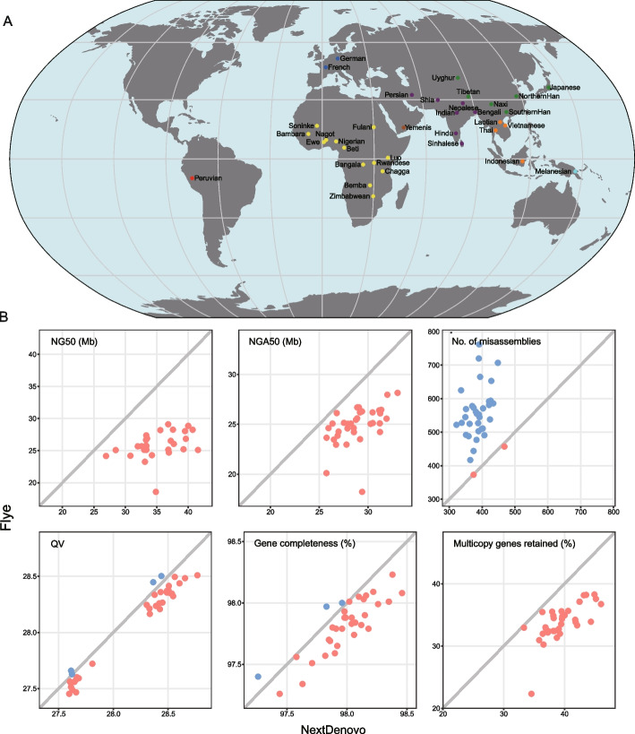

  <sub>**NextDenovo**：35 个人类基因组用 NextDenovo 与 Flye 组装的统计对比（Fig. 2）。数据：人类（非葡萄数据）。来源：Hu et al. 2024, Genome Biology, Fig. 2（[doi:10.1186/s13059-024-03252-4](https://doi.org/10.1186/s13059-024-03252-4)），CC BY。</sub>
- **YaHS** (工具) — 用 Hi-C 数据把 contig 排序、定向并挂到染色体上。 建图前给每条葡萄单倍型挂染色体，速度快。 [doi:10.1093/bioinformatics/btac808](https://doi.org/10.1093/bioinformatics/btac808) · [link](https://github.com/c-zhou/yahs)
- **HapHiC** (工具) — 不依赖参考基因组，用 Hi-C 给分相组装的两套单倍型分别挂染色体。 适合高杂合葡萄和杂交砧木，两套单倍型要分开挂载。 [doi:10.1038/s41477-024-01755-3](https://doi.org/10.1038/s41477-024-01755-3) · [link](https://github.com/zengxiaofei/HapHiC)
- **ALLHiC** (工具) — 面向多倍体和高杂合基因组、区分等位的 Hi-C 挂载工具。 可用于多倍体葡萄、圆叶葡萄材料，以及较早的葡萄组装。 [doi:10.1038/s41477-019-0487-8](https://doi.org/10.1038/s41477-019-0487-8) · [link](https://github.com/tangerzhang/ALLHiC)
- **3D-DNA** (工具) — 用 Hi-C 挂载并纠正错接，结果可在 Juicebox 里手工检查。 葡萄染色体组装手工校正时常用。 [doi:10.1126/science.aal3327](https://doi.org/10.1126/science.aal3327) · [link](https://github.com/aidenlab/3d-dna)
- **ALLMAPS** (工具) — 把遗传图、光学图或共线性图放在一起给 scaffold 排序。 葡萄遗传图谱多，可用来核对或修正染色体顺序。 [doi:10.1186/s13059-014-0573-1](https://doi.org/10.1186/s13059-014-0573-1) · [link](https://github.com/tanghaibao/jcvi)

<a id="section-2"></a>
## 2. 图谱构建

用于构建和拆分泛基因组变异图谱与压缩 de Bruijn 图的方法及命名规范，包括 PGGB、Minigraph-Cactus 和 PanSN-spec。

**需要**：按染色体命名（PanSN）的单倍型 FASTA。建图不需要群体读长。对已经分相的单倍型，先用 BUSCO Duplicated 和 Merqury 检查假重复，只在确有 haplotig 残留时才跑 purge_dups。 [按情景看数据需求](#data-needs)

- **PGGB** (工具) — 由全对全比对构建无偏倚的变异图谱（wfmash → seqwish → smoothxg → GFAffix）。 已是本仓库的发现图谱（脚本 04–05）；Grapepan v1.0 也使用了 PGGB。 [doi:10.1038/s41592-024-02430-3](https://doi.org/10.1038/s41592-024-02430-3) · [link](https://github.com/pangenome/pggb) · [详情](docs/PANGENOME_CATALOG.md#L54)

  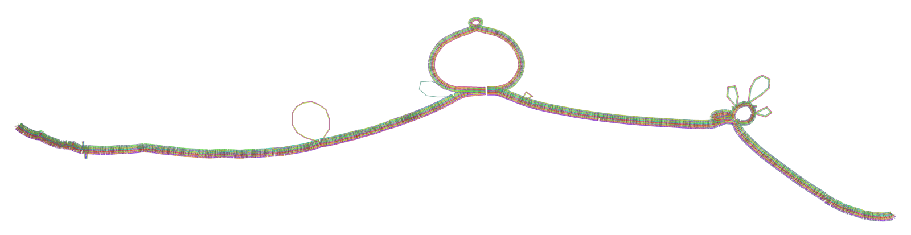

  <sub>**PGGB**：用 DRB1-3123 测试集（12 条人类 HLA-DRB1 单倍型序列）构建的 PGGB 图谱的 odgi draw 二维布局。数据：人类（非葡萄数据）。来源：仓库 [pangenome/pggb](https://github.com/pangenome/pggb/blob/4225c6ce010553ef353c5ea13805e38c2016b503/docs/img/DRB1-3123.fa.gz.pggb-E-s5000-l15000-p80-n10-a0-K16-k8-w50000-j5000-e5000-I0-R0-N.smooth.chop.og.lay.draw_mqc.png)，MIT。</sub>
- **Minigraph-Cactus** (工具) — 以参考为锚的碱基级泛基因组图谱：先用 minigraph 做 SV 骨架，再用 Cactus 比对，并带 vg/Giraffe 索引。 可得到供 Giraffe 使用的图谱；Grapepan v1.0 和栽培葡萄 G3 2026 图谱都用过。 [doi:10.1038/s41587-023-01793-w](https://doi.org/10.1038/s41587-023-01793-w) · [link](https://github.com/ComparativeGenomicsToolkit/cactus) · [详情](docs/PANGENOME_CATALOG.md#L55)

  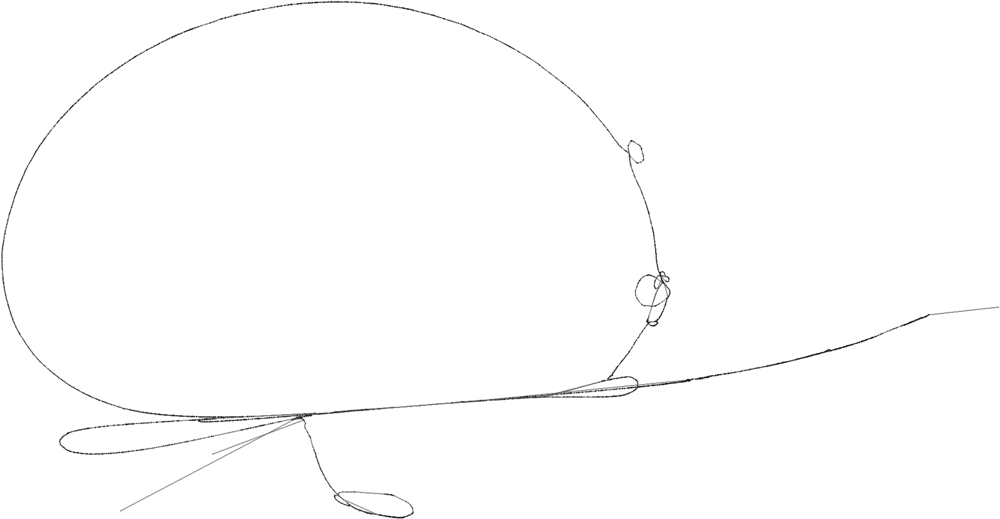

  <sub>**Minigraph-Cactus**：Minigraph-Cactus 酵母泛基因组教程图谱中 I 号染色体的 odgi draw 布局（真实酵母组装）。数据：酿酒酵母（非葡萄数据）。来源：仓库 [ComparativeGenomicsToolkit/cactus](https://github.com/ComparativeGenomicsToolkit/cactus/blob/1abe7c3e822d58d6c274c51738cbeb927614d747/doc/yeast-pg-chrI.full.draw.png)，MIT。</sub>
- **minigraph** (工具) — 由组装增量构建 SV 水平的 rGFA 图谱，并把序列比对到该图谱。 适合大型葡萄属面板的快速、仅含 SV 的图谱；脚本 13 已按染色体使用它。 [doi:10.1186/s13059-020-02168-z](https://doi.org/10.1186/s13059-020-02168-z) · [link](https://github.com/lh3/minigraph) · [详情](docs/PANGENOME_CATALOG.md#L56)
- **wfmash** (工具) — 基于 mashmap 片段和波前比对的全基因组全对全比对器；是 PGGB 的比对步骤。 参数 -p（相似度）决定分歧较大的野生葡萄属物种能在多大程度上并入同一张图谱。 [link](https://github.com/waveygang/wfmash) · [详情](docs/PANGENOME_CATALOG.md#L57)
- **seqwish** (工具) — 通过对比对比对做匹配的传递闭包，诱导出变异图谱。 PGGB 的核心步骤；理解它可以解释葡萄重复位点处的图谱复杂度。 [link](https://github.com/pangenome/seqwish) · [详情](docs/PANGENOME_CATALOG.md#L58)
- **smoothxg** (工具) — 对 seqwish 图谱做局部重新比对（POA）并规范化，以去掉比对噪声。 在从葡萄图谱检测变异之前，减少虚假的小气泡。 [link](https://github.com/pangenome/smoothxg) · [详情](docs/PANGENOME_CATALOG.md#L59)
- **GFAffix** (工具) — 折叠变异图谱中保持路径的共享前后缀。 PGGB 的最后一步规范化；使图谱更小，变异分解更干净。 [link](https://github.com/codialab/GFAffix) · [详情](docs/PANGENOME_CATALOG.md#L60)
- **impg** (工具) — 把全对全比对当作隐式泛基因组图谱，用以投射和提取同源位点，而不构建完整图谱。 可以较低成本在许多单倍型上研究单个葡萄位点（例如性别或果色区域）。 [link](https://github.com/pangenome/impg) · [详情](docs/PANGENOME_CATALOG.md#L61)
- **AlfaPang** (工具) — 无需比对即可构建变异图谱，作为 PGGB 前几步的更快替代。 当葡萄属面板扩大到数百条单倍型时，可能节省计算成本。 [doi:10.1186/s13015-025-00277-7](https://doi.org/10.1186/s13015-025-00277-7) · [link](https://github.com/AdamCicherski/AlfaPang) · [详情](docs/PANGENOME_CATALOG.md#L62)
- **Progressive Cactus** (工具) — 面向许多基因组的、不以单一参考为中心的多基因组比对器。 用于 Vitis / Muscadinia 属级比对；此时泛基因组图谱可能因分歧过大而不适用。 [doi:10.1038/s41586-020-2871-y](https://doi.org/10.1038/s41586-020-2871-y) · [link](https://github.com/ComparativeGenomicsToolkit/cactus) · [详情](docs/PANGENOME_CATALOG.md#L63)
- **pgr-tk** (工具) — 构建以 minimizer 为锚的序列图谱（MAP graphs）和主束，用于位点水平的泛基因组分析。 适合跨葡萄单倍型分析富含重复的抗病基因簇（例如 NLR 位点）。 [doi:10.1038/s41592-023-01914-y](https://doi.org/10.1038/s41592-023-01914-y) · [link](https://github.com/cschin/pgr-tk) · [详情](docs/PANGENOME_CATALOG.md#L64)
- **Bifrost** (工具) — 为许多基因组构建并查询着色的压缩 de Bruijn 图谱。 为葡萄属面板提供无需比对的 k-mer 图谱视角，可用于 k-mer GWAS 或存在性查询。 [doi:10.1186/s13059-020-02135-8](https://doi.org/10.1186/s13059-020-02135-8) · [link](https://github.com/pmelsted/bifrost) · [详情](docs/PANGENOME_CATALOG.md#L65)
- **GGCAT** (工具) — 快速构建压缩且着色的 de Bruijn 图谱。 把 k-mer 图谱扩展到大型重测序面板。 [doi:10.1101/gr.277615.122](https://doi.org/10.1101/gr.277615.122) · [link](https://github.com/algbio/ggcat) · [详情](docs/PANGENOME_CATALOG.md#L66)
- **Cuttlefish 2** (工具) — 以较低内存从许多参考构建压缩 de Bruijn 图谱。 为基于 k-mer 的关联分析提供一种成本较低的图谱表示。 [doi:10.1186/s13059-022-02743-6](https://doi.org/10.1186/s13059-022-02743-6) · [link](https://github.com/COMBINE-lab/cuttlefish) · [详情](docs/PANGENOME_CATALOG.md#L67)
- **Pangenome graph construction review (Plant)** (分析) — 综述植物图谱泛基因组的构建、比对和基因分型工具及其局限。 一份较新的、针对植物的方法全景图。 [doi:10.1007/s42994-025-00206-7](https://doi.org/10.1007/s42994-025-00206-7) · [详情](docs/PANGENOME_CATALOG.md#L68)
- **PanSN-spec** (设想) — 泛基因组序列的命名约定：sample#haplotype#contig。 脚本 01 已经采用；保证葡萄属单倍型在各工具间可追溯。 [link](https://github.com/pangenome/PanSN-spec) · [详情](docs/PANGENOME_CATALOG.md#L69)
- **Chromosome-level graph partitioning** (设想) — 按染色体或按 mash 群落各建一张图谱，以限制内存和运行时间。 葡萄有 19 条染色体且共线性较好，按染色体建图是自然做法。 [doi:10.1093/bioinformatics/btae609](https://doi.org/10.1093/bioinformatics/btae609) · [link](https://github.com/nf-core/pangenome) · [详情](docs/PANGENOME_CATALOG.md#L70)
- **SweepGA** (工具) — 带平面扫描过滤和支架链式连接的全对全基因组比对（FastGA/wfmash）。（年份为仓库创建年；未核对该论文） 去除由 TE 引起的跨染色体虚假比对，这是葡萄中已知的问题。 [link](https://github.com/pangenome/sweepga) · [详情](docs/PANGENOME_CATALOG_SUPPLEMENT_1.md#vs005)
- **SibeliaZ** (工具) — 在许多近缘基因组中寻找局部共线性区块。 葡萄单倍型的共线性区块视角；SibeliaZ 不构建泛基因组图谱（一种不做图谱的替代，思路上更接近第 6 节）。 [doi:10.1038/s41467-020-19777-8](https://doi.org/10.1038/s41467-020-19777-8) · [link](https://github.com/medvedevgroup/SibeliaZ) · [详情](docs/PANGENOME_CATALOG_SUPPLEMENT_1.md#vs006)
- **abPOA** (工具) — 带自适应带宽的快速偏序比对（POA）库。 PGGB 的 smoothxg 内部用它做局部规整，调 PGGB 参数时要知道。 [doi:10.1093/bioinformatics/btaa963](https://doi.org/10.1093/bioinformatics/btaa963) · [link](https://github.com/yangao07/abPOA)
- **SPOA** (工具) — SIMD 加速的偏序比对库，smoothxg 可选的另一个 POA 引擎。 在葡萄 PGGB 图的平滑步骤里作用同 abPOA。 [doi:10.1101/gr.214270.116](https://doi.org/10.1101/gr.214270.116) · [link](https://github.com/rvaser/spoa)
- **TwoPaCo** (工具) — 从多条完整基因组构建压缩 de Bruijn 图。 不做比对，把所有葡萄单倍型建成 k-mer 级的图做比较。 [doi:10.1093/bioinformatics/btw609](https://doi.org/10.1093/bioinformatics/btw609) · [link](https://github.com/medvedevgroup/TwoPaCo)
- **rust-mdbg** (工具) — 基于 minimizer 空间的 de Bruijn 图，组装和建图都很快。 在普通机器上快速给大量葡萄组装建探索性的图。 [doi:10.1016/j.cels.2021.08.009](https://doi.org/10.1016/j.cels.2021.08.009) · [link](https://github.com/ekimb/rust-mdbg)

<a id="section-3"></a>
## 3. 基因分型前的组装与图谱质控

在下游基因分型前用于检查组装完整性、碱基准确度与图谱拓扑结构的评估工具和基准流程，如 Merqury、Inspector 和 Truvari。

**需要**：组装或图谱；核对 k-mer 或碱基准确度时，还要组装所用的读长。 [按情景看数据需求](#data-needs)

- **Merqury** (工具) — 无需参考、基于 k-mer 评估组装的 QV、完整性和分相。 每条单倍型进入图谱前都应运行。 [doi:10.1186/s13059-020-02134-9](https://doi.org/10.1186/s13059-020-02134-9) · [link](https://github.com/marbl/merqury) · [详情](docs/PANGENOME_CATALOG.md#L80)

  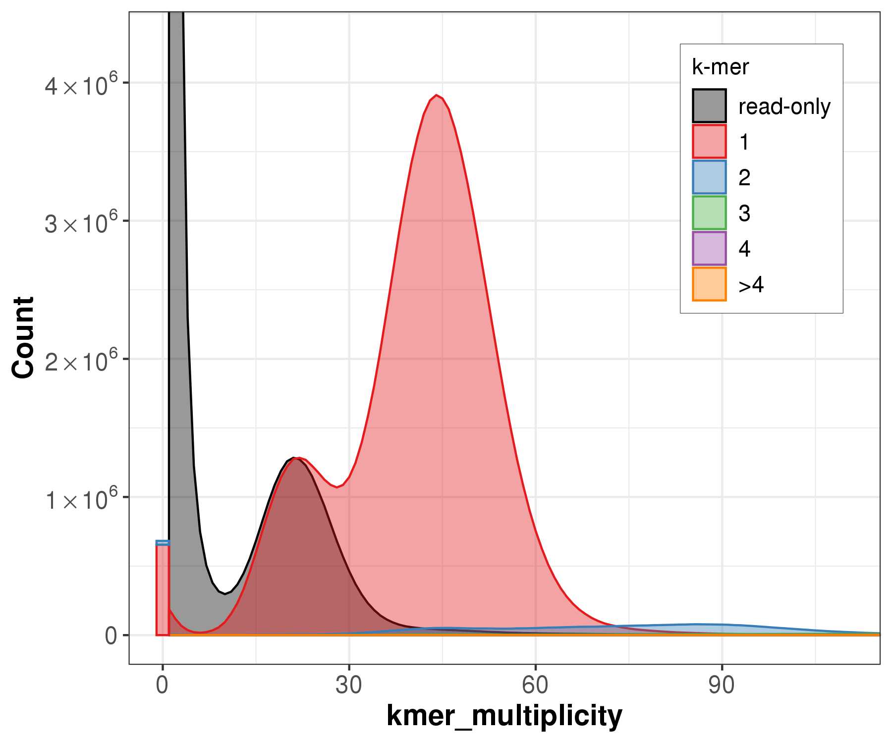

  <sub>**Merqury**：拟南芥 Col-0 × Cvi-0 F1 的 TrioCanu CLR Col-0 单倍型组装的 Merqury 拷贝数谱。数据：拟南芥（非葡萄数据）。来源：仓库 [marbl/merqury](https://github.com/marbl/merqury/blob/88f37c0f4dbb073001d194bcc5d5989a0b0527df/example/triocanu_clr.col.spectra-cn.fl.png)，公有领域（美国政府作品，NHGRI）。</sub>
- **BUSCO** (工具) — 用单拷贝直系同源基因评估基因空间完整性。 每条葡萄属单倍型的常规门槛（Grapepan 报告约 98%）。 [doi:10.1093/molbev/msab199](https://doi.org/10.1093/molbev/msab199) · [link](https://busco.ezlab.org/) · [详情](docs/PANGENOME_CATALOG.md#L81)
- **compleasm** (工具) — 基于 miniprot 的更快 BUSCO 式完整性估计。 适合对几十条葡萄单倍型做快速复查。 [doi:10.1093/bioinformatics/btad595](https://doi.org/10.1093/bioinformatics/btad595) · [link](https://github.com/huangnengCSU/compleasm) · [详情](docs/PANGENOME_CATALOG.md#L82)
- **LAI** (工具) — LTR Assembly Index，衡量重复区的连续性。 葡萄基因组约 55–59% 为 TE；LAI 可在建图前标出重复区组装薄弱之处。 [doi:10.1093/nar/gky730](https://doi.org/10.1093/nar/gky730) · [link](https://github.com/oushujun/LTR_retriever) · [详情](docs/PANGENOME_CATALOG.md#L83)
- **Inspector** (工具) — 基于 reads 检测并纠正组装错误。 找出可能被误当成图谱 SV 的结构组装错误。 [doi:10.1186/s13059-021-02527-4](https://doi.org/10.1186/s13059-021-02527-4) · [link](https://github.com/Maggi-Chen/Inspector) · [详情](docs/PANGENOME_CATALOG.md#L84)
- **CRAQ** (工具) — 根据截短的 read 比对，定位区域性和结构性组装错误。 在单碱基分辨率上把真实的葡萄属 SV 与组装错误分开。 [doi:10.1038/s41467-023-42336-w](https://doi.org/10.1038/s41467-023-42336-w) · [link](https://github.com/JiaoLaboratory/CRAQ) · [详情](docs/PANGENOME_CATALOG.md#L85)
- **Flagger** (工具) — 根据读深标记二倍体组装中的错误、重复或坍缩区块（HPRC）。 在构建图谱前，屏蔽分相葡萄单倍型中不可靠的区块。 [doi:10.1038/s41586-023-05896-x](https://doi.org/10.1038/s41586-023-05896-x) · [link](https://github.com/mobinasri/flagger) · [详情](docs/PANGENOME_CATALOG.md#L86)
- **Crop graph evaluation framework** (分析) — 在作物数据上比较 minigraph、PGGB 和 Minigraph-Cactus，使用完整性、重复和 SV 保真等指标。 提供现成的质控指标，用于选择并说明葡萄属图谱构建器。 [doi:10.1093/gigascience/giaf121](https://doi.org/10.1093/gigascience/giaf121) · [详情](docs/PANGENOME_CATALOG.md#L87)

  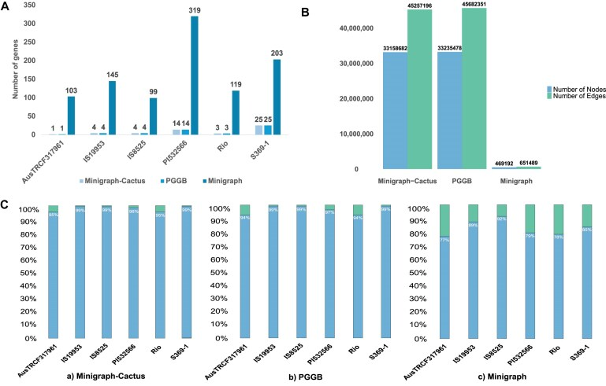

  <sub>**Crop graph evaluation framework**：用真实高粱组装构建的 Minigraph-Cactus、PGGB 和 Minigraph 图谱的特征与缺失基因（Figure 4）。数据：高粱（非葡萄数据）。来源：Kopalli et al. 2025, GigaScience, Figure 4（[doi:10.1093/gigascience/giaf121](https://doi.org/10.1093/gigascience/giaf121)），CC BY。</sub>
- **Human graph method comparison** (分析) — 评测构建方法如何改变图谱结构及下游使用。 解释 PGGB 与 MC 图谱在气泡和大小上为何不同。 [doi:10.1186/s13059-023-03098-2](https://doi.org/10.1186/s13059-023-03098-2) · [详情](docs/PANGENOME_CATALOG.md#L88)
- **odgi stats / validate** (工具) — 变异图谱的统计、路径检查和基于布局的质控。 脚本 16 质控的基础；在任何群体基因分型之前运行。 [doi:10.1093/bioinformatics/btac308](https://doi.org/10.1093/bioinformatics/btac308) · [link](https://github.com/pangenome/odgi) · [详情](docs/PANGENOME_CATALOG.md#L89)
- **gfatools** (工具) — 转换并汇总 GFA/rGFA 图谱。 对 minigraph 图谱做快速合理性检查。 [link](https://github.com/lh3/gfatools) · [详情](docs/PANGENOME_CATALOG.md#L90)
- **Truvari** (工具) — 按序列相似度比较、合并并评测 SV VCF。 用组装的 SyRI 结果作为对照，评测图谱来源的 SV。 [doi:10.1186/s13059-022-02840-6](https://doi.org/10.1186/s13059-022-02840-6) · [link](https://github.com/ACEnglish/truvari) · [详情](docs/PANGENOME_CATALOG.md#L91)
- **vcfdist** (工具) — 考虑分相的小变异和结构变异检测评测。 在留出的葡萄属单倍型上评估基因分型准确度。 [doi:10.1038/s41467-023-43876-x](https://doi.org/10.1038/s41467-023-43876-x) · [link](https://github.com/TimD1/vcfdist) · [详情](docs/PANGENOME_CATALOG.md#L92)
- **Leave-one-out haplotype benchmark** (设想) — 从面板中去掉一个已组装样本，对其 reads 做基因分型，再与该组装比较。 在没有独立真值集时，衡量葡萄属图谱基因分型准确度的标准做法。 [doi:10.1038/s41588-022-01043-w](https://doi.org/10.1038/s41588-022-01043-w) · [详情](docs/PANGENOME_CATALOG.md#L93)
- **gretl** (工具) — 图谱统计（节点/路径相似度、自助法增长、窗口）。 用窗口水平的图谱统计比较 PGGB 与 MC 葡萄图谱。 [doi:10.1093/bioinformatics/btae755](https://doi.org/10.1093/bioinformatics/btae755) · [link](https://github.com/MoinSebi/gretl) · [详情](docs/PANGENOME_CATALOG_SUPPLEMENT_1.md#vs007)
- **gfastats** (工具) — 组装/图谱的统计与操作。 在葡萄属组装之间给出一致的 N50/缺口统计。 [doi:10.1093/bioinformatics/btac460](https://doi.org/10.1093/bioinformatics/btac460) · [link](https://github.com/vgl-hub/gfastats) · [详情](docs/PANGENOME_CATALOG_SUPPLEMENT_1.md#vs008)
- **skani** (工具) — 通过稀疏链式连接快速估计 ANI。 对含野生种的图谱，成对相似度比 Mash 更准确。 [doi:10.1038/s41592-023-02018-3](https://doi.org/10.1038/s41592-023-02018-3) · [link](https://github.com/bluenote-1577/skani) · [详情](docs/PANGENOME_CATALOG_SUPPLEMENT_1.md#vs009)
- **QUAST** (工具) — 统计组装连续性；有参考时还能报错误组装。 每条葡萄单倍型进图前的常规第一轮统计。 [doi:10.1093/bioinformatics/btt086](https://doi.org/10.1093/bioinformatics/btt086) · [link](https://github.com/ablab/quast)
- **GenomeScope 2.0** (工具) — 用 k-mer 频谱估计基因组大小、杂合度和倍性。 决定是否做分相组装前，先看葡萄品种的杂合度。 [doi:10.1038/s41467-020-14998-3](https://doi.org/10.1038/s41467-020-14998-3) · [link](https://github.com/tbenavi1/genomescope2.0)

  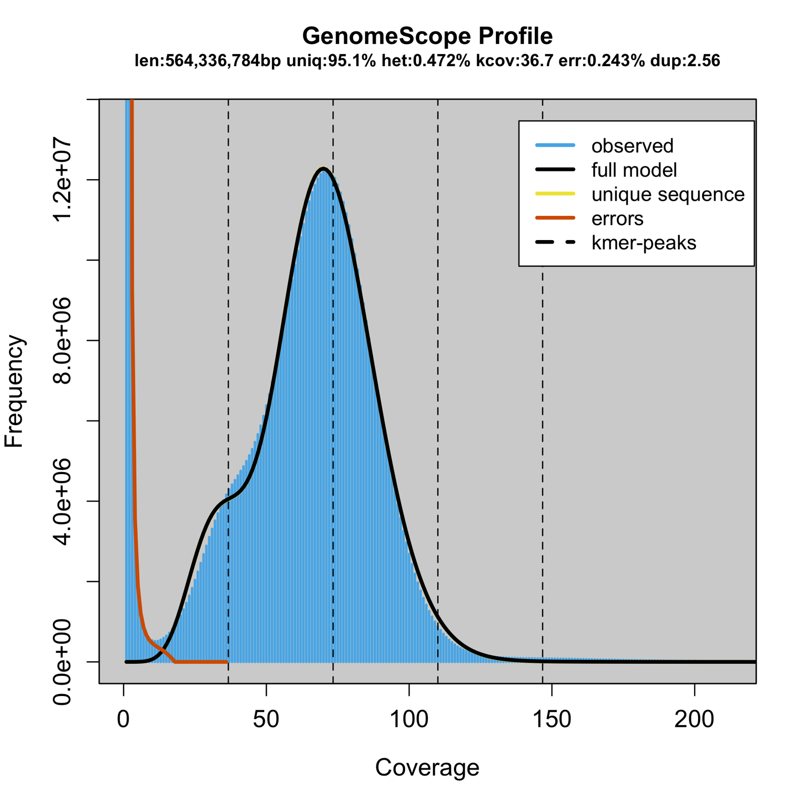

  <sub>**GenomeScope 2.0**：欧洲鲈鱼短读长的 GenomeScope 2.0 k-mer（k=21）分布与模型拟合（仓库示例 example1）。数据：欧洲鲈鱼（非葡萄数据）。来源：仓库 [tbenavi1/genomescope2.0](https://github.com/tbenavi1/genomescope2.0/blob/8f25e3a25eaa691cdae474daf5cfe5416bfc60dc/user_data/example1/plot.png)，Apache-2.0。</sub>
- **Smudgeplot** (工具) — 用杂合 k-mer 对推断倍性。 确认葡萄和砧木材料是二倍体还是多倍体。 [doi:10.1038/s41467-020-14998-3](https://doi.org/10.1038/s41467-020-14998-3) · [link](https://github.com/KamilSJaron/smudgeplot)

  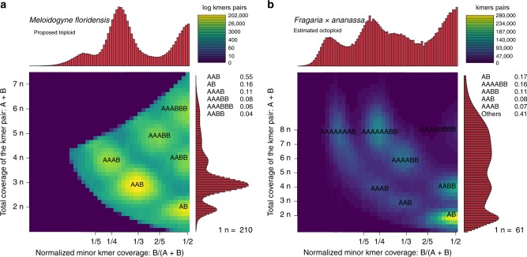

  <sub>**Smudgeplot**：真实数据的 Smudgeplot：三倍体根结线虫 Meloidogyne floridensis 与八倍体草莓（Fig. 8）。数据：根结线虫和栽培草莓（非葡萄数据）。来源：Ranallo-Benavidez et al. 2020, Nature Communications, Fig. 8（[doi:10.1038/s41467-020-14998-3](https://doi.org/10.1038/s41467-020-14998-3)），CC BY。</sub>
- **KAT** (工具) — 比较读长和组装的 k-mer，找缺失或重复的序列。 看葡萄单倍型组装是保住了两个等位还是塌缩成一个。 [doi:10.1093/bioinformatics/btw663](https://doi.org/10.1093/bioinformatics/btw663) · [link](https://github.com/EarlhamInst/KAT)
- **OMArk** (工具) — 对照已知基因家族检查基因集是否完整、是否有污染。 和 BUSCO 互补，用于比较各葡萄组装的基因集（基因模型本身归 gene-structure-annotation）。 [doi:10.1038/s41587-024-02147-w](https://doi.org/10.1038/s41587-024-02147-w) · [link](https://github.com/DessimozLab/OMArk)
- **tidk** (工具) — 在组装上找端粒重复并画出分布。 快速核对葡萄 T2T 单倍型两端是否都有端粒。 [doi:10.1093/bioinformatics/btaf049](https://doi.org/10.1093/bioinformatics/btaf049) · [link](https://github.com/tolkit/telomeric-identifier)
- **BlobToolKit** (工具) — 画出 contig 的 GC、覆盖度和物种归属，用来发现污染。 建图前筛掉葡萄组装里的真菌、细菌或细胞器 contig。 [doi:10.1534/g3.119.400908](https://doi.org/10.1534/g3.119.400908) · [link](https://github.com/genomehubs/blobtoolkit)

<a id="section-4"></a>
## 4. 变异发现：序列 PAV、结构变异和 TE 插入

用于检测序列有无变异（PAV）、结构变异与 TE 插入多态性的检测工具及图谱拆解方法，如 panacus、vg deconstruct 和 GraffiTE。TE 库构建不在本仓库中（位于 `vitis-te`）。

**需要**：做序列 PAV 和 SV 用图谱或组装；做 TE 插入多态还要 vitis-te 中整理好的 TE 库。 [按情景看数据需求](#data-needs)

### (a) 序列和窗口 PAV，以及增长曲线

序列或窗口水平的存在/缺失和增长曲线。这里不是基因水平的 PAV。

- **panacus** (工具) — 从图谱计算泛基因组增长和核心大小曲线（按碱基、节点或边）。 脚本 06 使用它；这是序列水平（碱基）的增长，不是基因 PAV。 [doi:10.1093/bioinformatics/btae720](https://doi.org/10.1093/bioinformatics/btae720) · [link](https://github.com/codialab/panacus) · [详情](docs/PANGENOME_CATALOG.md#L105)

  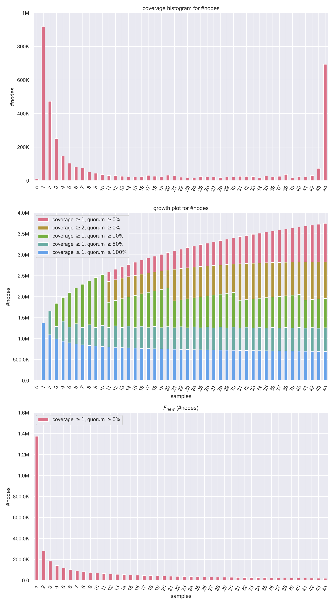

  <sub>**panacus**：HPRC v1.0 PGGB 图谱 chr22 的 panacus 节点覆盖直方图与泛基因组增长曲线。数据：人类（HPRC）（非葡萄数据）。来源：仓库 [marschall-lab/panacus](https://github.com/marschall-lab/panacus/blob/79ba82b01f7d44b22faada755f05464f045fbd20/docs/chr22.hprc-v1.0-pggb.histgrowth.node.png)，MIT。</sub>
- **odgi pav** (工具) — 图谱中路径在 BED 窗口上的存在/缺失。 葡萄单倍型的窗口水平序列 PAV（与基因 PAV 分开）。 [doi:10.1093/bioinformatics/btac308](https://doi.org/10.1093/bioinformatics/btac308) · [link](https://github.com/pangenome/odgi) · [详情](docs/PANGENOME_CATALOG.md#L106)
- **GraTools** (工具) — 对 GFA 建立一次索引，提取子图、核心/非必需比例和组别特异片段。[preprint] 寻找野生与栽培、或鲜食与酿酒等葡萄组别特异的片段。 [doi:10.64898/2025.12.01.691558](https://doi.org/10.64898/2025.12.01.691558) · [link](https://gratools.readthedocs.io/) · [详情](docs/PANGENOME_CATALOG.md#L107)
- **Heaps law openness** (设想) — 对泛基因组增长做拟合，判断泛基因组是开放还是封闭。 用来解释葡萄属的 panacus 曲线（属水平较开放，与近乎封闭的 V. vinifera 相对）。 [doi:10.1016/j.mib.2008.09.006](https://doi.org/10.1016/j.mib.2008.09.006) · [详情](docs/PANGENOME_CATALOG.md#L108)
- **PanK-Pipeline** (工具) — 把 k-mer 存在/缺失基因分型输出为 VCF，并做 PCA、结构和系统发育（以 Brassica rapa 为例）。这是序列水平 PAV，不是基因 PAV。（年份为仓库创建年；未核对该论文） 在葡萄材料间做无需参考的序列 PAV。 [link](https://github.com/caixu0518/PanK-Pipeline) · [详情](docs/PANGENOME_CATALOG_SUPPLEMENT_1.md#vs010)
- **panagram** (工具) — 使用 KMC k-mer 索引的、无需比对的泛基因组浏览/分析。这是序列水平的存在性，不是基因 PAV。（年份为仓库创建年；未核对该论文） 沿葡萄染色体浏览 k-mer PAV。 [link](https://github.com/kjenike/panagram) · [详情](docs/PANGENOME_CATALOG_SUPPLEMENT_1.md#vs011)
- **pangrowth** (工具) — 由 k-mer 或基因家族计算泛基因组增长/开放度。（年份为仓库创建年；未核对该论文） 对葡萄属应分别报告 k-mer（序列）增长和基因家族增长，二者回答的问题不同。基因家族增长的结果属于第 7 节；不要与第 4a 节的序列/窗口 PAV 报告混在一起。 [link](https://github.com/gi-bielefeld/pangrowth) · [详情](docs/PANGENOME_CATALOG_SUPPLEMENT_1.md#vs012)

### (b) 结构变异和 TE 插入

从图谱、组装或长读长新等位基因中发现的结构变异和 TE 插入。

- **vg deconstruct** (工具) — 相对选定的参考路径，输出图谱气泡的 VCF。 脚本 05 从图谱本身发现变异。 [doi:10.1038/nbt.4227](https://doi.org/10.1038/nbt.4227) · [link](https://github.com/vgteam/vg) · [详情](docs/PANGENOME_CATALOG.md#L114)

  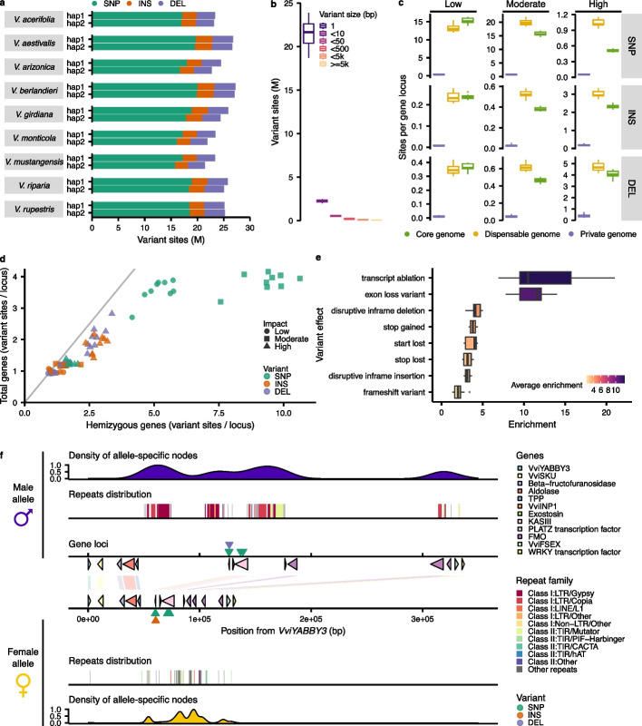

  <sub>**vg deconstruct**：从 9 个北美葡萄属物种（18 条单倍型）的 PGGB 超泛基因组图谱拆解出的变异：数量、大小分布与影响（Fig. 5）。数据：9 个北美葡萄属物种（葡萄数据）。来源：Cochetel et al. 2023, Genome Biology, Fig. 5（[doi:10.1186/s13059-023-03133-2](https://doi.org/10.1186/s13059-023-03133-2)），CC BY。</sub>
- **vcfbub** (工具) — 过滤图谱 VCF 中嵌套或过大的气泡。 在群体分析前去掉巨大的嵌套位点。 [link](https://github.com/pangenome/vcfbub) · [详情](docs/PANGENOME_CATALOG.md#L115)
- **vcfwave (vcflib)** (工具) — 把复杂的图谱等位基因重新比对成基本的 SNP/indel/SV。 使图谱 VCF 能被常规的葡萄群体遗传工具使用。 [doi:10.1371/journal.pcbi.1009123](https://doi.org/10.1371/journal.pcbi.1009123) · [link](https://github.com/vcflib/vcflib) · [详情](docs/PANGENOME_CATALOG.md#L116)
- **SyRI** (工具) — 在两条染色体水平组装之间寻找共线性、重排和局部变异。 脚本 10 使用它；来自组装的独立 SV 参照。 [doi:10.1186/s13059-019-1911-0](https://doi.org/10.1186/s13059-019-1911-0) · [link](https://github.com/schneebergerlab/syri) · [详情](docs/PANGENOME_CATALOG.md#L117)
- **PAV (EichlerLab assembly variant caller)** (工具) — 以分相组装相对参考检测 SNV、indel、SV 和倒位。 为每条葡萄单倍型给出单倍型分辨的 SV 结果，以便与图谱气泡比较。 [doi:10.1126/science.abf7117](https://doi.org/10.1126/science.abf7117) · [link](https://github.com/EichlerLab/pav) · [详情](docs/PANGENOME_CATALOG.md#L118)
- **SVIM-asm** (工具) — 组装到参考的 SV 检测工具。 在许多葡萄属单倍型上，作为 PAV（EichlerLab 组装变异检测工具）的轻量替代。 [doi:10.1093/bioinformatics/btaa1034](https://doi.org/10.1093/bioinformatics/btaa1034) · [link](https://github.com/eldariont/svim-asm) · [详情](docs/PANGENOME_CATALOG.md#L119)
- **Sniffles2** (工具) — 长读长 SV 检测工具，支持群体规模合并（SNF 文件）和镶嵌 SV 检测。 用于葡萄无性系和群体的 HiFi/ONT 重测序。 [doi:10.1038/s41587-023-02024-y](https://doi.org/10.1038/s41587-023-02024-y) · [link](https://github.com/fritzsedlazeck/Sniffles) · [详情](docs/PANGENOME_CATALOG.md#L120)
- **cuteSV** (工具) — 通过签名聚类快速检测长读长 SV。 在葡萄属长读长上与 Sniffles2 做多检测器共识。 [doi:10.1186/s13059-020-02107-y](https://doi.org/10.1186/s13059-020-02107-y) · [link](https://github.com/tjiangHIT/cuteSV) · [详情](docs/PANGENOME_CATALOG.md#L121)
- **SVision-pro** (工具) — 用神经网络从长读长中发现复杂、新生和体细胞 SV。 检测葡萄无性系之间的体细胞 SV（例如 Pinot 无性系）。 [doi:10.1038/s41587-024-02190-7](https://doi.org/10.1038/s41587-024-02190-7) · [link](https://github.com/songbowang125/SVision-pro) · [详情](docs/PANGENOME_CATALOG.md#L122)
- **Jasmine** (工具) — 用最小生成森林方法合并多样本的 SV 检测结果。 从许多葡萄检测集合并出非冗余的 SV 目录。 [doi:10.1038/s41592-022-01753-3](https://doi.org/10.1038/s41592-022-01753-3) · [link](https://github.com/mkirsche/Jasmine) · [详情](docs/PANGENOME_CATALOG.md#L123)
- **SURVIVOR** (工具) — SV 检测结果的模拟、合并和比较。 经典的合并/共识步骤；植物 SV 论文中仍常用。 [doi:10.1038/ncomms14061](https://doi.org/10.1038/ncomms14061) · [link](https://github.com/fritzsedlazeck/SURVIVOR) · [详情](docs/PANGENOME_CATALOG.md#L124)
- **SVarp** (工具) — 从比对到泛基因组图谱的长读长中发现图谱中没有的新 SV 等位基因。[preprint] 相对葡萄图谱做真正的新 SV 发现，不同于对已知气泡的基因分型。 [doi:10.1101/2024.02.18.580171](https://doi.org/10.1101/2024.02.18.580171) · [link](https://github.com/asylvz/SVarp) · [详情](docs/PANGENOME_CATALOG.md#L125)
- **SVPG** (工具) — 利用单倍型分辨的泛基因组参考，从长读长检测 SV，并快速把新样本增补进图谱。[preprint] 加入新的葡萄属材料而不必重建整张图谱。 [doi:10.1101/2025.07.11.664486](https://doi.org/10.1101/2025.07.11.664486) · [link](https://github.com/coopsor/SVPG) · [详情](docs/PANGENOME_CATALOG.md#L126)
- **Swave** (工具) — 深度学习方法，利用组装来源泛基因组图谱中的群体特征，解析简单和复杂 SV。 从 PGGB/MC 葡萄图谱得到的 SV 分类，比仅做气泡分解更好。 [doi:10.1038/s41588-026-02538-6](https://doi.org/10.1038/s41588-026-02538-6) · [link](https://github.com/songbowang125/Swave) · [详情](docs/PANGENOME_CATALOG.md#L127)
- **GraffiTE** (工具) — 从组装/长读长中寻找多态 TE 插入，构建图谱并对其基因分型（v1.1 增加甲基化，2026 预印本 10.64898/2026.11.06.764993）。 TE 插入可驱动葡萄性状（例如 VvMybA1 处的 Gret1）；可得到每个材料的多态 TE 目录。这不是 vitis-te 中的 TE 库构建，也不是结构注释里用可信库做软屏蔽的步骤。 [doi:10.1101/2023.09.11.557209](https://doi.org/10.1101/2023.09.11.557209) · [link](https://github.com/cgroza/GraffiTE) · [详情](docs/PANGENOME_CATALOG.md#L128)
- **TE insertion polymorphisms from pangenome (rice)** (分析) — 水稻泛基因组范围内与耐寒相关的 TE 插入多态。 把葡萄 TE-SV 与抗寒性（例如 V. amurensis）联系起来的模板。 [doi:10.1038/s41467-025-62887-4](https://doi.org/10.1038/s41467-025-62887-4) · [详情](docs/PANGENOME_CATALOG.md#L129)
- **SV size and class taxonomy** (设想) — 按类别（INS/DEL/INV/DUP/complex）、大小区间以及 TE/串联来源报告 SV，而不是只给一个计数。 避免在葡萄汇总中把序列 PAV、SV 和基因 PAV 混在一起。 [doi:10.1126/science.abf7117](https://doi.org/10.1126/science.abf7117) · [详情](docs/PANGENOME_CATALOG.md#L130)
- **Inversions in pangenome graphs** (分析) — 倒位在图谱中如何表示和检测。 葡萄 SV 图谱在着丝粒附近报告许多倒位；图谱 VCF 可能对它们表示不当。 [doi:10.1093/nargab/lqag125](https://doi.org/10.1093/nargab/lqag125) · [link](https://pmc.ncbi.nlm.nih.gov/articles/PMC13669635/) · [详情](docs/PANGENOME_CATALOG_SUPPLEMENT_1.md#vs013)
- **collapse-bubble** (工具) — 在 Minigraph-Cactus VCF 的同一气泡内合并冗余 SV 等位基因，同时保留分相基因型。（年份为仓库创建年；未核对该论文） 在制作葡萄 GWAS 标记集之前，清理 MC deconstruct 的 VCF。 [link](https://github.com/Han-Cao/collapse-bubble) · [详情](docs/PANGENOME_CATALOG_SUPPLEMENT_1.md#vs014)
- **Delly** (工具) — 用双端和断裂读长检测结构变异的短读长软件。 没有长读长时，大规模短读长葡萄群体的基础 SV 检测。 [doi:10.1093/bioinformatics/bts378](https://doi.org/10.1093/bioinformatics/bts378) · [link](https://github.com/dellytools/delly)
- **Manta** (工具) — 快速的短读长 SV 和中等长度 indel 检测。 可与 Delly 取交集，用于葡萄重测序数据。 [doi:10.1093/bioinformatics/btv710](https://doi.org/10.1093/bioinformatics/btv710) · [link](https://github.com/Illumina/manta)
- **DeBreak** (工具) — 长读长 SV 检测，侧重准确断点。 断点准，把葡萄 SV 合进图的 bubble 时更好对齐。 [doi:10.1038/s41467-023-35996-1](https://doi.org/10.1038/s41467-023-35996-1) · [link](https://github.com/ChongLab/DeBreak)
- **SVDSS** (工具) — 用样本特有字符串在难区域从 HiFi 读长检测 SV。 针对葡萄重复多、比对类软件容易漏检的区域。 [doi:10.1038/s41592-022-01674-1](https://doi.org/10.1038/s41592-022-01674-1) · [link](https://github.com/Parsoa/SVDSS)
- **Assemblytics** (工具) — 从整基因组组装比对中找出变异并汇总。 快速汇总某条葡萄单倍型相对 PN40024 的 SV 大小和类型。 [doi:10.1093/bioinformatics/btw369](https://doi.org/10.1093/bioinformatics/btw369) · [link](https://github.com/MariaNattestad/assemblytics)

  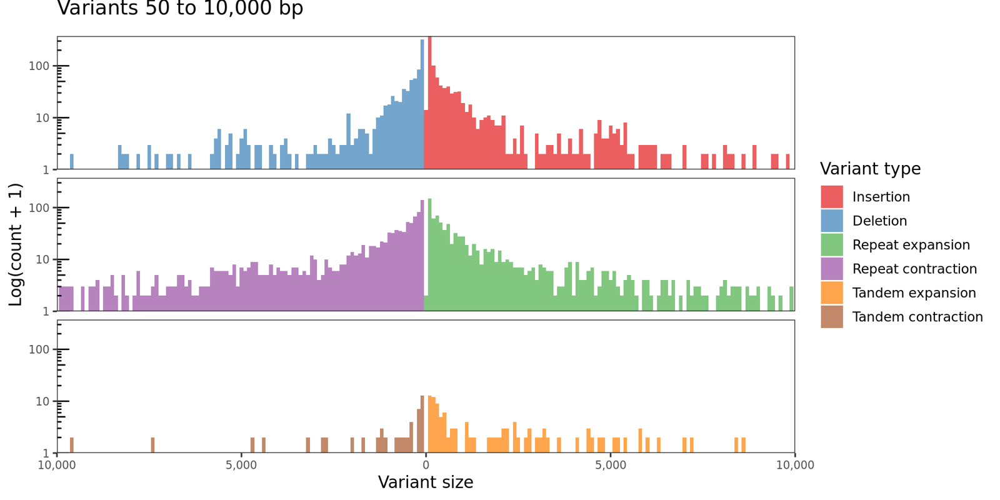

  <sub>**Assemblytics**：仓库中拟南芥示例（组装对参考比对）的 Assemblytics 插入、缺失、重复与串联扩张/收缩大小分布。数据：拟南芥（非葡萄数据）。来源：仓库 [MariaNattestad/assemblytics](https://github.com/MariaNattestad/assemblytics/blob/7acd1acec5b4175ab71a7c885a6ddadec0e355ab/output_examples/arabidopsis/Arabidopsis_example.Assemblytics.size_distributions.all_variants.log_all_sizes.png)，MIT。</sub>
- **dipcall** (工具) — 用分相二倍体组装对参考检测变异。 给每个分相葡萄材料出“真值”式变异集，用来评估图分型结果。 [doi:10.1038/s41592-018-0054-7](https://doi.org/10.1038/s41592-018-0054-7) · [link](https://github.com/lh3/dipcall)
- **McClintock 2** (工具) — 在一个流程里跑多个短读长 TE 插入检测器并比较结果。 检测葡萄群体的 TE 插入多态；TE 库本身来自 vitis-te。 [doi:10.1186/s13100-023-00296-4](https://doi.org/10.1186/s13100-023-00296-4) · [link](https://github.com/bergmanlab/mcclintock)
- **TEMP2** (工具) — 从短读长检测种系和新发 TE 插入。 可看葡萄芽变克隆间的 TE 插入；用 vitis-te 的库。 [doi:10.1093/nar/gkab010](https://doi.org/10.1093/nar/gkab010) · [link](https://github.com/weng-lab/TEMP2)

<a id="section-5"></a>
## 5. 群体基因分型与 reads 到图谱的比对

短读长与长读长的图谱比对工具及群体基因分型工具，包括 vg Giraffe、vg call、PanGenie 和 GraphAligner。注意 Giraffe + vg call 与 PanGenie 仅对图谱中已有的位点进行基因分型，不会添加新的等位基因。

**需要**：图谱加群体读长。Giraffe + vg call 只分型图中已有的位点（`vg augment` 可发现新变异，但非本仓库默认流程）。PanGenie 使用短读长 k-mer，需要已分相并拆成 bubble 的 VCF（如 Minigraph-Cactus 加 vcfbub），不能直接读 PGGB 的 GFA；长读长用 GraphAligner 或 minigraph。 [按情景看数据需求](#data-needs)

- **vg Giraffe** (工具) — 面向 GBZ 泛基因组图谱的、考虑单倍型的快速短读长比对器。 脚本 14 的比对器；把重测序的葡萄群体比对到图谱。 [doi:10.1126/science.abg8871](https://doi.org/10.1126/science.abg8871) · [link](https://github.com/vgteam/vg) · [详情](docs/PANGENOME_CATALOG.md#L140)
- **vg Giraffe long reads** (工具) — 把 Giraffe 扩展到大型泛基因组图谱上的快速长读长和短读长比对。[preprint] 把 HiFi/ONT 葡萄 reads 比对到与短读长相同的图谱上。 [doi:10.1101/2025.09.29.678807](https://doi.org/10.1101/2025.09.29.678807) · [link](https://github.com/vgteam/vg) · [详情](docs/PANGENOME_CATALOG.md#L141)
- **vg call** (工具) — 在 vg pack 之后，根据 read 支持对已知图谱气泡（SV 和小变异）做基因分型。 脚本 14 的步骤：对图谱中已有变异做群体基因分型，不是发现新的等位基因。 [doi:10.1186/s13059-020-1941-7](https://doi.org/10.1186/s13059-020-1941-7) · [link](https://github.com/vgteam/vg) · [详情](docs/PANGENOME_CATALOG.md#L142)
- **Haplotype sampling (personalized graphs)** (工具) — 用 k-mer 为每个样本抽样最相近的单倍型，在比对前构建个性化图谱。 当葡萄图谱包含许多分歧较大的野生单倍型时，可改善比对。 [doi:10.1038/s41592-024-02407-2](https://doi.org/10.1038/s41592-024-02407-2) · [link](https://github.com/vgteam/vg) · [详情](docs/PANGENOME_CATALOG.md#L143)
- **PanGenie** (工具) — 无需比对、基于 k-mer HMM，对短读长中已知的泛基因组变异做基因分型。 脚本 15；对图谱 SV 做快速群体基因分型。与 Giraffe+vg call 的差别在于使用 k-mer 还是 read 比对。 [doi:10.1038/s41588-022-01043-w](https://doi.org/10.1038/s41588-022-01043-w) · [link](https://github.com/eblerjana/pangenie) · [详情](docs/PANGENOME_CATALOG.md#L144)

  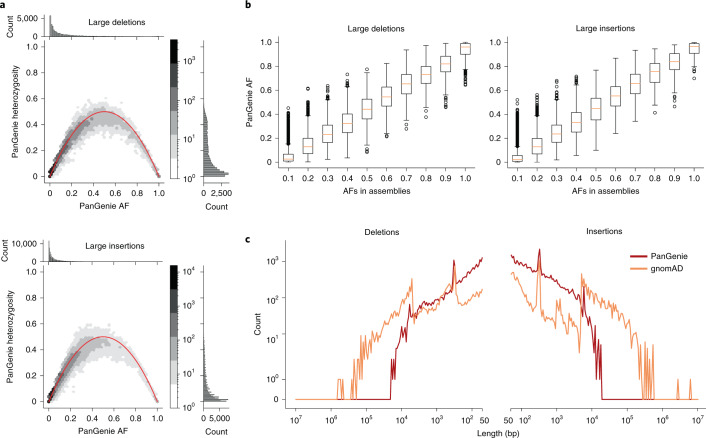

  <sub>**PanGenie**：200 个无亲缘关系的千人基因组样本的 PanGenie 分型：等位基因频率与杂合度等质控（Fig. 4）。数据：人类（千人基因组）（非葡萄数据）。来源：Ebler et al. 2022, Nature Genetics, Fig. 4（[doi:10.1038/s41588-022-01043-w](https://doi.org/10.1038/s41588-022-01043-w)），CC BY。</sub>
- **PanGenie with haplotype sampling and polishing** (工具) — 增加样本特异的单倍型抽样和稀有变异抛光，以扩大 PanGenie 群体规模。[preprint] 可处理比原先 254 条单倍型上限更大的葡萄面板。 [doi:10.64898/2026.06.29.735275](https://doi.org/10.64898/2026.06.29.735275) · [link](https://github.com/eblerjana/pangenie) · [详情](docs/PANGENOME_CATALOG.md#L145)
- **Varigraph** (工具) — 面向图谱上小变异和大变异的 k-mer 分型器，包括多倍体等位基因剂量。 在植物基因组上构建并测试过；也可用于多倍体/杂种砧木材料。 [doi:10.1016/j.molp.2025.08.001](https://doi.org/10.1016/j.molp.2025.08.001) · [link](https://github.com/JiaoLab2021/varigraph) · [详情](docs/PANGENOME_CATALOG.md#L146)
- **GraphAligner** (工具) — 把长读长比对到序列图谱。 把长读长比对到 minigraph 葡萄图谱。 [doi:10.1186/s13059-020-02157-2](https://doi.org/10.1186/s13059-020-02157-2) · [link](https://github.com/maickrau/GraphAligner) · [详情](docs/PANGENOME_CATALOG.md#L147)
- **Haplotype-aware long-read alignment** (工具) — 在尊重单倍型路径的前提下把序列比对到泛基因组图谱（Minichain/考虑单倍型的共线性链式比对）。 避免跨葡萄单倍型的嵌合路径。 [doi:10.1101/gr.279143.124](https://doi.org/10.1101/gr.279143.124) · [详情](docs/PANGENOME_CATALOG.md#L148)
- **BayesTyper** (工具) — 基于 k-mer 的贝叶斯方法，对 SNV、indel 和 SV 做基因分型。 较早的 k-mer 分型器；可作为比较的参照。 [doi:10.1038/s41588-018-0145-5](https://doi.org/10.1038/s41588-018-0145-5) · [link](https://github.com/bioinformatics-centre/BayesTyper) · [详情](docs/PANGENOME_CATALOG.md#L149)
- **Paragraph** (工具) — 用局部图谱从短读长对 SV 做基因分型。 对一套经过整理的葡萄 SV 做定向基因分型。 [doi:10.1186/s13059-019-1909-7](https://doi.org/10.1186/s13059-019-1909-7) · [link](https://github.com/Illumina/paragraph) · [详情](docs/PANGENOME_CATALOG.md#L150)
- **GraphTyper2** (工具) — 用局部泛基因组图谱做群体规模的 SV 基因分型。 在大型葡萄重测序面板中对 SV 做联合群体基因分型。 [doi:10.1038/s41467-019-13341-9](https://doi.org/10.1038/s41467-019-13341-9) · [link](https://github.com/DecodeGenetics/graphtyper) · [详情](docs/PANGENOME_CATALOG.md#L151)
- **KAGE** (工具) — 使用 k-mer 和群体先验的快速、无需比对的基因分型。 适合育种规模葡萄群体的低成本基因分型。 [doi:10.1186/s13059-022-02771-2](https://doi.org/10.1186/s13059-022-02771-2) · [link](https://github.com/kage-genotyper/kage) · [详情](docs/PANGENOME_CATALOG.md#L152)
- **SVJedi-graph** (工具) — 在包含相近/重叠 SV 的变异图谱上，用长读长对 SV 做基因分型。 用 ONT 数据对嵌套的葡萄 SV 做基因分型。 [doi:10.1093/bioinformatics/btad237](https://doi.org/10.1093/bioinformatics/btad237) · [link](https://github.com/SandraLouise/SVJedi-graph) · [详情](docs/PANGENOME_CATALOG.md#L153)
- **COSIGT** (工具) — 以 1–2x 覆盖度，通过把读深向量与图谱单倍型匹配，对复杂位点做基因分型。 用于低覆盖度或古代葡萄种子 DNA 在复杂位点上的基因分型。 [doi:10.1186/s13059-026-04242-4](https://doi.org/10.1186/s13059-026-04242-4) · [link](https://github.com/davidebolo1993/cosigt) · [详情](docs/PANGENOME_CATALOG.md#L154)
- **Panmap** (工具) — 在带有突变注释的泛基因组上，用系统发育压缩的 k-mer 索引做放置、比对和基因分型。[preprint] 把新的葡萄样本放到单倍型系统树上的一种设想。 [doi:10.64898/2026.03.29.711974](https://doi.org/10.64898/2026.03.29.711974) · [link](https://github.com/amkram/panmap) · [详情](docs/PANGENOME_CATALOG.md#L155)
- **Pangenome-aware DeepVariant** (工具) — 在 pileup 图像中加入泛基因组单倍型的小变异检测。[preprint] 在分歧较大的葡萄区域可得到更准确的 SNP/indel。这是可以报告图谱中尚不存在的 SNP/indel 的小变异发现；它不是对已知图谱气泡的基因分型，与本节中的 Giraffe + vg call 或 PanGenie 不同。 [doi:10.1101/2025.06.05.657102](https://doi.org/10.1101/2025.06.05.657102) · [link](https://github.com/google/deepvariant) · [详情](docs/PANGENOME_CATALOG.md#L156)
- **Locityper** (工具) — 通过从面板中选择已知单倍型的最佳配对（短读长或长读长），对复杂多态位点做基因分型。 针对面板中已有的单倍型，对 NLR 或其他高度变异的葡萄位点做群体基因分型；它不发现新的等位基因。 [doi:10.1038/s41588-025-02362-4](https://doi.org/10.1038/s41588-025-02362-4) · [link](https://github.com/tprodanov/locityper) · [详情](docs/PANGENOME_CATALOG_SUPPLEMENT_1.md#vs015)
- **GraphChainer** (工具) — 用于长读长图谱比对的共线性链式方法。 在重复区更准确地放置长读长。 [doi:10.1093/bioinformatics/btad460](https://doi.org/10.1093/bioinformatics/btad460) · [link](https://github.com/algbio/GraphChainer) · [详情](docs/PANGENOME_CATALOG_SUPPLEMENT_1.md#vs016)
- **RecAlign** (工具) — 考虑重组的、面向变异图谱的长读长比对。 重组葡萄后代的 reads 会在单倍型之间切换。 [doi:10.1186/s12859-026-06640-8](https://doi.org/10.1186/s12859-026-06640-8) · [link](https://github.com/AlgoLab/rec_align_exps) · [详情](docs/PANGENOME_CATALOG_SUPPLEMENT_1.md#vs017)
- **Moni-align** (工具) — 在基因组集合的 r-index 上做短读长比对。 用于局部葡萄区域的、不做图谱的泛基因组比对替代。 [doi:10.1101/gr.279858.124](https://doi.org/10.1101/gr.279858.124) · [link](https://github.com/maxrossi91/moni-align) · [详情](docs/PANGENOME_CATALOG_SUPPLEMENT_1.md#vs018)
- **Plant graph genotyper benchmark + ensemble** (分析) — 在植物基因组上评测 vg、GraphTyper2、BayesTyper、PanGenie 等，并给出集成流程。 根据植物（而非人类）证据为葡萄群体选择分型器。 [doi:10.1186/s13059-024-03239-1](https://doi.org/10.1186/s13059-024-03239-1) · [link](https://pmc.ncbi.nlm.nih.gov/articles/PMC11003132/) · [详情](docs/PANGENOME_CATALOG_SUPPLEMENT_1.md#vs019)

  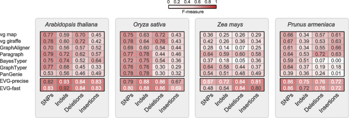

  <sub>**Plant graph genotyper benchmark + ensemble**：图谱分型工具在水稻、玉米和杏真实短读长上的分型表现（Fig. 6）。数据：水稻、玉米和杏（非葡萄数据）。来源：Du et al. 2024, Genome Biology, Fig. 6（[doi:10.1186/s13059-024-03239-1](https://doi.org/10.1186/s13059-024-03239-1)），CC BY。</sub>
- **GLIMPSE2** (工具) — 利用参考面板对低覆盖度测序做分相和基因型填补。 把参考面板中已知的 SNP 和小 indel 位点填补到浅层测序的葡萄群体中；仅限面板中的已知位点，不是图谱结构变异。 [doi:10.1038/s41588-023-01438-3](https://doi.org/10.1038/s41588-023-01438-3) · [link](https://github.com/odelaneau/GLIMPSE) · [详情](docs/PANGENOME_CATALOG_SUPPLEMENT_1.md#vs020)
- **Practical Haplotype Graph (PHG v2)** (工具) — 存储面板单倍型，并把它们填补到低覆盖度或低密度样本中。 把已知的葡萄面板单倍型低成本填补到育种群体中；仅限已知位点。 [doi:10.1093/bioinformatics/btac410](https://doi.org/10.1093/bioinformatics/btac410) · [link](https://github.com/maize-genetics/phg_v2) · [详情](docs/PANGENOME_CATALOG_SUPPLEMENT_1.md#vs021)
- **Beagle 5** (工具) — 面向大参考面板的基因型填充和定相。 用图分型得到的参考面板（线性 VCF）给低深度葡萄样本填充。 [doi:10.1016/j.ajhg.2018.07.015](https://doi.org/10.1016/j.ajhg.2018.07.015) · [link](https://faculty.washington.edu/browning/beagle/beagle.html)
- **SHAPEIT5** (工具) — 给大群体定相，包括稀有变异。 图分型后给葡萄群体 VCF 定相。 [doi:10.1038/s41588-023-01415-w](https://doi.org/10.1038/s41588-023-01415-w) · [link](https://github.com/odelaneau/shapeit5)
- **BCFtools** (工具) — 对 VCF/BCF 做变异检测、过滤、合并和规范化。 葡萄群体 vg call / PanGenie 结果日常过滤和规范化。 [doi:10.1093/gigascience/giab008](https://doi.org/10.1093/gigascience/giab008) · [link](https://github.com/samtools/bcftools)
- **Clair3** (工具) — 深度学习的长读长小变异检测。 用葡萄 ONT/HiFi 读长检测 SNP/indel，与图分型结果比对。 [doi:10.1038/s43588-022-00387-x](https://doi.org/10.1038/s43588-022-00387-x) · [link](https://github.com/HKU-BAL/Clair3)
- **DeepVariant** (工具) — 深度学习 SNP 和 indel 检测，支持短读长和长读长。 作为目录中已有“pangenome-aware DeepVariant”的线性基线。 [doi:10.1038/nbt.4235](https://doi.org/10.1038/nbt.4235) · [link](https://github.com/google/deepvariant)
- **SVTyper** (工具) — 用短读长对已知 SV 做贝叶斯分型。 用短读长给已知葡萄 SV 分型，作线性对照。 [doi:10.1038/nmeth.3505](https://doi.org/10.1038/nmeth.3505) · [link](https://github.com/hall-lab/svtyper)
- **WhatsHap** (工具) — 基于读长的定相，并给读长打单倍型标签。 给葡萄长读长定相并按单倍型打标签，便于等位特异分析。 [doi:10.1101/085050](https://doi.org/10.1101/085050) · [link](https://github.com/whatshap/whatshap)

<a id="section-6"></a>
## 6. 共线性、比对与比较图谱

用于基因组间组装比较与共线性区块分析的全基因组比对和共线性工具，如 minimap2、AnchorWave 和 GENESPACE。

**需要**：两个或更多组装；若做基于基因的共线性（GENESPACE、JCVI），还要 gene-structure-annotation 里的基因模型。跨属做葡萄属与圆叶葡萄属共线性时，须把圆叶葡萄的 chr7 和 chr20 同时映射到葡萄属 chr7，不要按编号一对一配对。 [按情景看数据需求](#data-needs)

- **minimap2** (工具) — 通用的长序列和组装比对器。 用于 SyRI 和点图的组装对组装比对。 [doi:10.1093/bioinformatics/bty191](https://doi.org/10.1093/bioinformatics/bty191) · [link](https://github.com/lh3/minimap2) · [详情](docs/PANGENOME_CATALOG.md#L166)
- **AnchorWave** (工具) — 以基因为锚的全基因组比对，可处理全基因组复制（WGD）和 SV。 在分歧较大的葡萄属物种 / Muscadinia 之间可得到更好的比对。 [doi:10.1073/pnas.2113075119](https://doi.org/10.1073/pnas.2113075119) · [link](https://github.com/baoxingsong/AnchorWave) · [详情](docs/PANGENOME_CATALOG.md#L167)
- **plotsr** (工具) — 在多条染色体水平组装上绘制共线性和 SV。 由 SyRI 结果绘制葡萄单倍型的核型水平图。 [doi:10.1093/bioinformatics/btac196](https://doi.org/10.1093/bioinformatics/btac196) · [link](https://github.com/schneebergerlab/plotsr) · [详情](docs/PANGENOME_CATALOG.md#L168)

  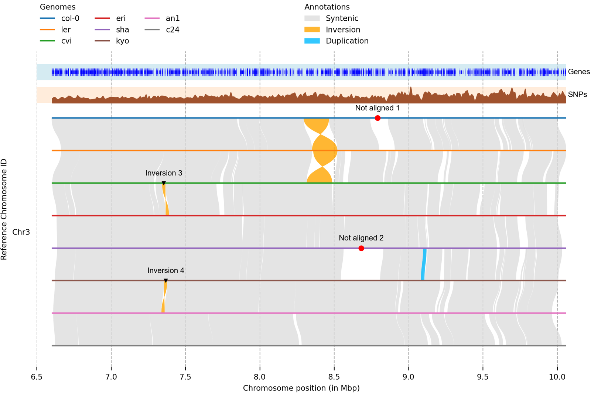

  <sub>**plotsr**：拟南芥 AMPRIL 材料对 Col-0 在 chr3 6.6–10 Mb 的 plotsr 共线性与 SV 图。数据：拟南芥（非葡萄数据）。来源：仓库 [schneebergerlab/plotsr](https://github.com/schneebergerlab/plotsr/blob/d2da00875c96a34dd758487f3967fa223228843d/example/ampril_col0_chr3_6600000_10000000.png)，MIT。</sub>
- **msyd** (工具) — 由成对 SyRI 结果做多基因组共线性分解。 在许多葡萄单倍型上区分核心与可变共线性区域。[待确认: 未核对该发表] [link](https://github.com/schneebergerlab/msyd) · [详情](docs/PANGENOME_CATALOG.md#L169)
- **ntSynt** (工具) — 由 minimizer 图谱映射得到多基因组共线性区块，无需比对。 在整个葡萄属面板上快速做共线性分析。 [doi:10.1186/s12915-025-02455-w](https://doi.org/10.1186/s12915-025-02455-w) · [link](https://github.com/BirolLab/ntSynt) · [详情](docs/PANGENOME_CATALOG.md#L170)
- **GENESPACE** (工具) — 受共线性和直系同源约束的比较，带河岸图和泛基因集合。 葡萄单倍型及其近缘的基因顺序视角。 [doi:10.7554/eLife.78526](https://doi.org/10.7554/eLife.78526) · [link](https://github.com/jtlovell/GENESPACE) · [详情](docs/PANGENOME_CATALOG.md#L171)

  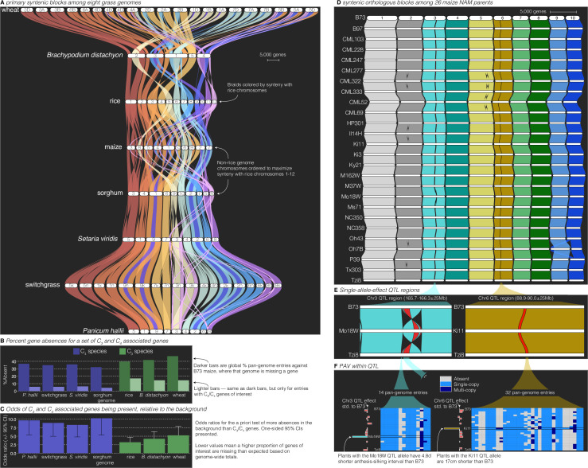

  <sub>**GENESPACE**：8 个禾本科基因组间共线直系同源区段的 GENESPACE riparian 图，按水稻染色体着色（Figure 3）。数据：8 个禾本科基因组（非葡萄数据）。来源：Lovell et al. 2022, eLife, Figure 3（[doi:10.7554/eLife.78526](https://doi.org/10.7554/eLife.78526)），CC BY。</sub>
- **JCVI / MCscan** (工具) — 用于共线性、宏/微共线性作图和比较基因组的 Python 工具包。 葡萄单倍型及其近缘的标准共线性点图和宏/微共线性图。 [doi:10.1002/imt2.211](https://doi.org/10.1002/imt2.211) · [link](https://github.com/tanghaibao/jcvi) · [详情](docs/PANGENOME_CATALOG.md#L172)
- **Mumemto** (工具) — 在泛基因组中寻找 multi-MUM，并可视化保守性、共线性和组装错误。 一次对全部葡萄单倍型做无需比对的共线性检查。 [doi:10.1186/s13059-025-03644-0](https://doi.org/10.1186/s13059-025-03644-0) · [link](https://github.com/vikshiv/mumemto) · [详情](docs/PANGENOME_CATALOG.md#L173)

  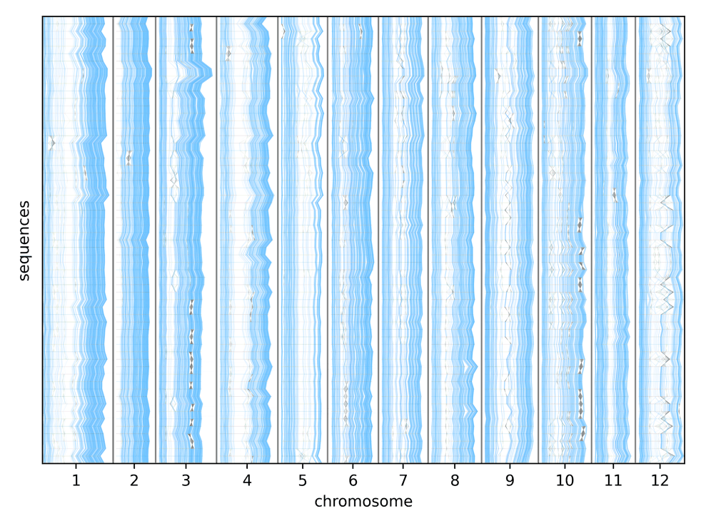

  <sub>**Mumemto**：马铃薯泛基因组组装的 Mumemto multi-MUM 共线性视图（组装来自 Cheng et al. 2025, Nature）。数据：马铃薯（非葡萄数据）。来源：仓库 [vikshiv/mumemto](https://github.com/vikshiv/mumemto/blob/ec48f10535f463ce709fe4181bec76ca0c4577db/img/potato_syn.png)，GPL-3.0。</sub>
- **MUMmer4** (工具) — 全基因组比对（nucmer）及相关工具。 SyRI 的输入；在葡萄 SV 论文中仍是常规做法。 [doi:10.1371/journal.pcbi.1005944](https://doi.org/10.1371/journal.pcbi.1005944) · [link](https://github.com/mummer4/mummer) · [详情](docs/PANGENOME_CATALOG_SUPPLEMENT_1.md#vs022)
- **FastGA** (工具) — 快速的基因组对基因组比对器，输出 .1aln（供 sweepga 使用）。 加快 50 条以上葡萄单倍型的全对全比对。 [doi:10.1093/bioadv/vbaf238](https://doi.org/10.1093/bioadv/vbaf238) · [link](https://github.com/thegenemyers/FASTGA) · [详情](docs/PANGENOME_CATALOG_SUPPLEMENT_1.md#vs023)
- **WGDI** (工具) — 全基因组复制、共线性和祖先核型分析。 葡萄的 gamma 三倍化；用于葡萄科比较的祖先核型。 [doi:10.1016/j.molp.2022.10.018](https://doi.org/10.1016/j.molp.2022.10.018) · [link](https://github.com/SunPengChuan/wgdi) · [详情](docs/PANGENOME_CATALOG_SUPPLEMENT_1.md#vs024)
- **MCScanX** (工具) — 根据基因位置和 BLAST 结果找共线性区块和共线基因。 葡萄单倍型之间、与其他葡萄科物种之间的基因级共线性。 [doi:10.1093/nar/gkr1293](https://doi.org/10.1093/nar/gkr1293) · [link](https://github.com/wyp1125/MCScanX)
- **LAST** (工具) — 带自适应种子的基因组比对器，适合差异较大的序列。 葡萄与远缘葡萄科或圆叶葡萄比对时，比 minimap2 更灵敏。 [doi:10.1101/gr.113985.110](https://doi.org/10.1101/gr.113985.110) · [link](https://gitlab.com/mcfrith/last)
- **D-GENIES** (工具) — 大基因组比对的交互式网页点图。 新的葡萄组装对 PN40024 的快速目检。 [doi:10.7717/peerj.4958](https://doi.org/10.7717/peerj.4958) · [link](https://github.com/genotoul-bioinfo/dgenies)
- **halSynteny** (工具) — 从 HAL 多序列比对中构建保守共线性区块。 直接从葡萄 Progressive Cactus / Minigraph-Cactus 结果取共线性区块。 [doi:10.1093/gigascience/giaa047](https://doi.org/10.1093/gigascience/giaa047) · [link](https://github.com/ComparativeGenomicsToolkit/hal)

<a id="section-7"></a>
## 7. 图谱层面的基因有无与基因家族拷贝数

用于直系同源聚类、基因投射以及跨泛基因组追踪基因有无和家族拷贝数的工具，如 OrthoFinder、pangene 和 Liftoff。本节仅涉及图谱层面的基因有无与基因家族拷贝数，不包括基因结构注释。

**需要**：图谱或单倍型，加上来自 gene-structure-annotation 的基因模型或蛋白。本节不生产新的基因模型。 [按情景看数据需求](#data-needs)

- **OrthoFinder** (工具) — 推断跨基因组的直系同源组和基因树。 葡萄单倍型间的基因家族拷贝数表（使用来自注释仓库的基因模型）。 [doi:10.1186/s13059-019-1832-y](https://doi.org/10.1186/s13059-019-1832-y) · [link](https://github.com/davidemms/OrthoFinder) · [详情](docs/PANGENOME_CATALOG.md#L183)
- **Pandagma** (工具) — 考虑共线性的泛基因和家族集合，处理 WGD 和染色体约束。 为葡萄属内比较构建泛基因集合。 [doi:10.1093/bioinformatics/btae526](https://doi.org/10.1093/bioinformatics/btae526) · [link](https://github.com/legumeinfo/pandagma) · [详情](docs/PANGENOME_CATALOG.md#L184)
- **pangene** (工具) — 由蛋白到基因组比对（miniprot）构建泛基因图谱，显示基因顺序和拷贝变化。 在不必全面重新注释的情况下，做图谱层面的基因有无/拷贝数分析。 [doi:10.1093/bioinformatics/btae456](https://doi.org/10.1093/bioinformatics/btae456) · [link](https://github.com/lh3/pangene) · [详情](docs/PANGENOME_CATALOG.md#L185)

  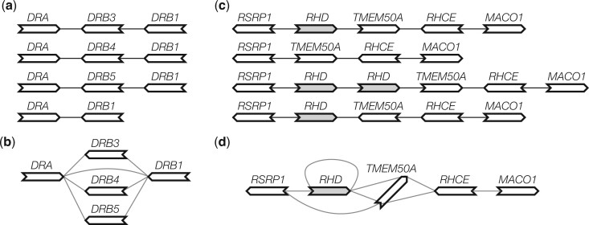

  <sub>**pangene**：人类单倍型在 HLA-DRB1 和 RHD 附近的 pangene 图，显示基因拷贝数变化（Figure 1）。数据：人类（非葡萄数据）。来源：Li et al. 2024, Bioinformatics, Figure 1（[doi:10.1093/bioinformatics/btae456](https://doi.org/10.1093/bioinformatics/btae456)），CC BY。</sub>
- **PanTools (ploidy-aware)** (工具) — 基于图数据库的泛基因组，可在单倍型内部和之间做基因、共线性、重复和 Ka/Ks 分析。 在苹果和马铃薯的分相基因组上测试过；适合葡萄的成对单倍型。 [doi:10.1111/pbi.14545](https://doi.org/10.1111/pbi.14545) · [link](https://git.wur.nl/bioinformatics/pantools) · [详情](docs/PANGENOME_CATALOG.md#L186)

  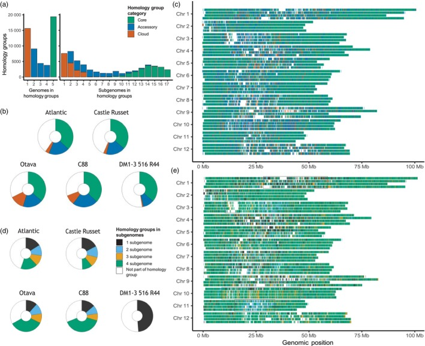

  <sub>**PanTools (ploidy-aware)**：四倍体马铃薯泛基因组的基因组成：按基因组和亚基因组划分的同源组（Figure 2）。数据：四倍体马铃薯（非葡萄数据）。来源：Jonkheer et al. 2025, Plant Biotechnology Journal, Figure 2（[doi:10.1111/pbi.14545](https://doi.org/10.1111/pbi.14545)），CC BY。</sub>
- **GET_HOMOLOGUES-EST** (工具) — 面向植物的核心/软核心/云基因聚类。 在葡萄注释之间绘制简单的基因水平核心/非必需曲线。 [doi:10.3389/fpls.2017.00184](https://doi.org/10.3389/fpls.2017.00184) · [link](https://github.com/eead-csic-compbio/get_homologues) · [详情](docs/PANGENOME_CATALOG.md#L187)

  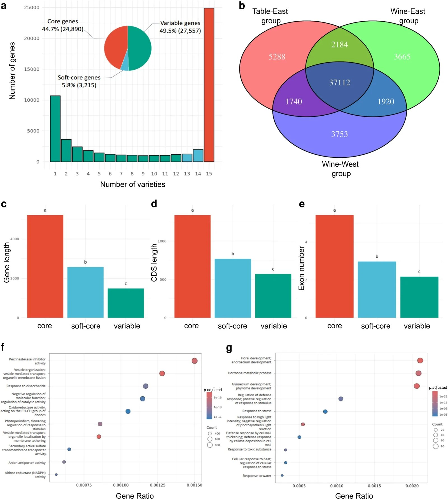

  <sub>**GET_HOMOLOGUES-EST**：用 GET_HOMOLOGUES-EST 聚类的 15 个栽培葡萄品种的泛基因（core/soft-core/shell/cloud）组成变化（Fig. 2）。数据：15 个栽培葡萄品种（葡萄数据）。来源：Pierre et al. 2026, G3: Genes, Genomes, Genetics, Fig. 2（[doi:10.1093/g3journal/jkag168](https://doi.org/10.1093/g3journal/jkag168)），CC BY。</sub>
- **SonicParanoid2** (工具) — 结合机器学习和结构域架构图的快速直系同源推断。 在加入许多葡萄单倍型时，更快地得到家族表。 [doi:10.1186/s13059-024-03298-4](https://doi.org/10.1186/s13059-024-03298-4) · [link](https://gitlab.com/salvo981/sonicparanoid2) · [详情](docs/PANGENOME_CATALOG.md#L188)
- **miniprot** (工具) — 快速的蛋白到基因组剪接比对。 把参考蛋白投射到每条葡萄单倍型，以检查基因是否存在。 [doi:10.1093/bioinformatics/btad014](https://doi.org/10.1093/bioinformatics/btad014) · [link](https://github.com/lh3/miniprot) · [详情](docs/PANGENOME_CATALOG.md#L189)
- **Liftoff** (工具) — 在同一物种的组装之间提升（lift）基因模型，并报告拷贝增加。 检查已有基因模型在每条单倍型中是否存在或发生重复；制作新的基因模型仍留在 gene-structure-annotation。 [doi:10.1093/bioinformatics/btaa1016](https://doi.org/10.1093/bioinformatics/btaa1016) · [link](https://github.com/agshumate/Liftoff) · [详情](docs/PANGENOME_CATALOG.md#L190)
- **LiftOn** (工具) — 结合 DNA 和蛋白比对，改进提升得到的基因模型。 在分歧较大的葡萄位点上得到更好的有无/拷贝判断；产生基因模型仍留在 gene-structure-annotation。 [doi:10.1101/gr.279620.124](https://doi.org/10.1101/gr.279620.124) · [link](https://github.com/Kuanhao-Chao/LiftOn) · [详情](docs/PANGENOME_CATALOG.md#L191)
- **Pan-NLRome** (分析) — 通过抗病基因富集，在 64 份拟南芥材料中饱和描述 NLR 库。 可作为 *Vitis* pan-NLRome 的模型。*Vitis* 超泛基因组（doi:10.1038/s41588-025-02111-7）报告，欧洲栽培品种中编码 TIR-NBARC-LRR 结构域的 NLR 家族抗病基因（TNL 亚类）组成更小，而不是全部 NLR 都减少。[待确认]：正文或 Extended Data Fig. 6 中全部亚类的 NLR 总数是否也随组别不同，此处未核对，因为正式发表的文章不是开放获取，且对投稿的 bioRxiv PDF 的脚本抓取返回了 HTTP 429。 [doi:10.1016/j.cell.2019.07.038](https://doi.org/10.1016/j.cell.2019.07.038) · [详情](docs/PANGENOME_CATALOG.md#L192)
- **NLR-Annotator** (工具) — 根据基序寻找 NLR 位点，包括部分基因和假基因。 NLR-Annotator 是结构层的位点识别工具（基于基序，包括部分基因和假基因）；制作基因模型仍留在 gene-structure-annotation。本目录只借用其位点列表，来统计各单倍型上 NLR 位点的有无和拷贝数。 [doi:10.1104/pp.19.01273](https://doi.org/10.1104/pp.19.01273) · [link](https://github.com/steuernb/NLR-Annotator) · [详情](docs/PANGENOME_CATALOG.md#L193)
- **Gene-level vs sequence-level PAV** (设想) — 分开报告三层：序列/窗口 PAV、SV，以及基因/家族 PAV 或拷贝数。 避免在葡萄结果中把 panacus 的碱基增长曲线称为「基因 PAV」。 [link](https://github.com/codialab/panacus) · [详情](docs/PANGENOME_CATALOG.md#L194)
- **Wheat k-mer gene catalog (PanSK)** (分析) — 用独特 k-mer 直接从原始 reads 推断基因家族是否存在，用于关联分析。 无需组装即可推断葡萄材料中 NLR 或萜烯合酶家族是否存在。 [doi:10.1016/j.molp.2024.05.006](https://doi.org/10.1016/j.molp.2024.05.006) · [详情](docs/PANGENOME_CATALOG.md#L195)
- **GET_PANGENES** (工具) — 由全基因组比对把各基因组中共线性的基因模型聚类为泛基因。 利用已有基因模型，对葡萄单倍型做图谱/比对层面的基因 PAV。 [doi:10.1186/s13059-023-03071-z](https://doi.org/10.1186/s13059-023-03071-z) · [link](https://github.com/Ensembl/plant-scripts/tree/master/pangenes) · [详情](docs/PANGENOME_CATALOG_SUPPLEMENT_1.md#vs025)
- **PanOryza pangene catalog** (分析) — 在 16 个以上水稻基因组之间使用稳定的泛基因编号。 可作为与 Grapedia 编号相连的、稳定的葡萄泛基因编号目录的模型。 [doi:10.1101/gr.280790.125](https://doi.org/10.1101/gr.280790.125) · [详情](docs/PANGENOME_CATALOG_SUPPLEMENT_1.md#vs026)
- **Melon pan-NLRome graph** (分析) — 对 143 份材料的 NLR 区域做适应性抽样组装，构建 PGGB 子图，并做节点和 k-mer GWAS。 葡萄 Rpv/Run NLR 簇的模板：定向长读长组装、位点亚图、NLR 等位基因计数。 [doi:10.1093/hr/uhag399](https://doi.org/10.1093/hr/uhag399) · [详情](docs/PANGENOME_CATALOG_SUPPLEMENT_1.md#vs027)
- **NLR neighborhoods by graph traversal (Arabidopsis)** (分析) — 通过在泛基因组图谱上走到共线性单拷贝锚点（odgi），定义 NLR 邻域。 在葡萄属中以图谱方式定义 NLR 家族拷贝数区域。 [doi:10.1016/j.chom.2025.07.011](https://doi.org/10.1016/j.chom.2025.07.011) · [详情](docs/PANGENOME_CATALOG_SUPPLEMENT_1.md#vs028)
- **CAFE 5** (工具) — 在物种树上模拟基因家族的扩张和收缩。 葡萄属各物种间家族大小变化（如 NLR、萜烯合酶）。 [doi:10.1093/bioinformatics/btaa1022](https://doi.org/10.1093/bioinformatics/btaa1022) · [link](https://github.com/hahnlab/CAFE5)
- **Broccoli** (工具) — 结合系统发育和网络聚类做直系同源划分。 葡萄基因家族划分时 OrthoFinder 的替代方案。 [doi:10.1093/molbev/msaa159](https://doi.org/10.1093/molbev/msaa159) · [link](https://github.com/rderelle/Broccoli)
- **CNVnator** (工具) — 基于读深的短读长 CNV 检测。 在短读长葡萄群体中看基因区域拷贝数。 [doi:10.1101/gr.114876.110](https://doi.org/10.1101/gr.114876.110) · [link](https://github.com/abyzovlab/CNVnator)
- **mosdepth** (工具) — 快速计算 BAM/CRAM 的逐碱基和逐区域覆盖度。 用覆盖度给重测序葡萄材料判断基因有无。 [doi:10.1093/bioinformatics/btx699](https://doi.org/10.1093/bioinformatics/btx699) · [link](https://github.com/brentp/mosdepth)
- **DupGen_finder** (工具) — 把重复基因按产生方式分类（WGD、串联、邻近、转座、分散）。 葡萄保留 γ 三倍化；可把它和家族里的串联拷贝变化分开。 [doi:10.1186/s13059-019-1650-2](https://doi.org/10.1186/s13059-019-1650-2) · [link](https://github.com/qiao-xin/DupGen_finder)
- **Hecaton** (工具) — 面向植物、从短读长检测 CNV。 在植物上测试过，适合葡萄重测序数据。 [待确认: 未找到代码网址] [doi:10.1186/s12864-019-6153-8](https://doi.org/10.1186/s12864-019-6153-8)

<a id="section-8"></a>
## 8. 图谱分析、索引与格式

用于查询和拆解泛基因组图谱的处理工具包、压缩索引与格式规范，包括 odgi、GBZ / GBWT 和 GFA specification。

**需要**：图谱本身（GFA / GBZ / GBWT）。除非做 IBD 等分析，不需要额外的群体数据。 [按情景看数据需求](#data-needs)

- **odgi** (工具) — 用于排序、布局、提取、解开和汇总变异图谱的工具包。 PGGB 葡萄图谱的核心分析工具包。 [doi:10.1093/bioinformatics/btac308](https://doi.org/10.1093/bioinformatics/btac308) · [link](https://github.com/pangenome/odgi) · [详情](docs/PANGENOME_CATALOG.md#L205)
- **GBZ / GBWT** (工具) — vg Giraffe 使用的、压缩且考虑单倍型的图谱格式。 脚本 14 中 Giraffe 基因分型所需的格式。 [doi:10.1093/bioinformatics/btac656](https://doi.org/10.1093/bioinformatics/btac656) · [link](https://github.com/jltsiren/gbwtgraph) · [详情](docs/PANGENOME_CATALOG.md#L206)
- **vg toolkit** (工具) — 用于构建、索引、比对和检测的变异图谱工具包。 脚本 08 和 14 的主干。 [doi:10.1038/nbt.4227](https://doi.org/10.1038/nbt.4227) · [link](https://github.com/vgteam/vg) · [详情](docs/PANGENOME_CATALOG.md#L207)
- **BubbleGun** (工具) — 检测图谱中的气泡、超级气泡和链。 汇总葡萄图谱中的变异热点。 [doi:10.1093/bioinformatics/btac448](https://doi.org/10.1093/bioinformatics/btac448) · [link](https://github.com/fawaz-dabbaghieh/bubble_gun) · [详情](docs/PANGENOME_CATALOG.md#L208)
- **Snarl decomposition** (设想) — 关于超级气泡、超气泡和 cactus 结构的理论，用于定义图谱变异位点。 解释葡萄图谱经 vg deconstruct 得到的 VCF 中的嵌套位点。 [doi:10.1089/cmb.2017.0251](https://doi.org/10.1089/cmb.2017.0251) · [详情](docs/PANGENOME_CATALOG.md#L209)
- **AGC** (工具) — 压缩已组装基因组集合，并支持随机访问。 高效分发和存储许多葡萄单倍型。 [doi:10.1093/bioinformatics/btad097](https://doi.org/10.1093/bioinformatics/btad097) · [link](https://github.com/refresh-bio/agc) · [详情](docs/PANGENOME_CATALOG.md#L210)
- **Mash** (工具) — 基因组之间的 MinHash 距离。 脚本 03；用于设定 PGGB 相似度和划分群落。 [doi:10.1186/s13059-016-0997-x](https://doi.org/10.1186/s13059-016-0997-x) · [link](https://github.com/marbl/Mash) · [详情](docs/PANGENOME_CATALOG.md#L211)
- **gfainject** (工具) — 把比对到线性路径的 BAM 投射为图谱上的 GAF。 复用已有的葡萄 BAM，做图谱覆盖度分析。 [link](https://github.com/AndreaGuarracino/gfainject) · [详情](docs/PANGENOME_CATALOG.md#L212)
- **gafpack** (工具) — 把 GAF 比对转换为节点覆盖度向量。 用于关联或 CNV 检查的节点水平覆盖度矩阵。 [link](https://github.com/pangenome/gafpack) · [详情](docs/PANGENOME_CATALOG.md#L213)
- **Graph IBD with SVs (GIBD)** (工具) — 在 GBWT 中检测血统同源（IBD）片段，并注释共享的 SV。[preprint] 在 SV 背景下查看葡萄栽培品种之间的无性系和系谱关系。 [doi:10.64898/2026.11.05.764670](https://doi.org/10.64898/2026.11.05.764670) · [详情](docs/PANGENOME_CATALOG.md#L214)
- **GRAFIMO** (工具) — 在变异图谱上扫描转录因子基序，并考虑单倍型。 寻找由葡萄 SV 造成的启动子基序获得/丢失。[preprint] [doi:10.1101/2021.02.04.429752](https://doi.org/10.1101/2021.02.04.429752) · [link](https://github.com/pinellolab/GRAFIMO) · [详情](docs/PANGENOME_CATALOG.md#L215)
- **ropebwt3** (工具) — 面向超大序列集合的 BWT 构建和 FM-index 检索。（年份为仓库创建年；未核对该论文） 在全部葡萄单倍型上做精确匹配查询（例如标记 k-mer）。 [link](https://github.com/lh3/ropebwt3) · [详情](docs/PANGENOME_CATALOG_SUPPLEMENT_1.md#vs029)
- **Billi** (工具) — 面向大型泛基因组图谱的气泡/snarl 检测算法（预印本）。[preprint] 气泡分解定义了随后被基因分型的变异位点。 [doi:10.1101/2025.11.21.689636](https://doi.org/10.1101/2025.11.21.689636) · [详情](docs/PANGENOME_CATALOG_SUPPLEMENT_1.md#vs030)
- **Popping bubbles (arXiv)** (分析) — 泛基因组图谱中气泡结构的理论/算法（arXiv 预印本）。[preprint, arXiv 2410.20932] 说明葡萄图谱中变异位点如何被定义的背景。 [link](https://arxiv.org/abs/2410.20932) · [详情](docs/PANGENOME_CATALOG_SUPPLEMENT_1.md#vs031)
- **Cataloging variants in pangenome graphs (pantree)** (分析) — 通过参考树定义图谱变异并输出 VCF 目录。[preprint] [期刊版在 Cell Genomics；journal DOI 待确认，此处给出预印本 DOI] 在不同版本的葡萄图谱之间使用一致的变异编号。 [doi:10.1101/2025.08.04.668502](https://doi.org/10.1101/2025.08.04.668502) · [详情](docs/PANGENOME_CATALOG_SUPPLEMENT_1.md#vs032)
- **GFA specification** (格式) — GFA 1/2 格式规范，包括 W 行。（年份为仓库创建年；未核对该论文） 这里所有图谱工具共用的格式。 [link](https://github.com/GFA-spec/GFA-spec) · [详情](docs/PANGENOME_CATALOG_SUPPLEMENT_1.md#vs033)
- **GfaPy** (工具) — 用 Python 读、改、写 GFA1/GFA2 图的库。 给葡萄图写小脚本（改路径名、取片段等）。 [doi:10.1093/bioinformatics/btx398](https://doi.org/10.1093/bioinformatics/btx398) · [link](https://github.com/ggonnella/gfapy)
- **KMC 3** (工具) — 快速 k-mer 计数和集合运算。 葡萄样本的 k-mer 计数，用于 k-mer PAV、GWAS 和图质控。 [doi:10.1093/bioinformatics/btx304](https://doi.org/10.1093/bioinformatics/btx304) · [link](https://github.com/refresh-bio/KMC)
- **Fulgor** (工具) — 面向多基因组的紧凑彩色 k-mer 索引。 不比对即可查一段序列在哪些葡萄单倍型里。 [doi:10.1186/s13015-024-00251-9](https://doi.org/10.1186/s13015-024-00251-9) · [link](https://github.com/jermp/fulgor)
- **libbdsg / libhandlegraph** (工具) — vg 和 odgi 使用的动态变异图 C++ 库。 要写与 vg 格式兼容的葡萄图工具时的基础库。 [doi:10.1093/bioinformatics/btaa640](https://doi.org/10.1093/bioinformatics/btaa640) · [link](https://github.com/vgteam/libbdsg)
- **Themisto** (工具) — 可扩展的彩色 k-mer 索引，用于伪比对。 按 k-mer 颜色把读长分到葡萄单倍型。 [doi:10.1093/bioinformatics/btad233](https://doi.org/10.1093/bioinformatics/btad233) · [link](https://github.com/algbio/themisto)

<a id="section-9"></a>
## 9. 可视化

用于查看图谱拓扑、单倍型、共线性与序列重复的浏览器和绘图工具，如 BandageNG、SequenceTubeMap 和 odgi viz / draw。

**需要**：图谱和/或比对结果；可按需添加基因、变异或甲基化等轨道。 [按情景看数据需求](#data-needs)

- **Bandage** (工具) — 用于组装图和小型图谱的交互式查看器。 检查单个葡萄位点的子图。 [doi:10.1093/bioinformatics/btv383](https://doi.org/10.1093/bioinformatics/btv383) · [link](https://github.com/rrwick/Bandage) · [详情](docs/PANGENOME_CATALOG.md#L225)
- **BandageNG** (工具) — Bandage 的持续维护分支，改进了路径和 GFA 支持。 同样的用途，支持更现代的 GFA 路径。 [link](https://github.com/asl/BandageNG) · [详情](docs/PANGENOME_CATALOG.md#L226)

  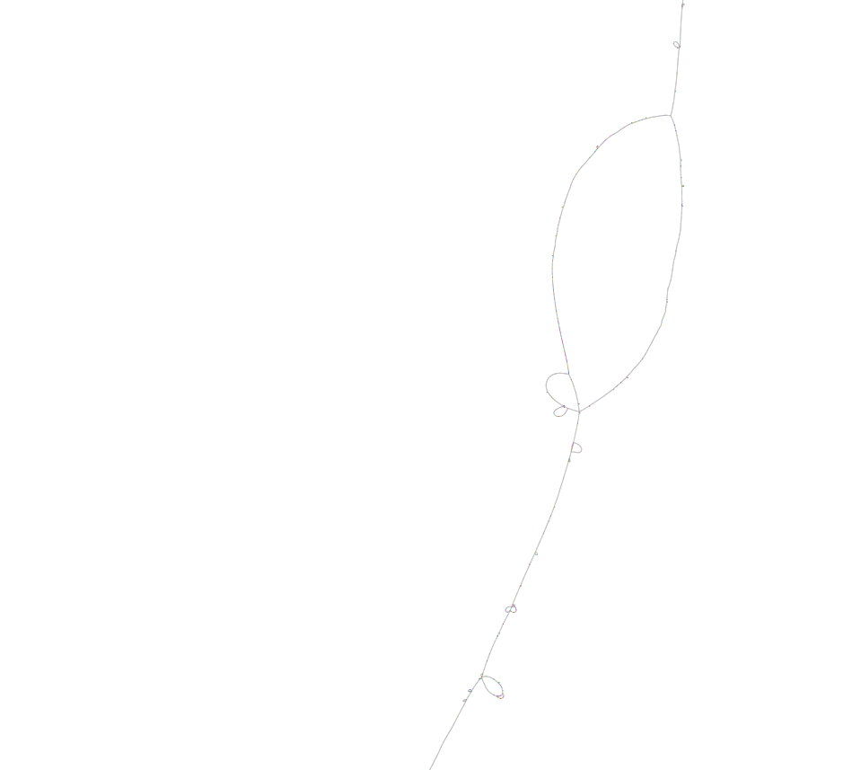

  <sub>**BandageNG**：由 GRCh38 及其 alt 位点构建的 Minigraph-Cactus 图谱中 MHC 区域（部分）的 Bandage-NG 视图。数据：人类（GRCh38）（非葡萄数据）。来源：仓库 [ComparativeGenomicsToolkit/cactus](https://github.com/ComparativeGenomicsToolkit/cactus/blob/1abe7c3e822d58d6c274c51738cbeb927614d747/doc/grch38-alt-pg-mhc.png)，MIT。</sub>
- **SequenceTubeMap** (工具) — 以管线图显示 vg 图谱中的单倍型路径和 reads。 在候选 SV 处展示葡萄单倍型和 read 支持。 [doi:10.1093/bioinformatics/btz597](https://doi.org/10.1093/bioinformatics/btz597) · [link](https://github.com/vgteam/sequenceTubeMap) · [详情](docs/PANGENOME_CATALOG.md#L227)
- **odgi viz / draw** (工具) — 图谱路径和布局的一维和二维渲染。 葡萄图谱多样性的整条染色体视图。 [doi:10.1093/bioinformatics/btac308](https://doi.org/10.1093/bioinformatics/btac308) · [link](https://github.com/pangenome/odgi) · [详情](docs/PANGENOME_CATALOG.md#L228)

  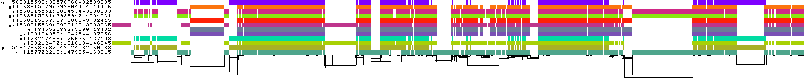

  <sub>**odgi viz / draw**：排序后的 DRB1-3123 图谱（人类 HLA-DRB1 单倍型）的 odgi viz 一维路径覆盖图。数据：人类（非葡萄数据）。来源：仓库 [pangenome/odgi](https://github.com/pangenome/odgi/blob/fb43f0817d8f3b81ce854f111d6daed8c4c8cbf4/docs/img/DRB1-3123_sorted.png)，MIT。</sub>
- **VRPG** (工具) — 把泛基因组图谱投射到线性参考坐标、并带注释轨道的网页浏览器。 在 PN40024 的基因轨道旁浏览葡萄图谱。 [doi:10.1101/gr.279461.124](https://doi.org/10.1101/gr.279461.124) · [link](https://github.com/codeatcg/VRPG) · [详情](docs/PANGENOME_CATALOG.md#L229)
- **PangyPlot** (工具) — 带线性导航和基于物理布局的泛基因组图谱浏览器。[preprint] 为葡萄育种者提供大型 SV 的可读视图。 [doi:10.1101/2025.10.31.684064](https://doi.org/10.1101/2025.10.31.684064) · [link](https://pangyplot.research.sickkids.ca/) · [详情](docs/PANGENOME_CATALOG.md#L230)
- **PanGraphViewer** (工具) — 用于 rGFA 或基于 VCF 的图谱的桌面/网页查看器，可叠加基因注释。 便于在本地查看 minigraph 葡萄图谱。[preprint] [doi:10.1101/2023.03.30.534931](https://doi.org/10.1101/2023.03.30.534931) · [link](https://github.com/TF-Chan-Lab/panGraphViewer) · [详情](docs/PANGENOME_CATALOG.md#L231)
- **MoMI-G** (工具) — 以 SV 为重点的多尺度基因组图谱浏览器。 面向葡萄的、以 SV 为中心的视图。 [doi:10.1186/s12859-019-3145-2](https://doi.org/10.1186/s12859-019-3145-2) · [link](https://github.com/MoMI-G/MoMI-G) · [详情](docs/PANGENOME_CATALOG.md#L232)
- **Panache** (工具) — 存在/缺失区块的线性化泛基因组浏览器（Wheat Panache；Brassica napus Panache 2026）。 用于葡萄泛基因组数据库的 PAV 区块浏览。 [doi:10.1002/tpg2.20221](https://doi.org/10.1002/tpg2.20221) · [link](https://github.com/SouthGreenPlatform/panache) · [详情](docs/PANGENOME_CATALOG.md#L233)

  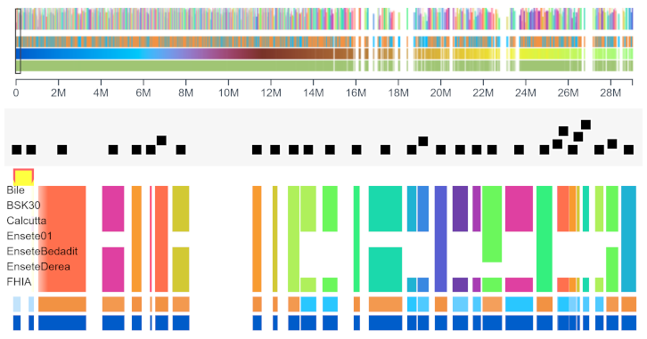

  <sub>**Panache**：香蕉泛基因组的 Panache 有无视图（Rijzaani et al. 2021 数据）。数据：香蕉（非葡萄数据）。来源：仓库 [SouthGreenPlatform/panache](https://github.com/SouthGreenPlatform/panache/blob/d003a516a40bbfb512e4ff0fed6162a2e8d87b57/imagesReadMe/panacheBanana_clipped.png)，MIT。</sub>
- **PanVA** (工具) — 在同源组中结合系统发育和元数据对变异做可视化分析。[preprint] 结合表型，查看葡萄材料中的抗病基因等位基因。 [doi:10.1101/2025.06.23.661080](https://doi.org/10.1101/2025.06.23.661080) · [link](https://github.com/PanBrowse/PanVA) · [详情](docs/PANGENOME_CATALOG.md#L234)
- **JBrowse 2** (工具) — 带共线性和多基因组视图的基因组浏览器。 GrapeGenomics.com 已经为葡萄属基因组提供 JBrowse 2。 [doi:10.1186/s13059-023-02914-z](https://doi.org/10.1186/s13059-023-02914-z) · [link](https://jbrowse.org/jb2/) · [详情](docs/PANGENOME_CATALOG.md#L235)
- **ntSynt-viz** (工具) — 用 ntSynt 共线性在多个基因组上绘制色带图。[preprint] 快速绘制属范围内的葡萄共线性图。 [doi:10.1101/2025.01.15.633221](https://doi.org/10.1101/2025.01.15.633221) · [link](https://github.com/BirolLab/ntSynt-viz) · [详情](docs/PANGENOME_CATALOG.md#L236)

  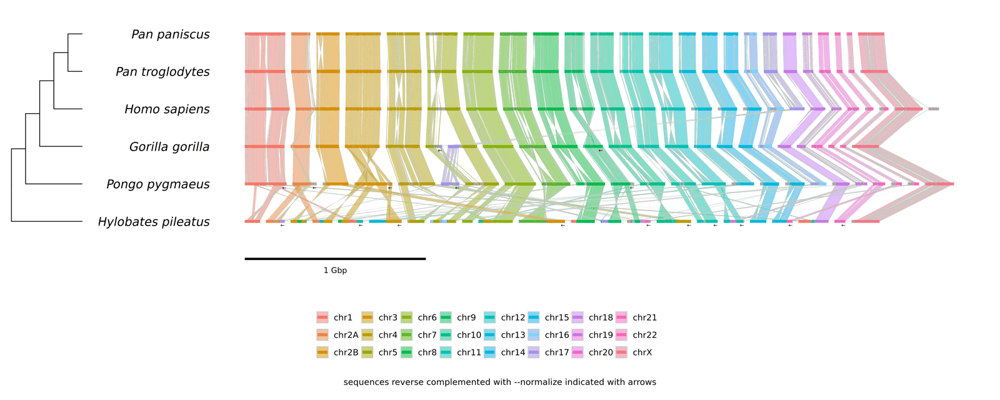

  <sub>**ntSynt-viz**：大猿类基因组组装间 ntSynt 共线性区块的 ntSynt-viz 条带图，附线粒体树。数据：大猿类（非葡萄数据）。来源：仓库 [bcgsc/ntSynt-viz](https://github.com/bcgsc/ntSynt-viz/blob/9abc3078d42a695c7cbffed0d7d753e6817189d0/tests/great-apes_ribbon-plots.example1.png)，GPL-3.0。</sub>
- **GfaViz** (工具) — GFA1/GFA2 可视化。 用于小型子图的快速作图。 [doi:10.1093/bioinformatics/bty1046](https://doi.org/10.1093/bioinformatics/bty1046) · [link](https://github.com/ggonnella/gfaviz) · [详情](docs/PANGENOME_CATALOG_SUPPLEMENT_1.md#vs034)
- **NGenomeSyn** (工具) — 多基因组共线性图。 可用于发表的、跨葡萄属物种的共线性图。 [doi:10.1093/bioinformatics/btad121](https://doi.org/10.1093/bioinformatics/btad121) · [link](https://github.com/hewm2008/NGenomeSyn) · [详情](docs/PANGENOME_CATALOG_SUPPLEMENT_1.md#vs035)
- **SVbyEye** (工具) — 用于组装水平 SV 可视化的 R 包（miropeats 风格）。 在如 Rpv3 或 Run1 等位点上，跨组装查看复杂 SV。 [doi:10.1093/bioinformatics/btaf332](https://doi.org/10.1093/bioinformatics/btaf332) · [link](https://github.com/daewoooo/SVbyEye) · [详情](docs/PANGENOME_CATALOG_SUPPLEMENT_1.md#vs036)
- **ModDotPlot** (工具) — 面向串联重复的快速相似度热图点图。 比较不同单倍型上的葡萄着丝粒阵列。 [doi:10.1093/bioinformatics/btae493](https://doi.org/10.1093/bioinformatics/btae493) · [link](https://github.com/marbl/ModDotPlot) · [详情](docs/PANGENOME_CATALOG_SUPPLEMENT_1.md#vs037)

  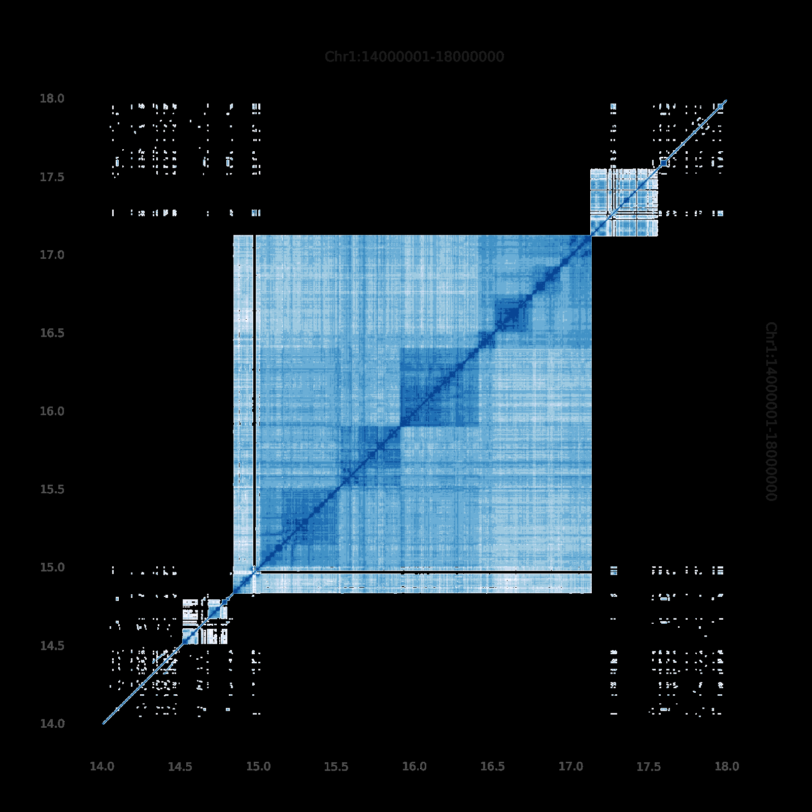

  <sub>**ModDotPlot**：拟南芥 Chr1 14–18 Mb（着丝粒区）的 ModDotPlot 自身一致性点图。数据：拟南芥（非葡萄数据）。来源：仓库 [marbl/ModDotPlot](https://github.com/marbl/ModDotPlot/blob/0be099ef3596473955dfb90b17a882dd95ee9dd9/images/Chr1_14000001-18000000_FULL.png)，MIT。</sub>
- **StainedGlass** (工具) — 串联重复结构的相似度热图。 互补的着丝粒/rDNA 视图。 [doi:10.1093/bioinformatics/btac018](https://doi.org/10.1093/bioinformatics/btac018) · [link](https://github.com/mrvollger/StainedGlass) · [详情](docs/PANGENOME_CATALOG_SUPPLEMENT_1.md#vs038)

  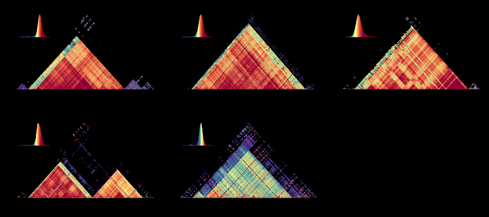

  <sub>**StainedGlass**：拟南芥 5 个着丝粒（Col-CEN 组装，Naish et al. 2021）的 StainedGlass 一致性热图。数据：拟南芥（非葡萄数据）。来源：仓库 [vollgerlab/StainedGlass](https://github.com/vollgerlab/StainedGlass/blob/bcd23c73ad232caafc0262445b3141a165c4cb83/images/CENs_Arabidopsis.2000.10000.tri.TRUE__onecolorscale.TRUE__all.png)，MIT。</sub>
- **waragraph** (工具) — GPU 泛基因组图谱查看器（一维/二维）。（年份为仓库创建年；未核对该论文） 交互式浏览整张图谱。 [link](https://github.com/chfi/waragraph) · [详情](docs/PANGENOME_CATALOG_SUPPLEMENT_1.md#vs039)
- **strangepg** (工具) — 面向超大 GFA 图谱的交互式查看器，带粗粒化和实时布局。（年份为仓库创建年；未核对该论文） 查看整条染色体的葡萄图谱。 [link](https://github.com/qwx9/strangepg) · [详情](docs/PANGENOME_CATALOG_SUPPLEMENT_1.md#vs040)
- **gfalook** (工具) — pangenome 组织中的泛基因组图谱绘制工具（odgi-viz 风格）。（年份为仓库创建年；未核对该论文） 用于 PGGB 葡萄图谱的轻量作图。 [link](https://github.com/pangenome/gfalook) · [详情](docs/PANGENOME_CATALOG_SUPPLEMENT_1.md#vs041)
- **IGV** (工具) — 桌面版基因组浏览器，看比对、变异和注释轨道。 把结果投到线性坐标后，在葡萄 SV、PAV 位点看读长证据。 [doi:10.1038/nbt.1754](https://doi.org/10.1038/nbt.1754) · [link](https://github.com/igvteam/igv)
- **Circos** (工具) — 用环形图展示基因组数据和连线。 葡萄全基因组 SV 密度和共线性连线的总览。 [待确认: 核对时 circos.ca 无法访问] [doi:10.1101/gr.092759.109](https://doi.org/10.1101/gr.092759.109)
- **pyGenomeTracks** (工具) — 用 Python 画出版风格的基因组轨道图。 把葡萄某个位点的覆盖度、基因和 SV 叠成一张图。 [doi:10.1093/bioinformatics/btaa692](https://doi.org/10.1093/bioinformatics/btaa692) · [link](https://github.com/deeptools/pyGenomeTracks)

  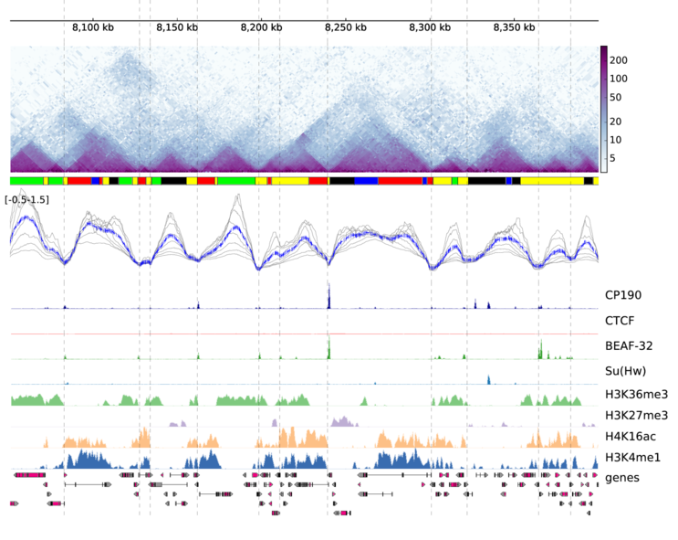

  <sub>**pyGenomeTracks**：pyGenomeTracks 绘制的 Hi-C 加轨道图（黑腹果蝇 Hi-C，原图来自 Ramírez et al. 2018 Nat Commun）。数据：黑腹果蝇（非葡萄数据）。来源：仓库 [deeptools/pyGenomeTracks](https://github.com/deeptools/pyGenomeTracks/blob/f25fcf1a48bb16a0afbd1cb95e9c5fed99d27fc7/docs/content/images/hic_example_nat_comm_small.png)，GPL-3.0；原图来自 Ramírez et al. 2018, Nature Communications（[doi:10.1038/s41467-017-02525-w](https://doi.org/10.1038/s41467-017-02525-w)，CC BY）。</sub>
- **karyoploteR** (工具) — R/Bioconductor 包，沿染色体画数据。 画葡萄 PAV 或 SV 密度的染色体图。 [doi:10.1093/bioinformatics/btx346](https://doi.org/10.1093/bioinformatics/btx346) · [link](https://github.com/bernatgel/karyoploteR)
- **GenomeSyn** (工具) — 绘制多个基因组之间的共线性和结构变异。 画多个葡萄单倍型的共线性和 SV 图。 [doi:10.1016/j.jgg.2022.03.013](https://doi.org/10.1016/j.jgg.2022.03.013) · [link](https://github.com/jmsong2/GenomeSyn)
- **TBtools** (工具) — 面向生物学家的图形界面工具包，含共线性、热图、环形图等。 国内葡萄实验室常用，不写代码也能出图。 [doi:10.1016/j.molp.2020.06.009](https://doi.org/10.1016/j.molp.2020.06.009) · [link](https://github.com/CJ-Chen/TBtools-II)
- **Gfaestus** (工具) — 基于 GPU 的大型 GFA 图交互查看器，用 odgi 布局。 交互浏览整条染色体的葡萄 PGGB 图。（未找到论文） [link](https://github.com/chfi/gfaestus)

<a id="section-10"></a>
## 10. 表达、QTL 与泛基因组 GWAS

将泛基因组结构变异、图谱节点、k-mer、转录组和甲基化组与表型关联的方法及研究案例，包括 Grapepan v1.0 SV-GWAS、NodeGWAS 和 rpvg / spliced pangenome graphs。

**需要**：GWAS 用已核对身份的图基因型加表型（每个克隆保留一份代表）；eQTL 再加同一基因型的 RNA-seq；甲基化层再加天然 5mC（ONT 需保留 pod5/fast5 或 MM/ML 标签，HiFi 需保留 kinetics）或亚硫酸氢盐读长。 [按情景看数据需求](#data-needs)

- **Grapepan v1.0 SV-GWAS** (分析) — 29 条单倍型的图谱泛基因组；对 466 份材料做基因分型；SV 为 29 个性状增加了遗传力和 QTL。 葡萄属 SV-GWAS 和基因组预测的直接先例。 [doi:10.1038/s41588-024-01967-5](https://doi.org/10.1038/s41588-024-01967-5) · [详情](docs/PANGENOME_CATALOG.md#L246)
- **Vitis super-pangenome SV-eQTL** (分析) — 72 个单倍型分辨的葡萄属基因组；SV-eQTL 和霜霉病侵染转录组鉴定出 VvLHT8 及其他抗霜霉病位点。 葡萄抗病中 SV 与表达联系的模型。 [doi:10.1038/s41588-025-02111-7](https://doi.org/10.1038/s41588-025-02111-7) · [详情](docs/PANGENOME_CATALOG.md#L247)
- **NodeGWAS** (工具) — 把图谱比对转成节点存在/计数矩阵做关联分析，并把显著位点映射到线性坐标。 在多样性或多倍体葡萄材料上直接对图谱节点做关联。 [doi:10.1016/j.xplc.2026.101835](https://doi.org/10.1016/j.xplc.2026.101835) · [link](https://github.com/zhangyixing3/NodeGWAS) · [详情](docs/PANGENOME_CATALOG.md#L248)
- **kmersGWAS** (工具) — 基于 k-mer 存在/缺失、无需参考的 GWAS。 捕捉葡萄 SNP GWAS 会漏掉的 SV 和 PAV 效应。 [doi:10.1038/s41588-020-0612-7](https://doi.org/10.1038/s41588-020-0612-7) · [link](https://github.com/voichek/kmersGWAS) · [详情](docs/PANGENOME_CATALOG.md#L249)
- **Graph meta-GWAS (rice)** (分析) — 用图谱来源的 PAV 对六个 GWAS 面板做荟萃分析，可增加检测到的 QTL。 把多个葡萄 GWAS 面板合并到同一张图谱上。 [doi:10.1038/s41467-025-58081-1](https://doi.org/10.1038/s41467-025-58081-1) · [详情](docs/PANGENOME_CATALOG.md#L250)
- **Potato PAV metabolite-GWAS** (分析) — 基于图谱的 SV PAV 与 1000 种以上块茎代谢物相关联。 葡萄浆果代谢物（香气、花青素）SV-mGWAS 的模板。 [doi:10.1016/j.molp.2025.01.017](https://doi.org/10.1016/j.molp.2025.01.017) · [详情](docs/PANGENOME_CATALOG.md#L251)
- **Brassica napus SV-eQTL** (分析) — 图谱基因分型的 SV 与表达揭示顺式 SV-eQTL，其中许多是 TE 插入。 同样的设计可用于葡萄浆果或叶片表达。 [doi:10.1007/s00122-025-04867-2](https://doi.org/10.1007/s00122-025-04867-2) · [详情](docs/PANGENOME_CATALOG.md#L252)
- **rpvg / spliced pangenome graphs** (工具) — 在带剪接的泛基因组图谱上做考虑单倍型的转录本定量。 跨葡萄单倍型的、考虑等位基因的表达分析；这不是注释中的 RNA 证据步骤。 [doi:10.1038/s41592-022-01731-9](https://doi.org/10.1038/s41592-022-01731-9) · [link](https://github.com/jonassibbesen/rpvg) · [详情](docs/PANGENOME_CATALOG.md#L253)
- **Tomato super-pangenome heritability** (分析) — 32 个基因组的图谱泛基因组，通过 SV 在 332 份材料中找回缺失的遗传力。 说明为何 SV 应进入葡萄性状模型。 [doi:10.1038/s41586-022-04808-9](https://doi.org/10.1038/s41586-022-04808-9) · [详情](docs/PANGENOME_CATALOG.md#L254)
- **Tomato SVs and expression** (分析) — 100 份番茄中的长读长 SV 改变基因剂量/表达和果实性状。 果树作物中经典的 SV–表达–性状设计。 [doi:10.1016/j.cell.2020.05.021](https://doi.org/10.1016/j.cell.2020.05.021) · [详情](docs/PANGENOME_CATALOG.md#L255)
- **Oat pangenome + pantranscriptome** (分析) — 把泛基因组与多组织转录组结合起来研究表达变异。 跨组织葡萄泛转录组的模板。 [doi:10.1038/s41586-025-09676-7](https://doi.org/10.1038/s41586-025-09676-7) · [详情](docs/PANGENOME_CATALOG.md#L256)
- **methylGrapher** (工具) — 把亚硫酸氢盐甲基化数据比对到基因组图谱。 在葡萄 SV/TE 处看甲基化，而不受单一参考的偏倚。 [doi:10.1093/nar/gkaf028](https://doi.org/10.1093/nar/gkaf028) · [link](https://github.com/twlab/methylGrapher) · [详情](docs/PANGENOME_CATALOG.md#L257)

### (a) 泛基因组上的表达与表观层

泛基因组水平的表达和表观分析。这不是给 gene-structure-annotation 提供 RNA 证据，也不是功能注释。

- **Graph Peak Caller** (工具) — 在图谱上做 ChIP-seq 峰检测。 用于葡萄表观组学中 SV 区域的峰检测。 [doi:10.1371/journal.pcbi.1006731](https://doi.org/10.1371/journal.pcbi.1006731) · [link](https://github.com/uio-bmi/graph_peak_caller) · [详情](docs/PANGENOME_CATALOG_SUPPLEMENT_1.md#vs042)

  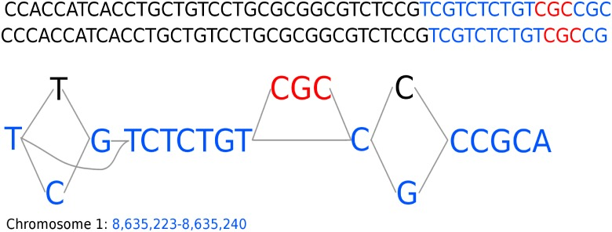

  <sub>**Graph Peak Caller**：在拟南芥图谱参考（chr1）上检出的 ChIP-seq 峰，覆盖线性参考中没有的 SNP 和一个 indel（Fig 4）。数据：拟南芥（非葡萄数据）。来源：Grytten et al. 2019, PLOS Computational Biology, Fig 4（[doi:10.1371/journal.pcbi.1006731](https://doi.org/10.1371/journal.pcbi.1006731)），CC BY。</sub>
- **methylation on graphs: panmethyl** (工具) — 把长读长甲基化比对到 GFA 泛基因组的 Nextflow 流程。（年份为仓库创建年；未核对该论文） 用 ONT/HiFi 查看非参考葡萄序列上的甲基化。 [link](https://github.com/cgroza/panmethyl) · [详情](docs/PANGENOME_CATALOG_SUPPLEMENT_1.md#vs043)
- **modkit** (工具) — 从 ONT BAM 中提取修饰碱基检测结果（5mC/6mA）。（年份为仓库创建年；未核对该论文） 用与组装相同的 ONT 数据得到单倍型分辨的甲基化。 [link](https://github.com/nanoporetech/modkit) · [详情](docs/PANGENOME_CATALOG_SUPPLEMENT_1.md#vs044)
- **Phased epigenomics in a Vitis hybrid** (分析) — 在一个葡萄 trio 中，通过分相图谱做等位基因特异的甲基化。 葡萄属单倍型分辨表观组学的直接先例。 [doi:10.1186/s13059-025-03858-2](https://doi.org/10.1186/s13059-025-03858-2) · [link](https://github.com/noecochetel/Epigenomics_Trio) · [详情](docs/PANGENOME_CATALOG_SUPPLEMENT_1.md#vs045)

  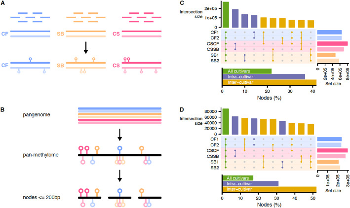

  <sub>**Phased epigenomics in a Vitis hybrid**：赤霞珠及其亲本的泛甲基化组：品种特异的亚硫酸氢盐数据投射到序列图上（Fig 2）。数据：赤霞珠及其亲本（葡萄数据）。来源：Cochetel et al. 2025, Genome Biology, Fig 2（[doi:10.1186/s13059-025-03858-2](https://doi.org/10.1186/s13059-025-03858-2)），CC BY。</sub>
- **Clonal genome-methylome map in grapevine** (分析) — 葡萄无性系之间的体细胞 SV 和甲基化。 无性繁殖意味着必须把体细胞 SV 与遗传的杂合性分开。 [doi:10.1186/s13059-026-04184-x](https://doi.org/10.1186/s13059-026-04184-x) · [link](https://pmc.ncbi.nlm.nih.gov/articles/PMC13352677/) · [详情](docs/PANGENOME_CATALOG_SUPPLEMENT_1.md#vs046)
- **Barley pan-transcriptome** (分析) — 20 个基因型中的核心/壳/云转录本。 葡萄泛转录组分类（在表达层做核心/壳/云）的模板。这不向 gene-structure-annotation 提供基因模型。 [doi:10.1038/s41588-024-02069-y](https://doi.org/10.1038/s41588-024-02069-y) · [link](https://doi.org/10.1038/s41588-024-02069-y) · [详情](docs/PANGENOME_CATALOG_SUPPLEMENT_1.md#vs047)
- **tensorQTL** (工具) — GPU 加速的 cis/trans eQTL 定位。 用图 SV 基因型和葡萄果实 RNA-seq 做 eQTL 扫描。 [doi:10.1186/s13059-019-1836-7](https://doi.org/10.1186/s13059-019-1836-7) · [link](https://github.com/broadinstitute/tensorqtl)
- **coloc** (工具) — 贝叶斯方法检验两个关联信号是否共用一个致病变异。 看葡萄 GWAS 位点和 eQTL 是否指向同一个 SV。 [doi:10.1371/journal.pgen.1004383](https://doi.org/10.1371/journal.pgen.1004383) · [link](https://github.com/chr1swallace/coloc)

### (b) QTL、泛基因组 GWAS 与基因组预测

使用图谱或 k-mer 变异做关联和预测。

- **kGWASflow** (工具) — 带 GWAS 后映射的 k-mer GWAS Snakemake 流程。 可直接运行的葡萄面板 k-mer GWAS。 [doi:10.1093/g3journal/jkad246](https://doi.org/10.1093/g3journal/jkad246) · [link](https://github.com/akcorut/kGWASflow) · [详情](docs/PANGENOME_CATALOG_SUPPLEMENT_1.md#vs048)
- **PanKmer** (工具) — 无需参考的 k-mer 泛基因组索引、存在/缺失和关联。 在葡萄群体中做无需参考的 k-mer 关联。存在/缺失索引本身是序列水平 PAV（第 4a 节），不是基因水平 PAV，也不是第 5 节对已知图谱位点的基因分型。 [doi:10.1093/bioinformatics/btad621](https://doi.org/10.1093/bioinformatics/btad621) · [link](https://gitlab.com/salk-tm/pankmer) · [详情](docs/PANGENOME_CATALOG_SUPPLEMENT_1.md#vs049)
- **kmdiff** (工具) — 在组别之间做差异 k-mer 分析，并校正群体结构。 病例/对照 k-mer（例如抗病与感病葡萄）。 [doi:10.1093/bioinformatics/btac689](https://doi.org/10.1093/bioinformatics/btac689) · [link](https://github.com/tlemane/kmdiff) · [详情](docs/PANGENOME_CATALOG_SUPPLEMENT_1.md#vs050)
- **pyseer** (工具) — 用混合模型做 k-mer/unitig/PAV 关联（源自微生物）。 可转用于葡萄 PAV 的 unitig-GWAS 思路。 [doi:10.1093/bioinformatics/bty539](https://doi.org/10.1093/bioinformatics/bty539) · [link](https://github.com/mgalardini/pyseer) · [详情](docs/PANGENOME_CATALOG_SUPPLEMENT_1.md#vs051)

  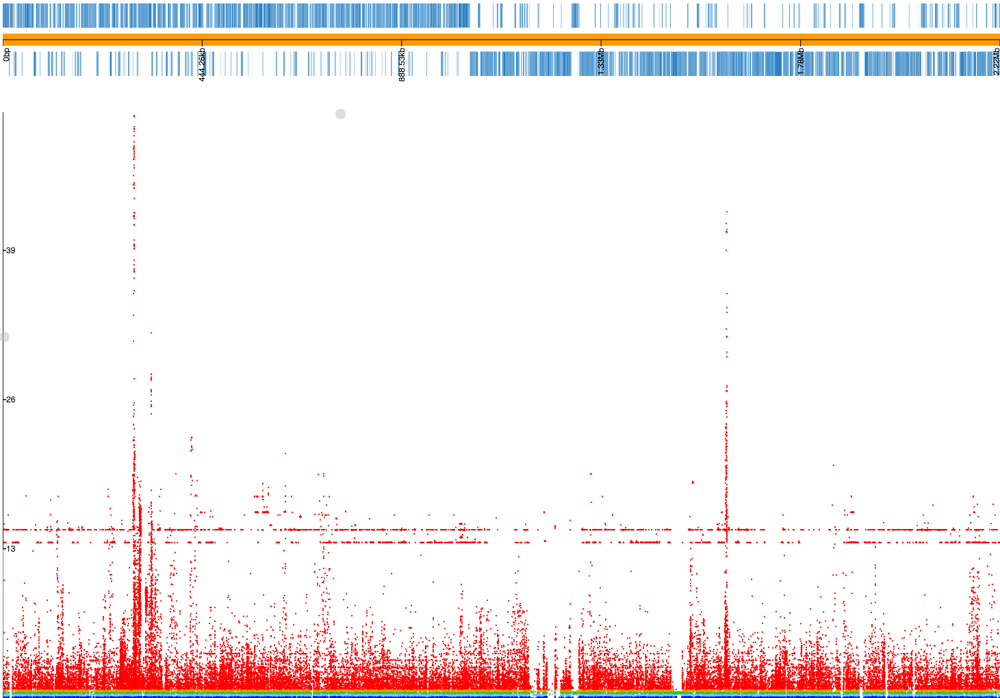

  <sub>**pyseer**：616 个肺炎链球菌基因组青霉素抗性 GWAS 的 pyseer 曼哈顿图（pyseer 教程）。数据：肺炎链球菌（非葡萄数据）。来源：仓库 [mgalardini/pyseer](https://github.com/mgalardini/pyseer/blob/65e0fbe30c8fce653431d154678321c460cda8cf/docs/pbp_manhattan.png)，Apache-2.0。</sub>
- **panGWAS (PHAC)** (工具) — 使用 pyseer 的泛基因组范围关联流程（SNP、PAV、SV）（源自微生物）。（年份为仓库创建年；未核对该论文） 多类变异联合关联的思路来源。 [link](https://github.com/phac-nml/pangwas) · [详情](docs/PANGENOME_CATALOG_SUPPLEMENT_1.md#vs052)
- **Cucumber graph pangenome in breeding** (分析) — 育种历史中的 SV 动态；基因组预测中的 SV 负担（预印本）。[preprint] 把 SV 负担作为葡萄育种系的预测变量。 [doi:10.1101/2025.07.17.665377](https://doi.org/10.1101/2025.07.17.665377) · [详情](docs/PANGENOME_CATALOG_SUPPLEMENT_1.md#vs053)
- **SV vs SNP genomic selection in rice** (分析) — 系统比较 SV 与 SNP 的基因组预测。 预期仅用 SV 大约相当于 SNP；在宣称葡萄基因组选择有增益之前应先检查。 [doi:10.1016/j.cj.2025.08.005](https://doi.org/10.1016/j.cj.2025.08.005) · [link](https://doi.org/10.1016/j.cj.2025.08.005) · [详情](docs/PANGENOME_CATALOG_SUPPLEMENT_1.md#vs054)
- **Pan-genome PAV in gene-bank genomic prediction** (分析) — 把 PAV 和低检出率 SNP 作为额外的基因组预测变量。 葡萄种质收集与基因库类似。 [doi:10.1007/s00122-025-05080-x](https://doi.org/10.1007/s00122-025-05080-x) · [link](https://pmc.ncbi.nlm.nih.gov/articles/PMC12594682/) · [详情](docs/PANGENOME_CATALOG_SUPPLEMENT_1.md#vs055)
- **GEMMA** (工具) — 线性混合模型关联分析。 在图得到的 SNP/SV/PAV 基因型上做葡萄 GWAS 的常用 LMM。 [doi:10.1038/ng.2310](https://doi.org/10.1038/ng.2310) · [link](https://github.com/genetics-statistics/GEMMA)

  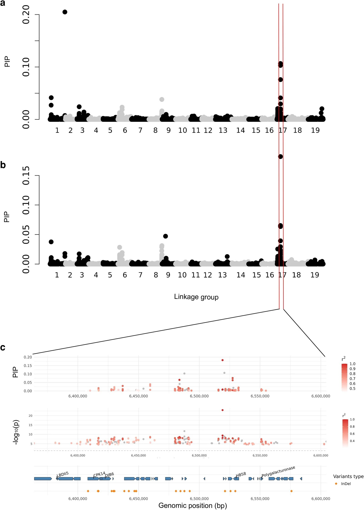

  <sub>**GEMMA**：277 个葡萄品种果粒重的 GEMMA BSLMM GWAS：PN40024 线性参考与泛基因组图谱基因型对比（Fig. 6）。数据：277 个葡萄品种（葡萄数据）。来源：Pierre et al. 2026, G3: Genes, Genomes, Genetics, Fig. 6（[doi:10.1093/g3journal/jkag168](https://doi.org/10.1093/g3journal/jkag168)），CC BY。</sub>
- **GCTA** (工具) — 遗传力估计、GREML 和混合模型关联。 估计葡萄 SV 在 SNP 之外还能解释多少性状方差。 [doi:10.1016/j.ajhg.2010.11.011](https://doi.org/10.1016/j.ajhg.2010.11.011) · [link](https://github.com/jianyangqt/gcta)
- **PLINK 2** (工具) — 快速处理基因型数据、质控和关联。 GWAS 前给葡萄群体基因型做质控、LD 修剪和 PCA。 [doi:10.1186/s13742-015-0047-8](https://doi.org/10.1186/s13742-015-0047-8) · [link](https://github.com/chrchang/plink-ng)
- **GAPIT 3** (工具) — R 包，做 GWAS（MLM、FarmCPU、BLINK）和基因组预测。 植物育种常用，可用多种模型做葡萄 GWAS。 [doi:10.1016/j.gpb.2021.08.005](https://doi.org/10.1016/j.gpb.2021.08.005) · [link](https://github.com/jiabowang/GAPIT)
- **rMVP** (工具) — 省内存的 R 语言 GWAS，自带曼哈顿图和 QQ 图。 适合带 SV/PAV 标记的大葡萄群体，图可直接用于报告。 [doi:10.1016/j.gpb.2020.10.007](https://doi.org/10.1016/j.gpb.2020.10.007) · [link](https://github.com/xiaolei-lab/rMVP)

<a id="section-11"></a>
## 11. 演化、祖先成分与渗入

谱系（ARG / 树序列）推断，如 SINGER 和 tsinfer；基因渗入检验，如 Dsuite；以及葡萄驯化与无性系分化的相关研究。

**需要**：已核对身份的群体基因型（每个克隆保留一份代表），做渗入检验还要外类群；做谱系（ARG / 树序列）推断还要分相单倍型和祖先等位基因。Dsuite 只标出候选渗入区段，不能区分渗入与选择。 [按情景看数据需求](#data-needs)

- **Grapevine SV domestication** (分析) — 葡萄驯化中 SV 和半合性的群体遗传学。 可将图谱结果与之比较的基础性葡萄属 SV 研究。 [doi:10.1038/s41477-019-0507-8](https://doi.org/10.1038/s41477-019-0507-8) · [详情](docs/PANGENOME_CATALOG.md#L267)
- **Grapevine clone diversification** (分析) — 葡萄无性系之间的体细胞 SV 和 SNV。 说明有必要为 Pinot/Chardonnay 等无性系建立无性系水平的图谱。 [doi:10.1186/s12864-019-6211-2](https://doi.org/10.1186/s12864-019-6211-2) · [详情](docs/PANGENOME_CATALOG.md#L268)

  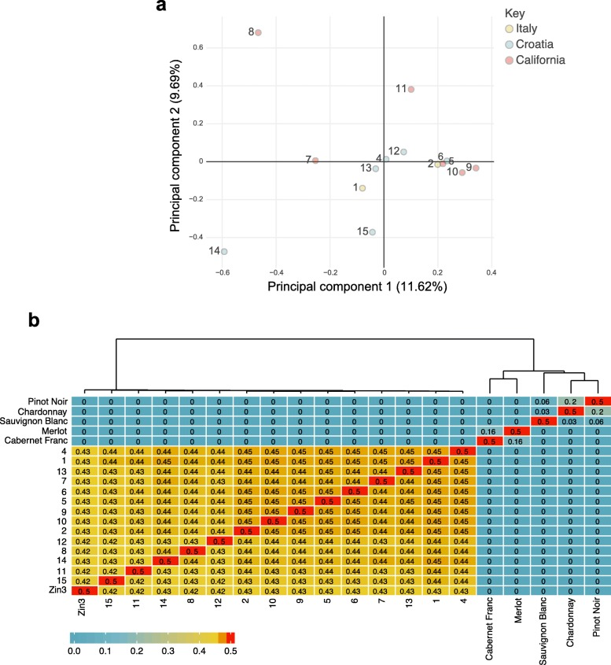

  <sub>**Grapevine clone diversification**：仙粉黛克隆选系基于 SNV 的 PCA 与亲缘关系（Fig. 3）。数据：仙粉黛克隆（葡萄数据）。来源：Vondras et al. 2019, BMC Genomics, Fig. 3（[doi:10.1186/s12864-019-6211-2](https://doi.org/10.1186/s12864-019-6211-2)），CC BY。</sub>
- **SINGER** (工具) — 面向数百个基因组的贝叶斯祖先重组图推断。 用于葡萄单倍型中渗入和选择的谱系。 [doi:10.1038/s41588-025-02317-9](https://doi.org/10.1038/s41588-025-02317-9) · [link](https://github.com/popgenmethods/SINGER) · [详情](docs/PANGENOME_CATALOG.md#L269)

  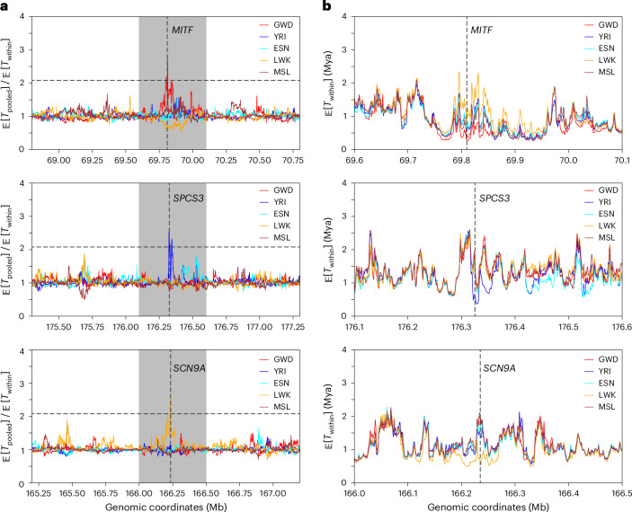

  <sub>**SINGER**：用 SINGER 推断的 5 个非洲千人基因组人群间基于 ARG 的溯祖时间分化（Fig. 5）。数据：人类（千人基因组）（非葡萄数据）。来源：Deng et al. 2025, Nature Genetics, Fig. 5（[doi:10.1038/s41588-025-02317-9](https://doi.org/10.1038/s41588-025-02317-9)），CC BY。</sub>
- **tsinfer** (工具) — 由已分相数据做可扩展的树序列推断。 大型葡萄群体的紧凑谱系。 [doi:10.1038/s41588-019-0483-y](https://doi.org/10.1038/s41588-019-0483-y) · [link](https://github.com/tskit-dev/tsinfer) · [详情](docs/PANGENOME_CATALOG.md#L270)
- **Twisst** (工具) — 沿基因组对局部树做拓扑加权。 跨单倍型查看 V. vinifera 与野生种之间的渗入。 [doi:10.1534/genetics.116.194720](https://doi.org/10.1534/genetics.116.194720) · [link](https://github.com/simonhmartin/twisst) · [详情](docs/PANGENOME_CATALOG.md#L271)

  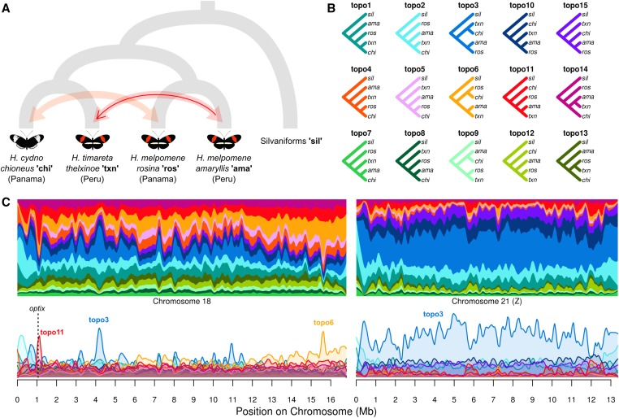

  <sub>**Twisst**：袖蝶全基因组的 Twisst 拓扑权重，显示翅斑位点的渗入（Figure 4）。数据：袖蝶（非葡萄数据）。来源：Martin et al. 2017, Genetics, Figure 4（[doi:10.1534/genetics.116.194720](https://doi.org/10.1534/genetics.116.194720)），CC BY。</sub>
- **Haplotype-aware phylogenomics** (设想) — 把每条分相单倍型作为树梢，以分离无性系杂种中的杂交祖先成分。 Vitis 超泛基因组用它来厘清葡萄的杂交历史。 [doi:10.1038/s41588-025-02111-7](https://doi.org/10.1038/s41588-025-02111-7) · [详情](docs/PANGENOME_CATALOG.md#L272)
- **NA Vitis wild introgression** (分析) — 北美野生葡萄超泛基因组，包含图谱和基于基因的分析。 本仓库 PGGB 默认参数的来源；也是砧木近缘种。 [doi:10.1186/s13059-023-03133-2](https://doi.org/10.1186/s13059-023-03133-2) · [详情](docs/PANGENOME_CATALOG.md#L273)
- **ARG-Needle** (工具) — 大规模 ARG 推断和基于 ARG 的关联。 面向葡萄性状的全谱系关联。 [doi:10.1038/s41588-023-01379-x](https://doi.org/10.1038/s41588-023-01379-x) · [link](https://github.com/PalamaraLab/arg-needle) · [详情](docs/PANGENOME_CATALOG_SUPPLEMENT_1.md#vs056)
- **Dsuite** (工具) — 快速的 ABBA-BABA 统计。 野生种向栽培种的渗入（sylvestris、V. amurensis）。 [doi:10.1111/1755-0998.13265](https://doi.org/10.1111/1755-0998.13265) · [link](https://github.com/millanek/Dsuite) · [详情](docs/PANGENOME_CATALOG_SUPPLEMENT_1.md#vs057)
- **Mashtree** (工具) — 基于 Mash 距离的邻接树。 建图前对组装做快速合理性检查树。 [doi:10.21105/joss.01762](https://doi.org/10.21105/joss.01762) · [link](https://github.com/lskatz/mashtree) · [详情](docs/PANGENOME_CATALOG_SUPPLEMENT_1.md#vs058)
- **Dual domestication of grapevine** (分析) — 3525 份材料的葡萄驯化群体基因组学。 把泛基因组 SV 放回驯化历史的群体框架。 [doi:10.1126/science.add8655](https://doi.org/10.1126/science.add8655) · [详情](docs/PANGENOME_CATALOG_SUPPLEMENT_1.md#vs059)
- **Clonal diversity in grapevine (review)** (分析) — 综述葡萄无性系中的体细胞变异及其在育种中的利用。 无性系水平变异是葡萄特有的一层泛基因组。 [doi:10.1007/s00122-025-04986-w](https://doi.org/10.1007/s00122-025-04986-w) · [link](https://link.springer.com/article/10.1007/s00122-025-04986-w) · [详情](docs/PANGENOME_CATALOG_SUPPLEMENT_1.md#vs060)
- **ADMIXTURE** (工具) — 基于模型从 SNP 估计祖先成分。 葡萄品种的祖先成分（野生/栽培、东/西）。 [doi:10.1101/gr.094052.109](https://doi.org/10.1101/gr.094052.109) · [link](https://dalexander.github.io/admixture/)
- **IQ-TREE 2** (工具) — 最大似然系统发育推断，带模型选择。 葡萄属物种系统树，以及某位点上图单倍型的系统树。 [doi:10.1093/molbev/msaa015](https://doi.org/10.1093/molbev/msaa015) · [link](https://github.com/iqtree/iqtree2)
- **SMC++** (工具) — 从多个未定相基因组推断群体大小历史。 野生和栽培葡萄群体的种群历史。 [doi:10.1038/ng.3748](https://doi.org/10.1038/ng.3748) · [link](https://github.com/popgenmethods/smcpp)
- **TreeMix** (工具) — 用等位频率建带混合边的群体树。 和 Dsuite 一起看葡萄群体间的基因流。 [待确认: 未找到代码网址] [doi:10.1371/journal.pgen.1002967](https://doi.org/10.1371/journal.pgen.1002967)
- **selscan** (工具) — 基于单倍型的选择扫描（iHS、XP-EHH、nSL）。 在与葡萄驯化性状相关的 SV、PAV 附近找选择信号。 [doi:10.1093/molbev/msu211](https://doi.org/10.1093/molbev/msu211) · [link](https://github.com/szpiech/selscan)
- **ASTRAL** (工具) — 在不完全谱系分选下由大量基因树推物种树。 用大量历史不一致的位点推葡萄属物种树。 [doi:10.1186/s12859-018-2129-y](https://doi.org/10.1186/s12859-018-2129-y) · [link](https://github.com/smirarab/ASTRAL)
- **RAiSD** (工具) — 综合多种选择清除信号检测选择清除。 在葡萄 SNP/SV 基因型上扫描选择清除。 [doi:10.1038/s42003-018-0085-8](https://doi.org/10.1038/s42003-018-0085-8) · [link](https://github.com/alachins/raisd)
- **ADMIXTOOLS 2** (工具) — 用 R 计算 f 统计量并拟合混合图。 检验野生和栽培葡萄之间复杂的混合模型。 [doi:10.7554/eLife.85492](https://doi.org/10.7554/eLife.85492) · [link](https://github.com/uqrmaie1/admixtools)

<a id="section-12"></a>
## 12. 葡萄属泛基因组研究与公开资源

已发表的葡萄属（*Vitis*）与圆叶葡萄属（*Muscadinia*）泛基因组数据集、参考基因组组装、综述与公开数据库，包括 Grapepan v1.0、Vitis super-pangenome 和 PN_T2T reference。

**需要**：无新数据方案——直接复用本节列出的已发表葡萄属 / 圆叶葡萄属组装、图谱和面板。VIVC 仅用于名称和系谱，样本身份须从基因型确认。将圆叶葡萄的 chr7 和 chr20 同时映射到葡萄属 chr7。 [按情景看数据需求](#data-needs)

- **Grapepan v1.0** (分析) — 18 条 T2T 单倍型加 11 个公开组装；包含 MC 和 PGGB 图谱。 可复用的公开葡萄属图谱。 [doi:10.1038/s41588-024-01967-5](https://doi.org/10.1038/s41588-024-01967-5) · [详情](docs/PANGENOME_CATALOG.md#L283)
- **Vitis super-pangenome** (分析) — 72 份材料（25 份野生，47 份栽培）；组装和注释存放在 Zenodo。 目前最大的属水平分相葡萄面板。 [doi:10.1038/s41588-025-02111-7](https://doi.org/10.1038/s41588-025-02111-7) · [link](https://doi.org/10.5281/zenodo.13982444) · [详情](docs/PANGENOME_CATALOG.md#L284)
- **Cultivated grapevine pangenome (G3)** (分析) — 15 个栽培品种基因组；共线性高，约 55% 的直系同源基因为非必需。 较近的、仅含 V. vinifera 的泛基因组，用于栽培品种水平的比较。 [doi:10.1093/g3journal/jkag168](https://doi.org/10.1093/g3journal/jkag168) · [详情](docs/PANGENOME_CATALOG.md#L285)

  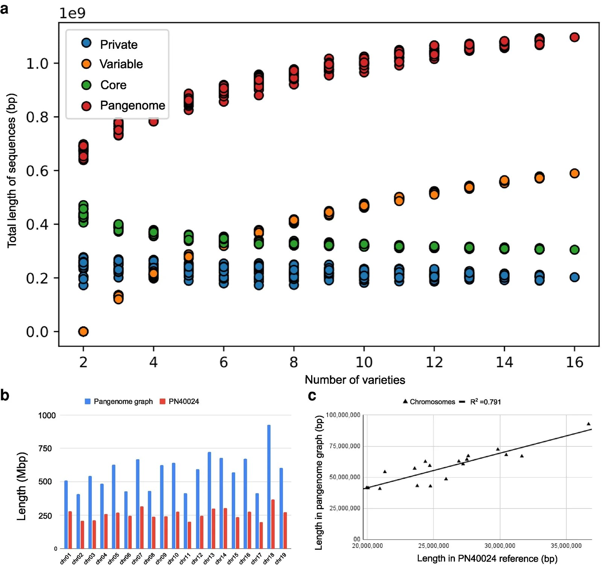

  <sub>**Cultivated grapevine pangenome (G3)**：15 个栽培葡萄品种加 PN40024 的 Minigraph-Cactus 图谱增长曲线（用 gretl 计算，Fig. 4）。数据：15 个栽培葡萄品种加 PN40024（葡萄数据）。来源：Pierre et al. 2026, G3: Genes, Genomes, Genetics, Fig. 4（[doi:10.1093/g3journal/jkag168](https://doi.org/10.1093/g3journal/jkag168)），CC BY。</sub>
- **Vitis amurensis graph (Vampan)** (分析) — 野生山葡萄的图谱泛基因组，把 TE 变异与气候适应联系起来。 抗寒的野生葡萄属；TE-SV 适应的模板。 [doi:10.1038/s41467-026-70026-w](https://doi.org/10.1038/s41467-026-70026-w) · [详情](docs/PANGENOME_CATALOG.md#L286)
- **NA Vitis super-pangenome** (分析) — 九个北美葡萄属物种的泛基因组和浏览器。 本仓库所用的默认参数；砧木物种的浏览器。 [doi:10.1186/s13059-023-03133-2](https://doi.org/10.1186/s13059-023-03133-2) · [link](https://grapegenomics.com/pages/NA_Vitis_pangenome/index.php) · [详情](docs/PANGENOME_CATALOG.md#L287)

  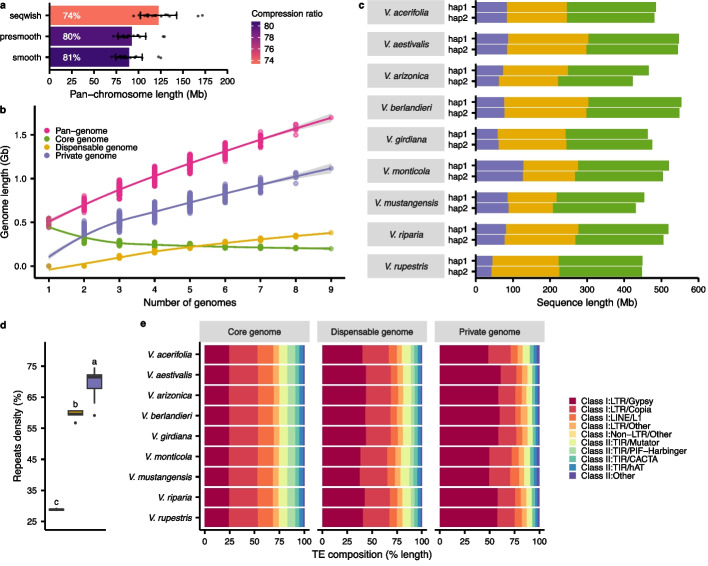

  <sub>**NA Vitis super-pangenome**：9 个北美葡萄属物种 PGGB 核苷酸级超泛基因组图谱的特性：压缩率及核心/可变/私有比例（Fig. 2）。数据：9 个北美葡萄属物种（葡萄数据）。来源：Cochetel et al. 2023, Genome Biology, Fig. 2（[doi:10.1186/s13059-023-03133-2](https://doi.org/10.1186/s13059-023-03133-2)），CC BY。</sub>
- **Grapedia** (工具) — 社区葡萄基因组和工具门户（基因组、Grape-RNA、浏览器）。 公开葡萄属基因组和注释的统一入口。 [link](https://grapedia.org/) · [详情](docs/PANGENOME_CATALOG.md#L288)
- **GrapeGenomics JBrowse** (工具) — 许多葡萄属基因组的 JBrowse 2 实例。 浏览用于图谱的葡萄组装。 [link](https://www.grapegenomics.com/pages/jbrowse2.php) · [详情](docs/PANGENOME_CATALOG.md#L289)
- **Grapevine pangenome review (Horticulturae)** (分析) — 综述参考基因组之外的 V. vinifera 多样性以及泛基因组框架。 较近的、专门针对葡萄的泛基因组设计综述。 [doi:10.3390/horticulturae12060756](https://doi.org/10.3390/horticulturae12060756) · [详情](docs/PANGENOME_CATALOG.md#L290)
- **Graph pangenomes in polyploid crops (review)** (分析) — 关于复杂多倍体基因组（从甘蔗到其他作物）图谱泛基因组的评述。 对多倍体或种间葡萄砧木有用。 [doi:10.1016/j.xplc.2026.101852](https://doi.org/10.1016/j.xplc.2026.101852) · [详情](docs/PANGENOME_CATALOG.md#L291)
- **PN_T2T reference** (资源) — 端粒到端粒的 PN40024 参考（PN_T2T / v5）。 Grapepan 和 Grapedia 使用的坐标骨架。 [doi:10.1093/hr/uhad061](https://doi.org/10.1093/hr/uhad061) · [详情](docs/PANGENOME_CATALOG_SUPPLEMENT_1.md#vs061)

  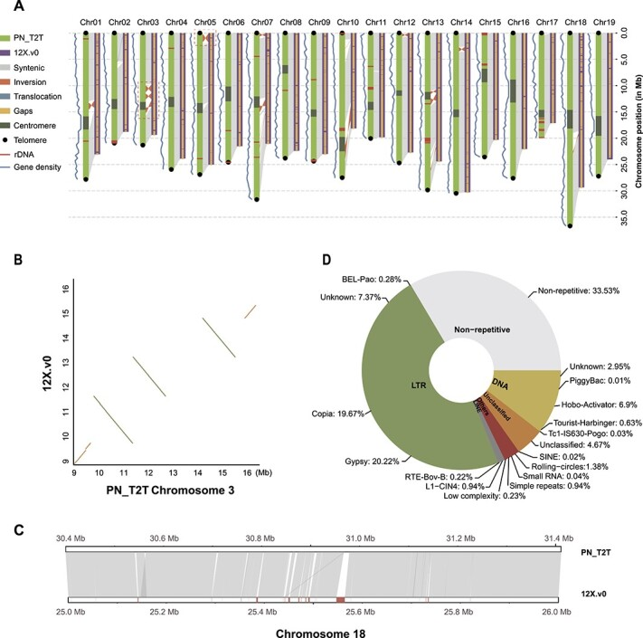

  <sub>**PN_T2T reference**：PN40024 无缺口 PN_T2T 组装与 12X.v0 的比较概览（Figure 1）。数据：PN40024（葡萄数据）。来源：Shi et al. 2023, Horticulture Research, Figure 1（[doi:10.1093/hr/uhad061](https://doi.org/10.1093/hr/uhad061)），CC BY。</sub>
- **Pierre et al. data deposit** (资源) — 16 个栽培品种的单倍型组装、注释、TE 注释和图谱。 本目录使用其中的单倍型组装和图谱。基因注释属于两个注释仓库；TE 注释或 TE 库属于 vitis-te。本条目不是本仓库中结构注释或 TE 库构建的方法。 [doi:10.57745/ckd4h5](https://doi.org/10.57745/ckd4h5) · [link](https://doi.org/10.57745/ckd4h5) · [详情](docs/PANGENOME_CATALOG_SUPPLEMENT_1.md#vs062)
- **Muscadinia rotundifolia Trayshed diploid assembly** (资源) — 分相的 Trayshed 组装；chr7/chr20 融合；R 基因扩增。 葡萄科超泛基因组的外群；必须处理核型差异。 [doi:10.1093/g3journal/jkab033](https://doi.org/10.1093/g3journal/jkab033) · [详情](docs/PANGENOME_CATALOG_SUPPLEMENT_1.md#vs063)
- **Muscadine Carlos assembly + pan-genome** (资源) — Carlos 组装和 4 个基因组的共线性泛基因组。 vinifera 中没有的皮尔斯病抗性基因。 [doi:10.1186/s12864-023-09514-y](https://doi.org/10.1186/s12864-023-09514-y) · [link](https://pmc.ncbi.nlm.nih.gov/articles/PMC10357881/) · [详情](docs/PANGENOME_CATALOG_SUPPLEMENT_1.md#vs064)

  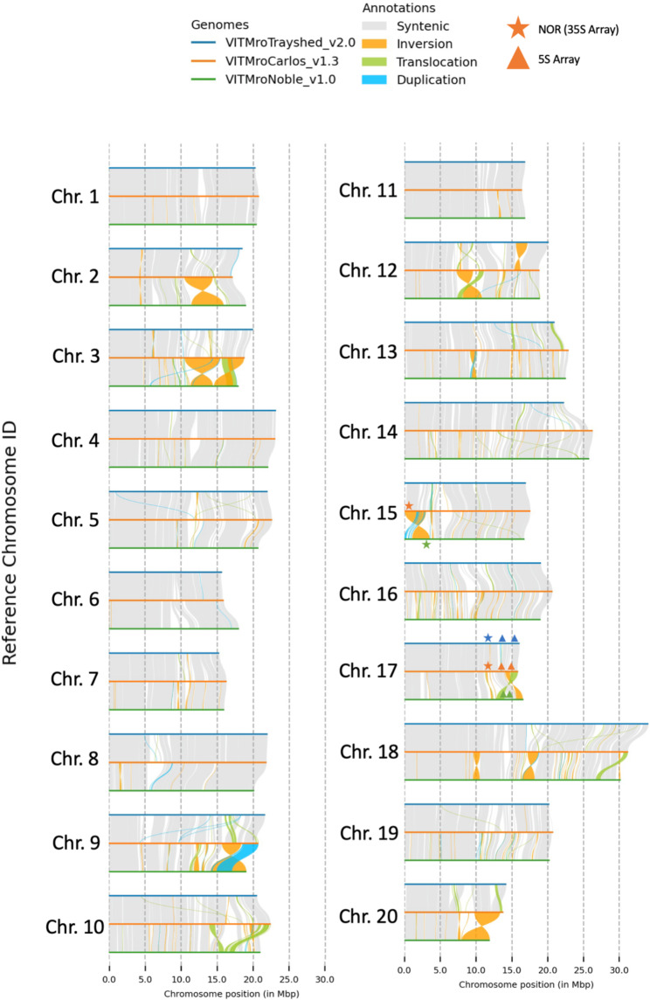

  <sub>**Muscadine Carlos assembly + pan-genome**：圆叶葡萄 Carlos、Trayshed 与 Noble 组装间的共线性及 rDNA/NOR 位置（Fig. 1）。数据：圆叶葡萄（葡萄数据）。来源：Huff et al. 2023, BMC Genomics, Fig. 1（[doi:10.1186/s12864-023-09514-y](https://doi.org/10.1186/s12864-023-09514-y)），CC BY。</sub>
- **Wild side of grape genomics (review)** (分析) — 综述 45 个野生葡萄基因组和泛基因组学。 可用野生葡萄属组装的地图。 [doi:10.1016/j.tig.2024.04.014](https://doi.org/10.1016/j.tig.2024.04.014) · [link](https://doi.org/10.1016/j.tig.2024.04.014) · [详情](docs/PANGENOME_CATALOG_SUPPLEMENT_1.md#vs065)
- **Grape family phylogenomics** (分析) — 葡萄科染色体水平基因组和系统基因组学，包括 SV 对 A/B 区室的影响。 葡萄属图谱的科级外群，以及 SV 的三维基因组视角。 [doi:10.1038/s41477-026-02442-1](https://doi.org/10.1038/s41477-026-02442-1) · [link](https://www.nature.com/articles/s41477-026-02442-1) · [详情](docs/PANGENOME_CATALOG_SUPPLEMENT_1.md#vs066)
- **Diploid phasing from draft (Minio et al.)** (工具) — 由草稿组装构建二倍体分相染色体的流程（HaploSync）。 把较早的葡萄组装升级为分相单倍型。 [doi:10.1093/g3journal/jkac143](https://doi.org/10.1093/g3journal/jkac143) · [详情](docs/PANGENOME_CATALOG_SUPPLEMENT_1.md#vs067)
- **Grapevine sex determination** (分析) — 葡萄属单倍型分辨的性别位点。 一个已知富含 SV 的位点，可用于验证图谱表示。 [doi:10.1038/s41467-020-16700-z](https://doi.org/10.1038/s41467-020-16700-z) · [link](https://www.nature.com/articles/s41467-020-16700-z) · [详情](docs/PANGENOME_CATALOG_SUPPLEMENT_1.md#vs068)

  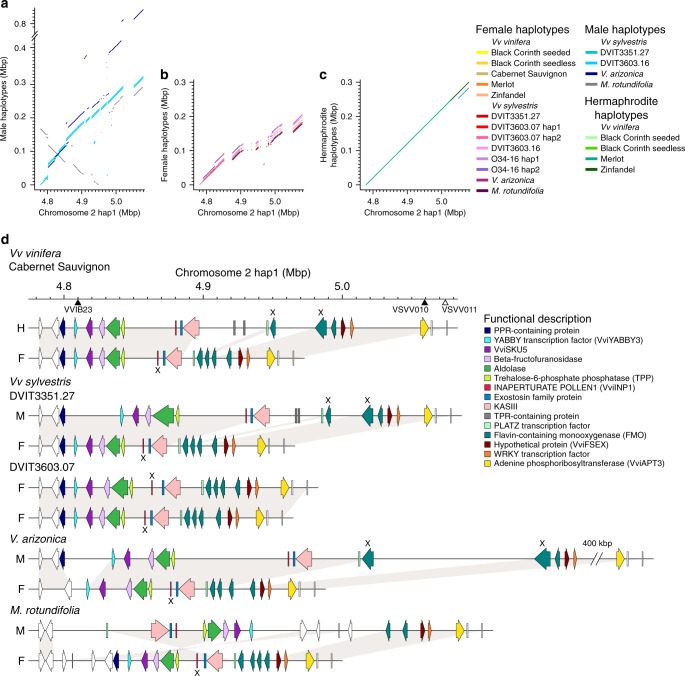

  <sub>**Grapevine sex determination**：葡萄性别决定区雄、雌、两性单倍型对赤霞珠 chr2 的全序列比对（Fig. 2）。数据：葡萄（葡萄数据）。来源：Massonnet et al. 2020, Nature Communications, Fig. 2（[doi:10.1038/s41467-020-16700-z](https://doi.org/10.1038/s41467-020-16700-z)），CC BY。</sub>
- **VitExpress + haplotype-resolved assembly** (资源) — 单倍型分辨的葡萄组装，并配有开放的表达平台。 用于查询图谱 SV 区域内基因的表达。 [doi:10.1073/pnas.2403750121](https://doi.org/10.1073/pnas.2403750121) · [link](https://pmc.ncbi.nlm.nih.gov/articles/PMC11161759/) · [详情](docs/PANGENOME_CATALOG_SUPPLEMENT_1.md#vs069)
- **Munage haplotype-resolved assemblies** (资源) — 一个新疆古老栽培品种的单倍型分辨基因组。 为图谱输入增加中亚多样性。 [doi:10.1093/hr/uhaf274](https://doi.org/10.1093/hr/uhaf274) · [详情](docs/PANGENOME_CATALOG_SUPPLEMENT_1.md#vs070)

  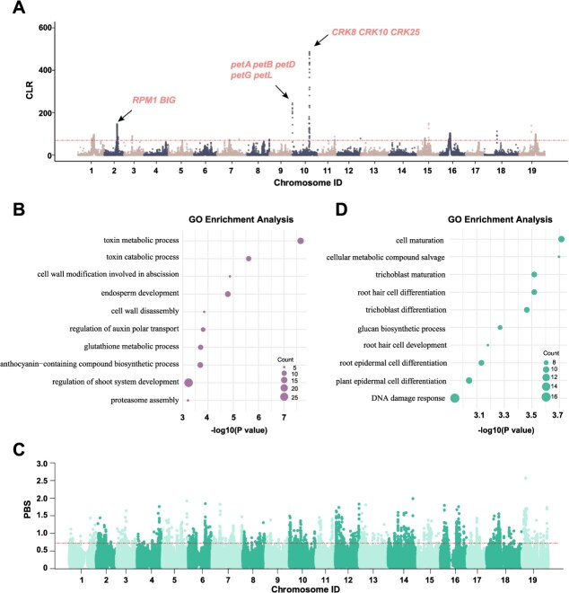

  <sub>**Munage haplotype-resolved assemblies**：木纳格葡萄的 SweeD 选择扫描与 PBS（Figure 4）。数据：木纳格葡萄（葡萄数据）。来源：Zhong et al. 2025, Horticulture Research, Figure 4（[doi:10.1093/hr/uhaf274](https://doi.org/10.1093/hr/uhaf274)），CC BY。</sub>
- **PN40024.v4 reference** (资源) — 改进的 PN40024 组装和注释（v4），早于 T2T v5。 很多公开葡萄数据仍用 v4 坐标，换到 PN_T2T 时要用到。 [doi:10.1093/g3journal/jkad067](https://doi.org/10.1093/g3journal/jkad067)
- **Grapevine 12X genome (Jaillon 2007)** (资源) — 第一个葡萄参考基因组（PN40024），发现祖先六倍化。 历史参考；解释葡萄共线性里看到的 γ 三倍化。 [doi:10.1038/nature06148](https://doi.org/10.1038/nature06148)
- **Cabernet Sauvignon FALCON-Unzip** (资源) — 用 FALCON-Unzip 得到的赤霞珠分相二倍体组装。 较早的分相葡萄品种组装，显示单个克隆内的单倍型差异。 [doi:10.1038/nmeth.4035](https://doi.org/10.1038/nmeth.4035)
- **472 Vitis accessions resequencing** (分析) — 472 份葡萄属材料重测序，分析多样性和种群历史。 大型短读长群体，可在葡萄图上分型。 [doi:10.1038/s41467-019-09135-8](https://doi.org/10.1038/s41467-019-09135-8)
- **VIVC (Vitis International Variety Catalogue)** (资源) — 葡萄品种、异名、系谱和 SSR 指纹数据库。 把品种加入图之前核对身份和系谱。 [link](https://www.vivc.de/)

<a id="section-13"></a>
## 13. 工作流与流程

端到端的泛基因组构建工作流与多样本分析流程，如 nf-core/pangenome、Pan1c 和 cactus-pangenome。

**需要**：与图谱构建相同的输入；若流程包含变异检出，再加群体读长（见第 2 和 5 节）。 [按情景看数据需求](#data-needs)

- **nf-core/pangenome** (工具) — 在集群上运行 PGGB 工具的 Nextflow 流程。 脚本 04–06 可直接用的编排。 [doi:10.1093/bioinformatics/btae609](https://doi.org/10.1093/bioinformatics/btae609) · [link](https://github.com/nf-core/pangenome) · [详情](docs/PANGENOME_CATALOG.md#L301)
- **Pan1c** (工具) — 用于染色体水平 PGGB/MC 图谱的 Snakemake 流程，带质控和报告。[preprint] 由植物研究组构建；与按染色体构建葡萄图谱的设计一致。 [doi:10.64898/2026.04.17.719212](https://doi.org/10.64898/2026.04.17.719212) · [link](https://forge.inrae.fr/genotoul-bioinfo/Pan1c/pan1c) · [详情](docs/PANGENOME_CATALOG.md#L302)
- **cactus-pangenome** (工具) — 一条命令运行的 Minigraph-Cactus 流程，产出 GBZ、VCF 和索引。 脚本 12 的封装目标。 [doi:10.1038/s41587-023-01793-w](https://doi.org/10.1038/s41587-023-01793-w) · [link](https://github.com/ComparativeGenomicsToolkit/cactus/blob/master/doc/pangenome.md) · [详情](docs/PANGENOME_CATALOG.md#L303)
- **HPRC release 2 graph workflow** (工具) — HPRC 第 2 版公开方案：wfmash 比对、隐式图谱和变异。 面向不断扩大的葡萄面板的具体大规模模板。 [link](https://github.com/pangenome/HPRCv2) · [详情](docs/PANGENOME_CATALOG.md#L304)
- **HPRC draft pangenome** (分析) — 人类草稿泛基因组参考及其图谱/评测做法。 图谱发布和质控的参考做法。 [doi:10.1038/s41586-023-05896-x](https://doi.org/10.1038/s41586-023-05896-x) · [详情](docs/PANGENOME_CATALOG.md#L305)
- **Rice pangenome reference (wild + cultivated)** (分析) — 野生稻和栽培稻的泛基因组，作为参考资源。 发布带野生近缘种的作物图谱参考的例子。 [doi:10.1038/s41586-025-08883-6](https://doi.org/10.1038/s41586-025-08883-6) · [详情](docs/PANGENOME_CATALOG.md#L306)
- **Snakemake** (工具) — 基于 Python 的流程管理器。 可把本仓库编号脚本包成可复现流程。 [doi:10.12688/f1000research.29032.2](https://doi.org/10.12688/f1000research.29032.2) · [link](https://github.com/snakemake/snakemake)
- **Nextflow** (工具) — 面向集群和云的数据流流程管理器。 在 HPC 上跑 nf-core/pangenome 等建图流程。 [doi:10.1038/nbt.3820](https://doi.org/10.1038/nbt.3820) · [link](https://github.com/nextflow-io/nextflow)
- **nf-core framework** (资源) — Nextflow 流程的社区规范和工具。 若把葡萄流程移到 Nextflow，可作模板。 [doi:10.1038/s41587-020-0439-x](https://doi.org/10.1038/s41587-020-0439-x) · [link](https://github.com/nf-core/tools)
- **Bioconda** (资源) — 收录数千个生物信息软件的 Conda 频道。 固定葡萄流程所用图工具的版本。 [doi:10.1038/s41592-018-0046-7](https://doi.org/10.1038/s41592-018-0046-7) · [link](https://github.com/bioconda/bioconda-recipes)
- **Galaxy** (资源) — 可复现分析的网页平台，含 vg/PGGB 等工具。 不会命令行的合作者也能重跑葡萄建图步骤。 [doi:10.1093/nar/gkac247](https://doi.org/10.1093/nar/gkac247) · [link](https://github.com/galaxyproject/galaxy)

<a id="section-14"></a>
## 14. 尚未在葡萄属上验证的设想

尚未在葡萄属上尝试的分析设想与 DNA 基础模型，如 COSIGT on ancient grape seeds、Berry-colour locus graph (VvMybA1) 和 PlantCaduceus。

**需要**：视具体设想而定——古 DNA 或标本馆读长（COSIGT，复杂位点 1–2×，尚未在葡萄属上试过）；同一品种多个克隆的两套单倍型；或果皮颜色等已知位点的表型。 [按情景看数据需求](#data-needs)

- **COSIGT on ancient grape seeds** (设想) — 在复杂位点上，对考古葡萄种子做低覆盖度图谱基因分型。 SV 等位基因的驯化时间。[待确认: 未在葡萄属上尝试] [doi:10.1186/s13059-026-04242-4](https://doi.org/10.1186/s13059-026-04242-4) · [详情](docs/PANGENOME_CATALOG.md#L316)
- **Berry-colour locus graph (VvMybA1)** (设想) — 在已知 SV 位点周围构建位点图谱（impg 或 PGGB），例如 VvMybA1（果色）处的 Gret1 反转录转座子。 在一个表型清楚的已知葡萄 SV 上测试图谱基因分型。 [doi:10.1126/science.1095011](https://doi.org/10.1126/science.1095011) · [详情](docs/PANGENOME_CATALOG.md#L317)
- **Pangenome foundation models** (设想) — 在番茄泛基因组节点上训练的、以图谱为条件的 DNA 语言模型（TomatoPGFM）。[preprint] 可能用于给葡萄 SV 效应打分；尚未在葡萄属上测试。 [doi:10.64898/2026.08.31.748176](https://doi.org/10.64898/2026.08.31.748176) · [详情](docs/PANGENOME_CATALOG.md#L318)
- **DeepGene** (工具) — 使用泛基因组图谱表示的 Transformer 基础模型。 在葡萄中做考虑图谱的序列模型的设想。 [doi:10.1109/tcbbio.2025.3614354](https://doi.org/10.1109/tcbbio.2025.3614354) · [详情](docs/PANGENOME_CATALOG.md#L319)
- **PlantCaduceus** (工具) — 用于变异效应预测的跨物种植物 DNA 语言模型。 对图谱 GWAS 得到的葡萄 SV/SNP 候选做优先级排序；尚未在葡萄属上测试。 [doi:10.1073/pnas.2421738122](https://doi.org/10.1073/pnas.2421738122) · [link](https://github.com/plantcad/plantcad) · [详情](docs/PANGENOME_CATALOG.md#L320)
- **AgroNT** (工具) — 在可食用植物基因组上训练的基础 DNA 语言模型。 在植物上训练的 DNA 语言模型；可能用于给葡萄变异效应打分；尚未在葡萄属上测试。 [doi:10.1038/s42003-024-06465-2](https://doi.org/10.1038/s42003-024-06465-2) · [link](https://github.com/instadeepai/nucleotide-transformer) · [详情](docs/PANGENOME_CATALOG.md#L321)
- **Graph-node GWAS + eQTL fusion** (设想) — 在同一张图谱上做节点水平 GWAS 和 SV-eQTL，以连接性状、SV 和表达。 把 Grapepan 的 GWAS 与超泛基因组的 eQTL 做法结合起来。 [doi:10.1016/j.xplc.2026.101835](https://doi.org/10.1016/j.xplc.2026.101835) · [详情](docs/PANGENOME_CATALOG.md#L322)
- **Clone-level pangenome** (设想) — 把同一栽培品种若干无性系的两条单倍型都加入图谱，以检测体细胞 SV。 葡萄是无性繁殖的；体细胞 SV 会影响无性系性状。 [doi:10.1186/s12864-019-6211-2](https://doi.org/10.1186/s12864-019-6211-2) · [详情](docs/PANGENOME_CATALOG.md#L323)
- **Implicit-graph locus atlas** (设想) — 预先计算所有 NLR 和萜烯合酶簇的 impg 投射。 以位点为中心浏览，而不必反复重建全基因组图谱。 [link](https://github.com/pangenome/impg) · [详情](docs/PANGENOME_CATALOG.md#L324)
- **Personalized-graph scaffolding** (设想) — 用从图谱中抽样的单倍型，为新的葡萄组装做支架。 为育种系节省 Hi-C 成本。[待确认] [doi:10.64898/2026.03.17.712436](https://doi.org/10.64898/2026.03.17.712436) · [详情](docs/PANGENOME_CATALOG.md#L325)
- **GPN** (工具) — 用于无监督变异效应预测的 DNA 语言模型（首先在拟南芥/十字花目上训练）。 可能用于对葡萄非编码区的图谱 SNP/indel 候选排序；未在葡萄属上测试。 [doi:10.1073/pnas.2311219120](https://doi.org/10.1073/pnas.2311219120) · [link](https://github.com/songlab-cal/gpn) · [详情](docs/PANGENOME_CATALOG_SUPPLEMENT_1.md#vs071)
- **Evo 2** (工具) — 跨生命域的基因组尺度 DNA 语言模型。（年份为仓库创建年；未核对该论文）[待确认: 未核对论文 DOI] 探索性的变异效应打分；未在葡萄属上测试 [待确认]。 [link](https://github.com/ArcInstitute/evo2) · [详情](docs/PANGENOME_CATALOG_SUPPLEMENT_1.md#vs072)
- **Pan-proteome with predicted structures (barley abstract)** (设想) — 会议摘要：76 个大麦基因型的 856,971 种蛋白形式，并按预测结构聚类。[会议摘要，非同行评审] 葡萄泛蛋白质组层的设想。“Predicted-structure clustering” 指按预测的蛋白质三维结构聚类，不是基因结构注释。仅为摘要，未经同行评审。 [link](https://ipk-bit.github.io/ib2026-abstract-book/abstracts/full-talks/144/) · [详情](docs/PANGENOME_CATALOG_SUPPLEMENT_1.md#vs073)
- **Variant-aware CRISPR off-target search (CRISPRme)** (设想) — 考虑群体变异和单倍型来搜索 CRISPR 脱靶位点。 设想：用葡萄图单倍型检查编辑向导，在所有品种上查脱靶，而不只是 PN40024。工具原为人类数据设计。 [doi:10.1038/s41588-022-01257-y](https://doi.org/10.1038/s41588-022-01257-y) · [link](https://github.com/pinellolab/CRISPRme)
- **Graph mapping for degraded DNA** (设想) — 把古 DNA 比对到变异图，可减少参考偏倚、改善 indel 检测。 设想：把考古或标本葡萄样本比对到葡萄图；与古种子 COSIGT 互补。 [doi:10.1186/s13059-020-02160-7](https://doi.org/10.1186/s13059-020-02160-7) · [link](https://github.com/vgteam/vg)
- **Tandem-repeat genotyping (TRGT)** (设想) — 从 HiFi 读长对串联重复分型并可视化。 设想：比较同一品种不同葡萄克隆间的串联重复长度。 [doi:10.1038/s41587-023-02057-3](https://doi.org/10.1038/s41587-023-02057-3) · [link](https://github.com/PacificBiosciences/trgt)

<a id="section-15"></a>
## 15. 其他植物泛基因组研究与综述

其他植物物种的泛基因组研究论文与方法学综述，包括 Rice super pan-genome、Maize 26 genomes (NAM) 和 Pangenome graphs review。

**需要**：非葡萄属数据方案，仅为其他物种的先例。 [按情景看数据需求](#data-needs)

- **Pangenome graphs review** (分析) — 泛基因组图谱模型和工具的综述。 本仓库文档的背景。 [doi:10.1146/annurev-genom-120219-080406](https://doi.org/10.1146/annurev-genom-120219-080406) · [详情](docs/PANGENOME_CATALOG_SUPPLEMENT_1.md#vs074)
- **Plant T2T methods review** (分析) — 植物 T2T 组装和泛基因组应用的综述。 葡萄属 T2T 图谱的组装标准。 [doi:10.1038/s41588-024-01830-7](https://doi.org/10.1038/s41588-024-01830-7) · [link](https://www.nature.com/articles/s41588-024-01830-7) · [详情](docs/PANGENOME_CATALOG_SUPPLEMENT_1.md#vs075)
- **Potato wild/cultivated genomes** (分析) — 44 个二倍体马铃薯基因组；无性繁殖作物中的 SV 和有害负荷。 与葡萄类似的无性、杂合作物对照。 [doi:10.1038/s41586-022-04822-x](https://doi.org/10.1038/s41586-022-04822-x) · [link](https://www.nature.com/articles/s41586-022-04822-x) · [详情](docs/PANGENOME_CATALOG_SUPPLEMENT_1.md#vs076)
- **Rice super pan-genome** (分析) — 带基因组图谱的水稻超泛基因组。 基于图谱的群体 SV 设计。 [doi:10.1038/s41422-022-00685-z](https://doi.org/10.1038/s41422-022-00685-z) · [link](https://www.nature.com/articles/s41422-022-00685-z) · [详情](docs/PANGENOME_CATALOG_SUPPLEMENT_1.md#vs077)
- **Barley pangenome** (分析) — 76 个大麦基因组，驯化中的 SV。 大型植物泛基因组方法（按染色体运行 minigraph）。 [doi:10.1038/s41586-024-08187-1](https://doi.org/10.1038/s41586-024-08187-1) · [link](https://www.nature.com/articles/s41586-024-08187-1) · [详情](docs/PANGENOME_CATALOG_SUPPLEMENT_1.md#vs078)
- **Arabidopsis 69 accessions** (分析) — 覆盖该物种的 69 份拟南芥材料的泛基因组，关注基因组结构保守性。 植物中核心/非必需分类的方法。 [doi:10.1038/s41588-024-01715-9](https://doi.org/10.1038/s41588-024-01715-9) · [link](https://www.nature.com/articles/s41588-024-01715-9) · [详情](docs/PANGENOME_CATALOG_SUPPLEMENT_1.md#vs079)
- **Cucumber graph pan-genome** (分析) — 带性状 SV 的图谱泛基因组。 果树作物中图谱 SV 与性状的设计。 [doi:10.1038/s41467-022-28362-0](https://doi.org/10.1038/s41467-022-28362-0) · [link](https://www.nature.com/articles/s41467-022-28362-0) · [详情](docs/PANGENOME_CATALOG_SUPPLEMENT_1.md#vs080)
- **Maize 26 genomes (NAM)** (分析) — NAM 奠基者基因组和泛基因分析。 泛基因分类和 PAV 参考设计。 [doi:10.1126/science.abg5289](https://doi.org/10.1126/science.abg5289) · [详情](docs/PANGENOME_CATALOG_SUPPLEMENT_1.md#vs081)
- **Soybean pan-genome** (分析) — 基于图谱的大豆泛基因组。 较早的作物图谱基因组。 [doi:10.1016/j.cell.2020.05.023](https://doi.org/10.1016/j.cell.2020.05.023) · [link](https://doi.org/10.1016/j.cell.2020.05.023) · [详情](docs/PANGENOME_CATALOG_SUPPLEMENT_1.md#vs082)
- **Wheat multiple genomes** (分析) — 10 个以上小麦基因组及渗入。 通过多个组装做渗入定位。 [doi:10.1038/s41586-020-2961-x](https://doi.org/10.1038/s41586-020-2961-x) · [link](https://www.nature.com/articles/s41586-020-2961-x) · [详情](docs/PANGENOME_CATALOG_SUPPLEMENT_1.md#vs083)
- **Pearl millet pangenome (heat tolerance)** (分析) — 与耐热相关的泛基因组 SV。 与葡萄耐热/耐旱工作相关的 SV 到非生物胁迫设计。 [doi:10.1038/s41588-023-01302-4](https://doi.org/10.1038/s41588-023-01302-4) · [link](https://www.nature.com/articles/s41588-023-01302-4) · [详情](docs/PANGENOME_CATALOG_SUPPLEMENT_1.md#vs084)
- **Apple haplotype-resolved genomes (rootstock dwarfing)** (分析) — 近乎无缺口的单倍型分辨苹果基因组，用于定位砧木诱导的矮化。 与葡萄一样是木质嫁接多年生植物；葡萄属砧木泛基因组的模板。 [doi:10.1038/s41588-024-01657-2](https://doi.org/10.1038/s41588-024-01657-2) · [link](https://www.nature.com/articles/s41588-024-01657-2) · [详情](docs/PANGENOME_CATALOG_SUPPLEMENT_1.md#vs085)
- **Eggplant graph pangenomes + pan-phenome** (分析) — 由 40 个组装得到的两张图谱泛基因组，外加 368 份材料的泛表型组。 显示序列增长曲线保持开放，而蛋白家族曲线趋于封闭；葡萄属也需要同样的分层。 [doi:10.1038/s41467-025-64866-1](https://doi.org/10.1038/s41467-025-64866-1) · [link](https://www.nature.com/articles/s41467-025-64866-1) · [详情](docs/PANGENOME_CATALOG_SUPPLEMENT_1.md#vs086)
- **What are we learning from plant pangenomes?** (分析) — 《Annual Review of Plant Biology》对植物泛基因组发现的概述。 背景综述。 [doi:10.1146/annurev-arplant-090823-015358](https://doi.org/10.1146/annurev-arplant-090823-015358) · [详情](docs/PANGENOME_CATALOG_SUPPLEMENT_1.md#vs087)
- **From structural pangenomes to functional panomics** (分析) — 综述：图谱坐标、panNLRome、泛转录组和泛表观组。 较近的综述：其中图谱坐标、panNLRome、转录组和表观组部分与本目录相关；功能注释本身仍留在 gene-function-annotation。该综述的范围比本目录更宽。 [doi:10.1093/molbev/msag087](https://doi.org/10.1093/molbev/msag087) · [详情](docs/PANGENOME_CATALOG_SUPPLEMENT_1.md#vs088)
- **Pangenomes for large/complex plant genomes** (分析) — 综述复杂植物基因组的构建策略和表示格式。 葡萄属发布时的格式选择。 [doi:10.1016/j.jare.2025.01.052](https://doi.org/10.1016/j.jare.2025.01.052) · [link](https://pmc.ncbi.nlm.nih.gov/articles/PMC12684929/) · [详情](docs/PANGENOME_CATALOG_SUPPLEMENT_1.md#vs089)
- **Complexity welcome (review)** (分析) — 关于图谱泛基因组用于植物群体基因组学的评述。 葡萄属基于图谱的群体遗传学的概念框架。 [doi:10.1017/qpb.2025.10028](https://doi.org/10.1017/qpb.2025.10028) · [link](https://www.cambridge.org/core/journals/quantitative-plant-biology/article/complexity-welcome-pangenome-graphs-for-comprehensive-population-genomics/B2DD25F2FD0B4CB91D238DFD2257E7FA) · [详情](docs/PANGENOME_CATALOG_SUPPLEMENT_1.md#vs090)
- **Sorghum pan-genome** (分析) — 栽培和野生高粱泛基因组，展示基因 PAV 和驯化中的丢失。 野生/栽培 PAV 设计可类比野生葡萄与欧亚种。 [doi:10.1038/s41477-021-00925-x](https://doi.org/10.1038/s41477-021-00925-x)
- **Sunflower haplotype blocks** (分析) — 野生向日葵中大片不重组的单倍型（多为倒位）决定生态型差异。 可借鉴用于检验野生葡萄适应中的倒位和单倍型块。 [doi:10.1038/s41586-020-2467-6](https://doi.org/10.1038/s41586-020-2467-6)
- **Setaria graph pan-genome** (分析) — 谷子及野生近缘种的图泛基因组，含 SV-性状关联。 图加 GWAS 的设计与本仓库葡萄计划接近。 [doi:10.1038/s41588-023-01423-w](https://doi.org/10.1038/s41588-023-01423-w)
- **Pea pan-genome** (分析) — 改进的豌豆参考基因组和泛基因组，含 PAV 和演化分析。 又一个“参考升级+泛基因组”的例子，类似 PN40024 v4 到 T2T。 [doi:10.1038/s41588-022-01172-2](https://doi.org/10.1038/s41588-022-01172-2)

<a id="data-needs"></a>
## 数据需求：泛基因组还需要搭配什么数据

每个情景列出**最低数据**（没有就做不了）、**建议数据**（只写有出处的葡萄属或近缘植物设计）、**对应目录章节和工具**，以及**易错点**。「图谱」指由单倍型组装建成的葡萄属泛基因组变异图（本仓库）。本仓库不含的内容放在兄弟仓库：TE 库构建在 [vitis-te](https://github.com/Xuzhen-Li/vitis-te)；基因模型在 [gene-structure-annotation](https://github.com/Xuzhen-Li/gene-structure-annotation)；名称、GO/KEGG 和结构域在 [gene-function-annotation](https://github.com/Xuzhen-Li/gene-function-annotation)。

上面每节开头都有一行「需要：」。各情景的详细说明（最低数据、建议数据、对应工具、易错点）以及仍标 [待确认] 的条目，见 [`docs/CATALOG.md`](docs/CATALOG.md#data-needs-zh)。下表中的「扩充」指 2026-11-13 新加入本页的条目。

### 总表

| 情景 | 最低输入 | 建议补充（仅在有出处时写） | 目录章节 |
|---|---|---|---|
| 1. 只建图谱 | 分相单倍型组装，按染色体命名（PanSN）。对已经分相的单倍型，不要把 purge_dups 当作必需输入 | HiFi 单倍型；要做 T2T 再加超长 ONT；要把 contig 排到染色体上时再加 Hi-C 或遗传/光学图（第 1 节工具）。本仓库 PGGB 起点 `-p 85 -s 10k` 来自北美葡萄属流程（Cochetel 等，2023，doi:10.1186/s13059-023-03133-2）。Grapepan v1.0 用了 18 条 T2T 单倍型加 11 条公开组装（doi:10.1038/s41588-024-01967-5）；超泛基因组用了 72 份分相材料（野生 25、栽培 47；doi:10.1038/s41588-025-02111-7）。 | 1、2、3、8、13 |
| 2. 群体分型 / SV-GWAS | 图谱 + 群体短读长或长读长 + 表型（做 GWAS 时） | Grapepan v1.0 在 29 条单倍型的图上对 466 份材料分型，并检测 29 个性状（doi:10.1038/s41588-024-01967-5）。另有 472 份葡萄属短读长群体（doi:10.1038/s41467-019-09135-8）。 | 5、10(b)、8；关联工具在第 10 节及其扩充 |
| 3. eQTL / 表达-PAV | 图谱（或图上的基因型）+ 同一基因型（且已用基因型核过身份）的 RNA-seq（同一品种的不同植株可以，见情景 3） | 超泛基因组把 72 条单倍型的图与 SV-eQTL、霜霉菌接种后的转录组结合（doi:10.1038/s41588-025-02111-7）。RNA-seq 样本量在目录摘要中未写 [待确认]。 | 10(a)、10(b)、5、7 |
| 4. 基因有无 / 拷贝数 | 图谱或单倍型 FASTA + gene-structure-annotation 里的基因模型（GFF3 / 蛋白） | 把一套注释投射或聚类到全部单倍型上；第 4a 节的序列 PAV 和第 7 节的基因 PAV 要分开。 | 7、6；读深 CNV 工具为第 7 节扩充 |
| 5. 祖先成分 / 渗入 | 图上或线性参考上的群体基因型 + 外类群 | 用野生葡萄属和圆叶葡萄属做外类群；做树序列或 ARG 时需要分相单倍型。超泛基因组用单倍型系统发育分析 25 份野生 + 47 份栽培材料（doi:10.1038/s41588-025-02111-7）。北美葡萄属是野生/砧木先例（doi:10.1186/s13059-023-03133-2）。 | 11、5、12 |
| 6. 驯化 / 选择扫描 | 含野生和栽培样本的群体基因型（先做基因型身份核对和按克隆去重）；极化需要祖先等位（尽量用多个外类群或概率极化） | Dong 等 2023 将 3,525 份材料放入驯化框架（doi:10.1126/science.add8655）。Zhou 等 2019 是葡萄 SV 与半合子的基础研究（doi:10.1038/s41477-019-0507-8）。 | 11、5、4、10 |
| 7. 体细胞 / 无性系变异 | 同一品种多个克隆的深度测序，或每份都有两套单倍型 | 见克隆分化（doi:10.1186/s12864-019-6211-2）和克隆基因组-甲基化组（doi:10.1186/s13059-026-04184-x）的设计。克隆水平泛基因组（把同一品种多个克隆的两套单倍型放进一张图）列为第 14 节的设想。此处不给具体测序深度 [待确认]。 | 4、5、11、14、10(a) |
| 8. 甲基化 / 表观 SV | 图谱 + ONT/PacBio 的天然 5mC，或亚硫酸氢盐测序读长 | 分相、单倍型水平的甲基化；葡萄 trio 是直接先例（doi:10.1186/s13059-025-03858-2）。GraffiTE v1.1 还在 TE 插入上加入了甲基化（预印本 10.64898/2026.11.06.764993）。 | 10(a)、4、1 |
| 9. 三维 / Hi-C | contig 组装 + Hi-C 读长（或遗传图 / 光学图）用来排染色体 | 建图前每套单倍型都有 Hi-C，或用 Hi-C 模式分相（hifiasm / GreenHill）。目录所列 Hi-C 工具用于挂载和分相。本目录没有在图上调用染色质互作的方法。 | 1（及第 1 节扩充）；检查可用第 9 节 |
| 10. 系谱 / 重组 | 亲本–子代或其他已知系谱的基因型 | 用 trio 做分相；用已发表遗传图核染色体顺序；用 VIVC 查同义名和官方系谱。tsinfer 需要分相数据（doi:10.1038/s41588-019-0483-y）。 | 5、11、8、1、12 |
| 11. TE 插入多态 | 图谱或组装 / 长读长 + vitis-te 中整理好的 TE 库 | 每份材料有长读长或单倍型组装；GraffiTE 建 TE 插入图并分型（doi:10.1101/2023.09.11.557209）。果皮颜色（VvMybA1 上的 Gret1）是经典葡萄例子（doi:10.1126/science.1095011）。 | 4、5、14（位点设想）；TE 库本身不在本仓库 |
| 12. 古 DNA 比对 | 图谱 + 考古或标本馆材料的短、损伤读长 | COSIGT 可在 1–2× 深度下对复杂位点分型（doi:10.1186/s13059-026-04242-4）。把它用在古代葡萄种子上，尚未在葡萄属上试过。损伤 DNA 比对到变异图是拟扩充条目，引用的证据是人类古 DNA 研究（doi:10.1186/s13059-020-02160-7），不是葡萄结果。 | 5（COSIGT）、14 |
| 13. 育种 / 标记设计 | 育种或种质群体在图上的基因型 + 表型；已有标记时还要对应位点的单倍型 | Grapepan v1.0 报告 SV 增加了遗传力和 QTL（doi:10.1038/s41588-024-01967-5）。软件 PHGv2（[maize-genetics/phg_v2](https://github.com/maize-genetics/phg_v2)；须记录版本或 commit 和访问日期；2026-11-13 核对）和 GLIMPSE2 可把面板中*已有*位点填充到低深度样本（见易错点）。PHG 方法论文（Bradbury 等，2022，doi:10.1093/bioinformatics/btac410）描述的是 PHG v1，未查到独立的 v2 DOI。先用基因型核对身份；VIVC 只用于名称和系谱，不能代替核对。 | 5、10(b)、12、14 |

### 共通易错点

- **只分型图里已有的位点。** 在本仓库默认流程中，Giraffe + `vg call` 和 PanGenie 只分型图谱里已有的变异位点，不添加新等位基因（目录第 5 节和本仓库 README）。新 SV 必须先从组装或长读长检测工具（第 4 节）发现，再加入图中。`vg augment` 可把有读长支持的变异加回图里以发现新变异，但不是本仓库的默认流程。PanGenie 使用短读长 k-mer，需要从组装导出、已分相并拆成 bubble 的 VCF（常见为 Minigraph-Cactus 加 vcfbub），不能直接读 PGGB 的 GFA。长读长用 GraphAligner 或 minigraph，不用 PanGenie。
- **参考偏倚。** 只把群体比对到 PN40024（12X、v4 或 PN_T2T），会漏掉该参考缺失的等位基因，这正是在图上分型的原因。如果单倍型集合太窄，或参考锚定方法丢掉了高分歧重复序列，图本身也会产生偏倚。本仓库保留双图原则：PGGB 用于变异盘点，Minigraph-Cactus 或 minigraph 用于群体比对。植物文献提醒 MC/minigraph 可能漏掉 PGGB 保留的高分歧重复（`docs/DUAL_GRAPH.md`）。
- **无性系重复和基因型身份。** 葡萄品种是克隆。种质库常有同义名、错标样本和同一品种的多个克隆。做 GWAS、群体结构分析或选择扫描前，先用基因型本身核对身份并去重（KING 亲缘或 IBS），每个克隆保留一份代表。VIVC 仅用于名称和系谱解释，查不出错标或重复测序的样本。此处不给亲缘或 IBS 阈值，阈值应写在 LOCK 中，而非本说明。若做体细胞或克隆性状研究，同一品种的多个克隆正是实验设计本身，而非错误。体细胞 SV 也必须与遗传杂合区分开（克隆甲基化组研究，doi:10.1186/s13059-026-04184-x）。
- **半合子。** 葡萄的许多 SV 是半合子（Zhou 等，2019，doi:10.1038/s41477-019-0507-8）。二倍体基因型编码和简单的「有/无」标签容易产生误导。
- **不要把序列 PAV 当成基因 PAV。** 第 4a 节（panacus 等工具）统计序列或窗口的有无。第 7 节统计基因有无和家族拷贝数，需要基因模型。
- **填充不是 SV 的通用捷径。** 目录勘误对 GLIMPSE2 写得很明确：它把参考面板中已知的 SNP 和小 indel 填充到浅层测序样本，而非图结构变异（doi:10.1038/s41588-023-01438-3）。软件 PHGv2（[maize-genetics/phg_v2](https://github.com/maize-genetics/phg_v2)；须记录版本或 commit 和访问日期；2026-11-13 核对）也仅填充已知面板单倍型；其方法论文是 Bradbury 等 2022，*Bioinformatics* 38(15):3698–3702，doi:10.1093/bioinformatics/btac410，描述的是 PHG v1，未查到独立的 v2 DOI。Beagle 5 和 SHAPEIT5（第 5 节扩充）只接受双等位 VCF 位点。图 SV 拆成双等位位点并去除嵌套变异（vcfbub / vcfwave）后可写入此类 VCF，但该路径在葡萄上的准确度尚未测试。
- **核型和倍性。** 圆叶葡萄（2n = 40）的 7 号和 20 号染色体共同对应葡萄属（2n = 38）的一条 7 号染色体；Cochetel 等（2021，doi:10.1093/g3journal/jkab033）将其解释为葡萄属谱系中的一次融合，并将融合点定位在赤霞珠和 PN40024 的 7 号染色体上。跨属建图或做共线性时，须把圆叶葡萄的 chr7 和 chr20 同时映射到葡萄属 chr7，不要按编号一对一配对。葡萄属有 19 条染色体，没有 20 号染色体。杂交砧木和部分材料不是简单二倍体；目录中用于多倍体等位基因剂量估计的工具是 Varigraph（doi:10.1016/j.molp.2025.08.001）。本仓库目前还没有单独、已核对的拷贝数或剂量方法（见 README 说明）。
- **合并公开群体。** 合并独立测序的群体（如把 472 份短读长面板与 Grapepan 的 466 份分型材料合并）会引入批次和变异检出偏差。应统一重新比对和分型所有样本，再按批次检查缺失率和杂合率。
- **极化。** tsinfer、iHS 和位点频率谱扫描需要祖先等位，不能只做分相。圆叶葡萄作为外类群分化较远，比对率偏低，重复区错误更多。尽量使用多个外类群或概率极化，并报告未极化位点的比例。
- **本稿不给通用测序深度。** 除 COSIGT 在复杂位点标注的 1–2× 外，本说明不推荐 Giraffe、PanGenie 或克隆变异检测的通用 WGS 深度。请按所选工具的论文来 [若以后要补引，仍标待核对]。

## 分析流程

参照三批同行的分析流程整理。参见 [`pipeline/00_overview.md`](pipeline/00_overview.md)、[`docs/ATTRIBUTION.md`](docs/ATTRIBUTION.md) 和 [`docs/DUAL_GRAPH.md`](docs/DUAL_GRAPH.md)。

Wave 1-2 涵盖 cannabis、potato、NA *Vitis*、Shuhua VCF 和 *Oryza* SyRI。使用脚本 `01` 到 `10`。

Wave 3 涵盖 maize、wheat 和 barley minigraph，以及 dual PGGB-MC + Giraffe / PanGenie。使用脚本 `12` 到 `16`。

各脚本一行说明（文件名和职责来自现有 README 和 `pipeline/00_overview.md`）：

- `00_overview.md` — 流程工作顺序
- `01_rename_pansn.py` — PanSN 重命名（PGGB 发现路径）
- `02_purge_split.sh` — 清理并拆分单倍型
- `03_mash_divergence.sh` — Mash 分歧度
- `04_pggb_per_chr.sh` — 按染色体运行 PGGB
- `05_variants.sh` — 从 PGGB 图谱提取变异
- `06_panacus_pav.sh` — panacus PAV
- `07_vcf_classify.sh` — VCF 分类
- `08_vg_genotype_sketch.sh` — vg sketch（旧比对路径）
- `09_vcf_postprocess.sh` — VCF 后处理
- `10_syri_pan_sv_merge.py` — SyRI pan-SV 合并（比对检查）
- `11_pointers.md` — 指针说明
- `12_minigraph_cactus.sh` — Minigraph-Cactus（MC / 可供 Giraffe 使用）
- `13_minigraph_per_chr.sh` — 按染色体运行 minigraph（轻量骨架）
- `14_giraffe_call.sh` — Giraffe call
- `15_pangenie_genotype.sh` — PanGenie
- `16_graph_qc.sh` — 图谱质控（分型前的 odgi + panacus）

配置文件为 [`config/example.env`](config/example.env)。默认的 PGGB `-p 85 -s 10k` 参照 NA *Vitis*。

```bash
cp config/example.env config/local.env
set -a && source config/local.env && set +a
```

## 说明

- 本目录不含样本数据、基因型或未发表的组装。
- 剂量方法没有单独成节：本仓库目前还没有已核对的拷贝数或剂量方法。Varigraph（第 5 节）可以估计多倍体的等位基因剂量，在目录中作为分型工具列出。
- *Vitis* 超泛基因组的 Zenodo 记录（doi:10.5281/zenodo.13982444）引自论文；Zenodo 拒绝了脚本化的链接检查。
- 期刊图只在许可允许时转载（CC BY 开放获取论文，或 OSI 许可、公有领域仓库中的图片），每张图的说明和下方「图片来源」表都写明出处与许可；其余期刊图不转载，目录文件只列出文献来源。
- 下列工具要分开看待，不能当作同一类。Helixer（以及仅用于产生基因模型时的 TOGA）属于 gene-structure-annotation，本目录未收录。Liftoff 和 LiftOn 已在第 7 节（V090 及相关条目），并带有边界说明；本目录并不把它们排除在外，也不说它们只属于注释仓库。NLR-Annotator 已是 V093：它是结构层的位点识别（包括部分基因和假基因）；本目录只借用其位点列表来统计有无和拷贝数；基因模型仍留在 gene-structure-annotation。它既不制作也不转移基因模型，也不只属于注释仓库。

<a id="figure-credits"></a>
## 图片来源

图片文件在 `docs/figures/catalog/`，均为软件或研究的真实输出；标「非葡萄」的图用的是其他物种的数据，只用来展示软件输出的样子。

| # | 文件 | 软件或研究 | 数据 | 来源 | 许可 |
|---:|---|---|---|---|---|
| 1 | [`01_nextdenovo_human_assemblies.jpg`](docs/figures/catalog/01_nextdenovo_human_assemblies.jpg) | NextDenovo | 人类（非葡萄） | Hu et al. 2024, Genome Biology, Fig. 2 ([doi:10.1186/s13059-024-03252-4](https://doi.org/10.1186/s13059-024-03252-4)) | CC BY |
| 2 | [`02_minigraph_cactus_yeast_chrI_w1600.png`](docs/figures/catalog/02_minigraph_cactus_yeast_chrI_w1600.png) | Minigraph-Cactus | 酿酒酵母（非葡萄） | [ComparativeGenomicsToolkit/cactus](https://github.com/ComparativeGenomicsToolkit/cactus/blob/1abe7c3e822d58d6c274c51738cbeb927614d747/doc/yeast-pg-chrI.full.draw.png) | MIT |
| 3 | [`02_pggb_drb1_odgi_draw_w1600.png`](docs/figures/catalog/02_pggb_drb1_odgi_draw_w1600.png) | PGGB | 人类（非葡萄） | [pangenome/pggb](https://github.com/pangenome/pggb/blob/4225c6ce010553ef353c5ea13805e38c2016b503/docs/img/DRB1-3123.fa.gz.pggb-E-s5000-l15000-p80-n10-a0-K16-k8-w50000-j5000-e5000-I0-R0-N.smooth.chop.og.lay.draw_mqc.png) | MIT |
| 4 | [`03_crop_graph_eval_sorghum.jpg`](docs/figures/catalog/03_crop_graph_eval_sorghum.jpg) | Crop graph evaluation framework | 高粱（非葡萄） | Kopalli et al. 2025, GigaScience, Figure 4 ([doi:10.1093/gigascience/giaf121](https://doi.org/10.1093/gigascience/giaf121)) | CC BY |
| 5 | [`03_genomescope2_seabass_w1600.png`](docs/figures/catalog/03_genomescope2_seabass_w1600.png) | GenomeScope 2.0 | 欧洲鲈鱼（非葡萄） | [tbenavi1/genomescope2.0](https://github.com/tbenavi1/genomescope2.0/blob/8f25e3a25eaa691cdae474daf5cfe5416bfc60dc/user_data/example1/plot.png) | Apache-2.0 |
| 6 | [`03_merqury_arabidopsis_spectra_cn.png`](docs/figures/catalog/03_merqury_arabidopsis_spectra_cn.png) | Merqury | 拟南芥（非葡萄） | [marbl/merqury](https://github.com/marbl/merqury/blob/88f37c0f4dbb073001d194bcc5d5989a0b0527df/example/triocanu_clr.col.spectra-cn.fl.png) | 公有领域（美国政府作品，NHGRI） |
| 7 | [`03_smudgeplot_strawberry.jpg`](docs/figures/catalog/03_smudgeplot_strawberry.jpg) | Smudgeplot | 根结线虫和栽培草莓（非葡萄） | Ranallo-Benavidez et al. 2020, Nature Communications, Fig. 8 ([doi:10.1038/s41467-020-14998-3](https://doi.org/10.1038/s41467-020-14998-3)) | CC BY |
| 8 | [`04_assemblytics_arabidopsis_w1600.png`](docs/figures/catalog/04_assemblytics_arabidopsis_w1600.png) | Assemblytics | 拟南芥（非葡萄） | [MariaNattestad/assemblytics](https://github.com/MariaNattestad/assemblytics/blob/7acd1acec5b4175ab71a7c885a6ddadec0e355ab/output_examples/arabidopsis/Arabidopsis_example.Assemblytics.size_distributions.all_variants.log_all_sizes.png) | MIT |
| 9 | [`04_panacus_hprc_chr22.png`](docs/figures/catalog/04_panacus_hprc_chr22.png) | panacus | 人类（HPRC）（非葡萄） | [marschall-lab/panacus](https://github.com/marschall-lab/panacus/blob/79ba82b01f7d44b22faada755f05464f045fbd20/docs/chr22.hprc-v1.0-pggb.histgrowth.node.png) | MIT |
| 10 | [`04_vg_deconstruct_na_vitis.jpg`](docs/figures/catalog/04_vg_deconstruct_na_vitis.jpg) | vg deconstruct | 9 个北美葡萄属物种（葡萄） | Cochetel et al. 2023, Genome Biology, Fig. 5 ([doi:10.1186/s13059-023-03133-2](https://doi.org/10.1186/s13059-023-03133-2)) | CC BY |
| 11 | [`05_pangenie_1000g.jpg`](docs/figures/catalog/05_pangenie_1000g.jpg) | PanGenie | 人类（千人基因组）（非葡萄） | Ebler et al. 2022, Nature Genetics, Fig. 4 ([doi:10.1038/s41588-022-01043-w](https://doi.org/10.1038/s41588-022-01043-w)) | CC BY |
| 12 | [`05_plant_genotyper_benchmark_real.jpg`](docs/figures/catalog/05_plant_genotyper_benchmark_real.jpg) | Plant graph genotyper benchmark + ensemble | 水稻、玉米和杏（非葡萄） | Du et al. 2024, Genome Biology, Fig. 6 ([doi:10.1186/s13059-024-03239-1](https://doi.org/10.1186/s13059-024-03239-1)) | CC BY |
| 13 | [`06_genespace_grasses.jpg`](docs/figures/catalog/06_genespace_grasses.jpg) | GENESPACE | 8 个禾本科基因组（非葡萄） | Lovell et al. 2022, eLife, Figure 3 ([doi:10.7554/eLife.78526](https://doi.org/10.7554/eLife.78526)) | CC BY |
| 14 | [`06_mumemto_potato_w982.png`](docs/figures/catalog/06_mumemto_potato_w982.png) | Mumemto | 马铃薯（非葡萄） | [vikshiv/mumemto](https://github.com/vikshiv/mumemto/blob/ec48f10535f463ce709fe4181bec76ca0c4577db/img/potato_syn.png) | GPL-3.0 |
| 15 | [`06_plotsr_arabidopsis_ampril_w1600.png`](docs/figures/catalog/06_plotsr_arabidopsis_ampril_w1600.png) | plotsr | 拟南芥（非葡萄） | [schneebergerlab/plotsr](https://github.com/schneebergerlab/plotsr/blob/d2da00875c96a34dd758487f3967fa223228843d/example/ampril_col0_chr3_6600000_10000000.png) | MIT |
| 16 | [`07_get_homologues_est_grape_w1600.jpg`](docs/figures/catalog/07_get_homologues_est_grape_w1600.jpg) | GET_HOMOLOGUES-EST | 15 个栽培葡萄品种（葡萄） | Pierre et al. 2026, G3: Genes, Genomes, Genetics, Fig. 2 ([doi:10.1093/g3journal/jkag168](https://doi.org/10.1093/g3journal/jkag168)) | CC BY |
| 17 | [`07_pangene_human_hla.jpg`](docs/figures/catalog/07_pangene_human_hla.jpg) | pangene | 人类（非葡萄） | Li et al. 2024, Bioinformatics, Figure 1 ([doi:10.1093/bioinformatics/btae456](https://doi.org/10.1093/bioinformatics/btae456)) | CC BY |
| 18 | [`07_pantools_potato.jpg`](docs/figures/catalog/07_pantools_potato.jpg) | PanTools (ploidy-aware) | 四倍体马铃薯（非葡萄） | Jonkheer et al. 2025, Plant Biotechnology Journal, Figure 2 ([doi:10.1111/pbi.14545](https://doi.org/10.1111/pbi.14545)) | CC BY |
| 19 | [`09_bandageng_grch38_mhc.png`](docs/figures/catalog/09_bandageng_grch38_mhc.png) | BandageNG | 人类（GRCh38）（非葡萄） | [ComparativeGenomicsToolkit/cactus](https://github.com/ComparativeGenomicsToolkit/cactus/blob/1abe7c3e822d58d6c274c51738cbeb927614d747/doc/grch38-alt-pg-mhc.png) | MIT |
| 20 | [`09_moddotplot_arabidopsis_chr1_w1600.png`](docs/figures/catalog/09_moddotplot_arabidopsis_chr1_w1600.png) | ModDotPlot | 拟南芥（非葡萄） | [marbl/ModDotPlot](https://github.com/marbl/ModDotPlot/blob/0be099ef3596473955dfb90b17a882dd95ee9dd9/images/Chr1_14000001-18000000_FULL.png) | MIT |
| 21 | [`09_ntsynt_viz_great_apes_w1600.png`](docs/figures/catalog/09_ntsynt_viz_great_apes_w1600.png) | ntSynt-viz | 大猿类（非葡萄） | [bcgsc/ntSynt-viz](https://github.com/bcgsc/ntSynt-viz/blob/9abc3078d42a695c7cbffed0d7d753e6817189d0/tests/great-apes_ribbon-plots.example1.png) | GPL-3.0 |
| 22 | [`09_odgi_viz_drb1.png`](docs/figures/catalog/09_odgi_viz_drb1.png) | odgi viz / draw | 人类（非葡萄） | [pangenome/odgi](https://github.com/pangenome/odgi/blob/fb43f0817d8f3b81ce854f111d6daed8c4c8cbf4/docs/img/DRB1-3123_sorted.png) | MIT |
| 23 | [`09_panache_banana_w726.png`](docs/figures/catalog/09_panache_banana_w726.png) | Panache | 香蕉（非葡萄） | [SouthGreenPlatform/panache](https://github.com/SouthGreenPlatform/panache/blob/d003a516a40bbfb512e4ff0fed6162a2e8d87b57/imagesReadMe/panacheBanana_clipped.png) | MIT |
| 24 | [`09_pygenometracks_hic.png`](docs/figures/catalog/09_pygenometracks_hic.png) | pyGenomeTracks | 黑腹果蝇（非葡萄） | [deeptools/pyGenomeTracks](https://github.com/deeptools/pyGenomeTracks/blob/f25fcf1a48bb16a0afbd1cb95e9c5fed99d27fc7/docs/content/images/hic_example_nat_comm_small.png) ；原图 Ramírez et al. 2018（[doi](https://doi.org/10.1038/s41467-017-02525-w)） | GPL-3.0 |
| 25 | [`09_stainedglass_arabidopsis_cens_w1600.png`](docs/figures/catalog/09_stainedglass_arabidopsis_cens_w1600.png) | StainedGlass | 拟南芥（非葡萄） | [vollgerlab/StainedGlass](https://github.com/vollgerlab/StainedGlass/blob/bcd23c73ad232caafc0262445b3141a165c4cb83/images/CENs_Arabidopsis.2000.10000.tri.TRUE__onecolorscale.TRUE__all.png) | MIT |
| 26 | [`10_gemma_grape_berry_weight_w1600.jpg`](docs/figures/catalog/10_gemma_grape_berry_weight_w1600.jpg) | GEMMA | 277 个葡萄品种（葡萄） | Pierre et al. 2026, G3: Genes, Genomes, Genetics, Fig. 6 ([doi:10.1093/g3journal/jkag168](https://doi.org/10.1093/g3journal/jkag168)) | CC BY |
| 27 | [`10_graph_peak_caller_arabidopsis.jpg`](docs/figures/catalog/10_graph_peak_caller_arabidopsis.jpg) | Graph Peak Caller | 拟南芥（非葡萄） | Grytten et al. 2019, PLOS Computational Biology, Fig 4 ([doi:10.1371/journal.pcbi.1006731](https://doi.org/10.1371/journal.pcbi.1006731)) | CC BY |
| 28 | [`10_phased_epigenomics_vitis.jpg`](docs/figures/catalog/10_phased_epigenomics_vitis.jpg) | Phased epigenomics in a Vitis hybrid | 赤霞珠及其亲本（葡萄） | Cochetel et al. 2025, Genome Biology, Fig 2 ([doi:10.1186/s13059-025-03858-2](https://doi.org/10.1186/s13059-025-03858-2)) | CC BY |
| 29 | [`10_pyseer_pneumo_penicillin.png`](docs/figures/catalog/10_pyseer_pneumo_penicillin.png) | pyseer | 肺炎链球菌（非葡萄） | [mgalardini/pyseer](https://github.com/mgalardini/pyseer/blob/65e0fbe30c8fce653431d154678321c460cda8cf/docs/pbp_manhattan.png) | Apache-2.0 |
| 30 | [`11_grape_clone_diversification.jpg`](docs/figures/catalog/11_grape_clone_diversification.jpg) | Grapevine clone diversification | 仙粉黛克隆（葡萄） | Vondras et al. 2019, BMC Genomics, Fig. 3 ([doi:10.1186/s12864-019-6211-2](https://doi.org/10.1186/s12864-019-6211-2)) | CC BY |
| 31 | [`11_singer_african_arg.jpg`](docs/figures/catalog/11_singer_african_arg.jpg) | SINGER | 人类（千人基因组）（非葡萄） | Deng et al. 2025, Nature Genetics, Fig. 5 ([doi:10.1038/s41588-025-02317-9](https://doi.org/10.1038/s41588-025-02317-9)) | CC BY |
| 32 | [`11_twisst_heliconius.jpg`](docs/figures/catalog/11_twisst_heliconius.jpg) | Twisst | 袖蝶（非葡萄） | Martin et al. 2017, Genetics, Figure 4 ([doi:10.1534/genetics.116.194720](https://doi.org/10.1534/genetics.116.194720)) | CC BY |
| 33 | [`12_cultivated_grape_graph_growth_w1600.jpg`](docs/figures/catalog/12_cultivated_grape_graph_growth_w1600.jpg) | Cultivated grapevine pangenome (G3) | 15 个栽培葡萄品种加 PN40024（葡萄） | Pierre et al. 2026, G3: Genes, Genomes, Genetics, Fig. 4 ([doi:10.1093/g3journal/jkag168](https://doi.org/10.1093/g3journal/jkag168)) | CC BY |
| 34 | [`12_grape_sex_sdr.jpg`](docs/figures/catalog/12_grape_sex_sdr.jpg) | Grapevine sex determination | 葡萄（葡萄） | Massonnet et al. 2020, Nature Communications, Fig. 2 ([doi:10.1038/s41467-020-16700-z](https://doi.org/10.1038/s41467-020-16700-z)) | CC BY |
| 35 | [`12_munage_sweed.jpg`](docs/figures/catalog/12_munage_sweed.jpg) | Munage haplotype-resolved assemblies | 木纳格葡萄（葡萄） | Zhong et al. 2025, Horticulture Research, Figure 4 ([doi:10.1093/hr/uhaf274](https://doi.org/10.1093/hr/uhaf274)) | CC BY |
| 36 | [`12_muscadine_carlos_collinearity.jpg`](docs/figures/catalog/12_muscadine_carlos_collinearity.jpg) | Muscadine Carlos assembly + pan-genome | 圆叶葡萄（葡萄） | Huff et al. 2023, BMC Genomics, Fig. 1 ([doi:10.1186/s12864-023-09514-y](https://doi.org/10.1186/s12864-023-09514-y)) | CC BY |
| 37 | [`12_na_vitis_superpangenome_graph.jpg`](docs/figures/catalog/12_na_vitis_superpangenome_graph.jpg) | NA Vitis super-pangenome | 9 个北美葡萄属物种（葡萄） | Cochetel et al. 2023, Genome Biology, Fig. 2 ([doi:10.1186/s13059-023-03133-2](https://doi.org/10.1186/s13059-023-03133-2)) | CC BY |
| 38 | [`12_pn_t2t_overview.jpg`](docs/figures/catalog/12_pn_t2t_overview.jpg) | PN_T2T reference | PN40024（葡萄） | Shi et al. 2023, Horticulture Research, Figure 1 ([doi:10.1093/hr/uhad061](https://doi.org/10.1093/hr/uhad061)) | CC BY |

## 详细目录文件

- 主目录（V001–V162）：[`docs/PANGENOME_CATALOG.md`](docs/PANGENOME_CATALOG.md)
- 补遗 1（VS001–VS090）：[`docs/PANGENOME_CATALOG_SUPPLEMENT_1.md`](docs/PANGENOME_CATALOG_SUPPLEMENT_1.md)
- 主目录勘误：[`docs/PANGENOME_CATALOG_ERRATUM.md`](docs/PANGENOME_CATALOG_ERRATUM.md)
- 补遗 1 勘误：[`docs/PANGENOME_CATALOG_SUPPLEMENT_1_ERRATUM.md`](docs/PANGENOME_CATALOG_SUPPLEMENT_1_ERRATUM.md)
- 数据需求各情景详细说明（英文与中文）：[`docs/CATALOG.md`](docs/CATALOG.md#data-needs-zh)

另外还有较早的两份入口页和一行一条索引：[`docs/CATALOG.md`](docs/CATALOG.md)、[`docs/CATALOG_INDEX_2026-11.md`](docs/CATALOG_INDEX_2026-11.md)。

作者：李旭真，[ORCID](https://orcid.org/0000-0003-3670-6657)
