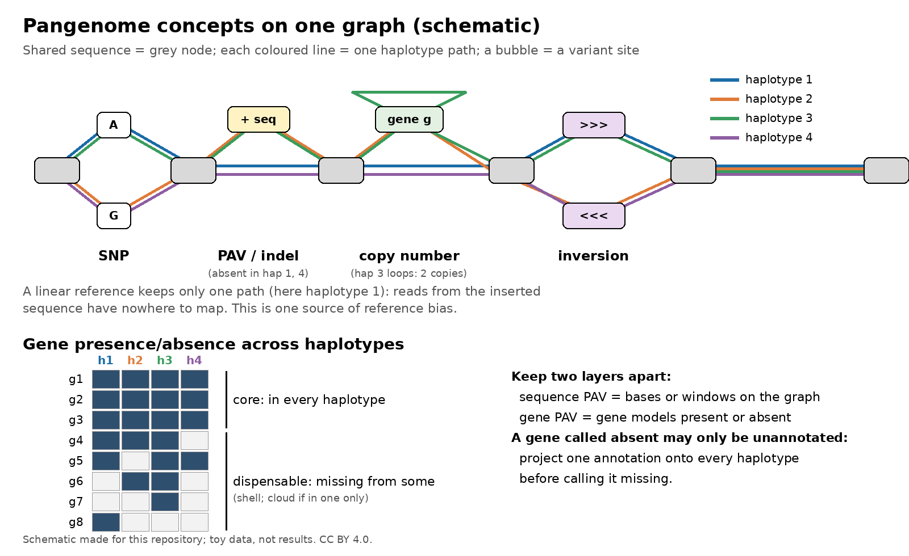
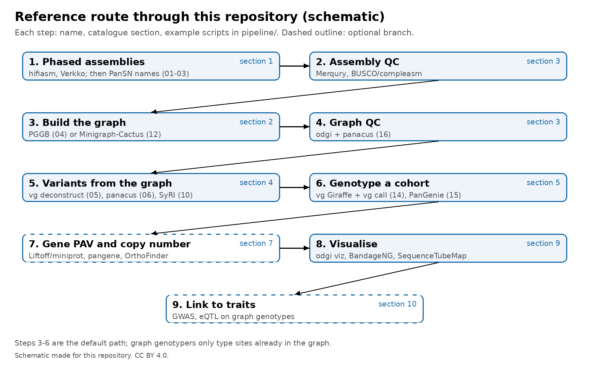

# Knowledge map

[中文](KNOWLEDGE_MAP.zh.md) · [Home page](../README.md)

This page is the entry to the repository as a knowledge base on plant pangenomes. It explains the main ideas, lists the tools for each analysis step and gives one reference route. Grapevine (*Vitis*) is the worked example. Each entry points to the matching section of the methods catalogue on the [home page](../README.md), where every tool has its own line, paper and link.

Every statement on this page that cites a paper was checked against that paper (title and abstract, or the full text for the two reproduced figures). The papers are listed under [Sources used on this page](#sources-used-on-this-page). Statements without a paper come from the catalogue pages of this repository and link to them.

## Contents

- [Guide figures](#guide-figures)
- [Concepts](#concepts)
- [Tools by analysis step](#tools-by-analysis-step)
- [Reference workflow](#reference-workflow)
- [Grapevine as the worked example](#grapevine-as-the-worked-example)
- [Where else to look](#where-else-to-look)
- [Sources used on this page](#sources-used-on-this-page)

## Guide figures

| # | Figure | What it shows | Source and licence |
|---|---|---|---|
| 1 | [Structural variant types](figures/guide/01_sv_types_dellacoletta2021_fig1.png) | Presence/absence variation, copy-number variation and chromosomal rearrangements drawn against a reference | Della Coletta et al. 2021, Genome Biology, Fig. 1 ([doi:10.1186/s13059-020-02224-8](https://doi.org/10.1186/s13059-020-02224-8)), CC BY 4.0, reproduced unchanged |
| 2 | [Linear reference versus graph pangenome](figures/guide/02_linear_vs_graph_dellacoletta2021_fig3.png) | Reads mapped to one linear reference or to a graph, and what that changes for association mapping | Della Coletta et al. 2021, Genome Biology, Fig. 3 ([doi:10.1186/s13059-020-02224-8](https://doi.org/10.1186/s13059-020-02224-8)), CC BY 4.0, reproduced unchanged |
| 3 | [Concepts on one graph](figures/guide/03_concepts_on_one_graph.png) | Haplotype paths, bubbles for SNP, PAV, copy number and inversion, and a core/dispensable gene table | Schematic made for this repository (toy data), CC BY 4.0 |
| 4 | [Reference route](figures/guide/04_reference_route.png) | The steps of the [reference workflow](#reference-workflow) with catalogue sections and example scripts | Schematic made for this repository, CC BY 4.0 |

Captions and the script that draws figures 3 and 4 are in [`figures/guide/`](figures/guide/README.md).

## Concepts

### Pangenome, core and dispensable genes

- A pangenome is the full set of sequence and genes found across many genomes of one species or genus, not just one reference. The term comes from bacteria: for *Streptococcus agalactiae*, the pan-genome was described as a core genome shared by all isolates plus a dispensable genome of partially shared and strain-specific genes (Tettelin et al. 2005).
- In cultivated grapevine, a comparison of 15 varieties found 55,662 orthologous genes, of which 55.3% appear dispensable; the same paper reports that about 12.6% of genes it classed as core were classed as dispensable in another study (Pierre et al. 2026). Core and dispensable counts therefore depend on the gene models and the clustering method.
- In this repository: gene-level presence and family copy number are in [catalogue section 7](../README.md#section-7). An existing figure from Pierre et al. 2026 shows core, soft-core, shell and cloud genes across 15 varieties: [`07_get_homologues_est_grape_w1600.jpg`](figures/catalog/07_get_homologues_est_grape_w1600.jpg).

### Pangenome graphs

- A pangenome graph stores many genomes in one structure. Shared sequence becomes shared nodes, differences form branches (bubbles), and each genome or haplotype is a path through the graph. Graph models support read alignment, variant calling, genotyping, visualisation and association studies (Eizenga et al. 2020).
- A linear reference represents only one version of each locus, which affects read mapping and introduces bias. Variation graphs are bidirected sequence graphs that also hold large structural variants such as inversions and duplications; vg maps reads to them (Garrison et al. 2018).
- A graph can keep the coordinates of the linear reference: minigraph was designed as a graph data model that represents multiple genomes while preserving the linear reference coordinate (Li et al. 2020).
- Graphs are usually exchanged as GFA files; ODGI is a toolkit for variation graphs in GFA that detects complex regions, extracts loci, removes artefacts, validates and visualises graphs (Guarracino et al. 2022).
- Builders differ in what they start from. PGGB builds the graph from all-to-all alignments, without a single reference and without excluding complex sequence (Garrison et al. 2024). Minigraph-Cactus builds it from whole-genome alignments of assemblies and keeps the graph usable by current mapping and genotyping tools (Hickey et al. 2023).
- In this repository: graph builders are in [section 2](../README.md#section-2), and graph formats and toolkits in [section 8](../README.md#section-8).

### Presence/absence variation (PAV)

- PAV is sequence that is present in some genomes and missing from others (figure 1, left panel). It is one class of structural variant (Della Coletta et al. 2021).
- Keep two layers apart. **Sequence PAV** counts bases, nodes or windows on the graph; panacus computes the core genome and pangenome growth from a GFA graph (Parmigiani et al. 2024). **Gene PAV** asks whether gene models are present; pangene builds a gene graph from protein alignments and reports gene order, orientation and copy-number changes (Li et al. 2024).
- In this repository: sequence PAV is [section 4a](../README.md#a-sequence-and-window-pav-growth-curves); gene PAV is [section 7](../README.md#section-7). The catalogue repeats that panacus growth curves are sequence-level, not gene PAV.

### Structural variants (SV)

- Structural variants include presence/absence variation, copy-number variation and chromosomal rearrangements such as inversions and translocations (figure 1; Della Coletta et al. 2021).
- Rearrangements matter beyond detection: SyRI separates syntenic from rearranged regions because rearranged regions are inherited differently (Goel et al. 2019).
- How calls are merged changes the result: Truvari showed that over-merging of SVs by other approaches can inflate allele frequency by up to 2.2-fold (English et al. 2022).
- In this repository: SV and TE insertion callers are in [section 4b](../README.md#b-structural-variants-and-te-insertions); synteny and alignment in [section 6](../README.md#section-6).

### Dosage and copy-number variation (CNV)

- Copy-number variation is a segment or gene present in different numbers of copies between genomes (figure 1, middle panel; Della Coletta et al. 2021). Dosage is the number of copies of an allele that one individual carries.
- Grapevine is a strong case: in the highly heterozygous Chardonnay genome, one in seven genes is hemizygous based on SVs, and SVs accrue as recessive heterozygotes in clonally propagated lineages (Zhou et al. 2019). A diploid presence/absence code can therefore mean one copy, not two.
- Two routes: from assemblies, pangene reports gene copy-number changes as gene-graph paths (Li et al. 2024); from short reads, read-depth callers such as CNVnator discover and genotype CNVs, but CNVnator misses CNVs created by retrotransposable elements (Abyzov et al. 2011).
- In this repository: read-depth CNV and family copy number are in [section 7](../README.md#section-7). The [Notes](../README.md#notes) on the home page state that there is no separate dosage method here yet; Varigraph in [section 5](../README.md#section-5) is listed as a genotyper that can estimate allele dosage in polyploids.

### Reference bias

- Mapping reads to a single reference genome introduces reference bias, and short reads make repetitive regions hard to type (Ebler et al. 2022). Reads from sequence that the reference lacks have nowhere to map (figure 2A; figure 3).
- Graph mappers such as Giraffe were built to map reads in polymorphic regions with SNPs and structural variants (Sirén et al. 2021). Because graph genotypers type only sites already in the graph ([section 5](../README.md#section-5)), it follows that a graph can remove this bias only for variation that its haplotypes contain.
- In this repository: mapping and genotyping are in [section 5](../README.md#section-5).

### Graph reference versus linear reference

- A linear reference gives one simple coordinate system; a graph relates several sequences and coordinate systems at once. Whether graphs will replace linear references is still open (Eizenga et al. 2020).
- Practical gains are reported for association studies. With the Grapepan v1.0 graph, adding SVs to GWAS raised estimated heritability by 22.78% on average, and 12 of 29 traits had significant SV contributions (Liu et al. 2024). In cultivated grapevine, GWAS for three traits on a pangenome graph found 32 loci that were not detected with the PN40024 genome as the reference, 20 of them newly reported (Pierre et al. 2026). Figure 2 shows the idea.
- Graph genotypers (vg Giraffe with vg call, and PanGenie) type sites already in the graph; they do not add new alleles. Linear callers remain the baseline for SNPs that are not in the graph. Both points are stated in [section 5](../README.md#section-5).
- Different graph builders give different graphs. A framework that compared Minigraph, PGGB and Minigraph-Cactus on sorghum used completeness, duplication and SV-fidelity metrics (Kopalli et al. 2025).

## Tools by analysis step

Main tools only; every step lists more alternatives, with notes on when to pick which, in the linked catalogue section.

| Step | Question | Main tools (catalogue entries) | Catalogue |
|---|---|---|---|
| 1. Assembly | Do I have two phased haplotypes per accession? | hifiasm, which keeps all haplotypes in a phased assembly graph (Cheng et al. 2021); Verkko; Hi-C scaffolding with YaHS or HapHiC | [section 1](../README.md#section-1) |
| 1b. Assembly QC | Is each haplotype accurate and complete? | Merqury (k-mer accuracy, completeness and phasing; Rhie et al. 2020), BUSCO or compleasm | [section 3](../README.md#section-3) |
| 2. Pangenome graph construction | Which graph: discovery or mapping? | PGGB for an all-to-all graph (Garrison et al. 2024); Minigraph-Cactus, which builds the graph from whole-genome alignments and keeps it usable by current mapping and genotyping tools (Hickey et al. 2023; the catalogue uses it as the Giraffe-ready graph); minigraph for an SV backbone (Li et al. 2020); nf-core/pangenome runs PGGB on clusters (Heumos et al. 2024) | [section 2](../README.md#section-2), [section 13](../README.md#section-13), [dual graph](DUAL_GRAPH.md) |
| 2b. Graph QC | Is the graph sound before calling? | odgi stats and validate (Guarracino et al. 2022), panacus (Parmigiani et al. 2024), graph evaluation metrics (Kopalli et al. 2025) | [section 3](../README.md#section-3) |
| 3. SV calling | Which SVs and TE insertions are there? | vg deconstruct (Garrison et al. 2018), then vcfbub and vcfwave; SyRI between assemblies (Goel et al. 2019); Sniffles2 for long reads (Smolka et al. 2024); Truvari to compare and merge (English et al. 2022); GraffiTE for TE insertions | [section 4b](../README.md#b-structural-variants-and-te-insertions) |
| 4. PAV calling | Which sequence and which genes are present or absent? | panacus and odgi pav for sequence; Liftoff or miniprot projection, then pangene (Li et al. 2024) or OrthoFinder for genes; CNVnator or cn.MOPS for read-depth copy number (Abyzov et al. 2011) | [section 4a](../README.md#a-sequence-and-window-pav-growth-curves), [section 7](../README.md#section-7) |
| 5. Genotyping on graphs | What does each cohort sample carry at known sites? | vg Giraffe with vg call (Sirén et al. 2021); PanGenie (Ebler et al. 2022); KING or NgsRelate v2 for identity checks | [section 5](../README.md#section-5) |
| 6. Visualisation | How do I show a locus or a whole chromosome? | odgi viz for chromosome overviews; BandageNG for single loci; SequenceTubeMap for vg graphs (Beyer et al. 2019) | [section 9](../README.md#section-9) |
| 7. Traits | Do graph variants explain traits or expression? | GWAS and eQTL tools on graph genotypes | [section 10](../README.md#section-10) |

The data each scenario needs (minimum and recommended inputs) are in [Data needed alongside the pangenome](../README.md#data-needs).

## Reference workflow

One route in nine steps (figure 4), matching the example scripts in [`pipeline/`](../pipeline/00_overview.md). The scripts are short reference code that shows each step; they are not a maintained package.

1. **Phased assemblies** ([section 1](../README.md#section-1)). Grapevine cultivars are highly heterozygous clones, so the catalogue treats two phased haplotypes per accession as the natural graph input. Rename sequences to PanSN names and check divergence (scripts `01`–`03`).
2. **Assembly QC** ([section 3](../README.md#section-3)). Check accuracy, completeness and telomeres for every haplotype before it enters the graph.
3. **Build the graph** ([section 2](../README.md#section-2)). Per chromosome: PGGB for discovery (script `04`, starting from `-p 85 -s 10k`, the setting of the North American *Vitis* pangenome; Cochetel et al. 2023) or Minigraph-Cactus when the cohort will be mapped with Giraffe (script `12`); minigraph for a light backbone (script `13`). Keeping both graphs is described in [`DUAL_GRAPH.md`](DUAL_GRAPH.md).
4. **Graph QC** ([section 3](../README.md#section-3)). odgi and panacus before any calling (script `16`).
5. **Variants from the graph** ([section 4](../README.md#section-4)). vg deconstruct and VCF post-processing (scripts `05`, `07`, `09`), sequence PAV and growth (script `06`), and an assembly-based SV check with SyRI (script `10`).
6. **Genotype a cohort** ([section 5](../README.md#section-5)). vg Giraffe with vg call (script `14`) or PanGenie (script `15`). Check sample identity first and keep one sample per clone.
7. **Optional: gene PAV and copy number** ([section 7](../README.md#section-7)), using gene models from [gene-structure-annotation](https://github.com/Xuzhen-Li/gene-structure-annotation).
8. **Visualise** ([section 9](../README.md#section-9)).
9. **Optional: link to traits** ([section 10](../README.md#section-10)).

A chart with the tool choices and decision points at each step is in [`CATALOG.md`](CATALOG.md#workflow-2026-11-14).

## Grapevine as the worked example

- **Grapepan v1.0**: a graph from 18 phased telomere-to-telomere assemblies and 11 published assemblies, with 236,449 SVs from resequencing of 466 cultivars and 148 QTL for 29 traits (Liu et al. 2024).
- ***Vitis* super-pangenome**: haplotype-resolved genomes of 72 accessions (25 wild, 47 cultivated); European cultivars carry a smaller repertoire of TIR-NBARC-LRR resistance genes, and SV-eQTL analysis linked over 63 SVs to downy mildew resistance (Guo et al. 2025).
- **Structural variants in domestication**: SVs are under strong purifying selection, especially inversions and translocations, and define outlier regions between wild and cultivated grapevine, including the sex-determination region and the berry colour locus (Zhou et al. 2019).
- **North American wild grapes**: nine wild species assembled, phased and joined in a reference-unbiased super-pangenome built from pairwise whole-genome alignments (Cochetel et al. 2023).
- **Cultivated grapevine (15 varieties)**: high collinearity, extensive dispensable gene content and graph-based GWAS (Pierre et al. 2026).
- More grape graphs, reference assemblies and public panels are in [section 12](../README.md#section-12); questions not yet tried on *Vitis* are in [section 14](../README.md#section-14).

## Where else to look

- Full methods catalogue: [home page](../README.md#contents) ([中文](../README.zh.md#目录)) and the detailed files listed under [Detailed catalog files](../README.md#detailed-catalog-files).
- Figures reproduced from papers, with credits: [Figure credits](../README.md#figure-credits).
- Related repositories: TE libraries in [TE-Lib](https://github.com/Xuzhen-Li/TE-Lib); gene models in [gene-structure-annotation](https://github.com/Xuzhen-Li/gene-structure-annotation); gene names, GO and KEGG in [gene-function-annotation](https://github.com/Xuzhen-Li/gene-function-annotation).
- Licences: [`LICENSE`](../LICENSE) and [`NOTICE.md`](../NOTICE.md).

## Sources used on this page

| Short name | Paper | DOI |
|---|---|---|
| Abyzov et al. 2011 | CNVnator: an approach to discover, genotype, and characterize typical and atypical CNVs from family and population genome sequencing. Genome Research | [10.1101/gr.114876.110](https://doi.org/10.1101/gr.114876.110) |
| Beyer et al. 2019 | Sequence tube maps: making graph genomes intuitive to commuters. Bioinformatics | [10.1093/bioinformatics/btz597](https://doi.org/10.1093/bioinformatics/btz597) |
| Cheng et al. 2021 | Haplotype-resolved de novo assembly using phased assembly graphs with hifiasm. Nature Methods | [10.1038/s41592-020-01056-5](https://doi.org/10.1038/s41592-020-01056-5) |
| Cochetel et al. 2023 | A super-pangenome of the North American wild grape species. Genome Biology | [10.1186/s13059-023-03133-2](https://doi.org/10.1186/s13059-023-03133-2) |
| Della Coletta et al. 2021 | How the pan-genome is changing crop genomics and improvement. Genome Biology | [10.1186/s13059-020-02224-8](https://doi.org/10.1186/s13059-020-02224-8) |
| Ebler et al. 2022 | Pangenome-based genome inference allows efficient and accurate genotyping across a wide spectrum of variant classes. Nature Genetics | [10.1038/s41588-022-01043-w](https://doi.org/10.1038/s41588-022-01043-w) |
| Eizenga et al. 2020 | Pangenome graphs. Annual Review of Genomics and Human Genetics | [10.1146/annurev-genom-120219-080406](https://doi.org/10.1146/annurev-genom-120219-080406) |
| English et al. 2022 | Truvari: refined structural variant comparison preserves allelic diversity. Genome Biology | [10.1186/s13059-022-02840-6](https://doi.org/10.1186/s13059-022-02840-6) |
| Garrison et al. 2018 | Variation graph toolkit improves read mapping by representing genetic variation in the reference. Nature Biotechnology | [10.1038/nbt.4227](https://doi.org/10.1038/nbt.4227) |
| Garrison et al. 2024 | Building pangenome graphs. Nature Methods | [10.1038/s41592-024-02430-3](https://doi.org/10.1038/s41592-024-02430-3) |
| Goel et al. 2019 | SyRI: finding genomic rearrangements and local sequence differences from whole-genome assemblies. Genome Biology | [10.1186/s13059-019-1911-0](https://doi.org/10.1186/s13059-019-1911-0) |
| Guarracino et al. 2022 | ODGI: understanding pangenome graphs. Bioinformatics | [10.1093/bioinformatics/btac308](https://doi.org/10.1093/bioinformatics/btac308) |
| Guo et al. 2025 | Super pangenome of *Vitis* empowers identification of downy mildew resistance genes for grapevine improvement. Nature Genetics | [10.1038/s41588-025-02111-7](https://doi.org/10.1038/s41588-025-02111-7) |
| Heumos et al. 2024 | Cluster-efficient pangenome graph construction with nf-core/pangenome. Bioinformatics | [10.1093/bioinformatics/btae609](https://doi.org/10.1093/bioinformatics/btae609) |
| Hickey et al. 2023 | Pangenome graph construction from genome alignments with Minigraph-Cactus. Nature Biotechnology | [10.1038/s41587-023-01793-w](https://doi.org/10.1038/s41587-023-01793-w) |
| Kopalli et al. 2025 | Toward a standardized framework for pangenome graph evaluation: assessing crop plant pangenome variation graph construction from multiple assemblies. GigaScience | [10.1093/gigascience/giaf121](https://doi.org/10.1093/gigascience/giaf121) |
| Li et al. 2020 | The design and construction of reference pangenome graphs with minigraph. Genome Biology | [10.1186/s13059-020-02168-z](https://doi.org/10.1186/s13059-020-02168-z) |
| Li et al. 2024 | Exploring gene content with pangene graphs. Bioinformatics | [10.1093/bioinformatics/btae456](https://doi.org/10.1093/bioinformatics/btae456) |
| Liu et al. 2024 | Grapevine pangenome facilitates trait genetics and genomic breeding. Nature Genetics | [10.1038/s41588-024-01967-5](https://doi.org/10.1038/s41588-024-01967-5) |
| Parmigiani et al. 2024 | Panacus: fast and exact pangenome growth and core size estimation. Bioinformatics | [10.1093/bioinformatics/btae720](https://doi.org/10.1093/bioinformatics/btae720) |
| Pierre et al. 2026 | Pangenomic analyses in the cultivated grapevine confirm high genomic collinearity and extensive dispensable gene content likely involved in adaptation. G3: Genes, Genomes, Genetics | [10.1093/g3journal/jkag168](https://doi.org/10.1093/g3journal/jkag168) |
| Rhie et al. 2020 | Merqury: reference-free quality, completeness, and phasing assessment for genome assemblies. Genome Biology | [10.1186/s13059-020-02134-9](https://doi.org/10.1186/s13059-020-02134-9) |
| Sirén et al. 2021 | Pangenomics enables genotyping of known structural variants in 5202 diverse genomes. Science | [10.1126/science.abg8871](https://doi.org/10.1126/science.abg8871) |
| Smolka et al. 2024 | Detection of mosaic and population-level structural variants with Sniffles2. Nature Biotechnology | [10.1038/s41587-023-02024-y](https://doi.org/10.1038/s41587-023-02024-y) |
| Tettelin et al. 2005 | Genome analysis of multiple pathogenic isolates of *Streptococcus agalactiae*: implications for the microbial "pan-genome". PNAS | [10.1073/pnas.0506758102](https://doi.org/10.1073/pnas.0506758102) |
| Zhou et al. 2019 | The population genetics of structural variants in grapevine domestication. Nature Plants | [10.1038/s41477-019-0507-8](https://doi.org/10.1038/s41477-019-0507-8) |
