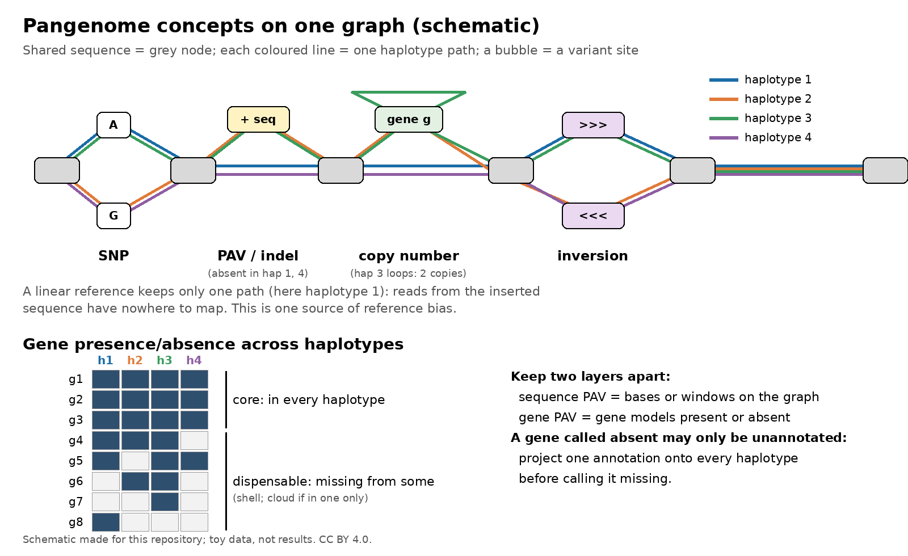
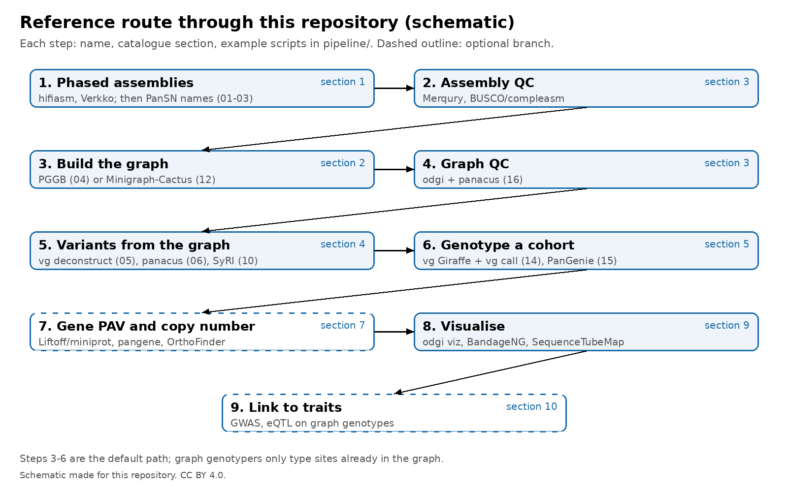

# 知识地图

[English](KNOWLEDGE_MAP.md) · [首页](../README.zh.md)

本页是把本仓库当作植物泛基因组知识库来用的入口：讲清主要概念，按分析步骤列出软件，并给出一条参考流程。全程以葡萄（*Vitis*）为示例。每一条都指向[首页](../README.zh.md)方法目录里对应的一节，那里每个工具都有自己的一行、论文和链接。

本页凡引用论文的说法，都对照过该论文（题目和摘要；两张转载图对照了全文）。论文列在[本页引用的文献](#本页引用的文献)。没有论文的说法来自本仓库的目录页，并附了链接。

## 目录

- [引导图](#引导图)
- [概念](#概念)
- [按分析步骤列出的软件](#按分析步骤列出的软件)
- [参考流程](#参考流程)
- [葡萄示例](#葡萄示例)
- [其他入口](#其他入口)
- [本页引用的文献](#本页引用的文献)

## 引导图

| # | 图 | 内容 | 来源与许可 |
|---|---|---|---|
| 1 | [结构变异类型](figures/guide/01_sv_types_dellacoletta2021_fig1.png) | 相对参考基因组画出的存在/缺失变异、拷贝数变异和染色体重排 | Della Coletta 等 2021，Genome Biology，图 1（[doi:10.1186/s13059-020-02224-8](https://doi.org/10.1186/s13059-020-02224-8)），CC BY 4.0，原图未改动 |
| 2 | [线性参考与图谱泛基因组](figures/guide/02_linear_vs_graph_dellacoletta2021_fig3.png) | reads 比对到单一线性参考或图谱上，以及这对关联分析的影响 | Della Coletta 等 2021，Genome Biology，图 3（[doi:10.1186/s13059-020-02224-8](https://doi.org/10.1186/s13059-020-02224-8)），CC BY 4.0，原图未改动 |
| 3 | [一张图里的几个概念](figures/guide/03_concepts_on_one_graph.png) | 单倍型路径；SNP、PAV、拷贝数和倒位形成的“泡”；核心/可变基因表 | 本仓库绘制的示意图（虚构数据），CC BY 4.0 |
| 4 | [参考流程](figures/guide/04_reference_route.png) | [参考流程](#参考流程)的各步，以及对应的目录章节和示例脚本 | 本仓库绘制的示意图，CC BY 4.0 |

图注和绘制图 3、图 4 的脚本见 [`figures/guide/`](figures/guide/README.zh.md)。图中文字为英文。

## 概念

### 泛基因组、核心基因与可变基因

- 泛基因组是一个物种或属的许多基因组里出现过的全部序列和基因，而不只是一个参考基因组。这个词来自细菌：*Streptococcus agalactiae* 的泛基因组被描述为所有分离株共有的核心基因组，加上部分共有和菌株特有基因组成的可变基因组（Tettelin 等 2005）。
- 栽培葡萄 15 个品种的比较共找到 55,662 个直系同源基因，其中 55.3% 看来是可变的；同一篇文章还指出，它归为核心的基因中约 12.6% 在另一项研究里被归为可变（Pierre 等 2026）。所以核心/可变的数目取决于基因模型和聚类方法。
- 本仓库：基因层面的有无和家族拷贝数见[目录第 7 节](../README.zh.md#section-7)。仓库里已有一张来自 Pierre 等 2026 的图，展示 15 个品种的核心、软核心、外壳和云基因：[`07_get_homologues_est_grape_w1600.jpg`](figures/catalog/07_get_homologues_est_grape_w1600.jpg)。

### 泛基因组图谱

- 泛基因组图谱把许多基因组存进一个结构：共有序列成为共用节点，差异形成分支（“泡”），每个基因组或单倍型是穿过图谱的一条路径。图模型可用于 reads 比对、变异检测、基因分型、可视化和关联分析（Eizenga 等 2020）。
- 线性参考每个位点只代表一个版本，这会影响 reads 比对并带来偏差。变异图是双向序列图，也能容纳倒位、重复等大的结构变异；vg 可以把 reads 比对到这种图上（Garrison 等 2018）。
- 图谱可以保留线性参考的坐标：minigraph 的数据模型在表示多个基因组的同时保留线性参考坐标（Li 等 2020）。
- 图谱通常以 GFA 文件交换；ODGI 是处理 GFA 变异图的工具集，可以找复杂区域、提取位点、去除假象、校验和可视化（Guarracino 等 2022）。
- 构图工具的出发点不同。PGGB 用全对全比对构图，不依赖单一参考，也不排除复杂序列（Garrison 等 2024）。Minigraph-Cactus 用组装之间的全基因组比对构图，构好的图可直接用于现有的比对和分型工具（Hickey 等 2023）。
- 本仓库：构图工具见[第 2 节](../README.zh.md#section-2)，图谱格式和工具集见[第 8 节](../README.zh.md#section-8)。

### 存在/缺失变异（PAV）

- PAV 指在一些基因组里有、在另一些里缺的序列（图 1 左栏），是结构变异的一类（Della Coletta 等 2021）。
- 要把两层分开。**序列 PAV** 统计图谱上的碱基、节点或窗口；panacus 从 GFA 图谱计算核心基因组和泛基因组增长曲线（Parmigiani 等 2024）。**基因 PAV** 问的是基因模型在不在；pangene 用蛋白比对构建基因图，报告基因顺序、方向和拷贝数的变化（Li 等 2024）。
- 本仓库：序列 PAV 见[第 4 节 (a)](../README.zh.md#section-4)，基因 PAV 见[第 7 节](../README.zh.md#section-7)。目录里也写明 panacus 的增长曲线是序列层面的，不是基因 PAV。

### 结构变异（SV）

- 结构变异包括存在/缺失变异、拷贝数变异，以及倒位、易位等染色体重排（图 1；Della Coletta 等 2021）。
- 重排不只是检测问题：SyRI 把共线区和重排区分开，因为重排区的遗传方式不同（Goel 等 2019）。
- 合并方式会改变结果：Truvari 发现其他方法过度合并 SV，可使等位基因频率最多虚高 2.2 倍（English 等 2022）。
- 本仓库：SV 和 TE 插入检测见[第 4 节 (b)](../README.zh.md#section-4)，共线性与比对见[第 6 节](../README.zh.md#section-6)。

### 剂量与拷贝数变异（CNV）

- 拷贝数变异指一段序列或一个基因在不同基因组里的拷贝数不同（图 1 中栏；Della Coletta 等 2021）。剂量指一个个体携带某个等位基因的拷贝数。
- 葡萄是典型例子：高度杂合的霞多丽基因组中，按 SV 判断每七个基因就有一个是半合子；在无性繁殖的谱系里，SV 以隐性杂合状态积累（Zhou 等 2019）。因此二倍体的“有/无”编码可能只代表一个拷贝，而不是两个。
- 两条途径：从组装出发，pangene 把基因拷贝数变化表示为基因图上的路径（Li 等 2024）；从短读长出发，CNVnator 等读深方法发现并分型 CNV，但 CNVnator 会漏掉由反转录转座元件产生的 CNV（Abyzov 等 2011）。
- 本仓库：读深 CNV 和家族拷贝数见[第 7 节](../README.zh.md#section-7)。首页的[说明](../README.zh.md#说明)一节写明这里还没有单独的剂量方法；[第 5 节](../README.zh.md#section-5)的 Varigraph 作为可估计多倍体等位基因剂量的分型工具列出。

### 参考偏差

- 把 reads 比对到单一参考基因组会带来参考偏差，而短读长也让重复区难以分型（Ebler 等 2022）。来自参考里没有的序列的 reads 无处可比（图 2A；图 3）。
- Giraffe 等图谱比对工具就是为在含 SNP 和结构变异的多态区域比对 reads 而设计的（Sirén 等 2021）。由于图谱分型工具只对图谱里已有的位点分型（[第 5 节](../README.zh.md#section-5)），可以推知：图谱只能消除它所含单倍型覆盖到的那部分偏差。
- 本仓库：比对与分型见[第 5 节](../README.zh.md#section-5)。

### 图谱参考与线性参考

- 线性参考提供一套简单的坐标；图谱能同时关联多条序列和多套坐标。图谱是否会取代线性参考仍无定论（Eizenga 等 2020）。
- 关联分析上已有实际收益的报道。用 Grapepan v1.0 图谱时，把 SV 加入 GWAS 使估计的遗传力平均提高 22.78%，29 个性状中有 12 个有显著的 SV 贡献（Liu 等 2024）。在栽培葡萄中，基于泛基因组图谱对三个性状做 GWAS，找到 32 个以 PN40024 为参考时检测不到的位点，其中 20 个是新报道的关联（Pierre 等 2026）。图 2 展示了这个思路。
- 图谱分型工具（vg Giraffe 加 vg call，以及 PanGenie）只对图谱里已有的位点分型，不会添加新的等位基因；图谱里没有的 SNP 仍以线性检测为基线。这两点都写在[第 5 节](../README.zh.md#section-5)。
- 不同构图工具得到的图谱不同。一个评估框架在高粱上比较了 Minigraph、PGGB 和 Minigraph-Cactus，指标包括完整性、重复程度和 SV 保真度（Kopalli 等 2025）。

## 按分析步骤列出的软件

只列主要工具；每一步更多的可替代工具和选用说明见链接的目录章节。

| 步骤 | 要回答的问题 | 主要工具（目录条目） | 目录 |
|---|---|---|---|
| 1. 组装 | 每个材料有没有两套分相单倍型？ | hifiasm，在分相组装图中保留所有单倍型（Cheng 等 2021）；Verkko；Hi-C 挂载用 YaHS 或 HapHiC | [第 1 节](../README.zh.md#section-1) |
| 1b. 组装质控 | 每套单倍型准确、完整吗？ | Merqury（k-mer 准确度、完整度和分相；Rhie 等 2020），BUSCO 或 compleasm | [第 3 节](../README.zh.md#section-3) |
| 2. 构建泛基因组图谱 | 要发现变异的图，还是用于比对的图？ | PGGB 构建全对全图谱（Garrison 等 2024）；Minigraph-Cactus 用全基因组比对构图，构好的图可用于现有的比对和分型工具（Hickey 等 2023；目录把它作为可直接用 Giraffe 的图谱）；minigraph 构建 SV 骨架（Li 等 2020）；nf-core/pangenome 在集群上运行 PGGB（Heumos 等 2024） | [第 2 节](../README.zh.md#section-2)、[第 13 节](../README.zh.md#section-13)、[双图谱](DUAL_GRAPH.md) |
| 2b. 图谱质控 | 检测前图谱可靠吗？ | odgi stats 与 validate（Guarracino 等 2022），panacus（Parmigiani 等 2024），图谱评估指标（Kopalli 等 2025） | [第 3 节](../README.zh.md#section-3) |
| 3. SV 检测 | 有哪些 SV 和 TE 插入？ | vg deconstruct（Garrison 等 2018），再用 vcfbub 和 vcfwave；组装之间用 SyRI（Goel 等 2019）；长读长用 Sniffles2（Smolka 等 2024）；用 Truvari 比较与合并（English 等 2022）；TE 插入用 GraffiTE | [第 4 节 (b)](../README.zh.md#section-4) |
| 4. PAV 检测 | 哪些序列、哪些基因有或无？ | 序列层面用 panacus 和 odgi pav；基因层面先用 Liftoff 或 miniprot 投射，再用 pangene（Li 等 2024）或 OrthoFinder；读深拷贝数用 CNVnator 或 cn.MOPS（Abyzov 等 2011） | [第 4 节 (a)](../README.zh.md#section-4)、[第 7 节](../README.zh.md#section-7) |
| 5. 图谱上的基因分型 | 群体中每个样本在已知位点上携带什么？ | vg Giraffe 加 vg call（Sirén 等 2021）；PanGenie（Ebler 等 2022）；身份核对用 KING 或 NgsRelate v2 | [第 5 节](../README.zh.md#section-5) |
| 6. 可视化 | 怎样展示一个位点或一整条染色体？ | 整条染色体用 odgi viz；单个位点用 BandageNG；vg 图谱用 SequenceTubeMap（Beyer 等 2019） | [第 9 节](../README.zh.md#section-9) |
| 7. 性状 | 图谱变异能解释性状或表达吗？ | 基于图谱基因型的 GWAS 与 eQTL 工具 | [第 10 节](../README.zh.md#section-10) |

各情景需要的数据（最低和推荐输入）见[数据需求](../README.zh.md#data-needs)。

## 参考流程

下面这条流程共九步（图 4），与 [`pipeline/`](../pipeline/00_overview.md) 中的示例脚本对应。这些脚本是演示每一步的简短参考代码，不是持续维护的软件包。

1. **分相组装**（[第 1 节](../README.zh.md#section-1)）。葡萄栽培品种是高度杂合的无性系，目录因此把每个材料的两套分相单倍型作为构图的自然输入。把序列改成 PanSN 命名并检查分化程度（脚本 `01`–`03`）。
2. **组装质控**（[第 3 节](../README.zh.md#section-3)）。每套单倍型进入图谱前都检查准确度、完整度和端粒。
3. **构建图谱**（[第 2 节](../README.zh.md#section-2)）。按染色体构建：发现变异用 PGGB（脚本 `04`，起始参数 `-p 85 -s 10k`，沿用北美野生葡萄泛基因组的设置；Cochetel 等 2023）；群体要用 Giraffe 比对时用 Minigraph-Cactus（脚本 `12`）；轻量骨架用 minigraph（脚本 `13`）。两种图谱同时保留的做法见 [`DUAL_GRAPH.md`](DUAL_GRAPH.md)。
4. **图谱质控**（[第 3 节](../README.zh.md#section-3)）。任何检测之前先跑 odgi 和 panacus（脚本 `16`）。
5. **从图谱得到变异**（[第 4 节](../README.zh.md#section-4)）。vg deconstruct 和 VCF 后处理（脚本 `05`、`07`、`09`），序列 PAV 与增长曲线（脚本 `06`），以及用 SyRI 做基于组装的 SV 核对（脚本 `10`）。
6. **群体分型**（[第 5 节](../README.zh.md#section-5)）。vg Giraffe 加 vg call（脚本 `14`）或 PanGenie（脚本 `15`）。先核对样本身份，每个无性系只保留一个样本。
7. **可选：基因 PAV 与拷贝数**（[第 7 节](../README.zh.md#section-7)），基因模型来自 [gene-structure-annotation](https://github.com/Xuzhen-Li/gene-structure-annotation)。
8. **可视化**（[第 9 节](../README.zh.md#section-9)）。
9. **可选：关联到性状**（[第 10 节](../README.zh.md#section-10)）。

每一步的工具选择和判断节点见 [`CATALOG.md` 中的流程图](CATALOG.md#workflow-2026-11-14-zh)。

## 葡萄示例

- **Grapepan v1.0**：由 18 套新测的分相端粒到端粒组装和 11 套已发表组装构建的图谱；466 个品种的重测序得到 236,449 个 SV，为 29 个性状定位到 148 个 QTL（Liu 等 2024）。
- ***Vitis* 超级泛基因组**：72 个材料（25 个野生、47 个栽培）的单倍型解析基因组；欧洲品种的 TIR-NBARC-LRR 抗病基因库较小，SV-eQTL 分析把 63 个以上的 SV 与霜霉病抗性联系起来（Guo 等 2025）。
- **驯化中的结构变异**：SV 受到强烈的纯化选择，倒位和易位尤甚；它们界定了野生与栽培葡萄之间的分化离群区，包括性别决定区和果色位点（Zhou 等 2019）。
- **北美野生葡萄**：九个野生种完成组装和分相，并用两两全基因组比对构建了不偏向参考的超级泛基因组（Cochetel 等 2023）。
- **栽培葡萄（15 个品种）**：共线性高，可变基因多，并做了基于图谱的 GWAS（Pierre 等 2026）。
- 更多葡萄图谱、参考组装和公开群体数据见[第 12 节](../README.zh.md#section-12)；尚未在葡萄属上试过的问题见[第 14 节](../README.zh.md#section-14)。

## 其他入口

- 完整方法目录：[首页](../README.zh.md)（[English](../README.md#contents)），以及首页末尾[详细目录文件](../README.zh.md#详细目录文件)一节列出的文件。
- 转载自论文的图及其来源：[图片来源](../README.zh.md#figure-credits)。
- 相关仓库：TE 库见 [TE-Lib](https://github.com/Xuzhen-Li/TE-Lib)；基因模型见 [gene-structure-annotation](https://github.com/Xuzhen-Li/gene-structure-annotation)；基因名称、GO 和 KEGG 见 [gene-function-annotation](https://github.com/Xuzhen-Li/gene-function-annotation)。
- 许可：[`LICENSE`](../LICENSE) 和 [`NOTICE.zh.md`](../NOTICE.zh.md)。

## 本页引用的文献

| 简称 | 论文 | DOI |
|---|---|---|
| Abyzov 等 2011 | CNVnator: an approach to discover, genotype, and characterize typical and atypical CNVs from family and population genome sequencing. Genome Research | [10.1101/gr.114876.110](https://doi.org/10.1101/gr.114876.110) |
| Beyer 等 2019 | Sequence tube maps: making graph genomes intuitive to commuters. Bioinformatics | [10.1093/bioinformatics/btz597](https://doi.org/10.1093/bioinformatics/btz597) |
| Cheng 等 2021 | Haplotype-resolved de novo assembly using phased assembly graphs with hifiasm. Nature Methods | [10.1038/s41592-020-01056-5](https://doi.org/10.1038/s41592-020-01056-5) |
| Cochetel 等 2023 | A super-pangenome of the North American wild grape species. Genome Biology | [10.1186/s13059-023-03133-2](https://doi.org/10.1186/s13059-023-03133-2) |
| Della Coletta 等 2021 | How the pan-genome is changing crop genomics and improvement. Genome Biology | [10.1186/s13059-020-02224-8](https://doi.org/10.1186/s13059-020-02224-8) |
| Ebler 等 2022 | Pangenome-based genome inference allows efficient and accurate genotyping across a wide spectrum of variant classes. Nature Genetics | [10.1038/s41588-022-01043-w](https://doi.org/10.1038/s41588-022-01043-w) |
| Eizenga 等 2020 | Pangenome graphs. Annual Review of Genomics and Human Genetics | [10.1146/annurev-genom-120219-080406](https://doi.org/10.1146/annurev-genom-120219-080406) |
| English 等 2022 | Truvari: refined structural variant comparison preserves allelic diversity. Genome Biology | [10.1186/s13059-022-02840-6](https://doi.org/10.1186/s13059-022-02840-6) |
| Garrison 等 2018 | Variation graph toolkit improves read mapping by representing genetic variation in the reference. Nature Biotechnology | [10.1038/nbt.4227](https://doi.org/10.1038/nbt.4227) |
| Garrison 等 2024 | Building pangenome graphs. Nature Methods | [10.1038/s41592-024-02430-3](https://doi.org/10.1038/s41592-024-02430-3) |
| Goel 等 2019 | SyRI: finding genomic rearrangements and local sequence differences from whole-genome assemblies. Genome Biology | [10.1186/s13059-019-1911-0](https://doi.org/10.1186/s13059-019-1911-0) |
| Guarracino 等 2022 | ODGI: understanding pangenome graphs. Bioinformatics | [10.1093/bioinformatics/btac308](https://doi.org/10.1093/bioinformatics/btac308) |
| Guo 等 2025 | Super pangenome of *Vitis* empowers identification of downy mildew resistance genes for grapevine improvement. Nature Genetics | [10.1038/s41588-025-02111-7](https://doi.org/10.1038/s41588-025-02111-7) |
| Heumos 等 2024 | Cluster-efficient pangenome graph construction with nf-core/pangenome. Bioinformatics | [10.1093/bioinformatics/btae609](https://doi.org/10.1093/bioinformatics/btae609) |
| Hickey 等 2023 | Pangenome graph construction from genome alignments with Minigraph-Cactus. Nature Biotechnology | [10.1038/s41587-023-01793-w](https://doi.org/10.1038/s41587-023-01793-w) |
| Kopalli 等 2025 | Toward a standardized framework for pangenome graph evaluation: assessing crop plant pangenome variation graph construction from multiple assemblies. GigaScience | [10.1093/gigascience/giaf121](https://doi.org/10.1093/gigascience/giaf121) |
| Li 等 2020 | The design and construction of reference pangenome graphs with minigraph. Genome Biology | [10.1186/s13059-020-02168-z](https://doi.org/10.1186/s13059-020-02168-z) |
| Li 等 2024 | Exploring gene content with pangene graphs. Bioinformatics | [10.1093/bioinformatics/btae456](https://doi.org/10.1093/bioinformatics/btae456) |
| Liu 等 2024 | Grapevine pangenome facilitates trait genetics and genomic breeding. Nature Genetics | [10.1038/s41588-024-01967-5](https://doi.org/10.1038/s41588-024-01967-5) |
| Parmigiani 等 2024 | Panacus: fast and exact pangenome growth and core size estimation. Bioinformatics | [10.1093/bioinformatics/btae720](https://doi.org/10.1093/bioinformatics/btae720) |
| Pierre 等 2026 | Pangenomic analyses in the cultivated grapevine confirm high genomic collinearity and extensive dispensable gene content likely involved in adaptation. G3: Genes, Genomes, Genetics | [10.1093/g3journal/jkag168](https://doi.org/10.1093/g3journal/jkag168) |
| Rhie 等 2020 | Merqury: reference-free quality, completeness, and phasing assessment for genome assemblies. Genome Biology | [10.1186/s13059-020-02134-9](https://doi.org/10.1186/s13059-020-02134-9) |
| Sirén 等 2021 | Pangenomics enables genotyping of known structural variants in 5202 diverse genomes. Science | [10.1126/science.abg8871](https://doi.org/10.1126/science.abg8871) |
| Smolka 等 2024 | Detection of mosaic and population-level structural variants with Sniffles2. Nature Biotechnology | [10.1038/s41587-023-02024-y](https://doi.org/10.1038/s41587-023-02024-y) |
| Tettelin 等 2005 | Genome analysis of multiple pathogenic isolates of *Streptococcus agalactiae*: implications for the microbial "pan-genome". PNAS | [10.1073/pnas.0506758102](https://doi.org/10.1073/pnas.0506758102) |
| Zhou 等 2019 | The population genetics of structural variants in grapevine domestication. Nature Plants | [10.1038/s41477-019-0507-8](https://doi.org/10.1038/s41477-019-0507-8) |
