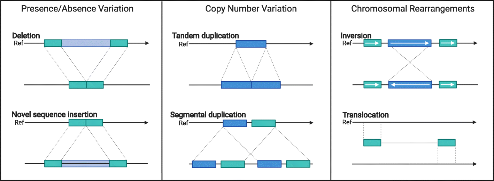
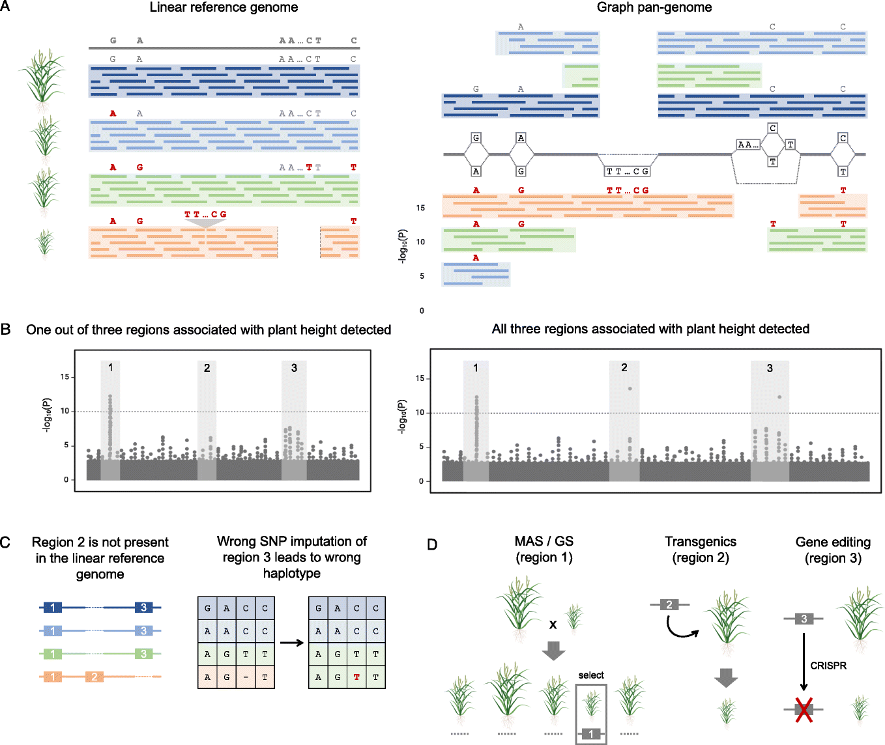
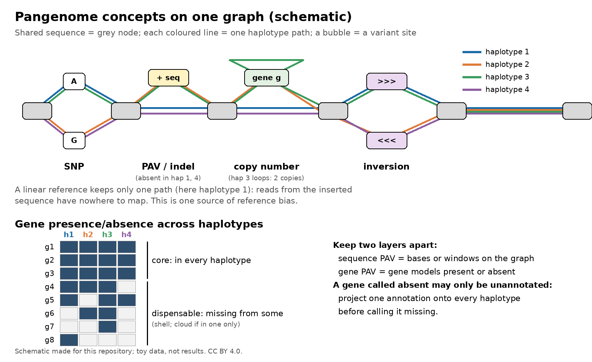
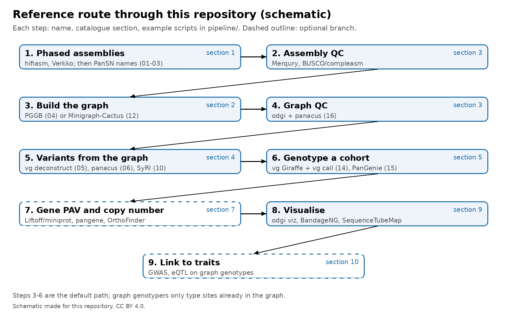

# Guide figures

[中文](README.zh.md) · [Knowledge map](../../KNOWLEDGE_MAP.md)

Four figures used by the [knowledge map](../../KNOWLEDGE_MAP.md) and the home page. Figures 1 and 2 are reproduced unchanged from a published open-access paper under its CC BY 4.0 licence; the licence was checked in three records that anyone can query: the article XML in PubMed Central (PMC7780660, licence element), the Crossref metadata for the DOI (licence URL) and the Europe PMC record (licence field). All three give CC BY 4.0. Figures 3 and 4 are schematics made for this repository by [`make_guide_figures.py`](make_guide_figures.py) and are licensed CC BY 4.0 (see [`NOTICE.md`](../../../NOTICE.md)).

## 1. Structural variant types



**Diagrams of structural variants that can be found in crop genomes.** Left: presence/absence variation (deletion, novel sequence insertion). Middle: copy-number variation (tandem duplication, segmental duplication). Right: chromosomal rearrangements (inversion, translocation). Each panel is drawn against a reference (Ref).

Source: Della Coletta R, Qiu Y, Ou S, Hufford MB, Hirsch CN. How the pan-genome is changing crop genomics and improvement. *Genome Biology* 22, 3 (2021), Fig. 1. [doi:10.1186/s13059-020-02224-8](https://doi.org/10.1186/s13059-020-02224-8). © The Author(s) 2021. Licence: [CC BY 4.0](https://creativecommons.org/licenses/by/4.0/). Reproduced without changes.

## 2. Linear reference versus graph pangenome



**Impact of pan-genome representation on dissection of quantitative variation and applications to crop improvement.** (A) Reads mapped to a single reference genome assembly (left) or to a pan-genome graph that captures structural variation in the species (right). (B) Effect of the mapping method and the variant calls that follow on detecting the regions behind a trait. (C) Why regions are missed with a single reference: a region absent from the reference, and wrong imputation leading to the wrong haplotype. (D) How breeders can use the new variants: marker-assisted or genomic selection, transgenes, or genome editing.

Source: Della Coletta R, Qiu Y, Ou S, Hufford MB, Hirsch CN. How the pan-genome is changing crop genomics and improvement. *Genome Biology* 22, 3 (2021), Fig. 3. [doi:10.1186/s13059-020-02224-8](https://doi.org/10.1186/s13059-020-02224-8). © The Author(s) 2021. Licence: [CC BY 4.0](https://creativecommons.org/licenses/by/4.0/). Reproduced without changes.

## 3. Concepts on one graph



Four haplotype paths through a small pangenome graph. Grey nodes are shared sequence; each bubble is a variant site: a SNP, a presence/absence insertion, a gene copied twice in one haplotype (copy number), and an inversion. Below, a gene presence/absence table separates core genes (in every haplotype) from dispensable genes (missing from some). Toy data drawn for this repository; not results. CC BY 4.0.

## 4. Reference route



The [reference workflow](../../KNOWLEDGE_MAP.md#reference-workflow) as nine steps, each with its catalogue section and the example scripts in [`pipeline/`](../../../pipeline/00_overview.md). Steps with a dashed outline are optional. Drawn for this repository. CC BY 4.0.

## Redrawing figures 3 and 4

The script uses only Python and Pillow with the DejaVu Sans fonts. The published PNGs were drawn with Pillow 12.3.0 (FreeType 2.14.3) and DejaVu Sans 2.37 from `/usr/share/fonts/truetype/dejavu/`. If the fonts are not at that path, the script asks FreeType to find them by file name and, failing that, falls back to the Pillow default font with a warning; the figure is then still drawn but will not be byte-identical.

```bash
python3 make_guide_figures.py OUTPUT_FOLDER
```

It writes `03_concepts_on_one_graph.png` and `04_reference_route.png` and stops if either file already exists. With the same Pillow version and fonts the output is byte-identical.
