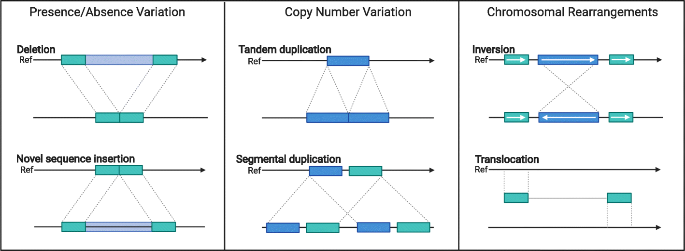
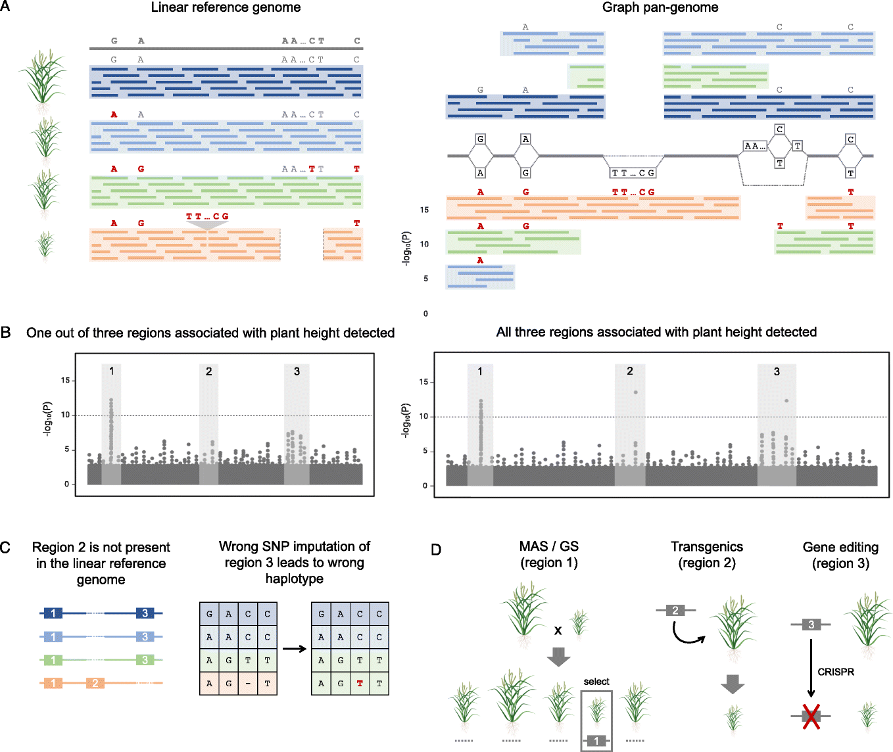
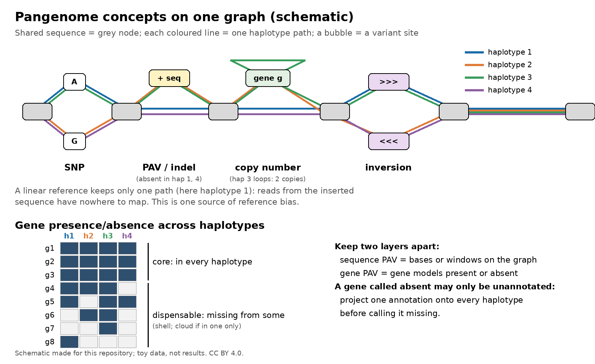
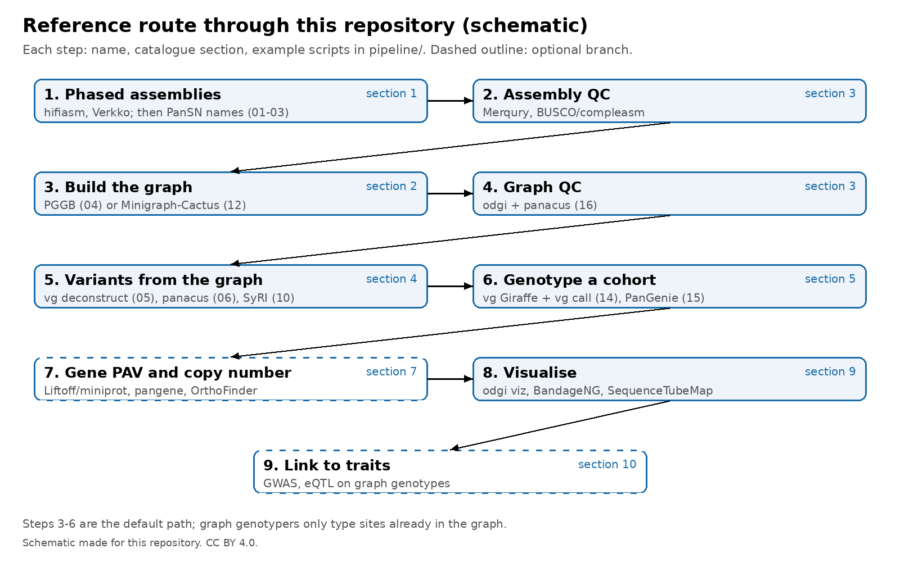

# 引导图

[English](README.md) · [知识地图](../../KNOWLEDGE_MAP.zh.md)

[知识地图](../../KNOWLEDGE_MAP.zh.md)和首页用到的四张图。图 1 和图 2 按 CC BY 4.0 许可原样转载自一篇已发表的开放获取论文；许可在三处任何人都能查询的记录里核对过：PubMed Central 的文章 XML（PMC7780660，license 元素）、该 DOI 的 Crossref 元数据（许可链接）和 Europe PMC 记录（license 字段），三处都是 CC BY 4.0。图 3 和图 4 是本仓库用 [`make_guide_figures.py`](make_guide_figures.py) 绘制的示意图，采用 CC BY 4.0 许可（见 [`NOTICE.zh.md`](../../../NOTICE.zh.md)）。图中文字为英文。

## 1. 结构变异类型



**作物基因组中可见的结构变异示意。** 左：存在/缺失变异（缺失、新序列插入）。中：拷贝数变异（串联重复、片段重复）。右：染色体重排（倒位、易位）。每栏都相对参考序列（Ref）画出。

来源：Della Coletta R, Qiu Y, Ou S, Hufford MB, Hirsch CN. How the pan-genome is changing crop genomics and improvement. *Genome Biology* 22, 3 (2021)，图 1。[doi:10.1186/s13059-020-02224-8](https://doi.org/10.1186/s13059-020-02224-8)。© The Author(s) 2021。许可：[CC BY 4.0](https://creativecommons.org/licenses/by/4.0/deed.zh-hans)。原图未改动。

## 2. 线性参考与图谱泛基因组



**泛基因组的表示方式对解析数量性状变异和作物改良的影响。** (A) reads 比对到单一参考组装（左）或比对到包含该物种结构变异的泛基因组图谱（右）。(B) 比对方式及随后的变异检测对找到性状相关区域的影响。(C) 用单一参考时漏掉区域的原因：参考里没有该区域，以及填充错误导致单倍型错误。(D) 育种上如何利用新变异：标记辅助选择或基因组选择、转基因或基因编辑。

来源：Della Coletta R, Qiu Y, Ou S, Hufford MB, Hirsch CN. How the pan-genome is changing crop genomics and improvement. *Genome Biology* 22, 3 (2021)，图 3。[doi:10.1186/s13059-020-02224-8](https://doi.org/10.1186/s13059-020-02224-8)。© The Author(s) 2021。许可：[CC BY 4.0](https://creativecommons.org/licenses/by/4.0/deed.zh-hans)。原图未改动。

## 3. 一张图里的几个概念



四条单倍型路径穿过一个小的泛基因组图谱。灰色节点是共有序列；每个“泡”是一个变异位点：SNP、一段存在/缺失的插入、在一条单倍型中复制了两次的基因（拷贝数），以及一个倒位。下方的基因有无表把核心基因（每条单倍型都有）和可变基因（部分缺失）分开。本仓库绘制的虚构数据，不是结果。CC BY 4.0。

## 4. 参考流程



把[参考流程](../../KNOWLEDGE_MAP.zh.md#参考流程)画成九步，每步标出目录章节和 [`pipeline/`](../../../pipeline/00_overview.md) 中的示例脚本。虚线框的步骤是可选的。本仓库绘制。CC BY 4.0。

## 重新绘制图 3 和图 4

脚本只用 Python、Pillow 和 DejaVu Sans 字体。仓库里的 PNG 用 Pillow 12.3.0（FreeType 2.14.3）和 `/usr/share/fonts/truetype/dejavu/` 下的 DejaVu Sans 2.37 绘制。字体不在该路径时，脚本先让 FreeType 按文件名查找，仍找不到就改用 Pillow 默认字体并给出提示；这时图照样画出，但不会逐字节一致。

```bash
python3 make_guide_figures.py OUTPUT_FOLDER
```

它写出 `03_concepts_on_one_graph.png` 和 `04_reference_route.png`；文件已存在时会停止。Pillow 版本和字体相同时，输出逐字节一致。
